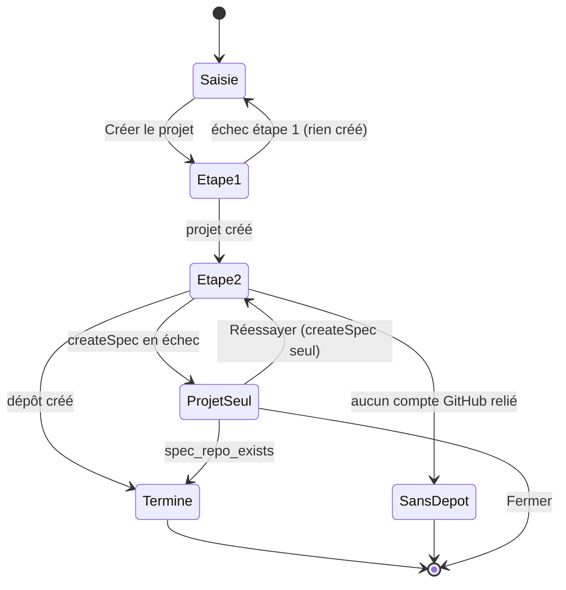

## 1. Utilisateurs et objectif
Personne connectée (vue équipe d'abord). Elle arrive après la connexion (`/projects`). Objectif : voir les projets auxquels elle a accès. Cet écran décrit aussi le **gabarit d'application** réutilisé par les écrans suivants.

## 2. Tâches et parcours
- Principale : repérer un projet par son nom.
- Secondaire : relancer le chargement en cas d'erreur ; basculer clair/sombre.
- Entrées : `/projects` (redirection depuis `/login` avec session). Sortie : sans session ou erreur `UNAUTHORIZED`, redirection vers `/login`. Le détail d'un projet est hors lot : les lignes ne sont pas des liens tant que la page détail n'existe pas.
- Création (TK-48 / 48c, remplace la création de TK-24) : le bouton « Créer un projet » (icône `add`, propriétaire et administrateur seulement) ouvre un panneau latéral (`Sheet`, 400 px) en **deux étapes visibles** : 1. Projet (`project.create`), 2. Dépôt de spec (`repo.createSpec`). Détail en §3, §4 et §5.2.
- Création (TK-24, historique) : le bouton « Créer un projet » (icône `add`, propriétaire et administrateur seulement) ouvre un panneau latéral (`Sheet`, 400 px) avec le champ « Nom du projet ». Entrée : `/projects` exige une organisation active ; sans organisation active, redirection vers `/organizations` (jamais vers `/login` quand une session existe, lacune G1).

## 3. Contenu
Source : `project.list` (`{ id: uuid, name: string }[]`).
- Titre de page « Projets » (h1, 30 px/600).
- Données : colonne unique « Nom » (`name`). `id` n'est pas affiché (identifiant technique).
- Gabarit (`sidebar-07`, TK-85) : logo « K » + nom « Koklo » en tête de barre latérale ; deux entrées de navigation : « Projets » (icône `account_tree`) et « Membres » (icône `person`, TK-24), `aria-current="page"` sur la page courante, icône remplie quand active ; bascule de thème en pied de barre ; `SidebarTrigger` dans l'en-tête du contenu. Aucune donnée de démo du bloc (équipes, projets factices, utilisateur).
- Correction TK-85 : blocs fidèles, installés par la CLI. En-tête de barre : TeamSwitcher « Koklo » seul (logo K, sans menu). Navigation : NavMain « Projets » (sans sous-menu). Groupe NavProjects : projets réels de `project.list`, non cliquables, masqué si vide, en chargement ou en erreur. Pied : NavUser (nom, e-mail, initiales de la session ; menu = thème + « Se déconnecter » via `signOut`). En-tête de contenu : `SidebarTrigger`, séparateur, fil d'Ariane « Koklo > Projets ». La bascule de thème quitte le pied de barre pour le menu utilisateur.
- Pied de barre latérale : `APP_VERSION` non affichée (pas de besoin utilisateur).

- TK-24, TeamSwitcher : n'est plus statique. Il affiche le nom de l'organisation active (repli « Koklo » pendant le chargement), le rôle en texte secondaire et l'icône `unfold_more`. Menu (`DropdownMenu`) : libellé « Organisations », une ligne par organisation (`check` sur l'active, changement via `setActive` puis rechargement des données), séparateur, « Créer une organisation » (icône `add`, vers `/organizations`).
- TK-24, création de projet : `Sheet` titre « Créer un projet », champ « Nom du projet » (1 à 100 caractères), boutons « Créer le projet » et « Annuler ». Source : `project.create`. Succès : le panneau se ferme, le focus revient sur le bouton déclencheur, la liste se recharge, une région `role="status"` annonce « Projet « <nom> » créé. » et le compteur monte.

### 3.1 Panneau de création (TK-48 / 48c)
Sources : `project.create` (`{ name }` -> `{ id, name }`), `repo.createSpec` (`{ projectId, installationId, name? }` -> repo), `installation.list` (`{ id, ownerKind, ownerLogin, status, userAuthorization }[]`, lecture pour choisir le compte), `installation.start` (`{ installationId }`, pour « Autoriser Koklo »), `repo.link` (repli, §5.3).

Le panneau garde son gabarit (`Sheet` 400 px, titre « Créer un projet ») et contient :
- Un indicateur de progression, liste ordonnée (`ol`, `aria-label` « Étapes de la création ») de deux lignes : « 1. Projet » et « 2. Dépôt de spec ». Chaque ligne porte un statut icône + texte (voir tableau). Toujours visible, dès l'ouverture (état « À faire » pour les deux), pour que la personne sache d'avance qu'il y a deux temps.
- Section 1, « Projet » : champ « Nom du projet » (inchangé : 1 à 100 caractères).
- Section 2, « Dépôt de spec » : texte d'explication « Koklo crée pour ce projet un dépôt privé sur GitHub, qui contient la spécification (écrans, fonctionnalités, règles). Vous pourrez la consulter et la modifier depuis Koklo. » ; puis, selon les installations actives : compte GitHub (voir ci-dessous) et champ facultatif « Nom du dépôt (facultatif) » avec aide « Laissez vide pour utiliser le nom du projet suivi de « -spec ». Lettres, chiffres, points, tirets et tirets bas, 100 caractères maximum. »
- Pied : « Créer le projet » (action principale) et « Annuler ».

Compte GitHub (installations dont `status = active` uniquement ; `suspended` et `deleted` sont ignorées) :
| Cas | Rendu |
|---|---|
| Une seule active | Pas de `Select` : ligne en lecture seule « Compte GitHub : `<ownerLogin>` (Compte personnel / Organisation GitHub) », préselectionnée d'office |
| Plusieurs actives | `Select` « Compte GitHub », **aucune présélection** (placeholder « Choisir un compte »), une option par installation « `<ownerLogin>` · Compte personnel / Organisation GitHub » ; choix obligatoire (« Choisissez le compte GitHub du dépôt. »). Raison : créer un dépôt sur le mauvais compte n'est pas annulable (le port n'a pas de suppression) |
| Aucune active | Pas de champ ; `Alert` neutre (icône `link`) « Aucun compte GitHub n'est relié. Le projet sera créé sans dépôt de spec. Vous pourrez relier GitHub ensuite. » + lien « Relier GitHub » vers `/github`. Le bouton reste « Créer le projet » |
| Liste en chargement | `LoadingStatus` « Chargement des comptes GitHub… » dans la section 2 ; « Créer le projet » désactivé (`aria-describedby` vers ce texte) pour ne pas décider « sans compte » par erreur |
| Erreur de liste | `ErrorNotice` « Impossible de charger les comptes GitHub » + « Réessayer » ; « Créer le projet » désactivé tant que la liste n'est pas connue |

Statuts des étapes (jamais la couleur seule) :
| Étape | État | Rendu |
|---|---|---|
| 1 ou 2 | À faire | `radio_button_unchecked` + « À faire » (texte secondaire) |
| 1 ou 2 | En cours | `play_circle` + « En cours… » |
| 1 ou 2 | Terminée | `check_circle` pleine + « Terminé » (`StatusBadge` validated) |
| 1 ou 2 | Échec | `warning` + « Non créé » (`Badge` outline, texte `foreground`) |
| 2 | Non applicable (aucun compte) | `block` + « Non créé : aucun compte GitHub relié » (`Badge` outline) |

Aucune icône nouvelle : `radio_button_unchecked`, `play_circle`, `check_circle`, `warning`, `block`, `link`, `lock` existent dans `@koklo/ui`. Aucune couleur en dur : tokens `status-*`, `muted-foreground`, `border`, `foreground` seulement. Le violet de marque ne sert à aucun statut.

Qui peut créer : propriétaire et administrateur seulement (`project.create` et `repo.createSpec` : `MANAGER_ROLES`). Les autres rôles n'ont pas le bouton (inchangé) ; si l'API répond `FORBIDDEN` à l'une des deux étapes, voir §4.

## 4. États
- **Chargement** : zone `role="status"` `aria-busy="true"` avec libellé visible « Chargement des projets… » et 3 lignes squelette (tokens `muted`). Aucun contenu périmé. Squelette immobile en mouvement réduit.
- **Vide** (`[]`) : `Card` centrée : icône `account_tree` (28), titre « Aucun projet pour le moment ». Propriétaire ou administrateur : texte « Créez votre premier projet pour commencer. » et bouton « Créer un projet ». Autres rôles : texte « Les projets auxquels vous avez accès apparaîtront ici. », sans bouton. Pas de tableau vide.
- **Données** : `Table` avec `TableCaption` masquée visuellement « Liste des projets », un `TableHead` « Nom », une ligne par projet. Compteur « N projet(s) » sous le titre.
- **Erreur** (`INTERNAL`, réseau) : `Alert` destructive, icône `warning`, titre « Impossible de charger les projets », description « Une erreur est survenue. Vérifiez votre connexion puis réessayez. », bouton `Button variant="outline"` « Réessayer » qui relance `project.list` (passe en état chargement).
- **Non connecté / `UNAUTHORIZED`** : redirection vers `/login`, sans message.
- Droits insuffisants (TK-24) : la liste est filtrée côté API ; pour les rôles autres que propriétaire et administrateur, le bouton « Créer un projet » n'est pas rendu. Si l'API répond `FORBIDDEN` à la création : `Alert` destructive dans le panneau, icône `lock`, « Vous n'avez pas le droit de créer un projet. Demandez à un propriétaire ou à un administrateur. », saisie conservée.
- Création en cours : champ en lecture seule, bouton `disabled` + `aria-busy`, « Création… ».
- Erreur de saisie : nom vide « Saisissez le nom du projet. » ; plus de 100 caractères « Le nom ne peut pas dépasser 100 caractères. » (sous le champ, `aria-invalid`, `aria-describedby`, focus sur le champ).
- Erreur `INTERNAL` à la création : `Alert` destructive dans le panneau, « Le projet n'a pas pu être créé », « Une erreur est survenue. Réessayez dans un instant. »
- Session sans organisation active (G1) : redirection vers `/organizations`, sans message.

### 4.1 États du panneau de création (TK-48 / 48c)
Machine d'états (le web mémorise `projectId` dès que l'étape 1 réussit ; il n'appelle `project.create` qu'**une seule fois** par ouverture du panneau) :

- **Saisie** : indicateur « À faire / À faire », champs actifs.
- **Étape 1 en cours** : « Projet : En cours… », « Dépôt de spec : À faire » ; champs en lecture seule ; « Créer le projet » `disabled` + `aria-busy`, libellé « Création du projet… » ; `Annuler` désactivé et fermeture bloquée (Échap, clic hors panneau) tant qu'un appel est en vol, pour ne jamais perdre le suivi d'une création en cours. Région `role="status"` : « Création du projet… ».
- **Échec de l'étape 1** : rien n'existe. `Alert` destructive (`role="alert"`) en haut du panneau : `FORBIDDEN` -> `lock`, « Vous n'avez pas le droit de créer un projet. Demandez à un propriétaire ou à un administrateur. » ; autre -> « Le projet n'a pas pu être créé », « Une erreur est survenue. Réessayez dans un instant. ». Étape 1 : « Non créé », étape 2 : « À faire ». Saisie conservée, le bouton « Créer le projet » relance **depuis le début** (rien n'avait été créé). Erreurs de saisie : inchangées (nom vide / trop long) et nom de dépôt invalide « Utilisez uniquement des lettres, chiffres, points, tirets et tirets bas (100 caractères maximum). » sous le champ (`aria-invalid`, focus sur le premier champ en erreur) **avant** tout appel : un nom de dépôt invalide n'est jamais découvert après la création du projet. Le web applique la même règle que l'API (`^[A-Za-z0-9._-]{1,100}$`, ni `.` ni `..`, pas de suffixe `.git`).
- **Étape 2 en cours** : « Projet : Terminé », « Dépôt de spec : En cours… » ; `role="status"` « Projet créé. Création du dépôt de spec… » ; le projet apparaît dans la liste derrière le panneau (liste invalidée dès l'étape 1).
- **Succès complet** : le panneau se ferme, le focus revient sur « Créer un projet », région `role="status"` de la page : « Projet « <nom> » et dépôt de spec créés. » (remplace « Projet « <nom> » créé. » quand un dépôt a été créé).
- **Sans compte GitHub (projet créé, aucune étape 2)** : l'étape 2 est « Non créé : aucun compte GitHub relié ». Le panneau ne se ferme pas tout seul : `Alert` neutre (`role="status"`, icône `link`) « Projet « <nom> » créé, sans dépôt de spec. Reliez GitHub pour que Koklo puisse en créer un. » + lien « Relier GitHub » (vers `/github`) et « Fermer ». Le focus est placé sur le titre de l'alerte (`tabIndex -1`) pour que l'annonce et le lien soient atteignables.
- **Échec partiel : projet créé, dépôt non créé** (cas central, `createSpec` en échec). Le projet reste (liste déjà rechargée). Étape 1 « Terminé », étape 2 « Non créé ». Le champ « Nom du projet » devient une ligne en lecture seule (« Projet « <nom> » »). `Alert` destructive `role="alert"`, icône `warning`, **titre fixe « Projet créé, dépôt de spec non créé »**, texte selon l'erreur (tableau ci-dessous), boutons : « Réessayer » (principal, `createSpec` **seul** avec le même `projectId` ; ne rappelle JAMAIS `project.create`), « Fermer ». Le compte et le nom du dépôt restent modifiables pour la reprise. Pendant « Réessayer » : « Réessayer » en `aria-busy` « Nouvelle tentative… », étape 2 « En cours… », fermeture bloquée. Si on ferme sans réussir : une notice de page persiste (voir §5.2).
- **Réessai réussi** : même fin que « Succès complet ». **Réessai : `spec_repo_exists`** : le dépôt existe déjà pour ce projet (réponse perdue d'une tentative précédente, ou autre session) : étape 2 « Terminé », annonce `role="status"` « Ce projet a déjà son dépôt de spec. » et fermeture proposée.

Erreurs de `repo.createSpec` (toutes rendues dans l'alerte « Projet créé, dépôt de spec non créé », sauf mention) :
| Code | Texte (sous le titre fixe) | Action |
|---|---|---|
| 503 `PROVIDER_UNAVAILABLE` | « GitHub ne répond pas, ou l'application GitHub n'est pas configurée sur cet environnement. Votre projet est enregistré ; réessayez plus tard. » | « Réessayer » |
| 403 `USER_TOKEN_REQUIRED` `{ownerLogin}` | « Pour créer un dépôt sur le compte `<ownerLogin>`, Koklo a besoin de votre autorisation. Vous serez redirigé vers GitHub, puis ramené ici. » | **« Autoriser Koklo »** (remplace « Réessayer » comme action principale, §5.1) |
| 403 `REPO_CREATION_FORBIDDEN` `reason: missing-user-token` | même texte et même action que `USER_TOKEN_REQUIRED` | « Autoriser Koklo » |
| 403 `REPO_CREATION_FORBIDDEN` `reason: resource-not-accessible` | « GitHub refuse la création d'un dépôt sur `<ownerLogin>`. L'application GitHub n'a pas le droit d'y créer des dépôts : un propriétaire de ce compte doit le lui accorder dans les paramètres GitHub, ou vous pouvez choisir un autre compte. » | « Réessayer » (après changement de compte ou de droits) |
| 403 `PROVIDER_AUTH_EXPIRED` `kind: user` | « Votre autorisation Koklo sur GitHub a expiré. » | « Réautoriser Koklo » (§5.1) |
| 403 `PROVIDER_AUTH_EXPIRED` `kind: installation` | « L'accès de Koklo à ce compte GitHub a expiré. Réinstallez l'application depuis la page GitHub, puis revenez réessayer. » | lien « Ouvrir la page GitHub » + « Réessayer » |
| 429 `PROVIDER_RATE_LIMITED` `{retryAfterMs?}` | « GitHub limite temporairement les demandes. Réessayez dans environ N seconde(s). » (N = `retryAfterMs` arrondi au supérieur ; sans valeur : « dans un instant ») | « Réessayer » (jamais désactivé par minuterie) |
| 409 `CONFLICT` `spec_repo_exists` | pas d'alerte d'erreur : traité comme un succès (voir « Réessai : `spec_repo_exists` ») | « Fermer » |
| 409 `CONFLICT` `repo_name_taken` | « Un dépôt nommé « `<nom>` » existe déjà sur `<ownerLogin>`. Il peut venir d'une tentative précédente. Choisissez un autre nom puis réessayez, ou reliez ce dépôt s'il est déjà prêt. » ; si le champ était vide : « Le nom proposé par défaut est déjà pris sur `<ownerLogin>`. » (le nom exact choisi par le serveur n'est pas connu du web) | focus sur « Nom du dépôt » ; « Réessayer » ; « Relier un dépôt existant » (§5.3) |
| 404 `NOT_FOUND` | « Ce compte GitHub n'est plus disponible. Choisissez-en un autre ou relancez la liste. » ; la liste des comptes est rechargée | « Réessayer » |
| 422 `VALIDATION` `field: name` | message du nom de dépôt invalide (ci-dessus) sous le champ, focus sur le champ ; pas d'alerte globale, mais le titre « Projet créé, dépôt de spec non créé » reste affiché | « Réessayer » |
| 403 `FORBIDDEN` | « Vous n'avez plus le droit de créer un dépôt. Le projet est créé : demandez à un propriétaire ou à un administrateur de relier le dépôt. » | « Fermer » seul |
| 401 `UNAUTHORIZED` | redirection `/login` (hook du kit), sans message | — |
| Autre, réseau | « Le dépôt de spec n'a pas pu être créé. Une erreur est survenue. Vérifiez votre connexion puis réessayez. Si le dépôt a pu être créé malgré tout, « Réessayer » le détectera. » | « Réessayer » |
| 409 `CONFLICT` `repo_already_linked` (repli `repo.link`) | « Ce dépôt est déjà relié à un projet. » | — |

Autorisation à froid (aide, sans blocage) : si le compte choisi est `ownerKind: user` et `userAuthorization` vaut `absent` ou `expired`, une aide en texte secondaire sous le compte dit « Ce compte personnel demande votre autorisation. Koklo vous la demandera si besoin après la création du projet. » ; le bouton reste actif (l'API arbitre).

## 5. Interactions et retours
« Réessayer » remet l'écran en chargement puis en données/vide/erreur. Bascule de thème immédiate, persistée (cookie/localStorage), sans flash au rechargement ; défaut clair (H-24). Panneau de détail : emplacement réservé (380–440 px, `aside` absent du DOM tant qu'aucun détail n'existe), aucune interaction.

### 5.1 Autoriser Koklo (TK-48 / 48c)
« Autoriser Koklo » / « Réautoriser Koklo » appelle `installation.start({ installationId })` (même mécanique que S-github : bouton `disabled` + `aria-busy` « Redirection vers GitHub… », un seul appel même au double clic, URL validée `https://github.com`, jamais construite côté web). Avant de partir, le web écrit dans `sessionStorage` (onglet courant, `try/catch`, jamais bloquant) un marqueur de reprise : `{ projectId, projectName, installationId, repoName?, savedAt }`. Aucun jeton, `state` ni URL. Le retour de GitHub arrive sur `/github?result=…` (cible fixe du contrat), pas sur `/projects` ; la reprise est donc proposée :
- `/github`, résultat `installed` ET marqueur valide : le message de résultat reçoit une ligne et un lien « Reprendre la création du projet « <nom> » » vers `/projects` (S-github v3, §3). Les autres résultats n'affichent pas ce lien (rien n'a été autorisé).
- `/projects`, marqueur valide (< 1 h, `projectId` uuid reconnu dans `project.list`) : notice de page (voir 5.2) au lieu de l'état « Projet créé » éphémère.

### 5.2 Notice de reprise sur la page (TK-48 / 48c)
Si l'on ferme le panneau avec un projet créé mais sans dépôt, ou si l'on revient de GitHub avec un marqueur : une `Alert` destructive (`role="alert"` à l'apparition) au-dessus du tableau, `warning`, titre « Projet « <nom> » : dépôt de spec non créé », texte « Le projet existe, mais son dépôt de spec n'a pas encore été créé. », boutons « Reprendre » (rouvre le panneau directement à l'étape 2 : projet en lecture seule, `createSpec` seul) et « Ignorer » (efface le marqueur ; le focus passe au bouton « Créer un projet »). La notice vit en mémoire de la page et dans `sessionStorage` ; elle disparaît dès qu'un `createSpec` réussit, ou `spec_repo_exists`. Après rechargement complet de la page ou nouvelle session, `project.list` ne dit pas si un dépôt existe : la notice n'est pas reconstruite (voir §9).

### 5.3 Reprise manuelle : relier un dépôt existant (TK-48 / 48c)
Proposée seulement après `repo_name_taken` (et accessible depuis la notice de reprise après ce même échec). Le bouton « Relier un dépôt existant » déplie sous l'alerte (`Collapsible`, `aria-expanded`) : texte « Si ce dépôt est déjà prêt, indiquez son nom : Koklo le reliera à ce projet sans le modifier. », ligne en lecture seule « Propriétaire : `<ownerLogin>` » (celui du compte choisi), champ « Nom du dépôt existant » (prérempli avec le nom saisi s'il y en a un), bouton « Relier ce dépôt ». Appelle `repo.link({ projectId, installationId, role: "spec", ownerLogin, name })`. Succès : même fin que « Succès complet » avec l'annonce « Projet « <nom> » et dépôt de spec reliés. ». Erreurs : `NOT_FOUND` « Koklo ne trouve pas ce dépôt sur `<ownerLogin>`. Vérifiez le nom, et que l'application GitHub a accès à ce dépôt. » ; `CONFLICT` `repo_already_linked` « Ce dépôt est déjà relié à un projet. » ; `CONFLICT` `spec_repo_exists` traité comme le succès ; 503 / 429 / `PROVIDER_AUTH_EXPIRED` / autre : mêmes textes que le tableau ci-dessus. Un dépôt lié ainsi n'a pas la structure initiale de Koklo : la phrase d'aide ne promet rien d'autre que la liaison.

## 6. Responsive
Gabarit : barre latérale **248 px** (`--sidebar-width: 15.5rem`) repliable en icônes (48 px, Tooltip), marge de page **32 px**, panneau de détail **380–440 px** réservé (absent du DOM).
Sous 768 px : barre latérale masquée, ouverte en `Sheet` par le trigger de l'en-tête (logo « K », « Projets », bascule de thème dedans), marge 16 px, cibles 44 px, tableau sans défilement horizontal à 375 px, `Alert` pleine largeur.

Panneau de création (48c) : sous 768 px le `Sheet` passe en pleine largeur, les boutons du pied sont empilés en 44 px ; le `Select` et les champs font 44 px ; l'indicateur d'étapes reste sur deux lignes (une par étape, icône + libellé + statut à droite, retour à la ligne du statut sous le libellé si besoin) ; le pied est collé en bas du panneau, le contenu défile à l'intérieur du panneau (pas la page) quand le clavier virtuel réduit la hauteur ; aucun défilement horizontal à 375 px. Dès 768 px : 400 px, boutons de 36 px, « Réessayer » et « Fermer » côte à côte.

## 7. Accessibilité
- Repères : `nav` (aria-label « Navigation principale ») dans la sidebar, `main` dans `SidebarInset`, titre h1 unique, aucun `aside` vide. `data-testid="app-shell"` conservé.
- Ordre de focus : trigger, lien « Projets », bascule de thème, contenu (« Réessayer » en erreur). Focus visible. Menu utilisateur : `aria-label` « Menu utilisateur », Échap restitue le focus. Mobile : Sheet avec focus piégé, Échap ferme et restitue le focus au trigger.
- `SidebarTrigger` : vrai `button`, `aria-label` « Réduire la barre latérale » / « Ouvrir la barre latérale », `aria-expanded` ; icônes `left_panel_close` / `left_panel_open`. Replié, le texte des liens reste sr-only et un Tooltip s'affiche au survol et au focus. Raccourci Ctrl/Cmd+B du bloc conservé.
- Item actif : `aria-current="page"` posé explicitement (le bloc ne pose que `data-active`).
- Bascule de thème : `IconButton` `aria-label` « Passer au thème sombre » / « Passer au thème clair » ; `dark_mode` en clair, `light_mode` en sombre.
- Statuts doublés d'une icône : erreur `warning` + texte ; chargement texte + squelette ; vide icône + texte.
- Chargement annoncé (`role="status"`), erreur annoncée (`role="alert"` via `Alert`).
- Mouvement réduit : le squelette ne pulse que sous `motion-safe:` ; transitions neutralisées sous `prefers-reduced-motion: reduce`.
- Contraste AA en clair et en sombre, vérifié par axe sur les 4 états.

### 7.1 Panneau de création (TK-48 / 48c)
- Titre du `Sheet` « Créer un projet » (nom accessible du dialogue) ; focus initial sur « Nom du projet » ; Échap et clic hors panneau ferment seulement hors appel en vol. À la fermeture, le focus revient au bouton « Créer un projet » (comportement TK-24 conservé), ou à « Reprendre » si la notice de reprise est affichée.
- Ordre de focus : champ nom, (compte GitHub : `Select` ou texte), nom du dépôt, « Créer le projet », « Annuler ». En échec partiel : l'alerte n'est pas focalisée (annoncée par `role="alert"`), puis « Réessayer » / « Autoriser Koklo », éventuel « Relier un dépôt existant », « Fermer ». Après une erreur de nom de dépôt : focus sur le champ concerné.
- Indicateur d'étapes : `ol` nommée ; chaque statut est un texte lisible (« Projet, Terminé ») avec icône `aria-hidden` ; le changement d'état est annoncé par une seule région `role="status"` (`aria-live="polite"`) du panneau, qui énonce la phrase de l'étape en cours, pas chaque icône.
- Erreurs : une seule alerte à la fois (`role="alert"`), icône + titre + texte ; erreur de champ liée par `aria-describedby` + `aria-invalid`. Les liens (`/github`) sont de vrais `a` ; les actions (« Réessayer », « Autoriser Koklo », « Relier ce dépôt ») de vrais `button`. `aria-label` de « Autoriser Koklo » complété par le login du compte (« Autoriser Koklo sur `<login>` »).
- `Select` : libellé visible « Compte GitHub », options lisibles au clavier (flèches, saisie), valeur annoncée ; l'état invalide `aria-invalid` + message.
- Statut jamais par la couleur seule : chaque état d'étape a une icône distincte (`radio_button_unchecked`, `play_circle`, `check_circle`, `warning`, `block`) et un texte. Contraste AA en clair et sombre par les tokens `status-*` et `foreground` ; le texte atténué utilise `muted-foreground` (jamais l'opacité).
- Mouvement réduit : aucune animation nouvelle ; l'ouverture du `Sheet` et du `Collapsible` est neutralisée sous `prefers-reduced-motion: reduce` ; le squelette pulse seulement sous `motion-safe:` ; aucune minuterie visible (pas de compte à rebours animé).
- Texte : français clair, sans « OAuth », « jeton », « token », « repository », « SHA », « branche ». On dit « dépôt », « compte GitHub », « autorisation ».

## 8. Alternatives écartées
1. **`Table` (retenu)** contre grille de `Card` : DESIGN.md prévoit des tableaux denses, et les prochaines colonnes (statut, version) s'y ajouteront sans refonte.
2. **Barre latérale 248 px repliable (retenu, TK-85)** contre barre supérieure seule ou barre fixe non repliable : les écrans suivants ont besoin d'une navigation étendue ; le repli libère la largeur des tableaux ; en mobile la `Sheet` remplace la barre supérieure.
3. **Squelette + libellé** contre spinner seul : le libellé donne un nom annoncé aux lecteurs d'écran et le squelette évite le saut de mise en page.
4. **Erreur en ligne avec « Réessayer »** contre redirection vers une page d'erreur : l'utilisateur garde le contexte et la navigation.
5. **Panneau de détail absent du DOM** contre colonne vide visible : une colonne vide de 380 px fait croire à une fonction manquante.
6. **`--sidebar` = `var(--card)` + bordure (TK-85)** contre teinte dédiée ou `--muted` : pas de nouveau token, pas d'ombre (DESIGN §5).
7. **NavUser réel (retenu, correction TK-85)** contre bascule de thème seule ou menu de démo (Compte, Facturation, Notifications) : seules actions réelles, thème et déconnexion.
8. **TeamSwitcher à entrée unique sans menu** contre équipes factices ou « Ajouter une équipe » : aucune notion d'équipe dans le contrat.

9. **Création dans un `Sheet` (TK-24, retenu)** contre page `/projects/new` : un seul champ, le contexte de la liste est conservé et le projet apparaît derrière le panneau à la fermeture.
10. **`Sheet` (retenu)** contre formulaire en ligne au-dessus du tableau : le formulaire en ligne pousse le tableau et se confond avec lui ; contre `Dialog` : absent de `@koklo/ui`. L'emplacement 380–440 px de DESIGN §5 est le même gabarit.
11. **Bouton absent pour les rôles non gestionnaires (TK-24)** contre bouton désactivé : un bouton désactivé n'explique rien.

12. **Un seul panneau, deux étapes visibles en même temps (retenu, 48c)** contre un assistant « Suivant » en deux écrans : le projet est créé sur le premier clic quel que soit le design ; un deuxième écran « avant création » ferait croire que rien n'existe encore, alors que l'étape 1 est déjà irréversible. Les deux sections visibles d'emblée annoncent les deux temps et laissent choisir le compte et le nom du dépôt avant de s'engager.
13. **Échec partiel : le projet reste, avec « Réessayer » sur l'étape 2 seule (retenu)** contre annuler le projet (suppression) ou tout recommencer : il n'existe pas de suppression de projet ni de dépôt dans le contrat 0.7.0, et rappeler `project.create` créerait un doublon. La reprise ne touche jamais l'étape 1.
14. **Compte GitHub sans présélection quand il y en a plusieurs (retenu)** contre présélectionner le premier : une erreur de compte crée un dépôt privé au mauvais endroit, sans retour possible ; un choix explicite coûte un clic.
15. **Pas de case « créer un dépôt de spec » (écarté)** : la vision R2 lie création de projet et dépôt de spec ; une case ajouterait une décision qui n'est pas la bonne par défaut. Le cas sans compte GitHub est déjà couvert (projet créé, étape 2 expliquée).
16. **`Select` seulement s'il y a plusieurs comptes (retenu)** contre toujours un `Select` : un `Select` à une option est un clic inutile et masque l'information.
17. **« Autoriser Koklo » dans l'alerte avec reprise au retour (retenu)** contre renvoyer vers `/github` sans mémoire : le cas `USER_TOKEN_REQUIRED` est le plus fréquent sur un compte personnel ; sans marqueur de reprise, la personne devrait retrouver seule le projet orphelin. Le marqueur est de `sessionStorage` (aucun secret, onglet courant) et non d'un cookie ou d'une base : pas de nouvelle table, pas de RGPD.
18. **Relier un dépôt existant, dépliable sous l'alerte `repo_name_taken` (retenu)** contre un lien vers une page dédiée ou un formulaire permanent : seule la situation « le dépôt orphelin d'une tentative précédente » justifie ce repli (le port n'a pas de suppression) ; ailleurs il alourdirait un panneau à un champ.
19. **Notice de page « Reprendre » (retenu)** contre un toast : le kit n'a pas de toast accessible ; la notice reste tant que la situation n'est pas résolue et s'annonce par `role="alert"`.
20. **Fermeture bloquée pendant un appel (retenu)** contre fermeture libre avec appel en arrière-plan : le résultat se perdrait (ni annonce, ni notice) et le double envoi serait possible.

## 9. Questions ouvertes
- TK-24 : pas de composant `Dialog` dans `@koklo/ui` ; `Sheet` utilisé. Pas de toast : confirmations par région `role="status"`.
- Colonnes à ajouter au tableau quand le contrat exposera plus que `id` et `name`.
- Icône `logout` absente de DESIGN §4 : ajoutée au générateur pour « Se déconnecter » (TK-85 correction).
- Items de navigation 32 px (bloc) contre 36-38 px (DESIGN §5) : bloc conservé ; 44 px sous 768 px.
- Repli en icônes (`collapsible="icon"`) absent de DESIGN §5 : conservé car c'est le bloc demandé (Q1 TK-85).
- Largeur 248 px (DESIGN §5) préférée aux 256 px du bloc.
- Cookie `sidebar_state` du bloc (état de repli, sans donnée personnelle) : à citer dans la future politique de confidentialité.
- Icône `refresh` absente de la bibliothèque : « Réessayer » reste texte seul.

- 48c : après rechargement ou nouvelle session, rien n'indique qu'un projet n'a pas de dépôt (`project.list` ne porte pas cette information, `repo.list` est par projet). La reprise ne vit que dans l'onglet. À traiter avec la page projet de 48d (état « sans dépôt de spec » + « Créer le dépôt » depuis la ligne), ou par un champ `hasSpecRepo` au contrat.
- 48c : le nom exact du dépôt par défaut (`<slug>-spec`) est calculé par l'API ; le web ne l'affiche pas (texte d'aide seulement). À exposer si le message `repo_name_taken` doit citer le nom.
- 48c : le retour d'autorisation passe par `/github` (cible fixe du callback) : la reprise vers `/projects` demande un clic de plus. Une cible de retour contrôlée par l'état signé est un changement d'API non prévu.
- 48c : un dépôt orphelin laissé par un échec réel ne se supprime pas depuis Koklo (port sans suppression) : à supprimer à la main sur GitHub.
- 48c : rôles autres que owner/admin sur un projet sans dépôt : aucune information à ce stade.

## 10. Historique
| Version | Date | Ticket | Changement et raison |
|---|---|---|---|
| 1 | 2026-10-27 | TK-14 | Création : gabarit d'application et liste des projets, 4 états + redirection |
| 2 | 2026-10-27 | TK-85 | Gabarit remplacé par `sidebar-07` : repli en icônes, Sheet mobile, mapping `--sidebar-*` sur les tokens, 248 px, nav nommée et `aria-current` conservés ; contenu et 4 états inchangés. Détail : `.workflow/TK-85/02-design.md` |
| 3 | 2026-10-28 | TK-85 (correction) | Retour à `sidebar-07` fidèle (CLI) : TeamSwitcher, NavMain, NavProjects réels, NavUser avec déconnexion, fil d'Ariane ; largeur 248 px et marges 32/16 px alignées sur DESIGN §5, reste du bloc conservé ; 44 px mobile. Détail : `.workflow/TK-85/02-design.md` |
| 4 | 2026-10-29 | TK-24 | Création de projet (`Sheet`, rôles owner/admin), état vide avec appel à l'action, TeamSwitcher réel (organisation active, changement, création), entrée « Membres », garde G1 vers `/organizations`. Détail : `.workflow/TK-24/02-design.md` |
| 5 | 2026-10-31 | TK-48 (48c) | Création de projet en deux étapes visibles (projet puis dépôt de spec), choix du compte GitHub, échec partiel avec « Réessayer » sur `createSpec` seul, « Autoriser Koklo », erreurs typées du fournisseur, relier un dépôt existant, notice de reprise. Détail : `.workflow/TK-48/02-design-48c.md` |
| 5.1 | 2026-10-31 | TK-48 (48c, refactor) | Aucun changement d'écran : captures régénérées par les e2e, tests unitaires ajoutés (redirection `/login`, clic hors panneau, mouvement réduit). |

## 11. Plan d'implémentation web et tests (brief développeur, 48c)
Fichiers (`apps/web/src`, chacun <= 300 lignes, refactor actif de `project-create-sheet.tsx`, 128 lignes aujourd'hui, à scinder)
- `components/project-create-sheet.tsx` : coque `Sheet` (ouverture, fermeture bloquée en vol, retour de focus).
- `components/project-create-flow.tsx` : machine d'états (§4.1) via un hook `lib/use-project-creation.ts` (`projectId` mémorisé dans un `useRef` + état ; `createProject()` n'est appelé que si `projectId` est absent ; `retrySpec()` n'appelle que `repo.createSpec`).
- `components/project-create-steps.tsx` : indicateur `ol` (tableau d'états §3.1) ; `components/github-account-field.tsx` : ligne seule / `Select` / alerte « aucun compte » / chargement / erreur ; `components/spec-repo-failure.tsx` : alerte « Projet créé, dépôt de spec non créé » + actions ; `components/spec-repo-link-form.tsx` : repli `repo.link` ; `components/spec-repo-resume-notice.tsx` : notice de page ; modification de `components/projects-page.tsx` (notice, annonce, ouverture à l'étape 2).
- `lib/spec-repo-errors.ts` : table code -> `{ text, action: "retry" | "authorize" | "reauthorize" | "github" | "close", focus? }` (tableau §4.1), testable seule ; `lib/spec-repo-name.ts` : règle de nom (partagée avec la validation avant appel) ; `lib/creation-resume.ts` : lecture/écriture/validation du marqueur `sessionStorage` (`try/catch`, schéma zod strict, expiration 1 h, jamais de secret) ; réutiliser `lib/github-redirect.ts` (validation d'URL, navigation) et `describeStartError` pour « Autoriser » ; réutiliser `lib/github-labels.ts` pour les libellés de compte (`Compte personnel` / `Organisation GitHub`).
- `components/github-result-notice.tsx` (S-github v3) : ligne et lien « Reprendre la création du projet « <nom> » » si résultat `installed` et marqueur valide.
- Requêtes : `orpc.installation.list` activée à l'ouverture du panneau seulement ; `project.list` invalidée après l'étape 1 (pas après l'étape 2 seule) ; erreurs lues par `errorCode`/`errorData` (`lib/api-error.ts`) ; `UNAUTHORIZED` -> `useUnauthorizedRedirect`.
- Réutiliser : `Sheet`, `Alert`, `Button`, `Select`, `Collapsible`, `Badge`, `StatusBadge`, `Icon`, `ErrorNotice`, `LoadingStatus`, `FormField`. Aucun composant, icône, couleur ni police nouveaux dans `@koklo/ui`.
- Bonus de refactor : `ProjectCreateSheet` n'est plus la seule dépendance de l'annonce ; l'annonce de la page est pilotée par l'issue (`{ kind: "created" | "created-with-repo" | "linked" | "existing-repo" }`).

Tests attendus (Red)
- Unitaires `spec-repo-errors` : un texte et une action par code du tableau §4.1 (dont `retryAfterMs` arrondi, `missing-user-token` = autorisation, `kind` user/installation), code inconnu -> générique, jamais de valeur brute dans le texte. `spec-repo-name` : valides/invalides (`.`, `..`, `x.git`, espace, >100). `creation-resume` : marqueur valide, expiré, malformé, uuid invalide, `sessionStorage` indisponible (lève) -> ignoré sans erreur.
- `project-create.test.tsx` (AC-48-19) : `project.create` puis `repo.createSpec` dans cet ordre, chacun une fois, avec `projectId` retourné et `installationId` ; nom de dépôt omis quand vide ; succès -> panneau fermé, annonce « Projet « X » et dépôt de spec créés. », focus au bouton déclencheur.
- Choix du compte (AC-48-19) : une seule active -> pas de `Select`, compte en lecture seule envoyé ; deux actives -> `Select` sans présélection, envoi bloqué sans choix (message), le compte choisi est envoyé ; installations `suspended`/`deleted` jamais proposées ; chargement et erreur de liste (« Créer le projet » désactivé, « Réessayer »).
- Sans compte (AC-48-22) : `project.create` appelé, `repo.createSpec` jamais ; alerte neutre avec lien vers `/github` ; étape 2 « Non créé : aucun compte GitHub relié ».
- Échec partiel (AC-48-20) : `createSpec` rejeté -> titre « Projet créé, dépôt de spec non créé », étape 1 « Terminé », étape 2 « Non créé », liste rechargée ; « Réessayer » appelle `repo.createSpec` et **zéro** `project.create` supplémentaire (compteur strict) ; changement de compte/nom pris en compte à la reprise ; réussite à la reprise -> annonce de succès.
- Erreurs typées (AC-48-21) : chacune des lignes du tableau §4.1 rend son texte en `role="alert"` avec l'action attendue ; `USER_TOKEN_REQUIRED` et `REPO_CREATION_FORBIDDEN{missing-user-token}` -> « Autoriser Koklo » appelle `installation.start({ installationId })` une seule fois (double clic), navigue vers l'URL `https://github.com/…` reçue, URL hors GitHub refusée, marqueur écrit ; `PROVIDER_AUTH_EXPIRED{user}` -> « Réautoriser Koklo » ; `spec_repo_exists` -> succès « Ce projet a déjà son dépôt de spec. » ; `repo_name_taken` -> focus sur « Nom du dépôt », variante champ vide, bouton « Relier un dépôt existant » ; `VALIDATION{field:name}` -> erreur sous le champ sans perdre le titre fixe.
- Repli `repo.link` : appel `repo.link({ role: "spec", ownerLogin, name })` ; `NOT_FOUND`, `repo_already_linked`, succès -> annonce « … reliés. ».
- Rôles : owner/admin voient le bouton ; dev/designer/client/business non ; `FORBIDDEN` à l'étape 1 et à l'étape 2 -> messages dédiés.
- Fermeture : Échap, clic hors panneau et « Annuler » sans effet pendant un appel en vol ; fermeture après échec partiel -> notice de page avec « Reprendre » (rouvre à l'étape 2, projet en lecture seule, aucun champ nom) et « Ignorer » (efface le marqueur, focus au déclencheur). Marqueur `sessionStorage` valide au chargement de `/projects` -> notice ; `projectId` absent de `project.list` -> ignoré.
- `github-page-result.test.tsx` : lien « Reprendre … » présent seulement pour `installed` + marqueur valide.
- Accessibilité : `ol` « Étapes de la création » avec texte de statut par étape ; région `role="status"` unique ; `Select` nommé « Compte GitHub » ; `aria-invalid`/`aria-describedby` sur les champs ; aucun terme « token », « OAuth », « repository », « SHA », « branche » dans le DOM du panneau.
- `design-conformity.test.ts` (existant) : aucune couleur/icône en dur dans les nouveaux fichiers.
- e2e Playwright `projects.spec.ts` (faux API / pile locale avec faux fournisseur, jamais github.com) : parcours nominal ; compte unique ; deux comptes ; sans compte ; échec partiel puis réessai réussi ; `USER_TOKEN_REQUIRED` jusqu'à la navigation interceptée vers l'URL générée ; `repo_name_taken` ; clair/sombre ; 375 px sans défilement horizontal ; axe sans violation sur chaque état ; mouvement réduit. Validation navigateur (Chrome) sur staging avec le faux ou la vraie App : NEEDS-HUMAN pour la création réelle (dépôt `koklo-sandbox-*`, suppression manuelle).

## 12. Captures (48c, générées par `apps/web/e2e/project-create.spec.ts`, clair et sombre)
Dossier `design/screens/captures/S-projects/` (générées par `apps/web/e2e/project-create.spec.ts`, 189 e2e verts avec `a11y.spec.ts` au Refactor ; `create-sheet`, issu de TK-24 et remplacé par `create-form`, supprimé) : `create-form`, `create-form-multi` (plusieurs comptes), `create-no-account`, `create-step1`, `create-step2`, `create-partial`, `create-partial-token` (`USER_TOKEN_REQUIRED`), `create-partial-name-taken`, `create-done`, `resume-notice` (chacun `-light` / `-dark`), `create-partial-mobile` (375 px) (21 fichiers). Les états `loading`, `empty`, `data`, `error` restent ceux de `projects.spec.ts`.
