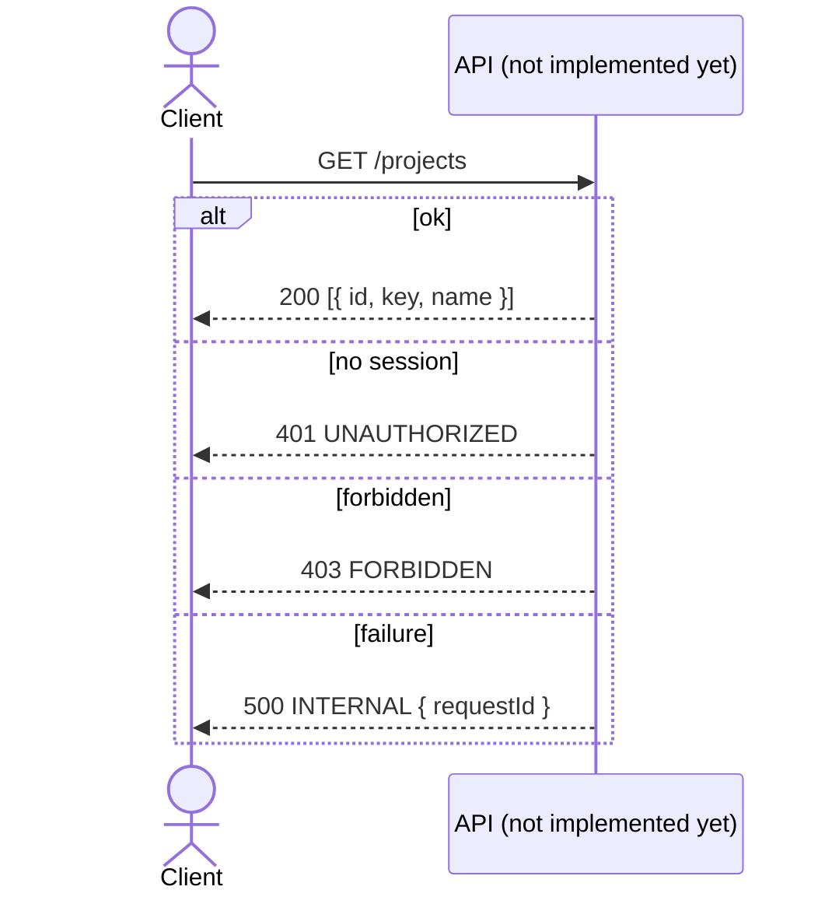

# API contract

The contract lives in `packages/contract` (`@koklo/contract`, tag `contract`). It is
written with oRPC v2 (`@orpc/contract`) and Zod; the OpenAPI document is generated from
it. No server implements it yet: this section describes the contract only.

## Exposed resources and operations

| Operation | Method | Path | Auth | Notes |
|-----------|--------|------|------|-------|
| `health` | GET | `/health` | none declared | Liveness and contract version |
| `project.list` | GET | `/projects` | session (declares `UNAUTHORIZED`, `FORBIDDEN`) | Lists projects |

Method and path are explicit on every route, via `.meta(openapi({ method, path }))`
(oRPC v2 syntax; `src/contract.ts`). The router shape is
`{ health, project: { list } }`.

## Inputs, outputs and error shapes

Schemas are in `packages/contract/src/schemas.ts`:

| Operation | Input | Output |
|-----------|-------|--------|
| `health` | `{}` (empty object) | `{ status: "ok", version: string }` |
| `project.list` | none | array of `{ id: uuid, key: string, name: string }` |

TypeScript types are exported from the package index: `HealthInput`, `HealthOutput`,
`ProjectListOutput`. Pagination and filtering: none defined (ASSUMPTION: to be added by
a later ticket).

Typed errors are declared in the contract (`src/errors.ts`); each route exposes only the
ones it lists:

| Code | HTTP status | Data | `health` | `project.list` |
|------|-------------|------|----------|----------------|
| `INTERNAL` | 500 | `{ requestId: string }` | yes | yes |
| `UNAUTHORIZED` | 401 | none | no | yes |
| `FORBIDDEN` | 403 | none | no | yes |

In the generated OpenAPI, the `INTERNAL` payload is the component schema `Internal`.

## Authentication and authorization
The contract only declares the `UNAUTHORIZED` and `FORBIDDEN` errors on `project.list`.
Where the check is enforced: TO DOCUMENT (no API implementation exists yet).

## OpenAPI generation
`generateOpenApi()` (`src/openapi.ts`) is pure (no I/O) and returns an OpenAPI 3.1.0
document titled `Koklo API`, whose `info.version` is `CONTRACT_VERSION`
(`src/version.ts`). Object keys are sorted recursively so the output is deterministic.
Error statuses are derived from the contract's own error maps, not written twice.

| Artifact | Role |
|----------|------|
| `packages/contract/openapi/openapi.json` | Reference document, committed |
| `packages/contract/openapi/versions.json` | Map `version → sha256` of the document |
| `packages/contract/scripts/generate-openapi.ts` | Writes both files (`pnpm --filter @koklo/contract openapi:generate`) |

## Compatibility and breaking changes
The OpenAPI document must not change without a version change (TK-9 acceptance
criterion). Contract tests (`packages/contract/test/contract.test.ts`) fail when:

- the generated document differs from `openapi/openapi.json`;
- `info.version` differs from `version` in `package.json`;
- the sha256 of the generated document differs from the entry for the current version
  in `openapi/versions.json`.

To change the contract: bump the version in `package.json` **and** `src/version.ts`, run
`pnpm --filter @koklo/contract openapi:generate`, commit the regenerated files.
`versions.json` only gains lines. Deprecation window and migration policy: TO DOCUMENT.

oRPC packages are pinned to `2.0.0-beta.46`: it is the only published line offering
`.meta(openapi(...))` (stable 1.16.1 uses `.route()`). Replace with 2.0 stable on release.
