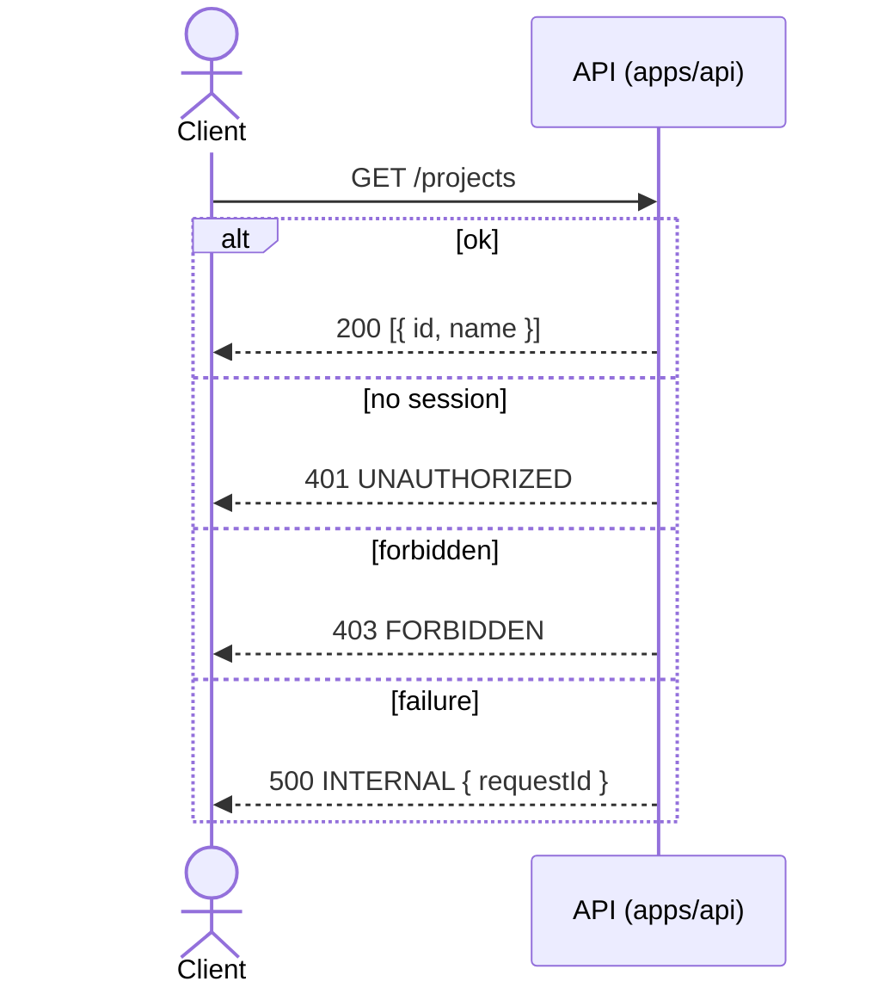

# API contract

The contract lives in `packages/contract` (`@koklo/contract`, tag `contract`). It is
written with oRPC v2 (`@orpc/contract`) and Zod; the OpenAPI document is generated from
it. `apps/api` (NestJS + `@orpc/nest`) implements it; see [ADR 0002](adr/0002-project-port-in-api.md).

## Exposed resources and operations

Contract version **0.3.0** (TK-21). The router shape is
`{ health, organization: { create, list }, member: { invite, list, setRole }, project: { list, create } }`:
8 routes on 6 paths. Method and path are explicit on every route, via
`.meta(openapi({ method, path }))` (`src/contract.ts`).

| Operation | Method | Path | Auth | Typed errors (besides `INTERNAL`) |
|-----------|--------|------|------|-----------------------------------|
| `health` | GET | `/health` | none (public) | none |
| `organization.create` | POST | `/organizations` | session | `UNAUTHORIZED`, `CONFLICT` |
| `organization.list` | GET | `/organizations` | session | `UNAUTHORIZED` |
| `member.invite` | POST | `/members/invitations` | session + active organization | `UNAUTHORIZED`, `FORBIDDEN`, `CONFLICT` |
| `member.list` | GET | `/members` | session + active organization | `UNAUTHORIZED` |
| `member.setRole` | PATCH | `/members/{memberId}/role` | session + active organization | `UNAUTHORIZED`, `FORBIDDEN`, `NOT_FOUND`, `CONFLICT` |
| `project.list` | GET | `/projects` | session + active organization | `UNAUTHORIZED`, `FORBIDDEN` |
| `project.create` | POST | `/projects` | session + active organization | `UNAUTHORIZED`, `FORBIDDEN` |

The six TK-21 routes are implemented in `apps/api` (TK-23); see the next section.

## Inputs, outputs and error shapes

Schemas are in `packages/contract/src/schemas.ts`:

| Operation | Input | Output |
|-----------|-------|--------|
| `health` | `{}` | `{ status: "ok", version: string }` |
| `organization.create` | `{ name: 1..100, slug?: 2..48, [a-z0-9-] }` | `{ id: uuid, name, slug }` |
| `organization.list` | none | array of `{ id, name, slug, role }` (caller's own role) |
| `member.invite` | `{ email, role: MemberRole }` | `{ id, email, role, status: "pending", expiresAt: ISO datetime }` |
| `member.list` | none | array of `{ id, userId, name, email, role }` |
| `member.setRole` | `{ memberId: uuid, role: MemberRole }` (`memberId` in the path) | `{ id, role: MemberRole }` |
| `project.list` | none | array of `{ id, name }` |
| `project.create` | `{ name: 1..100 }` | `{ id, name }` |

Roles (CDC §14): `Role` = `owner | admin | dev | designer | client | business`;
`MemberRole` = `Role` without `owner`. `owner` can never be granted by invitation or role
change. TypeScript types are exported from the package index (`Role`, `MemberRole`,
`OrganizationCreateInput`, `MemberInviteInput`, `ProjectCreateInput` and the outputs).
Pagination and filtering: none defined (ASSUMPTION: to be added by a later ticket).

Typed errors are declared in the contract (`src/errors.ts`); each route exposes only the
ones it lists:

| Code | HTTP status | Data | Meaning |
|------|-------------|------|---------|
| `INTERNAL` | 500 | `{ requestId: string }` | every route |
| `UNAUTHORIZED` | 401 | none | no or expired session |
| `FORBIDDEN` | 403 | none | role not allowed for the action (see below) |
| `NOT_FOUND` | 404 | none | `member.setRole`: member absent from the active organization |
| `CONFLICT` | 409 | `{ reason }` | state conflict |

`CONFLICT.data.reason` is one of: `slug_taken` (`organization.create`), `already_member`
and `already_invited` (`member.invite`), `last_owner` (`member.setRole`: would leave the
organization without owner). In the generated OpenAPI, the `INTERNAL` payload is the
component schema `Internal`.

Roles allowed per action (to enforce in TK-23): `member.invite` and `member.setRole` are
reserved to `owner`/`admin` (otherwise `FORBIDDEN`); `project.create` to the roles the CDC
allows to create projects (otherwise `FORBIDDEN`).

## Implementation of the six procedures (TK-23)
| Procedure | Controller guards | Behaviour |
|-----------|-------------------|-----------|
| `organization.create` | `UserSessionGuard` | Slug checked (`slug_taken`) or derived from the name with a numeric suffix; creation through Better Auth `createOrganization` (caller becomes `owner`, organization becomes active on the session) |
| `organization.list` | `UserSessionGuard` | Organizations the caller belongs to, with the caller's role |
| `member.list` | `SessionGuard` | Members of the session organization |
| `member.invite` | `SessionGuard`, `RoleGuard` | `already_member` / `already_invited` checks, then Better Auth `createInvitation`; its callback enqueues the email job |
| `member.setRole` | `SessionGuard`, `RoleGuard` | Serializable transaction: `NOT_FOUND`, H3, `last_owner` |
| `project.create` | `SessionGuard`, `RoleGuard` | Project created under the session organization |

`NOT_FOUND` is identical for an unknown member and a member of another organization.
Every organization value comes from the session, never from the input. The role check runs
before input validation (403 before 400).

### Permission matrix (CDC §14)
`RoleGuard` reads the role from `members` on every request. Single source of the manager
roles: `MANAGER_ROLES` in `apps/api/src/auth/roles.ts`, used by the `@Roles` decorators; the
Better Auth access-control table in the same file is its echo, and
`apps/api/test/roles-consistency.test.ts` fails if the two, or the contract's `roleSchema`,
drift apart.

| Procedure | owner | admin | dev | designer | client | business |
|-----------|:-----:|:-----:|:---:|:--------:|:------:|:--------:|
| `organization.create`, `organization.list` | yes | yes | yes | yes | yes | yes |
| `member.list` | yes | yes | yes | yes | yes | yes |
| `member.invite` | yes | yes | no | no | no | no |
| `member.setRole` | yes | yes | no | no | no | no |
| `project.create` | yes | yes | no | no | no | no |

`organization.*` needs a session only (any user; no role). Others: 401 without session or
active organization, 403 for a role marked "no".

### Web consumer (TK-24)
`apps/web` calls these procedures; the contract is unchanged. Roles are shown from `organization.list`
(`role` of the active organization); the UI hides what the matrix forbids, the API stays the authority.

| Screen | Procedure | Error handling in the UI |
|--------|-----------|--------------------------|
| `/organizations` | `organization.list`, `organization.create` | `CONFLICT slug_taken` shown under "Identifiant"; other errors in an alert; `UNAUTHORIZED` re-checks the session (no session: `/login`; session: `/organizations`) |
| `/members` | `member.list`, `member.invite` | `CONFLICT already_member` / `already_invited` under "Adresse e-mail"; `FORBIDDEN` as a message; other errors in an alert |
| `/projects` | `project.list`, `project.create` | `FORBIDDEN` as a message; other errors in an alert |

Organization activation is not an oRPC procedure: the web calls the Better Auth client
`organization.setActive` (`/api/auth/*`). `member.setRole` has no screen yet.

### Hypotheses to validate (product owner)
- **H1 (to validate)**: `project.create` is owner and admin only. The CDC has no "create a
  project" row; the cautious option was kept (TK-21 had assumed dev as well). Opening it to
  `dev` later is backward compatible, the reverse is not.
- **H2 (to validate)**: any member can list members.
- **H3 (to validate)**: only an `owner` changes the role of an `owner` or grants `admin`
  (invitation included); otherwise 403. `owner` is never assignable.

### Out of scope
The invitation acceptance page and the `acceptInvitation` call (web, follow-up ticket): TK-23
creates the invitation and enqueues the email, whose link is `<BETTER_AUTH_URL>/accept-invitation/<id>`.
Ownership transfer and member removal are not in the contract.

As of TK-86 the page exists: `apps/web/src/app/accept-invitation/[id]` calls the Better Auth client
`organization.getInvitation` (preview, recipient only) then `organization.acceptInvitation` (explicit click).
No oRPC procedure was added; without a session the proxy redirects to `/login?next=/accept-invitation/<id>`.

### Known limits
- Invitation acceptance (TK-86): Better Auth returns a single `INVITATION_NOT_FOUND` (400) for an
  unknown, expired, canceled or already accepted invitation, so the web shows one message naming the
  possible causes. For a user who is **already a member**, `acceptInvitation` answers **500** with no
  body (API log: Prisma `P2002` on `members_organization_id_user_id_key`); the invitation stays
  `pending` and the existing member is untouched (no duplicate). The web avoids the call by checking
  `organization.list` first (and again after a 5xx) and shows "Vous faites déjà partie de cette
  organisation". Another client calling the endpoint directly still gets the 500 (logged as ERROR).
- No pending-invitation list and no resend or cancel procedure: the web cannot show `already_invited`
  before the error, nor resend an email (TK-24 observation; see also the limits below).
- Better Auth swallows errors of `sendInvitationEmail`: if pg-boss fails, the invitation
  exists without an email and the response is still 200. The failure is logged
  (`enqueue failed`, queue and error name only) and sent to Sentry; there is no resend
  procedure yet.
- A concurrent `setRole` race on the last owner can abort the Serializable transaction and
  return `INTERNAL` (500) instead of `CONFLICT last_owner`. The organization is never left
  without an owner.

## Authentication and authorization
`project.list` requires a session (TK-11, [ADR 0003](adr/0003-better-auth-session-guard.md)).
`apps/api` mounts Better Auth on `/api/auth/*` (GitHub OAuth sign-in and callback, sign-out);
these routes belong to Better Auth, not to the oRPC contract. The session is a signed Better
Auth cookie.

Three guards (TK-23, [architecture.md](architecture.md#organizations-members-and-roles-tk-23)): `UserSessionGuard` (session only), `SessionGuard` (active organization) and `RoleGuard` (`@Roles`). A per-procedure Nest guard (`SessionGuard`, `@UseGuards` on `ProjectController.list`; not
global) resolves the session before the service runs. The request is refused with the typed
`UNAUTHORIZED` error (401, body `{ code, status, message, ... }`) when:

- there is no cookie, or it is unknown, forged or expired;
- the session has no active organization;
- the user is not a member of the active organization (checked in the `member` table).

The organization used for the query comes only from the resolved session
(`SessionOrganizationContext`); an organization sent by the client (header, query, body) is
ignored. `FORBIDDEN` is emitted by `RoleGuard` (TK-23). The repository port has no "list
everything" method: every read is filtered by `organizationId`. The Prisma tenant-filter
extension of CDC §18.4 does not exist yet.

Test session (e2e only): when `APP_ENV=test`, the header
`x-test-session: <userId>:<organizationId>` is accepted (exactly two non-empty segments,
otherwise 401). In any other `APP_ENV` the test resolver is not registered and the header
is ignored.

`GET /health` and `GET /openapi.json` are public. When the database does not answer within 2 s, `/health` returns `INTERNAL` (500) with `requestId` (`x-request-id` if given, otherwise a UUID); no connection detail is exposed.

## OpenAPI generation
`generateOpenApi()` (`src/openapi.ts`) is pure (no I/O) and returns an OpenAPI 3.1.0
document titled `Koklo API`, whose `info.version` is `CONTRACT_VERSION`
(`src/version.ts`). Object keys are sorted recursively so the output is deterministic.
Error statuses are derived from the contract's own error maps (the router tree is walked,
no list of procedures to maintain), not written twice.

| Artifact | Role |
|----------|------|
| `packages/contract/openapi/openapi.json` | Reference document, committed |
| `packages/contract/openapi/versions.json` | Map `version → sha256` of the document |
| `packages/contract/scripts/generate-openapi.ts` | Writes both files (`pnpm --filter @koklo/contract openapi:generate`) |

## Compatibility and breaking changes
The OpenAPI document must not change without a version change (TK-9 acceptance
criterion). Contract tests (`packages/contract/test/contract.test.ts`) fail when:

- the generated document differs from `openapi/openapi.json`;
- `info.version` differs from `version` in `package.json`;
- the sha256 of the generated document differs from the entry for the current version
  in `openapi/versions.json`.

To change the contract: bump the version in `package.json` **and** `src/version.ts`, run
`pnpm --filter @koklo/contract openapi:generate`, commit the regenerated files.
`versions.json` only gains lines. Deprecation window and migration policy: TO DOCUMENT.

oRPC packages are pinned to `2.0.0-beta.46`: it is the only published line offering
`.meta(openapi(...))` (stable 1.16.1 uses `.route()`). Replace with 2.0 stable on release.
