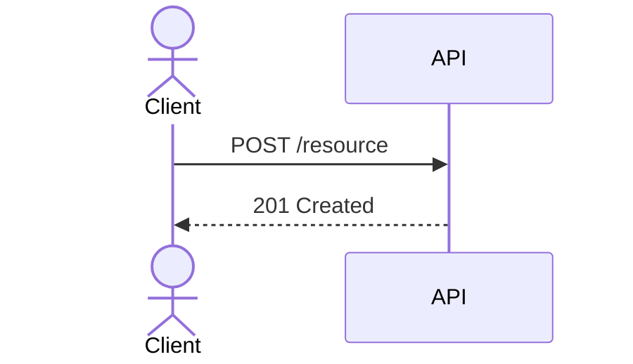

# API contract

## Exposed resources and operations
TO DOCUMENT — one row per operation: method, path, purpose, auth.

| Operation | Method | Path | Auth | Notes |
|-----------|--------|------|------|-------|
| TO DOCUMENT | — | — | — | — |

## Inputs, outputs and error shapes
TO DOCUMENT — payloads, validation rules, pagination, filtering, formats, and
the canonical error envelope.

## Authentication and authorization
TO DOCUMENT — who may call what, and where the check is enforced.

## Representative exchange

## Compatibility and breaking changes
TO DOCUMENT — versioning policy, deprecation window, migration notes.
