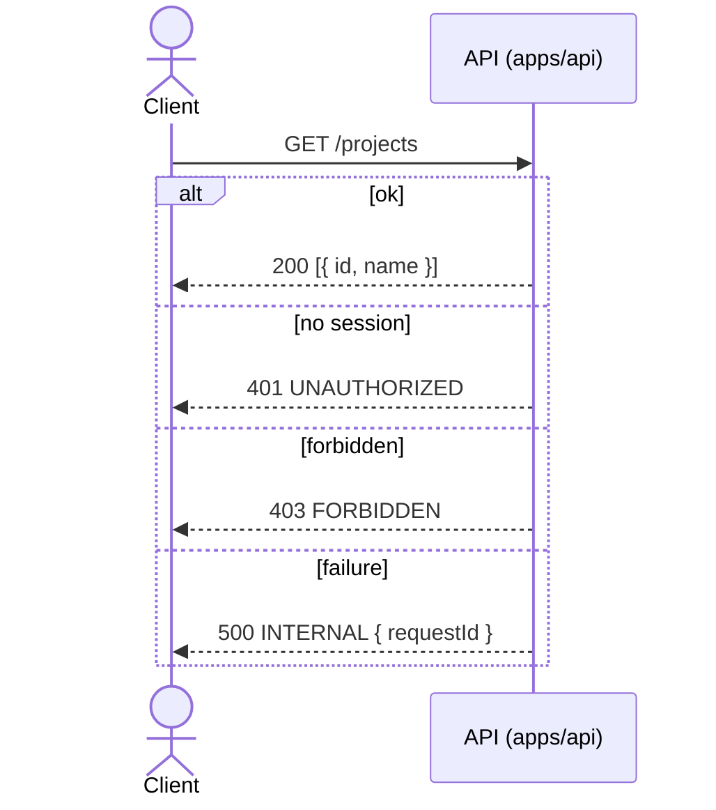
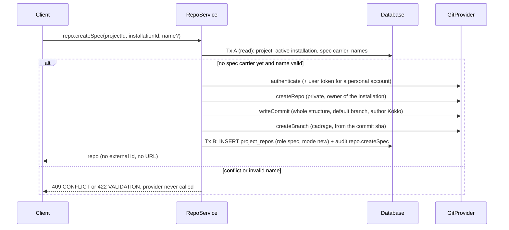
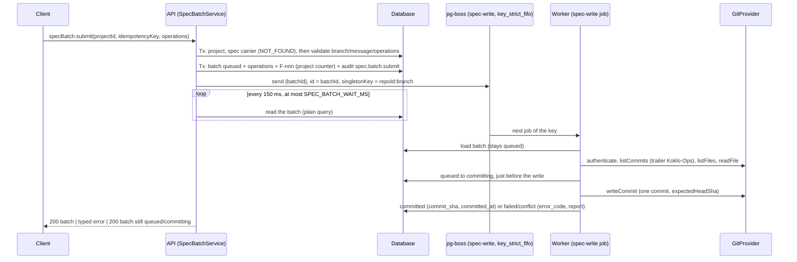
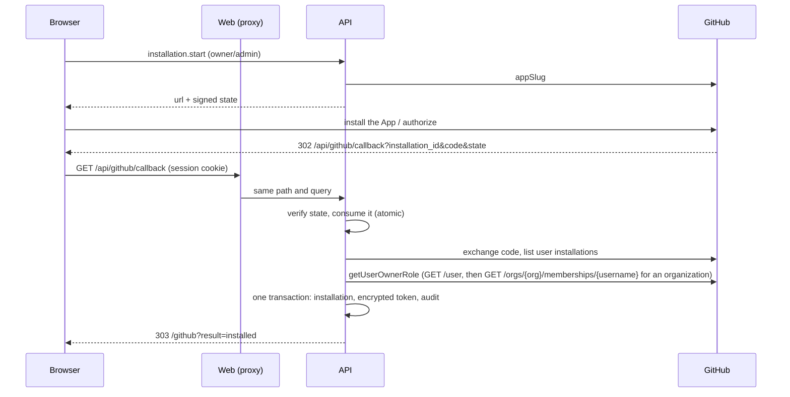

# API contract

The contract lives in `packages/contract` (`@koklo/contract`, tag `contract`). It is
written with oRPC v2 (`@orpc/contract`) and Zod; the OpenAPI document is generated from
it. `apps/api` (NestJS + `@orpc/nest`) implements it; see [ADR 0002](adr/0002-project-port-in-api.md).

## Exposed resources and operations

Contract version **2.8.0** (TK-93: project cards, one-step creation and EU data, `project.cards`, `project.creationStatus`, `project.retryRepo`, `project.setEuOnly`; TK-92: project overview, `project.overview` and `project.activity`; TK-91: idea maturity, Synthesis, `idea-vN` versions and the move to framing; TK-90: idea agent, proposals and `ai.ideaChat`; TK-89: group `idea`; see the version history below; TK-98: groups `aiProvider`, `aiModel`, `aiUsage`, `aiSettings`; see the version history below for 0.9.0 to 2.2.0; TK-54b: group `ai` and `llmCredential.verify`; 0.8.0 added the group `llmCredential`, TK-52b; routes otherwise unchanged since 0.5.0, TK-42). The router shape is
`{ health, organization, member, project, ticket, dependency, sprint, comment, projectState, lease, audit, installation, llmCredential, ai, repo, spec, specBatch }`:
51 routes on 37 paths (8 from TK-21, 25 from TK-29, 10 from TK-42, 4 from TK-52b, 4 from TK-54b; see "Provider, spec and feature batches (TK-42)", "BYOK LLM credentials (TK-52b)" and "AI proposals and key verification (TK-54b)"). Method and path are explicit on every
route, via the `route(method, path)` helper (`src/route-helpers.ts`, wrapping
`.meta(openapi({ method, path }))`) used by `src/contract.ts`, `src/contract-tickets.ts` and
`src/contract-collaboration.ts`.

| Operation | Method | Path | Auth | Typed errors (besides `INTERNAL`) |
|-----------|--------|------|------|-----------------------------------|
| `health` | GET | `/health` | none (public) | none |
| `organization.create` | POST | `/organizations` | session | `UNAUTHORIZED`, `CONFLICT` |
| `organization.list` | GET | `/organizations` | session | `UNAUTHORIZED` |
| `member.invite` | POST | `/members/invitations` | session + active organization | `UNAUTHORIZED`, `FORBIDDEN`, `CONFLICT` |
| `member.list` | GET | `/members` | session + active organization + team or business role | `UNAUTHORIZED`, `FORBIDDEN` |
| `member.setRole` | PATCH | `/members/{memberId}/role` | session + active organization | `UNAUTHORIZED`, `FORBIDDEN`, `NOT_FOUND`, `CONFLICT` |
| `project.list` | GET | `/projects` | session + active organization | `UNAUTHORIZED`, `FORBIDDEN` |
| `project.create` | POST | `/projects` | session + active organization | `UNAUTHORIZED`, `FORBIDDEN` |

The six TK-21 routes are implemented in `apps/api` (TK-23). Of the 25 TK-29 routes, the 15
ticket, dependency and sprint ones are implemented since TK-30 (see
[Tickets, dependencies and sprints (TK-30)](#tickets-dependencies-and-sprints-tk-30)); the
lease and project-state ones since TK-31 (see [Leases and project state (TK-31)](#leases-and-project-state-tk-31));
the comment and audit ones since TK-32 (see [Comments and audit log (TK-32)](#comments-and-audit-log-tk-32)). The
organisation and the project always come from the session or the server, never from the input;
a resource of another project is `NOT_FOUND` (no leak). The contract does not carry roles:
the matrix is enforced and tested in `apps/api`. "Manage" below means owner, admin, dev,
designer; "read" is open to every role (client for its own project, business). The column is
the contract's intent; the matrix actually enforced is in the TK-30 and TK-31 sections
(`ticket.delete` is currently open to every manager role, not only owner and admin).

| Operation | Method | Path | Roles (intent) | Typed errors (besides `INTERNAL`, `UNAUTHORIZED`) |
|-----------|--------|------|--------------------|---------------------------------------------------|
| `ticket.create` | POST | `/projects/{projectId}/tickets` | manage | `FORBIDDEN`, `VALIDATION`, `CONFLICT` |
| `ticket.get` | GET | `/projects/{projectId}/tickets/{key}` | read | `NOT_FOUND` |
| `ticket.list` | GET | `/projects/{projectId}/tickets` | read | none |
| `ticket.update` | PATCH | `/projects/{projectId}/tickets/{key}` | manage | `FORBIDDEN`, `NOT_FOUND`, `VALIDATION` |
| `ticket.delete` | DELETE | `/projects/{projectId}/tickets/{key}` | owner, admin | `FORBIDDEN`, `NOT_FOUND`, `CONFLICT` |
| `ticket.transition` | POST | `/projects/{projectId}/tickets/{key}/transition` | manage (agents and runners by token scope) | `FORBIDDEN`, `NOT_FOUND`, `CONFLICT`, `INVALID_TRANSITION` |
| `dependency.add` | POST | `/projects/{projectId}/tickets/{key}/dependencies` | manage | `FORBIDDEN`, `NOT_FOUND`, `DEPENDENCY_CYCLE` |
| `dependency.remove` | DELETE | `/projects/{projectId}/tickets/{key}/dependencies/{dependsOn}` | manage | `FORBIDDEN`, `NOT_FOUND` |
| `dependency.list` | GET | `/projects/{projectId}/tickets/{key}/dependencies` | read | `NOT_FOUND` |
| `sprint.create` | POST | `/projects/{projectId}/sprints` | manage | `FORBIDDEN`, `VALIDATION`, `CONFLICT` |
| `sprint.get` | GET | `/projects/{projectId}/sprints/{key}` | read | `NOT_FOUND` |
| `sprint.list` | GET | `/projects/{projectId}/sprints` | read | none |
| `sprint.update` | PATCH | `/projects/{projectId}/sprints/{key}` | manage | `FORBIDDEN`, `NOT_FOUND`, `VALIDATION` |
| `sprint.activate` | POST | `/projects/{projectId}/sprints/{key}/activate` | manage | `FORBIDDEN`, `NOT_FOUND`, `CONFLICT` |
| `sprint.close` | POST | `/projects/{projectId}/sprints/{key}/close` | manage | `FORBIDDEN`, `NOT_FOUND`, `CONFLICT` |
| `comment.create` | POST | `/projects/{projectId}/comments` | owner, admin, dev, designer, client; agents by token | `FORBIDDEN` |
| `comment.list` | GET | `/projects/{projectId}/comments` | read | none |
| `comment.delete` | DELETE | `/projects/{projectId}/comments/{id}` | author, owner, admin | `FORBIDDEN`, `NOT_FOUND` |
| `projectState.get` | GET | `/projects/{projectId}/project-state` | owner, admin, dev (enforced since TK-31) | none (the `FORBIDDEN` 403 is not typed in the contract) |
| `projectState.update` | PUT | `/projects/{projectId}/project-state` | owner, admin | `FORBIDDEN`, `VERSION_CONFLICT` |
| `lease.acquire` | POST | `/projects/{projectId}/tickets/{key}/lease` | owner, admin, dev | `FORBIDDEN`, `NOT_FOUND`, `LEASE_HELD` |
| `lease.heartbeat` | POST | `/projects/{projectId}/tickets/{key}/lease/heartbeat` | manage, then holder only | `NOT_FOUND`, `LEASE_NOT_HOLDER`, `LEASE_EXPIRED` |
| `lease.release` | DELETE | `/projects/{projectId}/tickets/{key}/lease` | manage, then holder only (no force mechanism in the contract) | `NOT_FOUND`, `LEASE_NOT_HOLDER` |
| `lease.get` | GET | `/projects/{projectId}/tickets/{key}/lease` | read | `NOT_FOUND` |
| `audit.list` | GET | `/projects/{projectId}/audit` | owner, admin | `FORBIDDEN` |

Since 2.0.0 (TK-96) every row above is scoped by the `projectId` path parameter. `audit.list` returns the entries
of that project (`audit_log.project_id`, set by the server from the request) plus the organization-level entries
(`project_id` NULL: members, provider keys, project creation, AI calls), never the entries of another project.

`audit` is read-only: the log is immutable (CDC §4.2) and fed by the server. There is no
`lock.*` group: the **merge and spec-write locks are not delivered on the API side** (no `locks`
table, no procedure in contract 0.4.0). Delivering them needs a database migration and a
contract 0.5.0; a follow-up ticket is to be created.

## Tickets, dependencies and sprints (TK-30)
Modules `ticket/`, `sprint/` and `tracker/` (shared bricks) in `apps/api`, a NestJS adapter on top
of `@koklo/domain` (a runtime dependency since TK-30): the domain decides (lifecycle table H1,
dependency graph, validation), the API orchestrates and persists. The contract is unchanged (0.4.0).

Each use case runs in **one Prisma transaction** under `withOrganization`
(`tracker/project-transactions.ts`): the project is checked to belong to the organization
(`NOT_FOUND` otherwise), then read, write, key counter (`TK-n`, `SP-n`, `tracker/counters.ts`)
and `audit_log` row (`tracker/audit.ts`) commit or roll back together.

| Procedure | Behaviour |
|-----------|-----------|
| `ticket.create` | Domain validation; `pkg:*` labels rejected (`VALIDATION`, field `labels`, rule `assertNoPackageLabel` of `@koklo/domain`); `sprintId` must be a planned or active sprint of the project; key from the counter; criteria stored with 1-based positions |
| `ticket.get` | Detail with criteria, dependencies and active lease; `lease.worktree` is `""` unless the caller's role is in `TICKET_WRITE_ROLES` (owner, admin, dev, designer; deny by default, also without role) |
| `ticket.list` | Filters `status`, `sprintId`, `pkg`, `assignee` (`kind:id` or bare id); default order priority descending, then ticket number, then id (see "Long lists (TK-94)"); cursor pagination; **an invalid cursor is ignored** (first page) because the contract declares no `VALIDATION` error on this route |
| `ticket.update` | Merged state validated by the domain, then only the provided fields are written; a provided `labels` or `linkedFeatures` list replaces the stored one |
| `ticket.delete` | Soft delete; `CONFLICT ticket_has_active_lease` while a lease is held |
| `ticket.transition` | Table H1, then CDC §7.2 for `todo -> in_progress`: every `blocks` dependency must be `done`, otherwise `INVALID_TRANSITION { from, to }` |
| `dependency.add` / `remove` / `list` | Cycle detection on the project graph (`DEPENDENCY_CYCLE`); re-adding an identical edge is an idempotent no-op (no write, no audit); removing an absent edge is `NOT_FOUND` |
| `sprint.create` / `update` | `endsOn >= startsOn` (`VALIDATION`, also when only one date changes); `SP-n` from the counter |
| `sprint.activate` / `close` | `planned -> active -> closed`, no reopening. One active sprint per project: pre-check plus the partial unique index; a concurrent loser (`P2002`) becomes `CONFLICT sprint_already_active` |

### Current project (v1, replaced by an explicit `projectId` since 2.0.0)
This section describes the behaviour before 2.0.0 (TK-96): the contract now carries `projectId` and the class below is
removed. Before, neither the session nor the contract carried a project, so `PROJECT_CONTEXT`
(`project/project-context.ts`) resolves it: `OldestProjectContext` returns the oldest project of
the session organization (`createdAt`, then `id`); an organization without project gives
`NOT_FOUND`. The value never comes from the client. An explicit project selection will replace
this class without touching the services. Every read and write is filtered by this `projectId`.

### Permission matrix (TK-30)
Single source of the write roles: `TICKET_WRITE_ROLES` in `apps/api/src/auth/roles.ts` (owner,
admin, dev, designer), checked by `apps/api/test/ticket-roles-consistency.test.ts`. The role is
re-read from `members` on every request (`RoleGuard`).

| Procedure | owner | admin | dev | designer | client | business |
|-----------|:-----:|:-----:|:---:|:--------:|:------:|:--------:|
| `ticket.get`, `ticket.list`, `dependency.list`, `sprint.get`, `sprint.list` | yes | yes | yes | yes | yes | yes |
| `ticket.create`, `update`, `delete`, `transition` | yes | yes | yes | yes | no | no |
| `dependency.add`, `dependency.remove` | yes | yes | yes | yes | no | no |
| `sprint.create`, `update`, `activate`, `close` | yes | yes | yes | yes | no | no |

401 without session or active organization, 403 for a role marked "no".

### Known limits and debt (TK-30)
- **No composite foreign key from child rows to the ticket (TK-28 debt).** `ticket_labels`,
  `ticket_features`, `acceptance_criteria` and `ticket_dependencies` reference the ticket by id
  only, so the database does not forbid a child row pointing to a ticket of another project or
  organization. This is covered by the application safety net only: every child write goes
  through `assertOwned` (ticket in the organization AND the current project), every read filters
  by `projectId`, and child rows are written through model operations (not nested writes) so the
  tenant extension applies. To harden later with composite keys `(id, project_id)`; a follow-up
  ticket should track it.
- The `pkg:*` label rule is domain logic (`assertNoPackageLabel` in
  `packages/domain/src/ticket-package.ts`), raised as `InvalidTicketError` and mapped to
  `VALIDATION`.
- `ticket.delete` is allowed to every manager role, while the contract intent says owner and
  admin only; to be arbitrated by the product owner.

## Inputs, outputs and error shapes

Schemas are in `packages/contract/src/schemas.ts`:

| Operation | Input | Output |
|-----------|-------|--------|
| `health` | `{}` | `{ status: "ok", version: string }` |
| `organization.create` | `{ name: 1..100, slug?: 2..48, [a-z0-9-] }` | `{ id: uuid, name, slug }` |
| `organization.list` | none | array of `{ id, name, slug, role }` (caller's own role) |
| `member.invite` | `{ email, role: MemberRole }` | `{ id, email, role, status: "pending", expiresAt: ISO datetime }` |
| `member.list` | none | array of `{ id, userId, name, email, role }` |
| `member.setRole` | `{ memberId: uuid, role: MemberRole }` (`memberId` in the path) | `{ id, role: MemberRole }` |
| `project.list` | none | array of `{ id, name }` |
| `project.create` | `{ name: 1..100 }` | `{ id, name }` |

TK-29 schemas live in `src/schemas-tickets.ts` (tickets, dependencies, sprints) and
`src/schemas-collaboration.ts` (comments, project state, leases, audit), re-exported by
`src/schemas.ts`. Enum values are the literals of `@koklo/domain`; the contract cannot
depend on the domain (`turbo boundaries`), so the parity is tested in
`apps/api/test/contract-domain-parity.test.ts`.

| Schema | Shape |
|--------|-------|
| `ticketKeySchema`, `sprintKeySchema` | `TK-n`, `SP-n` (`n >= 1`, no leading zero): public identifiers in paths |
| `instantSchema` | ISO-8601 UTC datetime; sprint dates are `YYYY-MM-DD` |
| `ticketSchema` | domain `Ticket` + `id` (uuid): `key, title, description, type, status, priority, sprint (SP-n or null), assignee (string or null), pkg (one of 15), labels, sensitivity, estimateHours (>= 0 or null), linkedFeatures, branch, pullRequest, attempts, reviewRounds, createdAt` |
| `ticketDetailSchema` | `ticketSchema` + `criteria [{ statement, specRef or null }]`, `dependencies`, `lease` (active or null) |
| `ticket.create` input | `title 1..200, type, priority, pkg, sensitivity` required; `description, status (backlog or todo), sprintId, assignee {kind member or runner, id}, labels, estimateHours, linkedFeatures, criteria` optional |
| `ticket.update` input | `key` + any editable field; **strict**: `status` is rejected (use `ticket.transition`) |
| `dependency.add` input | `{ key, dependsOn, type: blocks or related }`; `dependsOn === key` rejected |
| `sprintSchema` | `{ id, key, goal, status: planned, active or closed, startsOn, endsOn, definitionOfDone }`; `endsOn >= startsOn` (create, and update when both given); update is strict (no `status`) |
| `commentSchema` | `{ id, targetKind: ticket, feature, screen or change_request, targetId, authorKind: human, agent, client or system, authorId, body, createdAt }`; body 1..8000 on create; the author is never read from the input |
| `projectStateSchema` | `{ version >= 1, content: object }`; `projectState.update` takes `{ expectedVersion >= 1, content }` (full replacement) |
| `leaseSchema` | domain `Lease`: `ticket, holder {kind member or runner, id}, branch, worktree, acquiredAt, heartbeatAt, expiresAt, ttlMs > 0, released`; `lease.acquire` takes `{ key, branch, worktree, ttlMs? }`, the holder comes from the token; `lease.get` returns a lease or `null` |
| `auditEntrySchema` | `{ id, actorKind: human, agent, runner or system, actorId?, tokenId?, action, targetKind, targetId, ticketKey?, occurredAt }` |

Pagination (`ticket.list`, `comment.list`, `audit.list`): cursor-based, input `limit`
(1..100, coerced from the query string) and `cursor`, output `{ items, nextCursor: string or null }`.
`sprint.list` and `dependency.list` are not paginated (bounded volume).

Roles (CDC §14): `Role` = `owner | admin | dev | designer | client | business`;
`MemberRole` = `Role` without `owner`. `owner` can never be granted by invitation or role
change. TypeScript types are exported from the package index (`Role`, `MemberRole`,
`OrganizationCreateInput`, `MemberInviteInput`, `ProjectCreateInput` and the outputs).
Pagination and filtering: none defined (ASSUMPTION: to be added by a later ticket).

Typed errors are declared in the contract (`src/errors.ts`); each route exposes only the
ones it lists:

| Code | HTTP status | Data | Meaning |
|------|-------------|------|---------|
| `INTERNAL` | 500 | `{ requestId: string }` | every route |
| `UNAUTHORIZED` | 401 | none | no or expired session |
| `FORBIDDEN` | 403 | none | role not allowed for the action (see below) |
| `NOT_FOUND` | 404 | none | `member.setRole`: member absent from the active organization; TK-29 routes: ticket, sprint, comment, dependency or lease unknown or in another project |
| `CONFLICT` | 409 | `{ reason }` | state conflict |
| `INVALID_TRANSITION` | 409 | `{ from, to }` | `ticket.transition`: refused by the lifecycle table (`InvalidTicketTransitionError`) |
| `DEPENDENCY_CYCLE` | 409 | `{ path: TK-n[] }` | `dependency.add` (`DependencyCycleError`) |
| `VERSION_CONFLICT` | 409 | `{ expected, current: { version, content } }` | `projectState.update`: refused with the current state (`StaleProjectStateError`) |
| `LEASE_HELD` | 409 | `{ ticket, holder, expiresAt }` | `lease.acquire` (`LeaseAlreadyHeldError`) |
| `LEASE_EXPIRED` | 409 | `{ ticket, expiresAt }` | `lease.heartbeat` (`LeaseExpiredError`) |
| `LEASE_NOT_HOLDER` | 403 | `{ ticket, holder }` | `lease.heartbeat`, `lease.release`; `holder` is the actual holder (`LeaseNotHeldByError`) |
| `VALIDATION` | 422 | `{ field, message }` | `ticket.create/update`, `sprint.create/update`: semantically invalid input (`InvalidTicketError`, `TicketPackageError`, `InvalidSensitivityError`) |

`CONFLICT.data.reason` is one of: `slug_taken` (`organization.create`), `already_member`
and `already_invited` (`member.invite`), `last_owner` (`member.setRole`: would leave the
organization without owner), and since 0.4.0 `sprint_already_active`, `sprint_not_planned`,
`sprint_not_active` (`sprint.activate`/`close`, and `sprint.create`), `ticket_has_active_lease`
(`ticket.delete`) and `counter_limit_reached` (`ticket.create`, `ticket.transition`); the
extension is backward compatible (values added). In the generated OpenAPI, the `INTERNAL`
payload is the component schema `Internal`; the new payloads are `InvalidTransition`,
`DependencyCycle`, `VersionConflict`, `LeaseHeld`, `LeaseExpired`, `LeaseNotHolder` and
`Validation`.

Decisions taken in TK-29 (to confirm at implementation, TK-30 to TK-32): `ticket.transition`
does not expose `LEASE_NOT_HOLDER` (the contract does not force a lease for a transition);
the audit log is readable by owner and admin only (loosening it is not a breaking change).

Roles allowed per action (to enforce in TK-23): `member.invite` and `member.setRole` are
reserved to `owner`/`admin` (otherwise `FORBIDDEN`); `project.create` to the roles the CDC
allows to create projects (otherwise `FORBIDDEN`).

## Leases and project state (TK-31)
Modules `lease/` and `project-state/` in `apps/api`, same hexagonal shape as TK-30 (controller,
service, repository port, Prisma adapter, one `ProjectTransactions` transaction and one
`audit_log` row per write). The contract is unchanged (0.4.0). The domain decides (holder,
expiry, version rule: `acquireLease`, `heartbeat`, `release`, `writeProjectState`); domain errors
become typed errors through `tracker/api-errors.ts`.

**Injected clock.** `CLOCK` (`clock.ts`, global `ClockModule`) is the only source of time for a
decision: lease expiry, "active lease" filters of `ticket.get`/`ticket.delete`. Neither
`Date.now()` nor SQL `now()` decides anywhere; tests replace it with `overrideProvider(CLOCK)`.

| Constant (`auth/roles.ts`) | Roles | Used by |
|----------------------------|-------|---------|
| `LEASE_ACQUIRE_ROLES` | owner, admin, dev | `lease.acquire` |
| `TICKET_WRITE_ROLES` | owner, admin, dev, designer | `lease.heartbeat`, `lease.release` (then the holder only, else `LEASE_NOT_HOLDER`) |
| `PROJECT_STATE_READ_ROLES` | owner, admin, dev | `projectState.get` |
| `PROJECT_STATE_WRITE_ROLES` | owner, admin | `projectState.update` |

`lease.get` is open to every role; `canSeeWorktree(role)` (true for `TICKET_WRITE_ROLES`) masks
`worktree` as `""` for the others, in `lease.get` and `ticket.get` alike. A role outside
`PROJECT_STATE_READ_ROLES` gets a 403 on `projectState.get` that is **not typed** in the contract
(the route declares no `FORBIDDEN`); the client sees a generic forbidden response.

| Procedure | Behaviour |
|-----------|-----------|
| `lease.acquire` | Expired leases of the ticket are marked released in the same transaction, then the domain checks, then INSERT. A race lost on the partial unique index (`P2002`) rolls back and a second transaction reads the winner: `LEASE_HELD` |
| `lease.heartbeat` | Domain extends the lease; persisted by a conditional UPDATE (not released, not expired). No active lease: `LEASE_EXPIRED` if the ticket ever had one, else `NOT_FOUND` |
| `lease.release` | Holder only (`LEASE_NOT_HOLDER`); conditional UPDATE. **No one can force a release**: the contract has no such mechanism, so owner and admin are not exempt |
| `lease.get` | Active lease or `null` |
| `projectState.get` | Row created on demand (`{ version: 1, content: {} }`) with `createMany skipDuplicates` (no `P2002`) |
| `projectState.update` | Domain version rule, then `UPDATE ... WHERE version = expected`; zero rows means a concurrent write won: re-read and `VERSION_CONFLICT` |

## Implementation of the six procedures (TK-23)
| Procedure | Controller guards | Behaviour |
|-----------|-------------------|-----------|
| `organization.create` | `UserSessionGuard`, `NotClientOnlyGuard` (since 0.14.0) | Refused with `FORBIDDEN { reason: client_only }` when every membership of the caller is `client` (TK-55); a caller with no membership, or with any other role somewhere, may create. Slug checked (`slug_taken`) or derived from the name with a numeric suffix; creation through Better Auth `createOrganization` (caller becomes `owner`, organization becomes active on the session) |
| `organization.list` | `UserSessionGuard` | Organizations the caller belongs to, with the caller's role |
| `member.list` | `SessionGuard`, `RoleGuard` (`MEMBER_LIST_ROLES`) | Members of the session organization; closed to `client` (403, exposes names, emails and roles of the whole organization) and to any absent or unknown role |
| `member.invite` | `SessionGuard`, `RoleGuard` | `already_member` / `already_invited` checks, then Better Auth `createInvitation`; its callback enqueues the email job |
| `member.setRole` | `SessionGuard`, `RoleGuard` | Serializable transaction: `NOT_FOUND`, H3, `last_owner` |
| `project.create` | `SessionGuard`, `RoleGuard` | Project created under the session organization |

`NOT_FOUND` is identical for an unknown member and a member of another organization.
Every organization value comes from the session, never from the input. The role check runs
before input validation (403 before 400).

### Permission matrix (CDC §14)
`RoleGuard` reads the role from `members` on every request. Single source of the manager
roles: `MANAGER_ROLES` in `apps/api/src/auth/roles.ts`, used by the `@Roles` decorators; the
Better Auth access-control table in the same file is its echo, and
`apps/api/test/roles-consistency.test.ts` fails if the two, or the contract's `roleSchema`,
drift apart.

| Procedure | owner | admin | dev | designer | client | business |
|-----------|:-----:|:-----:|:---:|:--------:|:------:|:--------:|
| `organization.create` | yes | yes | yes | yes | no (client-only account, since 0.14.0) | yes |
| `organization.list` | yes | yes | yes | yes | yes | yes |
| `member.list` | yes | yes | yes | yes | no | yes |
| `member.invite` | yes | yes | no | no | no | no |
| `member.setRole` | yes | yes | no | no | no | no |
| `project.create` | yes | yes | no | no | no | no |

`organization.*` needs a session only (no active organization). `organization.create` is refused to an account whose memberships are all `client` (403 before input validation). Others: 401 without session or
active organization, 403 for a role marked "no".

### Web consumer (TK-24)
`apps/web` calls these procedures; the contract is unchanged. Roles are shown from `organization.list`
(`role` of the active organization); the UI hides what the matrix forbids, the API stays the authority.

| Screen | Procedure | Error handling in the UI |
|--------|-----------|--------------------------|
| `/organizations` | `organization.list`, `organization.create` | `CONFLICT slug_taken` shown under "Identifiant"; other errors in an alert; `UNAUTHORIZED` re-checks the session (no session: `/login`; session: `/organizations`) |
| `/members` | `member.list`, `member.invite` | `CONFLICT already_member` / `already_invited` under "Adresse e-mail"; `FORBIDDEN` as a message; other errors in an alert. A `client` never calls `member.list` (no "Membres" entry; the page shows a team-only notice) |
| `/projects` | `project.list`, `project.create` | `FORBIDDEN` as a message; other errors in an alert |

Organization activation is not an oRPC procedure: the web calls the Better Auth client
`organization.setActive` (`/api/auth/*`). `member.setRole` has no screen yet.

### Hypotheses to validate (product owner)
- **H1 (to validate)**: `project.create` is owner and admin only. The CDC has no "create a
  project" row; the cautious option was kept (TK-21 had assumed dev as well). Opening it to
  `dev` later is backward compatible, the reverse is not.
- **H2 (to validate)**: any member can list members.
- **H3 (to validate)**: only an `owner` changes the role of an `owner` or grants `admin`
  (invitation included); otherwise 403. `owner` is never assignable.

### Out of scope
The invitation acceptance page and the `acceptInvitation` call (web, follow-up ticket): TK-23
creates the invitation and enqueues the email, whose link is `<BETTER_AUTH_URL>/accept-invitation/<id>`.
Ownership transfer and member removal are not in the contract.

As of TK-86 the page exists: `apps/web/src/app/accept-invitation/[id]` calls the Better Auth client
`organization.getInvitation` (preview, recipient only) then `organization.acceptInvitation` (explicit click).
No oRPC procedure was added; without a session the proxy redirects to `/login?next=/accept-invitation/<id>`.

### Known limits
- Invitation acceptance (TK-86): Better Auth returns a single `INVITATION_NOT_FOUND` (400) for an
  unknown, expired, canceled or already accepted invitation, so the web shows one message naming the
  possible causes. For a user who is **already a member**, `acceptInvitation` answers **500** with no
  body (API log: Prisma `P2002` on `members_organization_id_user_id_key`); the invitation stays
  `pending` and the existing member is untouched (no duplicate). The web avoids the call by checking
  `organization.list` first (and again after a 5xx) and shows "Vous faites déjà partie de cette
  organisation". Another client calling the endpoint directly still gets the 500 (logged as ERROR).
- No pending-invitation list and no resend or cancel procedure: the web cannot show `already_invited`
  before the error, nor resend an email (TK-24 observation; see also the limits below).
- Better Auth swallows errors of `sendInvitationEmail`: if pg-boss fails, the invitation
  exists without an email and the response is still 200. The failure is logged
  (`enqueue failed`, queue and error name only) and sent to Sentry; there is no resend
  procedure yet.
- A concurrent `setRole` race on the last owner can abort the Serializable transaction and
  return `INTERNAL` (500) instead of `CONFLICT last_owner`. The organization is never left
  without an owner.

## Authentication and authorization
`project.list` requires a session (TK-11, [ADR 0003](adr/0003-better-auth-session-guard.md)).
`apps/api` mounts Better Auth on `/api/auth/*` (GitHub OAuth sign-in and callback, sign-out);
these routes belong to Better Auth, not to the oRPC contract. The session is a signed Better
Auth cookie.

Three guards (TK-23, [architecture.md](architecture.md#organizations-members-and-roles-tk-23)): `UserSessionGuard` (session only), `SessionGuard` (active organization) and `RoleGuard` (`@Roles`). A per-procedure Nest guard (`SessionGuard`, `@UseGuards` on `ProjectController.list`; not
global) resolves the session before the service runs. The request is refused with the typed
`UNAUTHORIZED` error (401, body `{ code, status, message, ... }`) when:

- there is no cookie, or it is unknown, forged or expired;
- the session has no active organization;
- the user is not a member of the active organization (checked in the `member` table).

The organization used for the query comes only from the resolved session
(`SessionOrganizationContext`); an organization sent by the client (header, query, body) is
ignored. `FORBIDDEN` is emitted by `RoleGuard` (TK-23). The repository port has no "list
everything" method: every read is filtered by `organizationId`. The Prisma tenant-filter
extension of CDC §18.4 does not exist yet.

Test session (e2e only): when `APP_ENV=test`, the header
`x-test-session: <userId>:<organizationId>` is accepted (exactly two non-empty segments,
otherwise 401). In any other `APP_ENV` the test resolver is not registered and the header
is ignored.

`GET /health` and `GET /openapi.json` are public. When the database does not answer within 2 s, `/health` returns `INTERNAL` (500) with `requestId` (`x-request-id` if given, otherwise a UUID); no connection detail is exposed.

## OpenAPI generation
`generateOpenApi()` (`src/openapi.ts`) is pure (no I/O) and returns an OpenAPI 3.1.0
document titled `Koklo API`, whose `info.version` is `CONTRACT_VERSION`
(`src/version.ts`). Object keys are sorted recursively so the output is deterministic.
Error statuses are derived from the contract's own error maps (the router tree is walked,
no list of procedures to maintain), not written twice.

| Artifact | Role |
|----------|------|
| `packages/contract/openapi/openapi.json` | Reference document, committed |
| `packages/contract/openapi/versions.json` | Map `version → sha256` of the document |
| `packages/contract/scripts/generate-openapi.ts` | Writes both files (`pnpm --filter @koklo/contract openapi:generate`) |

## Compatibility and breaking changes
The OpenAPI document must not change without a version change (TK-9 acceptance
criterion). Contract tests (`packages/contract/test/contract.test.ts`) fail when:

- the generated document differs from `openapi/openapi.json`;
- `info.version` differs from `version` in `package.json`;
- the sha256 of the generated document differs from the entry for the current version
  in `openapi/versions.json`.

To change the contract: bump the version in `package.json` **and** `src/version.ts`, run
`pnpm --filter @koklo/contract openapi:generate`, commit the regenerated files.
`versions.json` only gains lines. Deprecation window and migration policy: TO DOCUMENT.

oRPC packages are pinned to `2.0.0-beta.46`: it is the only published line offering
`.meta(openapi(...))` (stable 1.16.1 uses `.route()`). Replace with 2.0 stable on release.

## Comments and audit log (TK-32)
Modules `comment/` and `audit/` in `apps/api`, same hexagonal shape as TK-31. The contract is
unchanged (0.4.0). `comment.create` and `comment.delete` write their `audit_log` row
(`comment.create`, `comment.delete`, target kind `comment`, `ticket_id` = the commented ticket)
in the same transaction as the write. Roles live in `auth/roles.ts`: `COMMENT_WRITE_ROLES`
(owner, admin, dev, designer, client), `COMMENT_DELETE_ANY_ROLES` (owner, admin),
`AUDIT_READ_ROLES` (owner, admin).

| Route | Rule |
|---|---|
| `comment.create` | owner, admin, dev, designer, client (business is read-only: `FORBIDDEN`). The author comes from the session, never from the input: `client` writes as `authorKind: client`, the others as `human`, `authorId` is the user id. Body 1..8000 characters, stored as is (untrusted data). A body refused by the contract schema is returned as `VALIDATION` (422), see "Schema refusals" below |
| `comment.list` | every role. Oldest first, cursor on `(createdAt, id)`; deleted comments are hidden. A row with a NULL `author_id` (system comment) is served with `authorId: "system"` |
| `comment.delete` | the author, or owner and admin for any comment. Soft delete (`deleted_at` set from `CLOCK`); the row stays. Membership of the project is checked before the right: unknown, already deleted or foreign comment is `NOT_FOUND`, another author's comment is `FORBIDDEN` |
| `audit.list` | owner and admin only. Newest first, cursor on `(occurredAt, id)`. Filters combined with AND: `ticketKey` (unknown key: empty page), `actorKind`, `action` (exact), `from` (included), `to` (excluded). Null fields are omitted, `ticketKey` is resolved even for a soft-deleted ticket, the comment body is never exposed |

Target validation (done by the API; since 0.5.0 the contract types `targetId` as `z.uuid()`): only
`targetKind: ticket` is accepted (`VALIDATION{targetKind}` otherwise: features, screens and change
requests have no table); `targetId` must be a UUID (`VALIDATION{targetId}`); the ticket must exist,
not be deleted and belong to the current project (`NOT_FOUND`). Pagination: `limit` default 50,
maximum 100, a malformed cursor is `VALIDATION{cursor}`. These `VALIDATION`, `NOT_FOUND` and
`FORBIDDEN` errors are raised with the right HTTP status and, since 0.5.0, are typed in the OpenAPI
(with a nullable `authorId` and a `uuid` `targetId`; an enumerated audit `targetKind` stays open).

**Schema refusals (temporary interceptor).** The framework rejects an empty or over-long body, or a
`targetId` that is not a UUID, as `BAD_REQUEST` (400) even though 0.5.0 types `VALIDATION` on
`comment.create` and `comment.list`. The tests require 422, so `input-validation.ts` (an oRPC client interceptor registered in
`ORPCModule.forRoot`) converts it. Its scope is exactly the routes `POST /comments` and `GET /comments`, read from the
procedure's OpenAPI metadata; it converts only a `BAD_REQUEST` that carries schema `issues`
(field = first path segment, message = first issue) and passes every other error through
unchanged, so it hides nothing (organisation routes keep their 400). It is kept until a framework-level mapping of schema refusals to the typed `VALIDATION` exists.

**Shared bricks added by TK-32** (`tracker/`): `cursor.ts` (opaque base64url cursor on
`(sort key, id)`, `keysetAfter`, `pageOfItems`, default page size 50) now serves `ticket.list`,
`comment.list` and `audit.list`; `uuid.ts` (`isUuid`). A malformed cursor is `VALIDATION{cursor}` on
comments and audit, but still ignored on `ticket.list` (no typed error on that route).

**Typing corrections applied in 0.5.0**:
- `VALIDATION` and `NOT_FOUND` typed on `comment.create` and `comment.list`; `FORBIDDEN` typed on
  `comment.list` and `projectState.get` (`audit.list` already had it).
- `authorId` nullable (`null` for a system comment, empty string refused); `targetId` as
  `z.uuid()` on comments and audit entries.
- Still open: audit `targetKind` enumerated; explicit `projectId` instead of the oldest project
  on the historical routes.
- Open question: may the `client` role see comments written by agents? (Settled: `organization.create`,
  `member.invite`, `member.setRole` and `project.create` are journaled, see "Audit of organisation,
  member and project writes".)
- Only the `ticket` target is accepted for comments (no table for features, screens, change requests).

**Immutable log.** The only writer is `recordAudit` (`tracker/audit.ts`); the `audit` module only
calls `findMany`/`findFirst`, `/audit` has only `GET`, and the database triggers refuse `UPDATE`,
`DELETE` and `TRUNCATE`. A test derives every non-GET procedure of every group from the contract
(20 writes, no group excluded) and checks each one writes exactly one audit row.

**Audit of organisation, member and project writes (decision Q2: journaled).** `recordAudit` takes
an `AuditActor` (`{ organizationId, userId }`); a `ProjectScope` is one, and writes outside a
project pass the session's organisation and user. Actor is always `human` (session user), `ticket_id`
is NULL, `target_kind` is free text in the database (the TypeScript union gained `organization`,
`invitation`, `member`, `project`). No entry on refusal (403, 409).

| Procedure | action | targetKind / targetId | Entry's organisation | Atomicity |
|---|---|---|---|---|
| `project.create` | `project.create` | `project` / project id | session | same transaction as the insert |
| `member.setRole` | `member.setRole` | `member` / member id | session | same (Serializable) transaction as the update |
| `organization.create` | `organization.create` | `organization` / new organisation id | the NEW organisation | same transaction as the organisation and its `owner` member |
| `member.invite` | `member.invite` | `invitation` / invitation id | session | NOT atomic, see below |

`organization.create` no longer goes through Better Auth's `createOrganization`, which writes the
organisation and the member in separate, non-transactional statements and cannot join a caller's
transaction. The service inserts the organisation, the `owner` member (the plugin's `creatorRole`)
and the audit row in one Prisma transaction, then calls `auth.api.setActiveOrganization` to put the
organisation on the session. Slug conflicts still return `CONFLICT{slug_taken}` (pre-check, plus
re-check after a unique violation). Residual risk: if `setActiveOrganization` fails after the commit,
the organisation exists, is audited, and the call returns an error; the user is not locked out
(`organization.list` shows it, the session can select it) and retrying with the same name yields a
new suffixed slug. Better Auth hooks on the organisation model are bypassed (none configured).

`member.invite` stays on Better Auth's `createInvitation` (it also cancels earlier pending invitations
and hands the e-mail job to the worker through `sendInvitationEmail`; reimplementing that would
duplicate the plugin). Better Auth writes with its own client, so the audit cannot share its
transaction: `recordInvitation` writes the entry right after the invitation succeeds, before the
response. Compromise: if that insert fails (database outage between the two statements), the
invitation exists, its e-mail is queued, no audit row exists and the caller gets a 500. The window
is one statement; the failure is visible (500 and the request log), not silent. Reaching strict
atomicity would require owning the invitation write (a Prisma insert plus the queue) or a Better Auth
adapter transaction hook; neither is available in better-auth 1.7.14 for this endpoint.

## Sprint import (TK-34)
No new route and no contract change: the import is an administration command (`import:sprints`,
see [Quality and operations](quality-and-operations.md#sprint-import-command-importsprints-tk-34)),
absent from the OpenAPI document. It writes through the same ports, transactions and audit rows as
`ticket.*` and `sprint.*`, with three extra audit actions: `sprint.import`, `ticket.import` and
`dependency.import`. Imported tickets keep their `TK-n` keys, so the next `ticket.create` continues
after the highest imported number. The actor must be `owner` or `admin`, like the manager routes.

## Provider, spec and feature batches (TK-42)
Contract 0.5.0 adds four groups and 10 routes. `repo.*` is implemented since TK-43 (see "Repositories in the API (TK-43)") and `specBatch.*` since TK-44b (see "Spec batches in the API (TK-44b)"); `spec.*` since TK-45c2 (see "Spec reads in the API (TK-45c2)");
the new routes take an explicit `projectId` (path), the historical ones keep the implicit project.

| Operation | Method | Path | Notes |
|-----------|--------|------|-------|
| `installation.list` | GET | `/provider/installations` | owner/admin; no external id, `userAuthorization` is `absent`, `active` or `expired` |
| `installation.start` | POST | `/provider/installations/start` | optional `installationId` (user re-authorization); returns `{ url, expiresAt }`, the signed one-shot `state` lives inside the URL |
| `repo.list` | GET | `/projects/{projectId}/repos` | |
| `repo.link` | POST | `/projects/{projectId}/repos` | links an existing repository (`mode: adopted`), also the manual fallback of ADR 0009 |
| `repo.createSpec` | POST | `/projects/{projectId}/spec-repo` | always private, no visibility input |
| `spec.head` | GET | `/projects/{projectId}/spec` | `branch` or `commitSha`, never both; `null` while the branch is not indexed |
| `spec.listFeatures` | GET | `/projects/{projectId}/spec/features` | filters `status`, `priority`; paginated |
| `spec.getFeature` | GET | `/projects/{projectId}/spec/features/{specId}` | description and steps are read from git at the indexed commit |
| `specBatch.submit` | POST | `/projects/{projectId}/spec/batches` | idempotent, 1 to 50 operations, all or nothing |
| `specBatch.get` | GET | `/projects/{projectId}/spec/batches/{batchId}` | status, `commitSha`, `report`, per-operation `results` |

Operations are a union on `kind`: `feature.create` (the `F-nnn` is assigned by the server and
returned in `results`), `feature.update` (partial patch, at least one field, `criteria` replaced
as a whole) and `feature.delete`. Tables, endpoints and screens are out of 0.5.0. The author and
the commit trailers come from the session, never from the input.

The GitHub callback (`/api/github/callback`) is a browser redirect, not an oRPC procedure and absent
from the OpenAPI document; the contract only exports `installationCallbackQuerySchema` and
`installationCallbackOutcomeSchema` for the API and the web. There is no `/api/github/installed`
(Setup URL): linking an installation without proof from a user token would let an attacker with a
valid `state` bind someone else's installation to their organization (see "Installations in the API
(TK-48a2)").

New typed errors: `REPO_CREATION_FORBIDDEN` (403, `{ reason, ownerLogin, ownerKind }`) and
`USER_TOKEN_REQUIRED` (403, `{ ownerLogin }`) on `repo.createSpec`; `PROVIDER_AUTH_EXPIRED` (403,
`{ kind, refreshable }`), `PROVIDER_RATE_LIMITED` (429, `{ retryAfterMs? }`) and
`PROVIDER_UNAVAILABLE` (503) on `repo.link`, `repo.createSpec`, `spec.getFeature` and
`specBatch.submit`; `SPEC_BATCH_CONFLICT` (409, `{ reason, batchId? }`) and `SPEC_INVALID` (422,
`{ report }`, at most 100 issues) on `specBatch.submit`. `CONFLICT.reason` gains `spec_repo_exists`,
`repo_already_linked` and `repo_name_taken`. OpenAPI components: `RepoCreationForbidden`,
`UserTokenRequired`, `ProviderAuthExpired`, `ProviderRateLimited`, `ProviderUnavailable`,
`SpecBatchConflict`, `SpecInvalid`.

### Role matrix (vision section 14), enforced per procedure (`repo.*` since TK-43, `specBatch.*` since TK-44b)
The contract cannot enforce roles; the API must, per procedure. "Own project" means the caller is a
member of the project and of the organization of the session.

| Procedure | Allowed roles |
|-----------|---------------|
| `installation.list`, `installation.start` | owner, admin |
| `repo.link`, `repo.createSpec` | owner, admin |
| `repo.list` | owner, admin, dev, designer |
| `spec.head`, `spec.listFeatures`, `spec.getFeature` | owner, admin, dev, designer, business (never `client`, TK-55a) |
| `projectClient.list`, `projectClient.add`, `projectClient.remove` | owner, admin |
| `clientSpace.projects`, `clientSpace.features`, `clientSpace.feature` | all six roles (the `client` only on linked projects, 404 otherwise) |
| `specBatch.submit` | owner, admin, dev; designer only for design-related features, checked per operation by the API |
| `specBatch.get` | same roles as `specBatch.submit` |

`client` and `business` never write to the spec; `client` does not read the raw spec either (`FORBIDDEN`, TK-55a). A refused role returns `FORBIDDEN`.

### Membership rule (anti-IDOR), to enforce before any access
- Membership of the user in the project AND in the organization of the session is verified BEFORE
  any read or write. A non-member gets `NOT_FOUND`, never `FORBIDDEN`, so the existence of a
  project, repository, feature or batch is not disclosed.
- `repo.link` and `repo.createSpec`: the `installationId` must belong to the organization of the
  project. Otherwise `NOT_FOUND`.
- `specBatch.get`: the `batchId` must belong to the `projectId` of the path. Otherwise `NOT_FOUND`.
- Risk: identifiers are guessable or leaked, so skipping these checks is an IDOR (insecure direct
  object reference) giving cross-tenant access to installations, specs and batches.

### `installation.start` state requirement
The `state` embedded in the returned URL is the only CSRF guard, and the contract cannot impose it.
The API makes it signed (HMAC), bound to the user and to the organization of the session,
single-use and expiring (`expiresAt`). The callback rejects any state failing one of these checks
(implemented in TK-48a2).

### `criteria` on `feature.update`: numbering rule (decided in TK-44b)
`criteria` is replaced as a whole and carries no acceptance-criterion identifier. The worker renumbers
it with a fixed rule, see "Acceptance-criterion numbering" in "Spec batches in the API (TK-44b)". The
contract is unchanged.

**Secrets are never exposed.** No installation or user token, refresh token, app key, webhook
secret or external installation id appears in any input, output, error or the OpenAPI document;
tests scan the document for such property names. Enumerations (roles, modes, statuses, feature
status and priority, id patterns) are hard-coded copies kept in step with the domain, the
database and `@koklo/schema` by parity tests in `apps/api/test`, because the contract may not
import those packages.

## Repositories in the API (TK-43)
`repo.createSpec`, `repo.link` and `repo.list` are implemented in `apps/api/src/repo`. The contract
is unchanged (0.5.0). `installation.*` and its callback were not part of TK-43 (they arrive with
TK-48a2, below).

Roles: `repo.createSpec` and `repo.link` are `MANAGER_ROLES` (owner, admin); `repo.list` is
`REPO_READ_ROLES` (owner, admin, dev, designer). A refused role is `FORBIDDEN` for any project,
and it is checked before membership. The project must belong to the organization of the session
and the installation must be an `active` installation of that organization; otherwise `NOT_FOUND`,
before any call to the provider. A `suspended` or `deleted` installation is `NOT_FOUND` too.

Creating a project does not create its spec repository: the caller chains `project.create` then
`repo.createSpec` (the web does it in TK-48). A project without a repository is a valid state.

### `repo.createSpec` sequence
No network call ever happens inside a database transaction.

- The default name is `<project slug>-spec` (accents removed); a given `name` must match
  `^[A-Za-z0-9._-]{1,100}$`, not be `.` or `..` and not end with `.git`, else
  `VALIDATION{field: "name"}`. Visibility (always private) and owner (the installation's) never
  come from the client.
- The structure is `buildInitialSpecFiles` (vision annex A, section 4.0): manifest
  `koklo.project.yaml`, `README.md`, brief, architecture and technical skeletons, `domain/roles.yaml`,
  `data/relations.yaml`, `.koklo/rules.yaml` (minimal, its format is not defined yet) and a
  `.gitkeep` per empty directory. No example entity. It passes `checkSpec` without error.
- `external_id` of the row is the provider's `Repo.id` (a string), stable across renames.
- A personal account needs a user token (ADR 0009): `createRepo` alone uses it, commit and branch use
  an installation token. The user token is stored by the installation callback (TK-48a2, encrypted);
  without one (or without `GITHUB_APP_CLIENT_ID`/`SECRET` and `KOKLO_ENCRYPTION_KEY`, which select
  `NoUserCredentials`) a personal account gets `USER_TOKEN_REQUIRED` and falls back to `repo.link`.

### `repo.link`
Reads the repository with `getRepo` (installation token, no write), then inserts it in `mode: adopted`
with the provider's values (owner, name, default branch, external id) and the audit `repo.link` in
one transaction. `ownerLogin` must be the owner of the installation (else `NOT_FOUND`, compared
case-insensitively); a repository unknown to the installation is `NOT_FOUND`. `specPath` is allowed for
a non-`spec` role only, relative, without `..`, `.git`, empty segment or control character, the same rule the worker applies (else `VALIDATION{field: "specPath"}`). No structure
and no `cadrage` branch is created for an adopted repository.

### Errors
| Case | Response |
|------|----------|
| spec carrier already present (role `spec` or `spec_path`) | 409 `CONFLICT{spec_repo_exists}`, no provider call |
| repository already linked (`UNIQUE(installation_id, external_id)`) | 409 `CONFLICT{repo_already_linked}` |
| repository name taken at the provider (`createRepo`) | 409 `CONFLICT{repo_name_taken}` |
| `UserTokenRequiredError` | 403 `USER_TOKEN_REQUIRED{ownerLogin}` |
| `RepoCreationForbiddenError` | 403 `REPO_CREATION_FORBIDDEN{reason, ownerLogin, ownerKind}` |
| `GitAuthExpiredError` | 403 `PROVIDER_AUTH_EXPIRED{kind, refreshable}` |
| `GitRateLimitedError` | 429 `PROVIDER_RATE_LIMITED{retryAfterMs?}` |
| `GitProviderUnavailableError` | 503 `PROVIDER_UNAVAILABLE` |
| `GitNotFoundError` on `repo.link` | 404 `NOT_FOUND` |
| any other error, or a conflict/not-found on a repository just created | 500 `INTERNAL{requestId}` |

Provider errors are mapped by `instanceof`, never by `error.name` (enumerable, so forgeable). No
message of the provider, token or key reaches a response, the OpenAPI document, the audit log or the
logs.

### Partial failure
If `createRepo` succeeds and a later step fails (`writeCommit`, `createBranch`, or the database), the
repository stays at the provider (the port has no deletion) and nothing is stored: no row, no audit.
The log carries `owner/name` and the failed step, never a token. A new call with the default name gets
`repo_name_taken`. Recovery: give another `name`, or delete the repository by hand and retry, or
complete it by hand and attach it with `repo.link`.

### Provider not configured (staging without the App)
`GITHUB_APP_ID` and `GITHUB_APP_PRIVATE_KEY` are read as an all-or-nothing pair (an empty value counts
as missing). With neither, the API starts, logs one warning and `repo.createSpec` and `repo.link`
answer 503 `PROVIDER_UNAVAILABLE` after the access checks (`FORBIDDEN`, then `NOT_FOUND`);
`repo.list` works. With only those two (staging without client credentials) the provider is active:
organisation accounts work, and a personal account answers 403 `USER_TOKEN_REQUIRED` (no user-token
flow yet; fallback `repo.link`). `GITHUB_APP_CLIENT_ID` and `GITHUB_APP_CLIENT_SECRET` are optional,
all or nothing, and distinct from the sign-in OAuth pair `GITHUB_CLIENT_ID` / `GITHUB_CLIENT_SECRET`,
which the App configuration never reads. A single variable of a pair fails at startup, naming the
missing variable and never a value. The private key is accepted as the one-line base64 the infra stores
(`GH_APP_PRIVATE_KEY`) or as a PEM with literal `\n`. The fake provider is never selected by configuration, only injected by
tests through the `GIT_PROVIDER` token.

### Audit
`repo.createSpec` and `repo.link` write one entry (`targetKind: "repo"`, `targetId` the row id) in the
same transaction as the insert, so a failing audit rolls the insert back. `repo.list` is not audited.

## Spec batches in the API (TK-44b)
`specBatch.submit` and `specBatch.get` are implemented in `apps/api/src/spec-batch`; the write itself
is done by the `spec-write` job of `apps/worker`. The contract is unchanged (0.5.0). `spec.*` reads
the database index (TK-45c2): after a commit, `spec.head` lags until the push webhook rebuilds
the index, so a client compares `spec.head.commitSha` with the batch `commitSha`.

Roles: `SPEC_BATCH_ROLES` (owner, admin, dev, designer) on both procedures, checked before membership
(`client` and `business` get `FORBIDDEN`). The designer's limit is per operation and is applied by the
worker on the real state of the branch: a feature is "design-related" when its `ecrans` list is not empty
both before and after the operation (for a creation, in the operation itself); otherwise the batch ends
`failed` with `FORBIDDEN`. Project and organization membership, then the spec carrier of the project,
are verified before anything else (`NOT_FOUND`, never `FORBIDDEN`); `batchId` must belong to the
`projectId` of the path.

### `specBatch.submit` sequence
Nothing here calls the provider from the API, and no transaction stays open while waiting.

Order of the checks in `submit`: role guard, project and organization (`NOT_FOUND`), spec carrier
(`NOT_FOUND`), provider configured (`PROVIDER_UNAVAILABLE` 503, before any write), then validation
(`VALIDATION`), then idempotency, then the single transaction.

### Validation at the entry (`VALIDATION`, nothing stored)
| Field | Rule |
|-------|------|
| `branch` | omitted means `cadrage`; a valid git branch name (no `..`, no leading or trailing `/`, no `//`, no segment starting with `.` or ending with `.lock`, no space or `~^:?*[\\`); the default branch of the repository is refused (the spec evolves on a working branch) |
| `message` | one line (no CR, LF, NUL or Unicode line separator); it becomes the subject of the commit |
| `operations` | at most one operation per `specId` in a batch (`field: "operations"`) |

The batch, its operations (position starts at 1 in the database, `results[].position` starts at 0), the
`F-nnn` of the creations and the audit entry are written in ONE transaction. `F-nnn` come from the
`feature` counter of the project (never reused, a refused batch leaves a gap), so `results` carries them
while the batch is still `queued`, and a replay returns the same identifiers.

### Batch states
| Status | When | Fields |
|--------|------|--------|
| `queued` | inserted by `submit` | no `commitSha` |
| `committing` | the worker is about to call, or has called, `writeCommit` (the batch stays `queued` while the state is read) | no `commitSha`, even if the commit already exists at the provider (crash window, see Recovery) |
| `committed` | the commit is posted | `commitSha`, `committedAt` |
| `failed` | `SPEC_INVALID`, `FORBIDDEN`, `PROVIDER_UNAVAILABLE`, `PROVIDER_AUTH_EXPIRED`, `PROVIDER_RATE_LIMITED`, `INTERNAL` | `errorCode`; `report` for `SPEC_INVALID` |
| `conflict` | `stale_base`, `write_conflict` | `errorCode` is the reason |

`errorCode` is a closed list; it never holds a provider message or a token. The result lives in the batch:
`submit` waits at most `SPEC_BATCH_WAIT_MS` (default 8000, see `docs/quality-and-operations.md`) for a final
status, then answers 200 with the current batch (`queued` or `committing`) and the client polls
`specBatch.get`.

### Errors
| Final status of the batch | Response of `submit` (and of a replay) |
|---------------------------|----------------------------------------|
| `committed` | 200 batch |
| `queued` / `committing` after the wait | 200 batch (poll `specBatch.get`) |
| `failed` / `SPEC_INVALID` | 422 `SPEC_INVALID{report}` (new errors only, at most 100 issues, `truncated`) |
| `failed` / `FORBIDDEN` | 403 `FORBIDDEN` (designer outside design-related features) |
| `failed` / `PROVIDER_UNAVAILABLE`, `PROVIDER_RATE_LIMITED`, `PROVIDER_AUTH_EXPIRED` | 503, 429 `{}`, 403 `{kind: installation, refreshable: false}` |
| `failed` / `INTERNAL` | 500 `INTERNAL{requestId}` (inconsistent data or unknown outcome, never a typed error) |
| `conflict` / `stale_base` or `write_conflict` | 409 `SPEC_BATCH_CONFLICT{reason, batchId}` |
| same key, other content | 409 `SPEC_BATCH_CONFLICT{reason: idempotency_key_reused, batchId}` |

`stale_base`: `baseSha` differs from the head of the branch. `write_conflict`: an `update` or `delete` of a
feature that has no file `features/F-nnn-*.md` on the head (absent path, or a directory: verified with
`listFiles`), a `create` whose `F-nnn` already exists on the head (counter behind a hand-edited spec), a
missing branch, or a head that moved twice during the write. `specBatch.get` returns the batch whatever
its status; it never turns a failed batch into an error.

### Idempotency
`idempotencyKey` is scoped to the project (`UNIQUE(project_id, idempotency_key)`). A replay with the same
branch, `baseSha`, `message` and operations (same order) returns the same batch: same `id`, same `F-nnn`,
no new commit, no new audit entry, and a batch that ended in failure returns the same typed error (to
retry, use a new key). A replay of a batch still open enqueues it again: the job id is the batch id, so a
second `send` is a no-op, and it repairs an enqueue that failed after the insert. Two simultaneous
submissions of the same key yield one batch (the unique index decides, the loser rereads the winner).

### Commit written by the worker
One batch is one commit authored by the bot (`Koklo <koklo-bot@users.noreply.invalid>`, the real
no-reply address of the App is TK-47). The message is the subject (the `message` of the batch, else
`spec: créé F-001, F-002 ; modifié F-003`), a blank line, then the trailers written by the server only:
`Koklo-Ops: <batchId>`, then `Co-authored-by: <name> <email>` of the user of the session, read from the
database by `author_user_id` (never from the input; the name keeps its first line only and loses `<` and
`>`, so no trailer can be forged; a deleted user gives no `Co-authored-by` line). The e-mail of the author
therefore enters the git history of a private repository, as the vision requires (section 5.1).
Files are `features/F-nnn-<slug>.md` (slug: lowercase, no accents, `[a-z0-9-]`, at most 40 characters,
fallback `feature`), prefixed by the `spec_path` of a monorepo, produced by `emitFeatureMarkdown`. An
update keeps the file name. Defaults of a creation: `status` `brouillon`, empty links and criteria.

The worker validates the whole spec with `checkSpec` before and after the operations; only NEW errors
(key `rule|code|path|pointer|entityId`) block, so a draft with pre-existing errors is not stuck. New
warnings are kept in `report` of a committed batch. Nothing is written when any operation fails.

### Acceptance-criterion numbering
`criteria` replaces the list as a whole. A criterion keeps its `AC-n` when the feature already has one with
exactly the same title (after `trim`, case-sensitive, one match per existing criterion, in order); every
other criterion gets `max(existing AC-n, AC-n already given) + 1`. Identifiers are never reassigned and
gaps are allowed; the order of the file is the submitted order. Retitling a criterion makes it a new one.
A vanished `AC-n` still cited by a test scenario is `R4_UNKNOWN_CRITERION`, so the change ends in
`SPEC_INVALID`.

### Serialization and failures (`spec-write` queue)
The worker creates the queue with the `key_strict_fifo` policy: jobs with the same `singletonKey`
(`repoId:branch`) run one at a time in the order of enqueuing, other keys run in parallel (several local
consumers). A failed job would block its key, so the handler never lets a job fail: a business result is
written on the batch and the job completes; a transient failure (`PROVIDER_UNAVAILABLE`,
`PROVIDER_RATE_LIMITED`, database error) is rethrown for pg-boss to retry, and on the last attempt
(`retryCount` equals the queue `retryLimit`) the batch is written `failed` with the code and the job still
completes. The payload is `{ batchId }` only. Data read from the database (branch, `spec_path`, `F-nnn`) is
re-validated before any provider call; an invalid value ends `failed/INTERNAL` with zero calls. Without an
App and without an injected provider the job writes `failed/PROVIDER_UNAVAILABLE`.

### Recovery after a crash
If the process dies between `writeCommit` and the database update, the batch stays `committing` and
pg-boss runs the job again. The worker looks for the trailer `Koklo-Ops: <batchId>` (last paragraph of the
message only) in the last 50 commits of the branch: found, the batch becomes `committed` with that sha and
no second commit is made. Not found is NOT "not committed": if the batch had already been taken and the
window is full (50 commits without the trailer), the outcome is unknown and the batch ends `failed/INTERNAL`
without any new commit (the sweep of TK-46 will reconcile); with fewer than 50 commits the whole history
was read, or it is the first execution, and the batch is executed normally. A stale head between reading and
writing (`expectedHeadSha`) is retried once, then `write_conflict`.

Transient failure before the write: the batch moves to `committing` only just before `writeCommit`, so
it stays `queued` while the worker reads the state (`listFiles`, `readFile`, `listCommits`, validation).
A transient provider failure in that phase therefore leaves it `queued`, and the retry runs normally
(trailer search, then read-plan-commit) even on a branch of 50 commits or more; on the last attempt the
batch ends `failed/PROVIDER_UNAVAILABLE`. A failure of `writeCommit` itself never puts the batch back to
`queued` (the provider may have written): the retry searches the trailer, never commits twice. After the
expiry or the exhaustion of the job's attempts, the `repoId:branch` key stays blocked until the
reconciliation (TK-46).

### Audit
`specBatch.submit` writes one entry (`action: "spec.batch.submit"`, `targetKind: "spec_batch"`,
`targetId` the batch id, actor the user of the session) in the same transaction as the batch, its
operations and the counter. A replay, a refusal (role, validation, project) and `specBatch.get` write
none, nor do the worker transitions (the batch is its own journal).

## Spec reads in the API (TK-45c2)
`spec.head`, `spec.listFeatures` and `spec.getFeature` are implemented in `apps/api/src/spec-read`.
Contract 0.6.0 adds one typed error and no route (still 43 routes): `SPEC_INDEX_FAILED` (409,
`{ errorCode, commitSha }`, `errorCode` is the stored code such as `spec_too_large`, no message) on
`spec.listFeatures` and `spec.getFeature` only. OpenAPI component: `SpecIndexFailed`.

- **Roles and scope**: the five team roles read (owner, admin, dev, designer, business); `client` gets
  `403 FORBIDDEN` before any project check (TK-55a, D7), linked or not, so the answer is no oracle. The
  project must belong to the caller organisation, checked before the work; a foreign or unknown project is
  `NOT_FOUND`, never `FORBIDDEN`, with the same response. A `specId` unknown to the project (or of
  another project) is `NOT_FOUND` before any call to the provider. No read writes an audit entry.
- **Revision**: neither `branch` nor `commitSha` means the `cadrage` head if it has one, otherwise the
  default branch of the spec repository. `branch` and `commitSha` together, an unknown `status` or
  `priority`, a `limit` outside 1..100 or a malformed `cursor` are `VALIDATION` (422; the two list
  routes are declared in `VALIDATION_ROUTES`). A project without a spec repository, a branch or a
  commit that is not indexed give `spec.head` = `null` and an empty page (not 404). For a `commitSha`,
  `spec.head.branch` is a branch whose head points at that snapshot, or `""` when none does.
- **`spec.head`** reads the index only. It returns `status` and `errorCode` as stored, including for
  a `failed` snapshot (200, not an error), so a client can show why a branch is not readable.
- **`spec.listFeatures`** reads the index only (no provider call), sorted numerically on `F-nnn`
  (`F-999` before `F-1000`), default page of 50. Since 1.0.0 it is a long list (see "Long lists (TK-94)").
- **`spec.getFeature`** decides on the index (snapshot of the default head, then the feature row),
  then reads the file from git at the **indexed commit**, not the current branch head, outside any SQL
  transaction: `authenticate` then one `readFile` of `<spec_path>/<file_path>`. The answer carries
  the index `filePath` and `commitSha`. Provider errors: no App configured, or installation
  `suspended`/`deleted`: 503 `PROVIDER_UNAVAILABLE` without a call (the index stays readable);
  429 `PROVIDER_RATE_LIMITED`; 403 `PROVIDER_AUTH_EXPIRED`; file missing at the commit: 404
  `NOT_FOUND`. Nothing of the provider message, token or path is returned.
- **`failed` snapshot**: `spec.listFeatures` and `spec.getFeature` answer 409 `SPEC_INDEX_FAILED`
  before any provider call and before looking for the `specId`. A snapshot in `building` is not
  produced by the worker (it writes `ready` or `failed` in one transaction) and is read like a `ready` one;
  if a future writer produces it, the expected behaviour (409, 503 or readable) must be decided then.
  A `commitSha` pointed by several branches is reported with the first branch in alphabetical order.

## Webhook endpoint outside the contract (TK-45c1)
`POST /api/webhooks/github` is not an oRPC procedure and is absent from `openapi.json` (no contract
change, version unchanged). It is authenticated by the GitHub HMAC signature only. Answers, in
evaluation order: 503 `webhook_not_configured`, 413 `payload_too_large`, 415 `unsupported_media_type`,
401 `invalid_signature`, 400 `invalid_headers` / `invalid_body`, 202 `{ "received": true }`. Details and
the ingestion flow are in `architecture.md`; configuration and the manual check in
`quality-and-operations.md`.

## BYOK LLM credentials (TK-52b)
Contract 0.8.0, group `llmCredential` (`apps/api/src/llm-credential`, [ADR 0013](adr/0013-byok-credentials-storage.md)).
Roles: **owner and admin only**, `list` included (`MANAGER_ROLES`, vision section 14, "clés BYOK"); any other
role gets `403 FORBIDDEN`, no session `401`. Session only: an `Authorization: Bearer` header without a
session cookie is `401` (no automation token exists). The organization and the audit actor always come
from the session, never from the input.

| Operation | Method | Path | Input | Output | Typed errors (besides `INTERNAL`, `UNAUTHORIZED`, `FORBIDDEN`) |
|-----------|--------|------|-------|--------|---------------------------------------------------------------|
| `llmCredential.list` | GET | `/llm-credentials` | none | `{ items: Status[] }` (at most 6) | none |
| `llmCredential.set` | PUT | `/llm-credentials/{provider}` | `{ provider, apiKey, defaultModel?, baseUrl? }` | `Status` | `VALIDATION` 422, `ENCRYPTION_UNAVAILABLE` 503 |
| `llmCredential.remove` | DELETE | `/llm-credentials/{provider}` | `{ provider }` | `{ removed: true }` | `NOT_FOUND` 404, `VALIDATION` 422 |
| `llmCredential.invalidate` | POST | `/llm-credentials/{provider}/invalidate` | `{ provider }` | `Status` | `NOT_FOUND` 404, `VALIDATION` 422 |

- `provider`: `anthropic`, `openai`, `google`, `mistral`, `openrouter` or `openai_compatible` (same literals as the
  domain and the database enum; six since 1.1.0).
- `baseUrl` (1.1.0, input only, 1 to 2048 characters): required for `openai_compatible` and refused for every other
  provider (`VALIDATION` on `baseUrl`). The server refuses anything but a public `https` address on port 443
  (no credentials in the URL, no `localhost`, private, loopback, link-local or cloud-metadata address) at
  registration and again at each call. The error never repeats the address; the public `Status` never carries it.
- `apiKey`: 1 to 512 characters, not blank, no control character. `defaultModel`: 1 to 100 code points,
  no `/`, no `..`. These are the CHECK rules of the table, applied before the database; no message ever
  repeats the refused value. A schema refusal is `422 VALIDATION{field, message}` (`field: "provider"`
  for an unknown provider), also when no key ring is configured.
- `Status` = `{ provider, defaultModel?, configured: true, invalid, invalidatedAt?, lastUsedAt?, createdAt, updatedAt }`.
  **No key hint**: no `id`, no `keyVersion`, no suffix, length or fingerprint; absent values are absent
  keys, not `null`. The key is never returned, logged or exposed in the OpenAPI document (examples,
  if any, are `<api-key>`).
- `set` is a PUT: it creates the key or replaces it in place (same row, same `createdAt`, new nonce,
  key re-armed, absent `defaultModel` erased). The answer is `200` in both cases.
- `invalidate` on an already invalidated key is a no-op `200` (`invalidatedAt` unchanged, no audit
  line). A key that does not exist, or belongs to another organization, is `404 NOT_FOUND` for
  `remove` and `invalidate` (no distinction).
- `ENCRYPTION_UNAVAILABLE` (503, no `data`): `set` only, when no key ring is configured
  (`KOKLO_ENCRYPTION_KEY` absent). `list`, `remove` and `invalidate` still work without it.

### Audit
One line per successful write, in the same transaction as the write (if the audit insert fails, the
answer is `500 INTERNAL` and the key row is unchanged): `llm_credential.create` (first `set`),
`llm_credential.replace` (`set` on an existing row), `llm_credential.invalidate`,
`llm_credential.delete`. `targetKind` is `llm_credential`, `targetId` the id of the key row, the actor
the session user, no ticket. `list` and every refusal (403, 404, 422, 503) write nothing.
**Limit**: `audit_log` has no detail column, so nothing else is recorded (no provider, model or value);
the provider of a deleted row can no longer be found from the audit.

## AI proposals and key verification (TK-54b)
Contract 0.9.0, group `ai` plus `llmCredential.verify` (`apps/api/src/ai`, `apps/api/src/llm`,
[ADR 0015](adr/0015-anthropic-llm-adapter.md), [ADR 0011](adr/0011-llm-port-and-untrusted-data.md)). The model is the
organization's own: the BYOK key of `anthropic` (see above). **A proposal is never written**: nothing is
stored (no brief, no feature, no batch, no ticket, no commit); the human reads it, then submits it
through `specBatch.submit`.

| Operation | Method | Path | Roles | Input | Output |
|-----------|--------|------|-------|-------|--------|
| `ai.draftBrief` | POST | `/projects/{projectId}/ai/brief` | `SPEC_BATCH_ROLES` (owner, admin, dev, designer) | `{ projectId, idea (1..8000, not blank), answers? (0..10 of 1..1000) }` | `{ brief, meta }` |
| `ai.proposeFeatures` | POST | `/projects/{projectId}/ai/features` | `SPEC_BATCH_ROLES` | `{ projectId, brief (1..20000, not blank), maxFeatures? (integer 1..20, default 8) }` | `{ features, duplicates, meta }` |
| `ai.proposeCriteria` | POST | `/projects/{projectId}/ai/criteria` | `SPEC_BATCH_ROLES` | `{ projectId, specId (F-nnn) }` | `{ operation, meta }` |
| `llmCredential.verify` | POST | `/llm-credentials/{provider}/verify` | `MANAGER_ROLES` (owner, admin) | `{ provider }` (`fake` refused) | `{ ok: true, model, checkedAt }` |

The client and the business role get `403 FORBIDDEN`, no session `401`; a refusal spends nothing (no call,
no audit line, no quota). The organization and the actor come from the session. **No input chooses the
model, the budget, the provider, the key or the nonce** (unknown fields are dropped): the model is the
key's `defaultModel`, otherwise `ANTHROPIC_DEFAULT_MODEL` of `@koklo/llm`.

- `brief` = `{ title 1..200, problem 1..2000, users 1..2000, expectedOutcome 1..2000, constraints 0..2000, openQuestions: string[0..10] (1..500) }`.
- `features[i]` = `{ kind: "feature.create", title 1..200, priority, description 0..4000, criteria: [{ title 1..200, steps: [{ type, text 1..500 }] (3..12) }] (1..12) }`, 1 to 20 items.
  **No status** (implicit `brouillon`) **and no link** (`tables`, `endpoints`, `screens`, `roles`, `rules`, `nfr`):
  a human links them. Every item is accepted as is by `specBatch.submit` (parity test).
- `duplicates` = `[{ index, specId }]`: a proposal whose title equals (`trim().toLowerCase()`) the title of a
  feature of the index is **kept** and reported here; the human decides.
- `operation` (`proposeCriteria`) = `{ kind: "feature.update", specId, criteria }`, carrying criteria only: it replaces them.
- `meta` = `{ provider, model, usage: { inputTokens, outputTokens } }`: the model actually **served**; no cost.
- `verify` sends one constant prompt (16 output tokens, 15 s) and returns `{ ok: true, model (served), checkedAt }`;
  it keeps nothing of the answer. A provider of the domain with no adapter (`openai`, `google` in 0.9.0) is
  `LLM_PROVIDER_ERROR{unavailable}` before any call.

### Order of a call
1. Session and role guard (401/403). 2. Project in the session organization (and, for `proposeCriteria`, the
feature in the index: `404 NOT_FOUND`). 3. Engine pre-check, before any audit line or quota (since 1.1.0): monthly cap reached (`LLM_CAP_REACHED`), no usable
key (`LLM_NOT_CONFIGURED`, `ENCRYPTION_UNAVAILABLE`). The procedure names a **usage**, never a provider or a model:
`ai.draftBrief` is the usage `idea_space`; `ai.proposeFeatures` and `ai.proposeCriteria` are `spec_deliverables`
(B46); `llmCredential.verify` has no usage (the provider of the URL, the model of its key or of the catalog,
neither cap nor metering).
4. Prompt framed with a **fresh nonce** (a collision is `PROMPT_REJECTED`). 5. Concurrency gate then quota.
6. **Audit line written before the call**, in its own short transaction (if it fails, the call is not made:
`500 INTERNAL`). 7. Model call (never inside a transaction). 8. Engine: the usage resolves to a provider and a model, one fallback attempt on authentication, rate limit, quota,
unavailability or timeout, tokens and cost metered at the provider actually served; `meta.provider` is that
provider. The engine signals the key life (`markUsed` on success, invalidation on an explicit 401 with the key
revision), then the output is validated. A refusal before step 6 writes no line and consumes no quota.

### Errors (typed, `data` closed)
| Code | Status | `data` | When |
|------|--------|--------|------|
| `LLM_NOT_CONFIGURED` | 409 | `{ reason: missing \| invalidated \| undecryptable }` | no usable key |
| `LLM_CAP_REACHED` | 409 | none | monthly cap of the organization reached (`ai.*` only, never `llmCredential.verify`); no amount, no provider (1.1.0) |
| `ENCRYPTION_UNAVAILABLE` | 503 | none | no key ring configured |
| `LLM_RATE_LIMITED` | 429 | `{ retryAfterSeconds >= 1 }` | quota, concurrency gate, or the provider's own 429 (capped at 3600) |
| `LLM_PROVIDER_ERROR` | 502 | `{ reason: auth \| quota \| timeout \| aborted \| budget \| context_too_long \| refused \| model_not_found \| unavailable }` | the provider failed; **any unexpected exception** of the adapter is `unavailable`, never a 500 and never sent to Sentry |
| `LLM_OUTPUT_INVALID` | 502 | none | output refused (shape, content policy, step order, truncated by the budget) |
| `PROMPT_REJECTED` | 422 | `{ rank >= 1 }` | the data block of that rank contains the nonce or a delimiter |
| `VALIDATION` | 422 | `{ field, message }` | input refused (the four routes are in `VALIDATION_ROUTES`) |
| `NOT_FOUND` | 404 | none | project, or feature, not in the organization / the index (`ai.*` only) |

`verify` declares the first four plus `LLM_PROVIDER_ERROR`, but neither `LLM_OUTPUT_INVALID`, `PROMPT_REJECTED` nor
`NOT_FOUND`. `ai.proposeCriteria` also declares the errors of `spec.getFeature` (`PROVIDER_*`, `SPEC_INDEX_FAILED`),
since it reads the feature in git at the indexed commit. No message repeats a key, a prompt, an output, an
organization id or a provider text. A provider `401` **invalidates the key** (audit `llm_credential.invalidate`)
with a compare-and-swap on the key's revision (the hex of its AES-GCM nonce): a key replaced during the call is not
invalidated. A `403`, or a failure without status, does not touch the key.

### Quotas (to validate by the product owner, D8)
Computed from the audit lines of a sliding hour (no in-memory state; valid across instances): **30** `ai.*` calls
per organization, **10** per user, **5** `verify` per organization, **2** simultaneous calls per organization and per
process. Tuned by `AI_MAX_CALLS_PER_HOUR_ORG`, `AI_MAX_CALLS_PER_HOUR_USER`, `AI_MAX_VERIFY_PER_HOUR_ORG`,
`AI_MAX_CONCURRENT_PER_ORG` (see `quality-and-operations.md`). Budgets per call, set by the server: `features-propose`
4000 output tokens, `brief-draft` 1500, `criteria-propose` 1500, `credential-verify` 16; 60 s (15 s for `verify`);
60,000 prompt characters; 0.50 USD.

### Audit
One line per call that reaches the model, **written before** it (a spend attempted is a spend traced, even if the
provider fails): `ai.brief.draft`, `ai.features.propose`, `ai.criteria.propose` on `targetKind: project` /
`targetId` the project, and `llm_credential.verify` on the key row. The actor is the session user. **No content**
(no idea, brief, title, output, model or nonce). Refusals before the audit write nothing.

### What enters a prompt, and what never does (vision section 15)
Always as untrusted data blocks, never in the instruction: `draftBrief` the idea and the answers; `proposeFeatures`
the brief (block 1) then, if any, one block listing at most 100 lines `F-nnn | title | status | priority` of the
index (no description, no criterion); `proposeCriteria` the feature (title, status, priority, description, criteria
read in git at the indexed commit). **Never**: the key, a token, an id, name or email of a user or member, the id,
name or slug of the organization, the id or name of the project, the repository (owner, name, external id), the
installation, the audit log, comments, data of another project. The output is hostile by default: strict Zod, no
URL, HTML tag, markdown image or link, no control or bidirectional character, one-line steps, order Given, When,
Then (rule 5 of `@koklo/schema`).

### To validate (NEEDS-HUMAN)
- **GDPR**: free text typed by users (idea, brief, titles) is sent to a US sub-processor (Anthropic) with the
  organization's own key; the sending policy to display belongs to TK-59.
- Quotas, budgets and model prices (D8); no persisted brief or proposal table (D3, D4); content policy (D6); `verify`
  audited and marking the key used (D9).

## Client access by project (TK-55a)
Contract 0.10.0 (stacked on 0.9.0), group `projectClient` (`apps/api/src/project-client`,
[ADR 0016](adr/0016-client-access-by-project.md)), 54 routes, 39 paths. Roles: **owner and admin only**;
every other role, the linked `client` included, gets `403`, no session `401`. Order of checks: role (403),
project of the organization (404), then the member (422).

| Operation | Method | Path | Input | Output | Typed errors (besides `INTERNAL`, `UNAUTHORIZED`, `FORBIDDEN`, `NOT_FOUND`) |
|-----------|--------|------|-------|--------|---------------------------------------------------------------|
| `projectClient.list` | GET | `/projects/{projectId}/clients` | `{ projectId }` | `ProjectClient[]` | none |
| `projectClient.add` | POST | `/projects/{projectId}/clients` | `{ projectId, memberId }` | `ProjectClient` | `VALIDATION` 422 |
| `projectClient.remove` | DELETE | `/projects/{projectId}/clients/{memberId}` | `{ projectId, memberId }` | `{ removed: boolean }` | none |

- `ProjectClient` = `{ memberId, userId, name, email, createdAt }`: no row id, no role. `memberId` is the id of
  the `members` row. Organization, author and row id are set by the server, never read from the input.
- `add` is idempotent: an existing link answers `200` with the same item (same `createdAt`), no extra row and
  no audit line. A member who is not a `client`, belongs to another organization or does not exist is the same
  `422 VALIDATION{field: "memberId", message}` (no oracle).
- `remove` is idempotent: an absent link, or an unknown, foreign or non-client member, answers
  `200 { removed: false }` without audit; otherwise only the link of this project is deleted.
- `list` returns the clients linked to this project, ordered by link date then id.
- **Audit** (same transaction as the write; an audit failure leaves no link): `project_client.add` and
  `project_client.remove`, `targetKind` `project_client`, `targetId` the link row, no ticket, no free text.

### Client scoping and uniform 404 (TK-55a)
`isProjectScoped(role)` is true for every role outside `STAFF_ROLES` (fail-closed: absent, empty or unknown
roles are scoped like `client`). All project procedures go through `scopeOf` / `inScope` / `inProject`
(`apps/api/src/tracker/scope.ts`), which call `ProjectAccess.assertAccessible` **before** the work:
- team roles and business: any project of their organization (no link needed);
- `client`: only a linked project (TK-96: the project is the explicit `projectId`; the former implicit
  "oldest linked project" is gone, an unlinked project is `NOT_FOUND`). `project.list` returns the linked projects (`[]` if none, never an error);
- a role guard (403) always precedes the scoping (404): a client writing a ticket gets `403`, not `404`.

The `NOT_FOUND` is **uniform**: unlinked client, project of another organization, unknown project and missing
resource in an accessible project all return the same status and body, never `403`. The response time is not
an oracle: the refusal costs one query round-trip in every case (tolerance-based test, no constant-time claim).

## Installations in the API (TK-48a2)
`installation.list`, `installation.start` and the browser callback are implemented in
`apps/api/src/installation`. Roles: owner and admin only (`FORBIDDEN` otherwise, `401` without session).

### `installation.list`
Reads the database only (no provider call). Returns every installation of the session organization
(including `suspended` and `deleted`, sorted by creation) with `userAuthorization` for the caller:
`absent` (no stored token), `active` (token valid, or expired but renewable by a valid refresh token)
or `expired` (expired and not renewable). Neither the external id nor any token is returned.

### `installation.start`
Optional `installationId` (re-authorization): it must be an installation of the session organization
and not `deleted`, otherwise `404 NOT_FOUND` (no detail). The URL is
`https://github.com/apps/<slug>/installations/new?state=<state>` (slug read from the provider, outside any
transaction) or, for a re-authorization,
`https://github.com/login/oauth/authorize?client_id&redirect_uri&state`, where `redirect_uri` is
`<BETTER_AUTH_URL>/api/github/callback`. `expiresAt` is the application clock plus 10 minutes.

New typed errors on `installation.start` (contract 0.7.0): `PROVIDER_UNAVAILABLE` (503) when the App has
no client credentials, `KOKLO_ENCRYPTION_KEY` is missing, no provider is configured or the provider
fails; `VALIDATION{field: "installationId", message: "too_many_pending"}` (422) at the 21st unconsumed,
unexpired state of a user. Each `start` also purges the expired states of the organization and of the user and writes an
`installation.start` audit entry (target: the organization).

The `state` is `base64url(payload).base64url(HMAC-SHA256)`; the key is derived from
`KOKLO_ENCRYPTION_KEY` by HKDF (label `installation-state`) and the signature is compared in constant
time. The payload binds the nonce, the user, the organization and, for a re-authorization, the
installation. A row of `provider_auth_states` (created and expiring from the application clock)
arbitrates single use and expiry.

### `GET /api/github/callback` (Callback URL of the App, outside the contract)
Raw Nest route relayed by the web with the session cookie. It always answers `303` with
`Location: /settings/github?result=<outcome>` (fixed relative target, since contract 2.1.0 / TK-88: Settings hold the GitHub screen; the old `/github` path is redirected by the web proxy with its query, no received value ever echoed),
`Cache-Control: no-store`, no cookie; the request log keeps the path only and masks `Location`.
Evaluation order: session; configuration; query shape; signed state bound to the session user; atomic
consumption of the state (`UPDATE ... WHERE consumed_at IS NULL AND expires_at > now RETURNING`);
the user is still owner/admin of the organization carried by the state (not the active organization of
the session); the exchange of `code` for a user token; the proof that the installation is visible to
that token; and the proof of **ownership** of the installed account (see below).

| Outcome | Cases |
|---------|-------|
| `installed` | the token's `GET /user/installations` lists the installation AND the user owns the account (below); the row (organization of the state, owner kind and login read from GitHub, never from the request), the encrypted token and the audit entry are written in one transaction |
| `invalid_state` | no session, absent, forged, truncated, duplicated, other-user, other-organization, expired or replayed state; a re-authorization whose `installation_id` contradicts the state |
| `denied` | no `code`, code refused, installation absent from the token's list, installation `deleted` or no longer of the organization, user no longer owner/admin |
| `not_owner` | the installation is visible to the token but the user is not its owner: personal account of another login, or organization where the user is only a member, has a pending invitation or no link; nothing is written, audit `installation.link_refused` |
| `already_linked` | the installation belongs to another organization (which is never revealed) |
| `provider_error` | provider failure or timeout, App without client credentials at return, failure of the transaction (audit included); never a `500` |

Ownership proof (B1). `GET /user/installations` also lists the installations of organizations the user
merely belongs to, so visibility proves nothing. The API then asks the port `getUserOwnerRole` with the
same user token: personal account (`ownerKind` `user`) requires `GET /user` to return the same login
(case ignored, role `self`); organization requires `GET /user` then `GET /orgs/{org}/memberships/{username}` to answer
`role: admin` and `state: active` (role `admin`). A plain member, a pending invitation (`state:
pending`), a 404 (no link) or an unknown state is `not_owner`. The organization call needs the App
permission "Organization permissions > Members: Read-only", accepted by an owner of the organization
(without it GitHub answers `403 Resource not accessible by integration`). A failure
of that call (including a `403` when the organization blocks the App or the permission is missing) is `provider_error`, never a
link. Consequence: an organization squatted by a mere member is impossible, and the real admin can
still link it afterwards (no `already_linked`).

Re-authorization (state carrying `installationId`): GitHub returns no `installation_id`, the identifier
comes from the state; the token is still proven through `GET /user/installations` and the ownership
proof above (a user who is no longer admin of the GitHub organization is `not_owner`). The existing row and
its encrypted token are updated, no second row is created. Audit actions: `installation.link` (new row),
`installation.reauthorize` (existing row), `installation.link_refused` (target: the organization, only
when the organization comes from a valid signed state of the session user; no external id). Tokens are
AES-256-GCM encrypted (`provider_user_credentials`), never in a log, error, redirect, audit entry or
state.

## Client space reads (TK-55b)
Contract 0.11.0, group `clientSpace` (`apps/api/src/client-space`), 57 routes, 42 paths, read only. All six roles
read; a `client` reaches linked projects only, staff roles their whole organization, any other project is a uniform
404. Business vocabulary only (no branch, SHA, file path, table or endpoint):

| Procedure | Method | Path | Output |
|---|---|---|---|
| `clientSpace.projects` | GET | `/client-space/projects` | `[{ id, name, phase: framing or iteration }]` |
| `clientSpace.features` | GET | `/client-space/projects/{projectId}/features?limit&cursor` | `{ items: [{ id, title, priority, criteriaCount, validation, previouslyValidated, openSuggestions }], version, nextCursor }` |
| `clientSpace.feature` | GET | `/client-space/projects/{projectId}/features/{featureId}` | `{ id, title, description, priority, criteria, validation, previouslyValidated, version }` |

- `version` is an opaque token (the head of the spec read); `phase` is `iteration` once a baseline is tagged.
- `validation` (`validated`, `to_validate`, `to_revise`) comes from the latest review of the feature, valid only
  while its recorded head is the current one; read only, empty until reviews are written (TK-55d).
- A missing or failed index and any provider failure collapse into one typed error, `SPACE_NOT_READY` (503, no
  `data`); `SPEC_INDEX_FAILED` and `PROVIDER_*` are never exposed here. Malformed `limit`, cursor or identifiers: 422.
- The head is resolved by `SpecHeadResolver` (branch `cadrage` before the default branch), shared with `spec.*`.

## Suggestions (TK-55c)
Contract 0.12.0, group `suggestion` (`apps/api/src/suggestion`), 62 routes, 46 paths. The client suggests, the team
decides; accepting a suggestion records the decision only and never writes the spec. Keys are `SG-n`, one counter per
project, allocated in the transaction of the write (a refusal or a replay never consumes one).

| Procedure | Method | Path | Roles |
|---|---|---|---|
| `suggestion.create` | POST | `/projects/{projectId}/suggestions` | owner, admin, dev, designer, client |
| `suggestion.list` | GET | `/projects/{projectId}/suggestions?status&targetRef&limit&cursor` | all six roles |
| `suggestion.withdraw` | POST | `/projects/{projectId}/suggestions/{id}/withdraw` | the author (same roles as create) |
| `suggestion.accept` | POST | `/projects/{projectId}/suggestions/{id}/accept` | owner, admin, dev |
| `suggestion.reject` | POST | `/projects/{projectId}/suggestions/{id}/reject` | owner, admin, dev |

- Input of `create`: `{ projectId, targetKind: feature or project, targetRef (F-nnn, feature only), body }`. `body` is
  trimmed, 1 to 5000 characters; `note` of accept and reject, 0 to 2000. Control characters other than newline, tab and
  carriage return, and lone UTF-16 surrogates, are refused (422). The text is stored and returned unchanged; it is never
  logged, never put in the audit log or a notification, and reaches a prompt only through `untrustedSuggestion`.
  Server-set fields (author, role, key, status, base head) are ignored if sent.
- Output (one schema): `{ id, key, targetKind, targetRef, body, status, decisionNote, createdAt, decidedAt, mine,
  outdated }` plus `authorRole` for the team only. No head identifier, author identity or organization.
  `outdated` is true when the spec head moved since the suggestion was made.
- Lists are newest first, cursor paginated. A client sees every suggestion of its linked project (`mine` marks its own).
- Guards: role first (403), then project reach (uniform 404 for a client not linked, a foreign or an unknown project),
  then the suggestion. Withdraw by a non-author, or an unknown id, is the same 404.
- `create`: a feature target must exist in the current spec head (404 otherwise); an identical open suggestion of the
  same author is returned unchanged (200, nothing written); 409 `suggestion_quota` beyond 50 open per author and per
  project or 500 per project; 409 `framing_closed` for a client once the first baseline is tagged (the team can still
  suggest).
- `withdraw`, `accept`, `reject` are compare-and-set on `open`: replaying the same outcome is a 200 with nothing written,
  any other state is 409 `suggestion_not_open`. Decisions are made by a human session only.
- Audit: `suggestion.create|withdraw|accept|reject`, target kind `suggestion`, no content. Notifications (one emitter,
  same transaction): `suggestion.created` to owner, admin and dev except the author; `suggestion.decided` to the author
  (still a member, still linked for a client), never to the decider.
- Typed errors: `UNAUTHORIZED`, `FORBIDDEN` (not on `list`), `NOT_FOUND`, `VALIDATION`, `CONFLICT` with a reduced reason
  set per route (`suggestion_quota` and `framing_closed` on create, `suggestion_not_open` on the others; not on `list`).

## Reviews (TK-55d)
Contract 0.13.0, group `review` (`apps/api/src/review`), 64 routes, 47 paths. The client validates a feature or a
baseline against the exact version it read; the team reads the journal with the technical proof.

| Procedure | Method | Path | Roles |
|---|---|---|---|
| `review.submit` | POST | `/projects/{projectId}/reviews` | client only (never owner, admin or the team) |
| `review.list` | GET | `/projects/{projectId}/reviews?targetKind&targetRef&limit&cursor` | owner, admin, dev, designer, business |

- Input of `submit`: `{ projectId, targetKind: feature or baseline, targetRef (F-nnn or baseline-n, matching the kind),
  version, status: approved or changes_requested, comment? }`. `version` is an opaque token (1 to 256 characters, no
  format imposed); `comment` 0 to 2000 characters, same forbidden characters as suggestions, stored unchanged. Author,
  role, repository, organization and the retained head are set by the server and ignored if sent.
- Output of `submit`: `{ id, status, validation, createdAt }` only. `list` items: `{ id, targetKind, targetRef, sha,
  status, authorId, authorRole, comment, createdAt, current }`, newest first; `current` is true when `sha` is the head.
- Order of checks: role (403), project reach (uniform 404), head readable (503 `SPACE_NOT_READY` otherwise), `version`
  equal to the head (409 `STALE_VERSION`, no data: a stale, unknown, unreadable, upper-case or foreign version all get
  the same answer), target exists (404), baseline tagged (409 `baseline_not_open`), identical replay (200), baseline
  not `proposed` (409 `baseline_not_open`) or `proposed_sha` different from the head (409 `STALE_VERSION`).
- Journal: append-only (no update or delete route, and the database refuses both). A strictly identical replay of the
  author's own latest review of the target (sha, status, comment) returns that row and writes nothing; changing one's
  mind appends a new row. The latest review of a target, any client, decides `validation` in `clientSpace.*` and counts
  only if its sha is the head.
- Approving a `proposed` baseline moves it to `validated` (`review_id`, `validated_at`) in the same transaction as the
  review, the audit entry and the notifications; two parallel approvals give one 200 and one 409. `changes_requested`
  leaves the baseline untouched. Merging and tagging stay with TK-56.
- Audit: `review.approve` / `review.request_changes`, target kind `review`, target id the row, no comment, sha or ref.
  Notifications (one emitter, same transaction): `review.submitted` and, on a baseline approval, `baseline.validated`,
  to owner, admin, dev and designer (never business, clients or the author).
- The comment reaches a prompt only through `untrustedReviewComment` (origin `client-suggestion`).
- Typed errors: `submit` exposes `UNAUTHORIZED`, `FORBIDDEN`, `NOT_FOUND`, `VALIDATION`, `CONFLICT` (reason
  `baseline_not_open` only), `STALE_VERSION` (409) and `SPACE_NOT_READY` (503); `list` has no conflict or stale error.

## Long lists (TK-94)
Contract **1.0.0** (a major version: the output of two routes is widened with required fields and the cursor
of `spec.listFeatures` changes shape; see the history). Principle: nothing that comes from the database is
loaded whole (passation 07). Search, filters, counters and position are computed on the server.

**Input** (`listInputSchema`, shape `listInputShape(around)` in `schemas-lists.ts`; the filters stay typed
fields of each route, not a free object, because a GET request is described field by field in OpenAPI):

| Field | Rule |
|-------|------|
| `q` | 1 to 200 characters. Full-text search, every word required, the last one a prefix (`annul` finds `annulation`). Accents matter (`réservation` is found by `réservation`, not by `reservation`, see questions H5) |
| `cursor` | Opaque. Pages after (`nextCursor`) or before (`previousCursor`) a row |
| `limit` | 1 to 100, coerced from the query string. Default **50**, applied by the server |
| `around` | Identifier of the row to bring into the page (`F-nnn`, `TK-n`). Excludes `cursor` (`around` and `cursor` together are `VALIDATION` / `BAD_REQUEST`) |

**Output** (`listOf(item)`): `{ items, nextCursor, previousCursor, offset, total, facets? }`.
- `total`: real size of the filtered list (exact; the search keeps at most 10 000 matches, `SEARCH_LIMIT`).
- `offset`: rank (0 for the first) of the first item in the filtered list. The client derives `aria-posinset`
  as `offset + index + 1` and `aria-setsize` as `total`.
- `previousCursor`: loads the page before the first item, `null` at the head. `nextCursor`: `null` at the end.
- `facets`: count per value of each filterable dimension, **ignoring the filter of that dimension** (so a
  filter bar keeps the other choices visible). Only non-zero values are listed. `spec.listFeatures`:
  `status`, `priority`. `ticket.list`: `status`, `pkg`.
- `around`: the page that contains the row, aligned on a multiple of `limit` (`offset % limit == 0`), with
  `previousCursor` set when it is not the first. A key unknown to the project (or deleted) is `NOT_FOUND`
  (now declared on `ticket.list`). A row that exists but is excluded by the active filters returns the first
  page without error: the client sees that the row is not in it (question B35).
- Cursors are opaque and stable under insertion and deletion: they carry the sort key and the id of a row
  (`[direction, key, id]`), never a rank. A cursor not issued by the server is `VALIDATION{cursor}`.
- Sort: `spec.listFeatures` by `F-nnn` numeric order (generated column `spec_number`), `ticket.list` by
  **priority descending** (`critical`, `high`, `medium`, `low`), then ticket number (`TK-9` before `TK-10`), then
  id (question B42, decided 2026-11-06). It is the default order of tickets, for the list and for every kanban
  column, computed by the server over all rows: a client never sorts the cards it has loaded. There is no
  `sort` parameter (question B37).

**Table pagination** (schema 1.2, not used by any route yet, lots 6, 11 and 13): `pageNumberInputSchema`
(`q?`, `page >= 1`, `size` 25, 50 or 100) and `pageNumberOf(item)` (`items`, `total`, `totalIsEstimate`).

**Database** (migration `20261106150913_long_lists`, additive, `down.sql` reversible): generated columns
`spec_features.spec_number` and `search`, `tickets.priority_rank` (critical 0 to low 3), `tickets.key_number`
and `tickets.search` (`to_tsvector('french', ...)`; the dash of
`F-187` and `TK-420` is replaced by a space, otherwise the number is read as `-187`), indexes
`(snapshot_id, spec_number, id)`, `(project_id, priority_rank, key_number, id)` and
`(project_id, status, priority_rank, key_number, id)` (both partial on `deleted_at IS NULL`, the second serves one kanban column) and two GIN indexes on `search`.

**API** (`apps/api/src/tracker/long-list.ts`): one engine for both lists (a source provides `total`, `page`,
`countBefore`, `locate`). The tenant client refuses raw SQL, so the full-text match is the single exception:
`searchIds` in `@koklo/db` runs under `withOrganization`, always filters on the organization of the context,
takes a closed list of targets, binds the user text as a parameter after turning it into letters and digits only
(`tsqueryOf`: no `tsquery` syntax comes from outside), and returns identifiers that the repository then reads
through the tenant client. First page measured on `seed:large`: see `apps/api/test/long-lists-performance.test.ts`
(budget 300 ms server side, median of 15 calls).

**Seeds**: `pnpm seed:large` (project "Volume · charge": 1 000 features, 80 tables, 50 endpoints, 500 tickets over 7
statuses) and `pnpm seed:planche` (project "Volume · planche": 248, 65, 47, 60 tickets). Idempotent, refused when
`NODE_ENV=production`, the demo project is untouched. Volumes of models that do not exist yet (rules 300 and 86,
proposals 400, journeys 18, sample rows 1 240) are declared in `packages/db/src/seed-volumes.ts` (question B34).

## Application shell (TK-88)

Contract 2.1.0 (additive). Four read or personal-preference routes feed the application shell (sidebar, project
card, `SPEC N/7` group, command palette). Every one is open to any role that can reach the project: an unknown
project, a project of another organization and a project not linked to a client answer the same `404 NOT_FOUND`
(never `403`, question B73). Nothing here exposes spec content.

| Operation | Method | Path | Typed errors (besides `INTERNAL`) |
|-----------|--------|------|-----------------------------------|
| `project.shell` | GET | `/projects/{projectId}/shell` | `UNAUTHORIZED`, `NOT_FOUND` |
| `project.visit` | POST | `/projects/{projectId}/visit` | `UNAUTHORIZED`, `NOT_FOUND` |
| `project.recent` | GET | `/project-visits` | `UNAUTHORIZED` |
| `search.query` | GET | `/search?q=&projectId=` | `UNAUTHORIZED`, `NOT_FOUND`, `VALIDATION` |

- **`project.shell`** returns `{ id, name, phase, deliverables, validatedCount, ticketCount }`. `phase` is derived on
  the server: `idea` without any indexed feature, `framing` with features and no `validated` or `tagged` baseline,
  `iterations` otherwise. `deliverables` always has seven entries `{ key, available, after }` in the writing order
  `functional, data, architecture, technical, security, design, quality`. Until `spec.deliverables` (TK-100) exists,
  availability is derived from the spec index (question B77): Functional is always available, Data and Design open as
  soon as one feature is indexed, the other four stay locked; `after` names what opens an entry (`null` for
  Functional). `validatedCount` is `0` for now. `ticketCount` counts the tickets of the active sprint (`null` without
  an active sprint, `0` for an active sprint with no ticket; deleted tickets never count).
- **`project.visit`** upserts the caller's visit (`project_visits`, one row per member and project, unique
  `(project_id, user_id)`) and answers `{ visitedAt }`. It is a personal preference, not an audited action: it grants
  nothing, the access to the project is checked again on every read. `client-write-matrix.test.ts` classes it as
  `ALLOWED` for the client role.
- **`project.recent`** returns at most 8 `{ id, name, visitedAt }`, most recent first, restricted to the projects the
  caller can still reach (a client whose link was removed no longer sees the project; the visit row survives).
- **`search.query`** takes `q` (1 to 200 characters) and an optional `projectId`, and answers `listOf(searchResult)`:
  at most 20 items, `total` is the real total, `nextCursor` and `previousCursor` are always `null`, `offset` is `0`.
  Items are discriminated by `kind`: `project` (organization projects the caller can reach, matched on the name), then,
  with a current project, `feature` (`F-nnn`, title; staff roles only, a client never receives a feature or any spec
  content, even by exact identifier) and `ticket` (`TK-n`, title, status; deleted tickets excluded). Features and
  tickets use the full-text search of the long-list base (TK-94) plus an exact identifier match; project names use a
  case-insensitive substring match with `LIKE` wildcards escaped. A malformed `q` or `projectId` is `VALIDATION` (422).

**Client behaviour (command palette, TK-88 lot D).** The web palette (`⌘K` / `Ctrl K`) calls `search.query` 200 ms after
the last keystroke, with the current project when a project page is open; a newer keystroke cancels the request still
in flight (the TanStack Query signal is passed to the client). It shows the 20 items returned, grouped by `kind`, and
announces `total` (« 134 résultats · 20 affichés ») when it is larger. It never filters the server answer locally: only
the shell pages (Idée, Spec, Tickets, Tous les projets, Réglages; locked deliverables never appear) are filtered as the
person types. Opening a `feature` goes to `/projects/{projectId}/spec/functional?tab=features&sel=F-nnn`, a `ticket` to
`/projects/{projectId}/tickets`, a `project` to `/projects/{projectId}`. No contract change: the lot adds no route.

## Project overview (TK-92)

Contract 2.7.0 (additive). Two reads feed the project home page (`/projects/{projectId}`). Like `project.shell`, both
are open to any role that can reach the project and answer `404 NOT_FOUND` otherwise (unknown project, other
organization, client not linked: same body, never `403`); a missing session is `401`. They write nothing (the only
side effect is the idempotent reconciliation of `idea-vN` versions that `project.shell` already performs).

| Operation | Method | Path | Typed errors (besides `INTERNAL`) |
|-----------|--------|------|-----------------------------------|
| `project.overview` | GET | `/projects/{projectId}/overview` | `UNAUTHORIZED`, `NOT_FOUND` |
| `project.activity` | GET | `/projects/{projectId}/activity?cursor=&limit=` | `UNAUTHORIZED`, `NOT_FOUND`, `VALIDATION` |

- **Audience.** The role of the session (never an input) sets `audience`: `team` for owner, admin, dev and designer,
  `client` for client and business (any other role is treated as `client`). `canInvite` is true for owner and admin only.
  Every text is built on the server, in French; the screen only formats relative dates.
- **`project.overview`** returns `{ project, audience, phase, phaseSteps, primaryAction?, canInvite, nextAction?, stats,
  main, activity, people }` in one transaction.
  - `phase`: `idea`, `framing` or `iterations` (no transient `baseline` phase before TK-100). `phaseSteps` always has
    four entries `idea, framing, baseline, iterations` with `status` `done`, `current` or `todo` and a `subtitle`
    (« Version idea-v1 figée le 5 novembre 2026 », « Non utilisée » for a project that reached framing without an idea
    file, « Posée le … »).
  - `nextAction` (`rule`, `tone` `warning` | `neutral`, `title`, `body`, `action?` `{ label, href, kind: link | copy_link }`)
    is the first applicable rule of `nextActionOf` (pure function, `apps/api/src/project-overview/overview-next-action.ts`):
    AI not configured and failed spec preparation (owner and admin only), pending agent proposals, new project, required
    idea pages, client validation overdue (feature index at least 48 h old without a verdict), changes requested, propose
    next deliverable, team validation, tickets in review, change request. The two last rules and « propose next » have no
    source yet and never fire in production. The client view only keeps pending proposals (if the role can decide) and
    features to validate, worded for the client, and otherwise answers « Rien n'attend votre action. L'équipe travaille sur
    ... ». `copy_link` means the screen copies an absolute link; no e-mail is sent.
  - `stats`: cards of the phase; a measured zero is shown, a card whose source is missing is absent (no placeholder).
    The client receives no SHA and no git vocabulary.
  - `main`: `{ kind: 'idea', pages }` (5 pages: pending proposals, required unstable pages, recent ones),
    `{ kind: 'deliverables', items }` (seven cards in the writing order; only `functional` has statuses `todo`,
    `pending`, `revise`, `validated`, an `href` and `available: true`; the other six are `todo`, « Bientôt disponible »,
    unavailable; `validator` is `client` or `team`) or `{ kind: 'sprint', sprint?, tickets }` (5 tickets: in review, in
    progress, recently done).
  - `activity`: the 5 most recent readable events and the real `total`. `people`: at most 5 people (client first) and
    the number of `others`.
- **`project.activity`** is a list 1.1: `listOf(activityItem)`, 50 per page, `cursor` opaque (a malformed cursor is
  `VALIDATION`), `limit` 1 to 100, `total` the real total, `offset` the rank of the first item.
- **Readable events** come from `audit_log` through a closed list. Team: `review.approve`, `review.request_changes`,
  `suggestion.create`, `idea.freeze`, `idea.proposal.accept`, `sprint.activate`, `sprint.close`, `spec.batch.submit`,
  `project.create`, `project_client.add`. Client: only `review.*`, `suggestion.create` and `idea.freeze`. `system` events
  are never shown. The sentence is built from the journal and a join; no raw journal data, identifier or e-mail reaches the
  response. An actor whose account no longer exists is named « Un ancien membre ».

## Settings (TK-97, contract 2.2.0)

Settings screens (General, Members, My account). **Additive** (question B95): `member.invite`, `member.setRole` and
`member.list` stay, deprecated, and delegate to the same services (same rights, same audit); they are removed at the
next major. They keep their 2.1.0 behaviour (B106): `member.invite` leaves projects optional, `member.setRole` allows
changing one's own role. Flat names inside the `me` group (B104).

| Procedure | Route | Rights (server side, role re-read from `members`) |
|---|---|---|
| `org.get` | `GET /organization` | owner, admin, dev, designer, business (client: 403) |
| `org.update` | `PATCH /organization` | owner, admin; `CONFLICT slug_taken` |
| `invitation.create` | `POST /invitations` | owner, admin; only an owner invites an admin (H3); `projectIds` required for client and business, refused otherwise (`VALIDATION`), unknown or foreign project is 404; `already_member`, `already_invited` |
| `invitation.list` | `GET /invitations` | owner, admin; live `pending` invitations only, with their projects |
| `invitation.resend` | `POST /invitations/{invitationId}/resend` | owner, admin; 404 unless live and `pending`; enqueues the `send-invitation` job again |
| `invitation.revoke` | `DELETE /invitations/{invitationId}` | owner, admin; `pending` becomes `canceled`, 404 otherwise |
| `member.page` | `GET /members/page` | same roles as `member.list` (client: 403); numbered pages (schema 1.2: `page`, `size` 25/50/100, `q`), real `total`, `projects` (links of client and business), `lastActiveAt` (most recent session of the account, B102) |
| `member.updateRole` | `PATCH /members/{memberId}` | owner, admin; never on oneself (`self_role`); H3; leaving `client` purges the project links in the same transaction |
| `member.remove` | `DELETE /members/{memberId}` | owner, admin; never oneself (`self_remove`); H3; deletes the project links and the sessions of the account active on this organization, with the audit, in one serializable transaction |
| `me.get`, `me.update` | `GET /me`, `PATCH /me` | any session with an organization, client included; `me.update` changes the name only (1 to 80 characters), never the e-mail |
| `me.getNotifications`, `me.updateNotification` | `GET /me/notifications`, `PUT /me/notifications/{key}` | same; the closed key list is `NOTIFICATION_PREFERENCE_KEYS` (8 keys, B101, B107) and the `notification_preferences_key_check` constraint |

**Invitation projects (B98).** `invitation_projects` stores the projects proposed to an invitation. The Better Auth hook
`organizationHooks.afterAcceptInvitation` creates the `project_client_access` links (client and business) in one
transaction. If it fails the acceptance is undone (member deleted, invitation `pending` again), never a partial access
(B109). A client invited on P1 only sees P1 and gets the uniform 404 on any other project.

**Audit (B105).** One entry per write: `member.invite` (`invitation.create`), `invitation.resend`, `invitation.revoke`,
`organization.update`, `member.setRole` (`member.updateRole`), `member.remove`, `me.update` (target `user`),
`me.notifications.update` (target `notification_preference`). `client-write-matrix` classes the six management writes
as denied to a client and `me.update` / `me.updateNotification` as allowed (personal preference).

**E-mail preferences in the worker (B101, B107).** `claimForSend` reads the preference of the recipient for the key
bound to the notification type (`baseline.proposed`, `review.submitted`, `baseline.validated`); a disabled preference
settles the notification as `skipped` (reason `preference-off`) and the in-app notification stays. No row means the
default of the contract (`DEFAULT_NOTIFICATION_PREFERENCES`).

## AI providers (TK-98, contract 2.3.0)

Screen "Fournisseurs d'IA" (`/settings/ai`). **Additive**: `llmCredential.*` stays (the web screen no longer calls it)
and shares the same services. Four groups, 11 routes under `/ai/...` (no collision with `/projects/{projectId}/ai/...`).
Rights on **every** route, reads included: `MANAGER_ROLES` (owner, admin) through `SessionGuard` + `RoleGuard`; the role
is re-read from `members`, the organization and the actor come from the session, never from the input. A developer,
designer, business or client account gets `403` before any validation or lookup. `OriginGuard` guards the writes (CSRF).

| Procedure | Route | Input -> output |
|---|---|---|
| `aiProvider.list` | `GET /ai/providers` | -> `items[{ provider, role: primary / fallback / null, status: verified / unverified / invalid, lastUsedAt?, defaultModel?, intermediary, euEligible, baseUrlRequired }]`; never the key, never the host of `baseUrl` |
| `aiProvider.add` | `POST /ai/providers` | `{ provider, apiKey, baseUrl?, model? }` -> item. The key is **tested before any write** (B122); `409 already_configured` if a key exists |
| `aiProvider.verify` | `POST /ai/providers/{provider}/verify` | -> `{ ok, model, checkedAt }` (same service as `llmCredential.verify`); 404 without key |
| `aiProvider.replaceKey` | `PUT /ai/providers/{provider}/key` | `{ apiKey, baseUrl?, model? }` -> item; tested before the write, the old key stays intact on failure; model and address are kept when not given |
| `aiProvider.remove` | `DELETE /ai/providers/{provider}` | -> `{ removed: true }`; `VALIDATION` (`field: provider`, `message: is_primary`) on the primary (B124); a removed fallback is detached, its usage rows cascade, past consumption is kept |
| `aiProvider.setPrimary` | `POST /ai/providers/{provider}/primary` | -> item; swaps with the fallback when it was the fallback; 404 without key, `VALIDATION` on an invalidated key; already primary is a no-op (no audit) |
| `aiModel.listQualified` | `GET /ai/models` | -> `items[{ provider, model, usages[], economy }]` (the qualified catalog) |
| `aiUsage.set` | `PUT /ai/usages/{usage}` | `{ provider, model }` or `{ model: null }` -> `{ usage, provider?, model?, isDefault }`; unqualified model or provider without key is `VALIDATION` |
| `aiUsage.report` | `GET /ai/usage` | `{ month? }` (`YYYY-MM`, current month by default, else `VALIDATION`) -> `{ month, providers[{ provider, calls, inputTokens, outputTokens, costMicroUsd }], totalCostMicroUsd, monthlyCapMicroUsd?, capState: ok / warning / suspended }` |
| `aiSettings.get` | `GET /ai/settings` | -> `{ fallbackEnabled, monthlyCapMicroUsd?, usages[{ usage, provider?, model?, isDefault }] }` (one row per usage) |
| `aiSettings.update` | `PATCH /ai/settings` | `{ fallback?: provider / null, fallbackEnabled?, monthlyCapMicroUsd?: int > 0 / null }` -> same output as `get`; one write and one audit line whatever the number of fields |

**Key test (B122).** `AiCallRunner.probe` calls the provider adapter with the key typed, the address (already normalized
and checked by the anti-SSRF guard) and the model typed, else the first qualified model of the provider, else `502
LLM_PROVIDER_ERROR { unavailable }` with nothing sent. It reads and writes nothing in the database except the quota
line (`llm_credential.verify`, 5 per hour per organization, same quota as `verify`) and takes the same concurrency gate.
Validation of the key, model and address (`LlmCredentialInputError` -> `VALIDATION`) and the missing keyring (`503
ENCRYPTION_UNAVAILABLE`) are checked **before** the test. A failed test (rejected key, timeout, rate limit, quota) leaves
no `llm_provider_credentials` row, no setting and no `ai_provider.*` audit line.

**Roles on add (B124).** The first provider becomes primary; the second becomes fallback with the switch off
(`fallbackEnabled: false`); later ones have no role. Roles are only set by `setPrimary` and `aiSettings.update`.

**Stored model.** `model` follows `LLM_MODEL_PATTERN` (one `/` allowed, OpenRouter). The `default_model` column forbids `/`
(migration CHECK), so a model with a `/` is used for the test only and is not stored.

**Report field name.** The report state is called `capState` (not `state`): `state` is on the forbidden-names list of the
no-secrets test of the contract.

**Errors.** `writeErrors` (401, 403, 500), `VALIDATION` (422), `NOT_FOUND` (404), `CONFLICT` (409
`already_configured`) and, for `add`, `replaceKey` and `verify`, `llmCallErrors` (`ENCRYPTION_UNAVAILABLE` 503,
`LLM_RATE_LIMITED` 429, `LLM_PROVIDER_ERROR` 502 with a closed `reason`). No message names a provider, a key or an
address (B15); validation messages are fixed.

**Audit.** One line per write, never the key, the address or the model: `ai_provider.add`, `ai_provider.replaceKey`
(target `llm_credential`, the key row), `ai_provider.remove` (target `llm_credential`), `ai_provider.setPrimary` and
`ai_settings.update` (target `organization`). `add` and `replaceKey` also leave the quota line `llm_credential.verify`
written before the test (documented exception in `audit-coverage.test.ts`: two lines). `client-write-matrix` classes the
seven writes as denied to a client.

## Version history
- **2.8.0** (TK-93, lot A): project cards and one-step creation. New routes `project.cards` (`GET /projects/cards`),
  `project.creationStatus` (`GET /projects/{projectId}/creation`), `project.retryRepo`
  (`POST /projects/{projectId}/creation/retry`, owner and admin) and `project.setEuOnly`
  (`PATCH /projects/{projectId}/eu-only`, owner and admin); 4 routes, 118 routes and 92 paths in all. **Additive**:
  `project.list` is unchanged; `project.create` gains optional `clientEmail`, `ideaTemplate` (`default` or `empty`),
  `installationId`, `repoName`, `euOnly` and `idempotencyKey` (`{ name }` alone stays valid, same `{ id, name }` output,
  new `VALIDATION` error); `project.recent` items gain `initials` and `colorKey` (1 to 5). `project.cards` filters
  (`q`, `phase`), sorts (`activity`, `name`, `attention`), counts (`total`, `facets`, `attention`) and pages (24 at most,
  keyset cursor) on the server; a client only receives their own projects with `audience: "client"`. A card carries
  the phase, the progress, the next step (same pure rules as the overview), up to three people, the last activity and,
  while the spec repository is being created, has failed or has no GitHub account to use (`skipped`, `no_account`), its `creation` state (steps with a `status`, 12 closed error
  codes, `canAct` for owner and admin). New table `project_creations` and column `projects.eu_only` (migration
  `20261109120000_project_creations`, with `down.sql`). The fingerprint of 2.7.0 is frozen in
  `packages/contract/test/contract.test.ts`.
- **2.7.0** (TK-92, lot A): project overview. New routes `project.overview` (`GET /projects/{projectId}/overview`) and
  `project.activity` (`GET /projects/{projectId}/activity`); 2 routes, 114 routes and 88 paths in all. **Additive**: no
  route removed, no input changed, no table, no migration. The phase of `project.shell`, `project.overview` and
  `clientSpace.projects` now comes from one calculation (`phaseOf`); `clientSpace.projects` keeps its `framing` /
  `iteration` enum and returns `iteration` as soon as a `validated` or `tagged` baseline exists (it used to wait for
  `tagged`). The fingerprint of 2.6.0 is frozen in `packages/contract/test/contract.test.ts`. See "Project overview
  (TK-92)".
- **2.6.0** (TK-91, lot A): idea maturity, Synthesis and `idea-vN` versions. New routes `idea.freeze`
  (`POST /projects/{projectId}/idea/freeze`), `idea.synthesis.get` (`GET .../idea/synthesis`) and `ai.ideaSynthesis`
  (`POST .../ai/idea/synthesis`); 3 routes, 112 routes and 86 paths in all. **Additive** to `idea.list`: the listing
  gains `maturity` (`stable`, `total`, `missingRequired`, `openQuestions`) and `version` (`latest`, `modifiedSince`);
  no route removed, no input changed. New tables `idea_versions` and `idea_synthesis` (migration
  `20261109090000_idea_versions`, with `down.sql`). `specBatch.get` `results[].kind` also lists
  `idea.synthesis.write` and `idea.version.tag`. The fingerprint of 2.5.0 is frozen in
  `packages/contract/test/contract.test.ts`. See "Idea maturity, Synthesis and versions (TK-91)".
- **2.5.0** (TK-90, lot A): idea space agent. New sub-groups `idea.proposal` (`decide`, `undo`), `idea.message`
  (`list`) and `idea.agent` (`status`) plus `ai.ideaChat` (event stream) and `ai.ideaGaps`; 6 routes, 109 routes and
  83 paths in all. **Additive** to `idea.list` (each page gains `pendingProposals`, the listing gains
  `pendingPageProposals`) and `idea.get` (the page gains its pending `proposals`); no route removed, no input changed.
  New tables `idea_proposals`, `idea_messages`, `idea_ai_locks`, `idea_gap_runs` (migration
  `20261108120000_idea_agent`, with `down.sql`). The fingerprint of 2.4.0 is frozen in
  `packages/contract/test/contract.test.ts`. See "Idea agent (TK-90)".
- **2.4.0** (TK-89, lot A): idea space. New group `idea` (`list`, `get`, `save`, `setStatus`, `publish`, `presence`)
  and sub-group `idea.page` (`create`, `rename`, `reorder`, `delete`, `restore`); 11 routes under
  `/projects/{projectId}/idea`, 103 routes and 77 paths in all. `save` answers a stale `baseVersion` with
  `CONFLICT` and `data.currentVersion` (`ideaConflictError`); `page.delete` of a required page is `FORBIDDEN` with
  reason `required_page`. Reading: the six roles (a client only on linked projects); writing: owner, admin, dev,
  designer and client (business reads only); `publish`: owner, admin, dev, designer, and it only registers a batch on
  the `cadrage` branch (operations `idea.page.write`, `idea.page.delete`, `idea.index.write`), tracked by
  `specBatch.get` whose `results[].kind` now also lists these three kinds. New tables `idea_pages`,
  `idea_publications`, `idea_page_contributors`, `idea_presence` (migration `20261108090000_idea`, with `down.sql`,
  10 empty template pages per existing project). **Additive**: no route removed or changed; `specBatch.submit` input
  unchanged. The fingerprint of 2.3.0 is frozen in `packages/contract/test/contract.test.ts`.
- **2.3.0** (TK-98, lot A): AI providers. New groups `aiProvider` (`list`, `add`, `verify`, `replaceKey`, `remove`,
  `setPrimary`), `aiModel` (`listQualified`), `aiUsage` (`set`, `report`) and `aiSettings` (`get`, `update`); 11 routes,
  92 routes and 69 paths in all. New schemas in `schemas-ai-providers.ts` (`apiKeySchema` is now exported). No migration.
  **Additive**: no route removed or changed. The fingerprint of 2.2.0 is frozen in
  `packages/contract/test/contract.test.ts`; 0.1.0 to 2.2.0 unchanged.
- **2.2.0** (TK-97, lot A): settings. New groups `org` (`get`, `update`), `invitation` (`create`, `list`, `resend`,
  `revoke`) and `me` (`get`, `update`, `getNotifications`, `updateNotification`), and `member.page`, `member.updateRole`,
  `member.remove`; 13 routes, 81 routes and 60 paths in all. New schemas in `schemas-settings.ts`, constants
  `NOTIFICATION_PREFERENCE_KEYS`, `DEFAULT_NOTIFICATION_PREFERENCES`, `INVITATION_PROJECTS_MAX`. New tables
  `invitation_projects` and `notification_preferences` (migration `20261107170000_settings`, with `down.sql`).
  **Additive**: no route removed or changed; `member.invite`, `member.setRole` and `member.list` deprecated. The
  fingerprint of 2.1.0 is frozen in `packages/contract/test/contract.test.ts`; 0.1.0 to 2.1.0 unchanged.
- **2.1.0** (TK-88): application shell. New routes `project.shell` (`GET /projects/{projectId}/shell`), `project.visit`
  (`POST /projects/{projectId}/visit`), `project.recent` (`GET /project-visits`) and the group `search` with
  `search.query` (`GET /search`); 4 routes, 68 routes and 51 paths in all. New schemas `projectShellSchema`,
  `deliverableAvailabilitySchema`, `projectRecentSchema`, `searchResultSchema` and their inputs, constants
  `DELIVERABLE_KEYS`, `RECENT_PROJECTS_MAX`, `SEARCH_RESULTS_MAX`. New table `project_visits` (migration
  `20261107150000_project_visits`, with `down.sql`). **Additive**: no route removed or changed. The fingerprint of
  2.0.0 is frozen in `packages/contract/test/contract.test.ts`; 0.1.0 to 2.0.0 unchanged.
- **2.0.0** (TK-96): explicit project. The 25 piloting procedures (`ticket.*`, `dependency.*`, `sprint.*`, `comment.*`,
  `projectState.*`, `lease.*`, `audit.list`) take `projectId` (uuid, required) as a path parameter and move under
  `/projects/{projectId}/...` (`/projects/{projectId}/tickets/{key}/lease`, `/projects/{projectId}/audit`, ...); the old
  root paths (`/tickets`, `/sprints`, `/comments`, `/project-state`, `/audit`) are removed. **Breaking**: required input
  field and removed paths. `projectState.get` gains an input (`projectId`). Outputs are unchanged (`ticket.delete`,
  `dependency.remove` and `comment.delete` keep `{ key }`, the edge and `{ id }` through the new `ticketKeyOutputSchema`,
  `dependencyEdgeOutputSchema` and `commentIdOutputSchema`). Typed `NOT_FOUND` (404) is now declared on `ticket.create`,
  `sprint.create`, `sprint.list`, `projectState.*` and `audit.list`: an unknown project, a project of another
  organization or a project not linked to a client answer the same 404 (question B73). The server resolves the project
  from the input with an access check (`OldestProjectContext` is removed in the API lot). Route and path counts
  unchanged (64 routes, 47 paths). The fingerprint of 1.1.0 is frozen in `packages/contract/test/contract.test.ts`;
  0.1.0 to 1.1.0 unchanged. New exported schema `projectScopeShape` and `projectStateInputSchema`.
- **1.1.0** (TK-95): `llmProviderSchema` has six values (`mistral`, `openrouter`, `openai_compatible` added),
  `llmCredential.set` takes an optional `baseUrl` (input only), typed error `LLM_CAP_REACHED` (409, no `data`) on
  `ai.draftBrief`, `ai.proposeFeatures` and `ai.proposeCriteria`. Additive (B47): no route removed, no required
  field added, the enum value is read only by the web. Route and path counts unchanged (64 routes, 47 paths). The
  fingerprint of 1.0.0 is frozen in `packages/contract/test/contract.test.ts`; 0.1.0 to 1.0.0 unchanged. The settings,
  consumption and model routes (`aiProvider.*`, `aiModel.listQualified`, `aiUsage.*`, `aiSettings.update`) are TK-98;
  the engine ships `AiSettingsService` and `AiUsageReportService` without a route.
- **1.0.0** (TK-94): long lists. `spec.listFeatures` and `ticket.list` take `q` and `around` and return
  `previousCursor`, `offset`, `total` and `facets` (required except `facets`); `ticket.list` declares `NOT_FOUND`;
  the page size defaults to 50 on both. New exported schemas `listInputSchema`, `listInputShape`, `listOf`,
  `facetsSchema`, `pageNumberInputSchema`, `pageNumberOf`. **Breaking**: the output of the two routes gains required
  fields, and the cursor of `spec.listFeatures` (the raw `F-nnn`) becomes a composite cursor. Route and path counts
  unchanged (64 routes, 47 paths). Fingerprints of 0.1.0 to 0.14.0 unchanged.
- **0.14.0** (TK-55): `organization.create` declares `FORBIDDEN` with `data.reason` `client_only` (helper
  `forbiddenOf` in `errors.ts`); an account whose memberships are all `client` can no longer create an organization.
  Additive (new error on an existing route). Fingerprints of 0.1.0 to 0.13.0 unchanged.
- **0.13.0** (TK-55d): group `review` (`submit`, `list`; 2 routes, 64 routes and 47 paths in all), typed error
  `STALE_VERSION` (409), `CONFLICT` reason `baseline_not_open`. Additive. Fingerprints of 0.1.0 to 0.12.0 unchanged.
- **0.12.0** (TK-55c): group `suggestion` (`create`, `list`, `withdraw`, `accept`, `reject`; 5 routes, 62 routes and 46
  paths in all), schemas `suggestionSchema` and its inputs, three per-route `CONFLICT` reasons. Additive. Fingerprints of
  0.1.0 to 0.11.0 unchanged.
- **0.11.0** (TK-55b): group `clientSpace` (`projects`, `features`, `feature`; 3 routes, 57 routes and 42 paths in
  all), typed error `SPACE_NOT_READY` (503). Additive. Fingerprints of 0.1.0 to 0.10.0 unchanged.
- **0.10.0** (TK-55a): group `projectClient` (`list`, `add`, `remove`; 3 routes, 54 routes and 39 paths in all),
  schemas `projectClientSchema` and its inputs. Additive. Fingerprints of 0.1.0 to 0.9.0 unchanged.
- **0.9.0** (TK-54b): group `ai` (`draftBrief`, `proposeFeatures`, `proposeCriteria`) and `llmCredential.verify`
  (4 routes, 51 on 37 paths), five typed errors (`LLM_NOT_CONFIGURED`, `LLM_RATE_LIMITED`, `LLM_PROVIDER_ERROR`,
  `LLM_OUTPUT_INVALID`, `PROMPT_REJECTED`); `featureCreateSchema` exported. Additive. Fingerprints of 0.1.0 to 0.8.0
  unchanged.
- **0.7.0** (TK-48a2): typed errors `PROVIDER_UNAVAILABLE` (503) and `VALIDATION` (422) on
  `installation.start`; `installation_id` optional in `installationCallbackQuerySchema` and the outcome `not_owner` in
  `installationCallbackOutcomeSchema` (both outside the OpenAPI document). Same 43 routes. Fingerprints of 0.1.0 to 0.6.0 unchanged.
- **0.6.0** (TK-45c2): typed error `SPEC_INDEX_FAILED` (409, `{ errorCode, commitSha }`) on
  `spec.listFeatures` and `spec.getFeature`; same 43 routes. Fingerprints of 0.1.0 to 0.5.0 unchanged.
- **0.5.0** (TK-42): provider and spec groups `installation`, `repo`, `spec`, `specBatch` (10 routes,
  contract only), seven typed errors, three `CONFLICT` reasons, and the grouped typing corrections
  (`VALIDATION`/`NOT_FOUND` on `comment.create`/`list`, `FORBIDDEN` on `comment.list` and
  `projectState.get`, nullable `authorId`, `uuid` `targetId`). Fingerprints of 0.1.0 to 0.4.0 unchanged.
- **0.4.0** (TK-29, 15 routes implemented in TK-30, 6 more in TK-31: leases and project state): tickets, dependencies, sprints, comments, project state, leases and
  read-only audit (25 routes, all implemented since TK-32); typed errors `INVALID_TRANSITION`,
  `DEPENDENCY_CYCLE`, `VERSION_CONFLICT`, `LEASE_HELD`, `LEASE_EXPIRED`,
  `LEASE_NOT_HOLDER`, `VALIDATION`; `CONFLICT.reason` extended. Backward compatible
  (pre-1.0 addition); the frozen fingerprint of 0.3.0 is unchanged.
- 0.3.0 (TK-21): organisations, members, projects.

## Idea maturity, Synthesis and versions (TK-91)

Moving to framing freezes the idea as a numbered version (`idea-v1`, `idea-v2`, ... without gaps) and opens the
functional specification. Rights are checked on the server; a client or business user never freezes nor regenerates.

| Procedure | Route | Roles | Notes |
|---|---|---|---|
| `idea.freeze` | `POST /projects/{projectId}/idea/freeze` | owner, admin, dev, designer | Body `{ idempotencyKey }`. Refused `403 FORBIDDEN` with `data.reason: "framing_threshold"` while a required page (flag `required`, which follows renaming and moving; trash excluded) is not `stable`. Generates the Synthesis (never blocking: `synthesis: "skipped"` + `synthesisError` when no key, cap reached or model error), allocates the number, then registers ONE batch on `cadrage`: `idea.page.write` per page, `idea.page.delete`, `idea.index.write`, `idea.synthesis.write` (when generated) and `idea.version.tag`. Answer `{ batchId, tag, synthesis, synthesisError? }`; follow the batch with `specBatch.get`. Same key and same project: the same batch; another freeze still running: `409 SPEC_BATCH_CONFLICT` (`write_conflict`). |
| `idea.synthesis.get` | `GET .../idea/synthesis` | six read roles | `{ contentMd, source, generatedAt }` or `null`. `source` is `idea-vN` once published with that version, `null` for a preview (never published). |
| `ai.ideaSynthesis` | `POST .../ai/idea/synthesis` | owner, admin, dev, designer | Regenerates the Synthesis (same admissions as `ai.ideaGaps`: organization cap, quota, exclusive lock per project). `source` is the latest version, `null` before the first. |

- **`idea.list`** adds `maturity.stable / total` (active pages; the Synthesis is not a page), `maturity.missingRequired` (current titles of required pages not yet stable) and `maturity.openQuestions` (unchecked `- [ ]` tasks of the `hypotheses-risques` page, trash excluded; the server never blocks on them). `version.latest` is the newest version whose batch is committed; `version.modifiedSince` is true when a page was added, removed or changed version since then (a new Synthesis does not count).
- **Worker**: after the commit (also on the recovery path) it creates the git tag `idea-vN` on the commit. The name is built by the server and revalidated (`^idea-v[1-9][0-9]{0,3}$`); a tag already on the same commit is accepted, a transient failure is retried. `idea/_synthese.md` carries `genere: true`, `source: idea-vN` and `mis_a_jour`.
- **Phase**: `idea` until a version has a commit (or a feature exists), then `framing`.
- **What reaches the model**: page titles and content only (authors are "l'équipe" or "le client"); never an e-mail, a name or an id.
- **Audit**: `idea.freeze` (on the project) and `ai.idea.synthesis`.

## Idea agent (TK-90)

The agent never changes a page: it writes a message and **proposals**; only `idea.proposal.decide` by a human does.

| Procedure | Route | Roles | Notes |
|---|---|---|---|
| `idea.proposal.decide` | `POST /projects/{projectId}/idea/proposals/{proposalId}/decision` | owner, admin, dev, designer, client | `accept` applies the operation (`insert_after`, `replace`, `append`, `create_page`) and bumps `version` in one transaction; `contentMd` (optional) replaces the agent's text ("Modifier"). Stale page version: `409 CONFLICT` + `data.currentVersion`, the proposal becomes `stale`, the page is untouched. A stale proposal can still be rejected (`reject` succeeds, status `rejected`, audited: B253); accepting it stays `409 CONFLICT`. Already decided: `422 VALIDATION`. |
| `idea.proposal.undo` | `POST .../proposals/{proposalId}/undo` | same | A rejection becomes `pending` again. An acceptance restores the previous content under a **new** version if the page still has the version the acceptance produced (else `409`), and the proposal is `pending` again, rebased. A page added by the agent cannot be undone (`422`: the 30-day trash plays that role). |
| `idea.message.list` | `GET .../idea/messages` | six read roles | Cursor list (50 newest first, `nextCursor` for older ones). `author` is `{ name, isClient }`, `null` for the agent; never a user id or e-mail. |
| `idea.agent.status` | `GET .../idea/agent` | six read roles | `{ configured, canConfigure }`: the client does not read `aiProvider.list`. `canConfigure` is owner or admin. |
| `ai.ideaChat` | `POST /projects/{projectId}/ai/idea/chat` | owner, admin, dev, designer, client | Server-sent events: `{type:"text"}` pieces, then `{type:"proposals"}` (only for Develop, Simplify, Make a page, and in interview mode from the 2nd human answer on the page since the last proposal), then `{type:"done", messageId, nextQuestion?}`. Refusals before the first byte are HTTP errors (`FORBIDDEN`, `NOT_FOUND`, `PROMPT_REJECTED`, `LLM_NOT_CONFIGURED`, `LLM_CAP_REACHED`, `LLM_RATE_LIMITED`); later ones are `error` events with the same code. |
| `ai.ideaGaps` | `POST .../ai/idea/gaps` | same | At most 4 items `{ pageId \| null, suggestedPageTitle \| null, text }`; a result younger than 30 s is returned as is (`cached: true`, no model call, no quota). |

- **Anchors**: Markdown has no block id; `anchorBlockIndex` and `rangeEnd` are the rank of top-level blocks in `contentMd` at `baseVersion` (a fenced code block stays one block). Any version change makes pending proposals of the page `stale` (`idea.save`, `idea.page.delete`, another acceptance).
- **One AI call at a time** per user and project, by a row in `idea_ai_locks` (120 s, taken over when expired): a second call is `429 LLM_RATE_LIMITED` (`retryAfterSeconds: 5`). The hourly quota still applies: one message is one admission (audit row `ai.idea.chat`, even when a second JSON call writes the proposals; `ai.idea.gaps` for the gaps).
- **Output is hostile data**: message, proposal text, title, rationale and gaps pass the `isSafeText` policy (no link, tag, image, control or direction character) before anything is stored (`LLM_OUTPUT_INVALID`). A proposal needs `title` (`create_page`) or an anchor on an existing block (`insert_after`, `replace`).
- **What reaches the model**: page titles and content, the thread (authors are "l'équipe" or "le client"), the selection and the message. Never an e-mail, a name, an id of a user, organization, project or page, a repository, or a key. `euOnly` is `false` until TK-93 adds the per-project switch.
- **Audit**: `idea.proposal.accept`, `idea.proposal.reject`, `idea.proposal.undo` (on the page, or on the project for a rejected page proposal).
