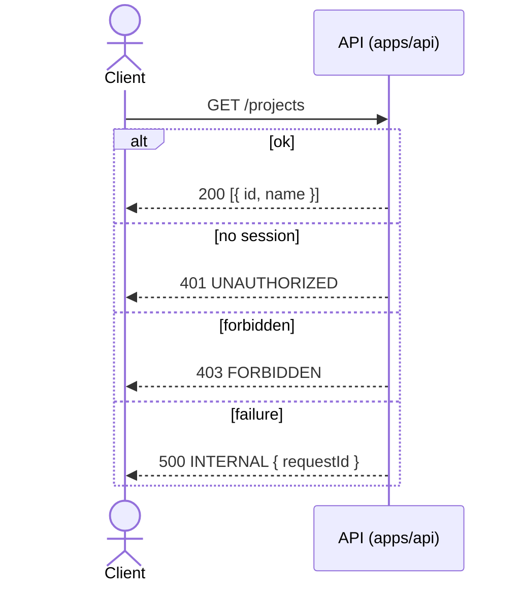
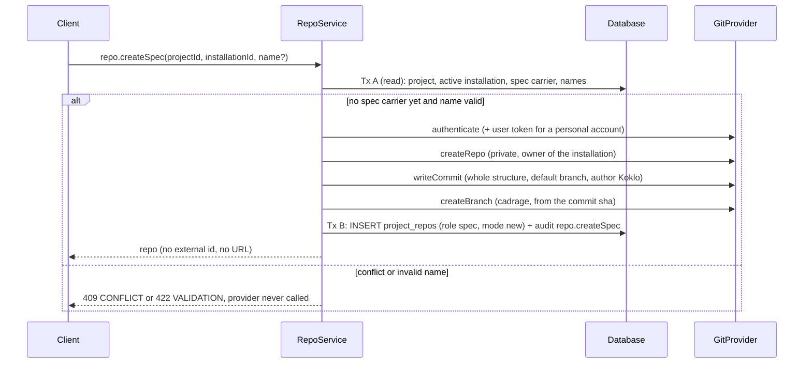
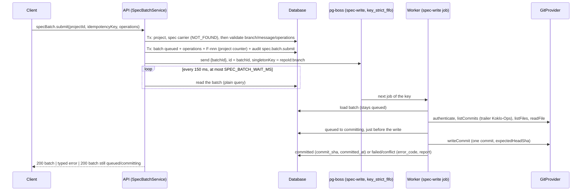

# API contract

The contract lives in `packages/contract` (`@koklo/contract`, tag `contract`). It is
written with oRPC v2 (`@orpc/contract`) and Zod; the OpenAPI document is generated from
it. `apps/api` (NestJS + `@orpc/nest`) implements it; see [ADR 0002](adr/0002-project-port-in-api.md).

## Exposed resources and operations

Contract version **0.5.0** (TK-42). The router shape is
`{ health, organization, member, project, ticket, dependency, sprint, comment, projectState, lease, audit, installation, repo, spec, specBatch }`:
43 routes on 30 paths (8 from TK-21, 25 from TK-29, 10 from TK-42; see "Provider, spec and feature batches (TK-42)"). Method and path are explicit on every
route, via the `route(method, path)` helper (`src/route-helpers.ts`, wrapping
`.meta(openapi({ method, path }))`) used by `src/contract.ts`, `src/contract-tickets.ts` and
`src/contract-collaboration.ts`.

| Operation | Method | Path | Auth | Typed errors (besides `INTERNAL`) |
|-----------|--------|------|------|-----------------------------------|
| `health` | GET | `/health` | none (public) | none |
| `organization.create` | POST | `/organizations` | session | `UNAUTHORIZED`, `CONFLICT` |
| `organization.list` | GET | `/organizations` | session | `UNAUTHORIZED` |
| `member.invite` | POST | `/members/invitations` | session + active organization | `UNAUTHORIZED`, `FORBIDDEN`, `CONFLICT` |
| `member.list` | GET | `/members` | session + active organization | `UNAUTHORIZED` |
| `member.setRole` | PATCH | `/members/{memberId}/role` | session + active organization | `UNAUTHORIZED`, `FORBIDDEN`, `NOT_FOUND`, `CONFLICT` |
| `project.list` | GET | `/projects` | session + active organization | `UNAUTHORIZED`, `FORBIDDEN` |
| `project.create` | POST | `/projects` | session + active organization | `UNAUTHORIZED`, `FORBIDDEN` |

The six TK-21 routes are implemented in `apps/api` (TK-23). Of the 25 TK-29 routes, the 15
ticket, dependency and sprint ones are implemented since TK-30 (see
[Tickets, dependencies and sprints (TK-30)](#tickets-dependencies-and-sprints-tk-30)); the
lease and project-state ones since TK-31 (see [Leases and project state (TK-31)](#leases-and-project-state-tk-31));
the comment and audit ones since TK-32 (see [Comments and audit log (TK-32)](#comments-and-audit-log-tk-32)). The
organisation and the project always come from the session or the server, never from the input;
a resource of another project is `NOT_FOUND` (no leak). The contract does not carry roles:
the matrix is enforced and tested in `apps/api`. "Manage" below means owner, admin, dev,
designer; "read" is open to every role (client for its own project, business). The column is
the contract's intent; the matrix actually enforced is in the TK-30 and TK-31 sections
(`ticket.delete` is currently open to every manager role, not only owner and admin).

| Operation | Method | Path | Roles (intent) | Typed errors (besides `INTERNAL`, `UNAUTHORIZED`) |
|-----------|--------|------|--------------------|---------------------------------------------------|
| `ticket.create` | POST | `/tickets` | manage | `FORBIDDEN`, `VALIDATION`, `CONFLICT` |
| `ticket.get` | GET | `/tickets/{key}` | read | `NOT_FOUND` |
| `ticket.list` | GET | `/tickets` | read | none |
| `ticket.update` | PATCH | `/tickets/{key}` | manage | `FORBIDDEN`, `NOT_FOUND`, `VALIDATION` |
| `ticket.delete` | DELETE | `/tickets/{key}` | owner, admin | `FORBIDDEN`, `NOT_FOUND`, `CONFLICT` |
| `ticket.transition` | POST | `/tickets/{key}/transition` | manage (agents and runners by token scope) | `FORBIDDEN`, `NOT_FOUND`, `CONFLICT`, `INVALID_TRANSITION` |
| `dependency.add` | POST | `/tickets/{key}/dependencies` | manage | `FORBIDDEN`, `NOT_FOUND`, `DEPENDENCY_CYCLE` |
| `dependency.remove` | DELETE | `/tickets/{key}/dependencies/{dependsOn}` | manage | `FORBIDDEN`, `NOT_FOUND` |
| `dependency.list` | GET | `/tickets/{key}/dependencies` | read | `NOT_FOUND` |
| `sprint.create` | POST | `/sprints` | manage | `FORBIDDEN`, `VALIDATION`, `CONFLICT` |
| `sprint.get` | GET | `/sprints/{key}` | read | `NOT_FOUND` |
| `sprint.list` | GET | `/sprints` | read | none |
| `sprint.update` | PATCH | `/sprints/{key}` | manage | `FORBIDDEN`, `NOT_FOUND`, `VALIDATION` |
| `sprint.activate` | POST | `/sprints/{key}/activate` | manage | `FORBIDDEN`, `NOT_FOUND`, `CONFLICT` |
| `sprint.close` | POST | `/sprints/{key}/close` | manage | `FORBIDDEN`, `NOT_FOUND`, `CONFLICT` |
| `comment.create` | POST | `/comments` | owner, admin, dev, designer, client; agents by token | `FORBIDDEN` |
| `comment.list` | GET | `/comments` | read | none |
| `comment.delete` | DELETE | `/comments/{id}` | author, owner, admin | `FORBIDDEN`, `NOT_FOUND` |
| `projectState.get` | GET | `/project-state` | owner, admin, dev (enforced since TK-31) | none (the `FORBIDDEN` 403 is not typed in the contract) |
| `projectState.update` | PUT | `/project-state` | owner, admin | `FORBIDDEN`, `VERSION_CONFLICT` |
| `lease.acquire` | POST | `/tickets/{key}/lease` | owner, admin, dev | `FORBIDDEN`, `NOT_FOUND`, `LEASE_HELD` |
| `lease.heartbeat` | POST | `/tickets/{key}/lease/heartbeat` | manage, then holder only | `NOT_FOUND`, `LEASE_NOT_HOLDER`, `LEASE_EXPIRED` |
| `lease.release` | DELETE | `/tickets/{key}/lease` | manage, then holder only (no force mechanism in the contract) | `NOT_FOUND`, `LEASE_NOT_HOLDER` |
| `lease.get` | GET | `/tickets/{key}/lease` | read | `NOT_FOUND` |
| `audit.list` | GET | `/audit` | owner, admin | `FORBIDDEN` |

`audit` is read-only: the log is immutable (CDC §4.2) and fed by the server. There is no
`lock.*` group: the **merge and spec-write locks are not delivered on the API side** (no `locks`
table, no procedure in contract 0.4.0). Delivering them needs a database migration and a
contract 0.5.0; a follow-up ticket is to be created.

## Tickets, dependencies and sprints (TK-30)
Modules `ticket/`, `sprint/` and `tracker/` (shared bricks) in `apps/api`, a NestJS adapter on top
of `@koklo/domain` (a runtime dependency since TK-30): the domain decides (lifecycle table H1,
dependency graph, validation), the API orchestrates and persists. The contract is unchanged (0.4.0).

Each use case runs in **one Prisma transaction** under `withOrganization`
(`tracker/project-transactions.ts`): the project is checked to belong to the organization
(`NOT_FOUND` otherwise), then read, write, key counter (`TK-n`, `SP-n`, `tracker/counters.ts`)
and `audit_log` row (`tracker/audit.ts`) commit or roll back together.

| Procedure | Behaviour |
|-----------|-----------|
| `ticket.create` | Domain validation; `pkg:*` labels rejected (`VALIDATION`, field `labels`, rule `assertNoPackageLabel` of `@koklo/domain`); `sprintId` must be a planned or active sprint of the project; key from the counter; criteria stored with 1-based positions |
| `ticket.get` | Detail with criteria, dependencies and active lease; `lease.worktree` is `""` unless the caller's role is in `TICKET_WRITE_ROLES` (owner, admin, dev, designer; deny by default, also without role) |
| `ticket.list` | Filters `status`, `sprintId`, `pkg`, `assignee` (`kind:id` or bare id); order `(createdAt, id)`; cursor pagination; **an invalid cursor is ignored** (first page) because the contract declares no `VALIDATION` error on this route |
| `ticket.update` | Merged state validated by the domain, then only the provided fields are written; a provided `labels` or `linkedFeatures` list replaces the stored one |
| `ticket.delete` | Soft delete; `CONFLICT ticket_has_active_lease` while a lease is held |
| `ticket.transition` | Table H1, then CDC §7.2 for `todo -> in_progress`: every `blocks` dependency must be `done`, otherwise `INVALID_TRANSITION { from, to }` |
| `dependency.add` / `remove` / `list` | Cycle detection on the project graph (`DEPENDENCY_CYCLE`); re-adding an identical edge is an idempotent no-op (no write, no audit); removing an absent edge is `NOT_FOUND` |
| `sprint.create` / `update` | `endsOn >= startsOn` (`VALIDATION`, also when only one date changes); `SP-n` from the counter |
| `sprint.activate` / `close` | `planned -> active -> closed`, no reopening. One active sprint per project: pre-check plus the partial unique index; a concurrent loser (`P2002`) becomes `CONFLICT sprint_already_active` |

### Current project (v1)
Neither the session nor the contract carries a project, so `PROJECT_CONTEXT`
(`project/project-context.ts`) resolves it: `OldestProjectContext` returns the oldest project of
the session organization (`createdAt`, then `id`); an organization without project gives
`NOT_FOUND`. The value never comes from the client. An explicit project selection will replace
this class without touching the services. Every read and write is filtered by this `projectId`.

### Permission matrix (TK-30)
Single source of the write roles: `TICKET_WRITE_ROLES` in `apps/api/src/auth/roles.ts` (owner,
admin, dev, designer), checked by `apps/api/test/ticket-roles-consistency.test.ts`. The role is
re-read from `members` on every request (`RoleGuard`).

| Procedure | owner | admin | dev | designer | client | business |
|-----------|:-----:|:-----:|:---:|:--------:|:------:|:--------:|
| `ticket.get`, `ticket.list`, `dependency.list`, `sprint.get`, `sprint.list` | yes | yes | yes | yes | yes | yes |
| `ticket.create`, `update`, `delete`, `transition` | yes | yes | yes | yes | no | no |
| `dependency.add`, `dependency.remove` | yes | yes | yes | yes | no | no |
| `sprint.create`, `update`, `activate`, `close` | yes | yes | yes | yes | no | no |

401 without session or active organization, 403 for a role marked "no".

### Known limits and debt (TK-30)
- **No composite foreign key from child rows to the ticket (TK-28 debt).** `ticket_labels`,
  `ticket_features`, `acceptance_criteria` and `ticket_dependencies` reference the ticket by id
  only, so the database does not forbid a child row pointing to a ticket of another project or
  organization. This is covered by the application safety net only: every child write goes
  through `assertOwned` (ticket in the organization AND the current project), every read filters
  by `projectId`, and child rows are written through model operations (not nested writes) so the
  tenant extension applies. To harden later with composite keys `(id, project_id)`; a follow-up
  ticket should track it.
- The `pkg:*` label rule is domain logic (`assertNoPackageLabel` in
  `packages/domain/src/ticket-package.ts`), raised as `InvalidTicketError` and mapped to
  `VALIDATION`.
- `ticket.delete` is allowed to every manager role, while the contract intent says owner and
  admin only; to be arbitrated by the product owner.

## Inputs, outputs and error shapes

Schemas are in `packages/contract/src/schemas.ts`:

| Operation | Input | Output |
|-----------|-------|--------|
| `health` | `{}` | `{ status: "ok", version: string }` |
| `organization.create` | `{ name: 1..100, slug?: 2..48, [a-z0-9-] }` | `{ id: uuid, name, slug }` |
| `organization.list` | none | array of `{ id, name, slug, role }` (caller's own role) |
| `member.invite` | `{ email, role: MemberRole }` | `{ id, email, role, status: "pending", expiresAt: ISO datetime }` |
| `member.list` | none | array of `{ id, userId, name, email, role }` |
| `member.setRole` | `{ memberId: uuid, role: MemberRole }` (`memberId` in the path) | `{ id, role: MemberRole }` |
| `project.list` | none | array of `{ id, name }` |
| `project.create` | `{ name: 1..100 }` | `{ id, name }` |

TK-29 schemas live in `src/schemas-tickets.ts` (tickets, dependencies, sprints) and
`src/schemas-collaboration.ts` (comments, project state, leases, audit), re-exported by
`src/schemas.ts`. Enum values are the literals of `@koklo/domain`; the contract cannot
depend on the domain (`turbo boundaries`), so the parity is tested in
`apps/api/test/contract-domain-parity.test.ts`.

| Schema | Shape |
|--------|-------|
| `ticketKeySchema`, `sprintKeySchema` | `TK-n`, `SP-n` (`n >= 1`, no leading zero): public identifiers in paths |
| `instantSchema` | ISO-8601 UTC datetime; sprint dates are `YYYY-MM-DD` |
| `ticketSchema` | domain `Ticket` + `id` (uuid): `key, title, description, type, status, priority, sprint (SP-n or null), assignee (string or null), pkg (one of 15), labels, sensitivity, estimateHours (>= 0 or null), linkedFeatures, branch, pullRequest, attempts, reviewRounds, createdAt` |
| `ticketDetailSchema` | `ticketSchema` + `criteria [{ statement, specRef or null }]`, `dependencies`, `lease` (active or null) |
| `ticket.create` input | `title 1..200, type, priority, pkg, sensitivity` required; `description, status (backlog or todo), sprintId, assignee {kind member or runner, id}, labels, estimateHours, linkedFeatures, criteria` optional |
| `ticket.update` input | `key` + any editable field; **strict**: `status` is rejected (use `ticket.transition`) |
| `dependency.add` input | `{ key, dependsOn, type: blocks or related }`; `dependsOn === key` rejected |
| `sprintSchema` | `{ id, key, goal, status: planned, active or closed, startsOn, endsOn, definitionOfDone }`; `endsOn >= startsOn` (create, and update when both given); update is strict (no `status`) |
| `commentSchema` | `{ id, targetKind: ticket, feature, screen or change_request, targetId, authorKind: human, agent, client or system, authorId, body, createdAt }`; body 1..8000 on create; the author is never read from the input |
| `projectStateSchema` | `{ version >= 1, content: object }`; `projectState.update` takes `{ expectedVersion >= 1, content }` (full replacement) |
| `leaseSchema` | domain `Lease`: `ticket, holder {kind member or runner, id}, branch, worktree, acquiredAt, heartbeatAt, expiresAt, ttlMs > 0, released`; `lease.acquire` takes `{ key, branch, worktree, ttlMs? }`, the holder comes from the token; `lease.get` returns a lease or `null` |
| `auditEntrySchema` | `{ id, actorKind: human, agent, runner or system, actorId?, tokenId?, action, targetKind, targetId, ticketKey?, occurredAt }` |

Pagination (`ticket.list`, `comment.list`, `audit.list`): cursor-based, input `limit`
(1..100, coerced from the query string) and `cursor`, output `{ items, nextCursor: string or null }`.
`sprint.list` and `dependency.list` are not paginated (bounded volume).

Roles (CDC §14): `Role` = `owner | admin | dev | designer | client | business`;
`MemberRole` = `Role` without `owner`. `owner` can never be granted by invitation or role
change. TypeScript types are exported from the package index (`Role`, `MemberRole`,
`OrganizationCreateInput`, `MemberInviteInput`, `ProjectCreateInput` and the outputs).
Pagination and filtering: none defined (ASSUMPTION: to be added by a later ticket).

Typed errors are declared in the contract (`src/errors.ts`); each route exposes only the
ones it lists:

| Code | HTTP status | Data | Meaning |
|------|-------------|------|---------|
| `INTERNAL` | 500 | `{ requestId: string }` | every route |
| `UNAUTHORIZED` | 401 | none | no or expired session |
| `FORBIDDEN` | 403 | none | role not allowed for the action (see below) |
| `NOT_FOUND` | 404 | none | `member.setRole`: member absent from the active organization; TK-29 routes: ticket, sprint, comment, dependency or lease unknown or in another project |
| `CONFLICT` | 409 | `{ reason }` | state conflict |
| `INVALID_TRANSITION` | 409 | `{ from, to }` | `ticket.transition`: refused by the lifecycle table (`InvalidTicketTransitionError`) |
| `DEPENDENCY_CYCLE` | 409 | `{ path: TK-n[] }` | `dependency.add` (`DependencyCycleError`) |
| `VERSION_CONFLICT` | 409 | `{ expected, current: { version, content } }` | `projectState.update`: refused with the current state (`StaleProjectStateError`) |
| `LEASE_HELD` | 409 | `{ ticket, holder, expiresAt }` | `lease.acquire` (`LeaseAlreadyHeldError`) |
| `LEASE_EXPIRED` | 409 | `{ ticket, expiresAt }` | `lease.heartbeat` (`LeaseExpiredError`) |
| `LEASE_NOT_HOLDER` | 403 | `{ ticket, holder }` | `lease.heartbeat`, `lease.release`; `holder` is the actual holder (`LeaseNotHeldByError`) |
| `VALIDATION` | 422 | `{ field, message }` | `ticket.create/update`, `sprint.create/update`: semantically invalid input (`InvalidTicketError`, `TicketPackageError`, `InvalidSensitivityError`) |

`CONFLICT.data.reason` is one of: `slug_taken` (`organization.create`), `already_member`
and `already_invited` (`member.invite`), `last_owner` (`member.setRole`: would leave the
organization without owner), and since 0.4.0 `sprint_already_active`, `sprint_not_planned`,
`sprint_not_active` (`sprint.activate`/`close`, and `sprint.create`), `ticket_has_active_lease`
(`ticket.delete`) and `counter_limit_reached` (`ticket.create`, `ticket.transition`); the
extension is backward compatible (values added). In the generated OpenAPI, the `INTERNAL`
payload is the component schema `Internal`; the new payloads are `InvalidTransition`,
`DependencyCycle`, `VersionConflict`, `LeaseHeld`, `LeaseExpired`, `LeaseNotHolder` and
`Validation`.

Decisions taken in TK-29 (to confirm at implementation, TK-30 to TK-32): `ticket.transition`
does not expose `LEASE_NOT_HOLDER` (the contract does not force a lease for a transition);
the audit log is readable by owner and admin only (loosening it is not a breaking change).

Roles allowed per action (to enforce in TK-23): `member.invite` and `member.setRole` are
reserved to `owner`/`admin` (otherwise `FORBIDDEN`); `project.create` to the roles the CDC
allows to create projects (otherwise `FORBIDDEN`).

## Leases and project state (TK-31)
Modules `lease/` and `project-state/` in `apps/api`, same hexagonal shape as TK-30 (controller,
service, repository port, Prisma adapter, one `ProjectTransactions` transaction and one
`audit_log` row per write). The contract is unchanged (0.4.0). The domain decides (holder,
expiry, version rule: `acquireLease`, `heartbeat`, `release`, `writeProjectState`); domain errors
become typed errors through `tracker/api-errors.ts`.

**Injected clock.** `CLOCK` (`clock.ts`, global `ClockModule`) is the only source of time for a
decision: lease expiry, "active lease" filters of `ticket.get`/`ticket.delete`. Neither
`Date.now()` nor SQL `now()` decides anywhere; tests replace it with `overrideProvider(CLOCK)`.

| Constant (`auth/roles.ts`) | Roles | Used by |
|----------------------------|-------|---------|
| `LEASE_ACQUIRE_ROLES` | owner, admin, dev | `lease.acquire` |
| `TICKET_WRITE_ROLES` | owner, admin, dev, designer | `lease.heartbeat`, `lease.release` (then the holder only, else `LEASE_NOT_HOLDER`) |
| `PROJECT_STATE_READ_ROLES` | owner, admin, dev | `projectState.get` |
| `PROJECT_STATE_WRITE_ROLES` | owner, admin | `projectState.update` |

`lease.get` is open to every role; `canSeeWorktree(role)` (true for `TICKET_WRITE_ROLES`) masks
`worktree` as `""` for the others, in `lease.get` and `ticket.get` alike. A role outside
`PROJECT_STATE_READ_ROLES` gets a 403 on `projectState.get` that is **not typed** in the contract
(the route declares no `FORBIDDEN`); the client sees a generic forbidden response.

| Procedure | Behaviour |
|-----------|-----------|
| `lease.acquire` | Expired leases of the ticket are marked released in the same transaction, then the domain checks, then INSERT. A race lost on the partial unique index (`P2002`) rolls back and a second transaction reads the winner: `LEASE_HELD` |
| `lease.heartbeat` | Domain extends the lease; persisted by a conditional UPDATE (not released, not expired). No active lease: `LEASE_EXPIRED` if the ticket ever had one, else `NOT_FOUND` |
| `lease.release` | Holder only (`LEASE_NOT_HOLDER`); conditional UPDATE. **No one can force a release**: the contract has no such mechanism, so owner and admin are not exempt |
| `lease.get` | Active lease or `null` |
| `projectState.get` | Row created on demand (`{ version: 1, content: {} }`) with `createMany skipDuplicates` (no `P2002`) |
| `projectState.update` | Domain version rule, then `UPDATE ... WHERE version = expected`; zero rows means a concurrent write won: re-read and `VERSION_CONFLICT` |

## Implementation of the six procedures (TK-23)
| Procedure | Controller guards | Behaviour |
|-----------|-------------------|-----------|
| `organization.create` | `UserSessionGuard` | Slug checked (`slug_taken`) or derived from the name with a numeric suffix; creation through Better Auth `createOrganization` (caller becomes `owner`, organization becomes active on the session) |
| `organization.list` | `UserSessionGuard` | Organizations the caller belongs to, with the caller's role |
| `member.list` | `SessionGuard` | Members of the session organization |
| `member.invite` | `SessionGuard`, `RoleGuard` | `already_member` / `already_invited` checks, then Better Auth `createInvitation`; its callback enqueues the email job |
| `member.setRole` | `SessionGuard`, `RoleGuard` | Serializable transaction: `NOT_FOUND`, H3, `last_owner` |
| `project.create` | `SessionGuard`, `RoleGuard` | Project created under the session organization |

`NOT_FOUND` is identical for an unknown member and a member of another organization.
Every organization value comes from the session, never from the input. The role check runs
before input validation (403 before 400).

### Permission matrix (CDC §14)
`RoleGuard` reads the role from `members` on every request. Single source of the manager
roles: `MANAGER_ROLES` in `apps/api/src/auth/roles.ts`, used by the `@Roles` decorators; the
Better Auth access-control table in the same file is its echo, and
`apps/api/test/roles-consistency.test.ts` fails if the two, or the contract's `roleSchema`,
drift apart.

| Procedure | owner | admin | dev | designer | client | business |
|-----------|:-----:|:-----:|:---:|:--------:|:------:|:--------:|
| `organization.create`, `organization.list` | yes | yes | yes | yes | yes | yes |
| `member.list` | yes | yes | yes | yes | yes | yes |
| `member.invite` | yes | yes | no | no | no | no |
| `member.setRole` | yes | yes | no | no | no | no |
| `project.create` | yes | yes | no | no | no | no |

`organization.*` needs a session only (any user; no role). Others: 401 without session or
active organization, 403 for a role marked "no".

### Web consumer (TK-24)
`apps/web` calls these procedures; the contract is unchanged. Roles are shown from `organization.list`
(`role` of the active organization); the UI hides what the matrix forbids, the API stays the authority.

| Screen | Procedure | Error handling in the UI |
|--------|-----------|--------------------------|
| `/organizations` | `organization.list`, `organization.create` | `CONFLICT slug_taken` shown under "Identifiant"; other errors in an alert; `UNAUTHORIZED` re-checks the session (no session: `/login`; session: `/organizations`) |
| `/members` | `member.list`, `member.invite` | `CONFLICT already_member` / `already_invited` under "Adresse e-mail"; `FORBIDDEN` as a message; other errors in an alert |
| `/projects` | `project.list`, `project.create` | `FORBIDDEN` as a message; other errors in an alert |

Organization activation is not an oRPC procedure: the web calls the Better Auth client
`organization.setActive` (`/api/auth/*`). `member.setRole` has no screen yet.

### Hypotheses to validate (product owner)
- **H1 (to validate)**: `project.create` is owner and admin only. The CDC has no "create a
  project" row; the cautious option was kept (TK-21 had assumed dev as well). Opening it to
  `dev` later is backward compatible, the reverse is not.
- **H2 (to validate)**: any member can list members.
- **H3 (to validate)**: only an `owner` changes the role of an `owner` or grants `admin`
  (invitation included); otherwise 403. `owner` is never assignable.

### Out of scope
The invitation acceptance page and the `acceptInvitation` call (web, follow-up ticket): TK-23
creates the invitation and enqueues the email, whose link is `<BETTER_AUTH_URL>/accept-invitation/<id>`.
Ownership transfer and member removal are not in the contract.

As of TK-86 the page exists: `apps/web/src/app/accept-invitation/[id]` calls the Better Auth client
`organization.getInvitation` (preview, recipient only) then `organization.acceptInvitation` (explicit click).
No oRPC procedure was added; without a session the proxy redirects to `/login?next=/accept-invitation/<id>`.

### Known limits
- Invitation acceptance (TK-86): Better Auth returns a single `INVITATION_NOT_FOUND` (400) for an
  unknown, expired, canceled or already accepted invitation, so the web shows one message naming the
  possible causes. For a user who is **already a member**, `acceptInvitation` answers **500** with no
  body (API log: Prisma `P2002` on `members_organization_id_user_id_key`); the invitation stays
  `pending` and the existing member is untouched (no duplicate). The web avoids the call by checking
  `organization.list` first (and again after a 5xx) and shows "Vous faites déjà partie de cette
  organisation". Another client calling the endpoint directly still gets the 500 (logged as ERROR).
- No pending-invitation list and no resend or cancel procedure: the web cannot show `already_invited`
  before the error, nor resend an email (TK-24 observation; see also the limits below).
- Better Auth swallows errors of `sendInvitationEmail`: if pg-boss fails, the invitation
  exists without an email and the response is still 200. The failure is logged
  (`enqueue failed`, queue and error name only) and sent to Sentry; there is no resend
  procedure yet.
- A concurrent `setRole` race on the last owner can abort the Serializable transaction and
  return `INTERNAL` (500) instead of `CONFLICT last_owner`. The organization is never left
  without an owner.

## Authentication and authorization
`project.list` requires a session (TK-11, [ADR 0003](adr/0003-better-auth-session-guard.md)).
`apps/api` mounts Better Auth on `/api/auth/*` (GitHub OAuth sign-in and callback, sign-out);
these routes belong to Better Auth, not to the oRPC contract. The session is a signed Better
Auth cookie.

Three guards (TK-23, [architecture.md](architecture.md#organizations-members-and-roles-tk-23)): `UserSessionGuard` (session only), `SessionGuard` (active organization) and `RoleGuard` (`@Roles`). A per-procedure Nest guard (`SessionGuard`, `@UseGuards` on `ProjectController.list`; not
global) resolves the session before the service runs. The request is refused with the typed
`UNAUTHORIZED` error (401, body `{ code, status, message, ... }`) when:

- there is no cookie, or it is unknown, forged or expired;
- the session has no active organization;
- the user is not a member of the active organization (checked in the `member` table).

The organization used for the query comes only from the resolved session
(`SessionOrganizationContext`); an organization sent by the client (header, query, body) is
ignored. `FORBIDDEN` is emitted by `RoleGuard` (TK-23). The repository port has no "list
everything" method: every read is filtered by `organizationId`. The Prisma tenant-filter
extension of CDC §18.4 does not exist yet.

Test session (e2e only): when `APP_ENV=test`, the header
`x-test-session: <userId>:<organizationId>` is accepted (exactly two non-empty segments,
otherwise 401). In any other `APP_ENV` the test resolver is not registered and the header
is ignored.

`GET /health` and `GET /openapi.json` are public. When the database does not answer within 2 s, `/health` returns `INTERNAL` (500) with `requestId` (`x-request-id` if given, otherwise a UUID); no connection detail is exposed.

## OpenAPI generation
`generateOpenApi()` (`src/openapi.ts`) is pure (no I/O) and returns an OpenAPI 3.1.0
document titled `Koklo API`, whose `info.version` is `CONTRACT_VERSION`
(`src/version.ts`). Object keys are sorted recursively so the output is deterministic.
Error statuses are derived from the contract's own error maps (the router tree is walked,
no list of procedures to maintain), not written twice.

| Artifact | Role |
|----------|------|
| `packages/contract/openapi/openapi.json` | Reference document, committed |
| `packages/contract/openapi/versions.json` | Map `version → sha256` of the document |
| `packages/contract/scripts/generate-openapi.ts` | Writes both files (`pnpm --filter @koklo/contract openapi:generate`) |

## Compatibility and breaking changes
The OpenAPI document must not change without a version change (TK-9 acceptance
criterion). Contract tests (`packages/contract/test/contract.test.ts`) fail when:

- the generated document differs from `openapi/openapi.json`;
- `info.version` differs from `version` in `package.json`;
- the sha256 of the generated document differs from the entry for the current version
  in `openapi/versions.json`.

To change the contract: bump the version in `package.json` **and** `src/version.ts`, run
`pnpm --filter @koklo/contract openapi:generate`, commit the regenerated files.
`versions.json` only gains lines. Deprecation window and migration policy: TO DOCUMENT.

oRPC packages are pinned to `2.0.0-beta.46`: it is the only published line offering
`.meta(openapi(...))` (stable 1.16.1 uses `.route()`). Replace with 2.0 stable on release.

## Comments and audit log (TK-32)
Modules `comment/` and `audit/` in `apps/api`, same hexagonal shape as TK-31. The contract is
unchanged (0.4.0). `comment.create` and `comment.delete` write their `audit_log` row
(`comment.create`, `comment.delete`, target kind `comment`, `ticket_id` = the commented ticket)
in the same transaction as the write. Roles live in `auth/roles.ts`: `COMMENT_WRITE_ROLES`
(owner, admin, dev, designer, client), `COMMENT_DELETE_ANY_ROLES` (owner, admin),
`AUDIT_READ_ROLES` (owner, admin).

| Route | Rule |
|---|---|
| `comment.create` | owner, admin, dev, designer, client (business is read-only: `FORBIDDEN`). The author comes from the session, never from the input: `client` writes as `authorKind: client`, the others as `human`, `authorId` is the user id. Body 1..8000 characters, stored as is (untrusted data). A body refused by the contract schema is returned as `VALIDATION` (422), see "Schema refusals" below |
| `comment.list` | every role. Oldest first, cursor on `(createdAt, id)`; deleted comments are hidden. A row with a NULL `author_id` (system comment) is served with `authorId: "system"` |
| `comment.delete` | the author, or owner and admin for any comment. Soft delete (`deleted_at` set from `CLOCK`); the row stays. Membership of the project is checked before the right: unknown, already deleted or foreign comment is `NOT_FOUND`, another author's comment is `FORBIDDEN` |
| `audit.list` | owner and admin only. Newest first, cursor on `(occurredAt, id)`. Filters combined with AND: `ticketKey` (unknown key: empty page), `actorKind`, `action` (exact), `from` (included), `to` (excluded). Null fields are omitted, `ticketKey` is resolved even for a soft-deleted ticket, the comment body is never exposed |

Target validation (done by the API; since 0.5.0 the contract types `targetId` as `z.uuid()`): only
`targetKind: ticket` is accepted (`VALIDATION{targetKind}` otherwise: features, screens and change
requests have no table); `targetId` must be a UUID (`VALIDATION{targetId}`); the ticket must exist,
not be deleted and belong to the current project (`NOT_FOUND`). Pagination: `limit` default 50,
maximum 100, a malformed cursor is `VALIDATION{cursor}`. These `VALIDATION`, `NOT_FOUND` and
`FORBIDDEN` errors are raised with the right HTTP status and, since 0.5.0, are typed in the OpenAPI
(with a nullable `authorId` and a `uuid` `targetId`; an enumerated audit `targetKind` stays open).

**Schema refusals (temporary interceptor).** The framework rejects an empty or over-long body, or a
`targetId` that is not a UUID, as `BAD_REQUEST` (400) even though 0.5.0 types `VALIDATION` on
`comment.create` and `comment.list`. The tests require 422, so `input-validation.ts` (an oRPC client interceptor registered in
`ORPCModule.forRoot`) converts it. Its scope is exactly the routes `POST /comments` and `GET /comments`, read from the
procedure's OpenAPI metadata; it converts only a `BAD_REQUEST` that carries schema `issues`
(field = first path segment, message = first issue) and passes every other error through
unchanged, so it hides nothing (organisation routes keep their 400). It is kept until a framework-level mapping of schema refusals to the typed `VALIDATION` exists.

**Shared bricks added by TK-32** (`tracker/`): `cursor.ts` (opaque base64url cursor on
`(sort key, id)`, `keysetAfter`, `pageOfItems`, default page size 50) now serves `ticket.list`,
`comment.list` and `audit.list`; `uuid.ts` (`isUuid`). A malformed cursor is `VALIDATION{cursor}` on
comments and audit, but still ignored on `ticket.list` (no typed error on that route).

**Typing corrections applied in 0.5.0**:
- `VALIDATION` and `NOT_FOUND` typed on `comment.create` and `comment.list`; `FORBIDDEN` typed on
  `comment.list` and `projectState.get` (`audit.list` already had it).
- `authorId` nullable (`null` for a system comment, empty string refused); `targetId` as
  `z.uuid()` on comments and audit entries.
- Still open: audit `targetKind` enumerated; explicit `projectId` instead of the oldest project
  on the historical routes.
- Open question: may the `client` role see comments written by agents? (Settled: `organization.create`,
  `member.invite`, `member.setRole` and `project.create` are journaled, see "Audit of organisation,
  member and project writes".)
- Only the `ticket` target is accepted for comments (no table for features, screens, change requests).

**Immutable log.** The only writer is `recordAudit` (`tracker/audit.ts`); the `audit` module only
calls `findMany`/`findFirst`, `/audit` has only `GET`, and the database triggers refuse `UPDATE`,
`DELETE` and `TRUNCATE`. A test derives every non-GET procedure of every group from the contract
(20 writes, no group excluded) and checks each one writes exactly one audit row.

**Audit of organisation, member and project writes (decision Q2: journaled).** `recordAudit` takes
an `AuditActor` (`{ organizationId, userId }`); a `ProjectScope` is one, and writes outside a
project pass the session's organisation and user. Actor is always `human` (session user), `ticket_id`
is NULL, `target_kind` is free text in the database (the TypeScript union gained `organization`,
`invitation`, `member`, `project`). No entry on refusal (403, 409).

| Procedure | action | targetKind / targetId | Entry's organisation | Atomicity |
|---|---|---|---|---|
| `project.create` | `project.create` | `project` / project id | session | same transaction as the insert |
| `member.setRole` | `member.setRole` | `member` / member id | session | same (Serializable) transaction as the update |
| `organization.create` | `organization.create` | `organization` / new organisation id | the NEW organisation | same transaction as the organisation and its `owner` member |
| `member.invite` | `member.invite` | `invitation` / invitation id | session | NOT atomic, see below |

`organization.create` no longer goes through Better Auth's `createOrganization`, which writes the
organisation and the member in separate, non-transactional statements and cannot join a caller's
transaction. The service inserts the organisation, the `owner` member (the plugin's `creatorRole`)
and the audit row in one Prisma transaction, then calls `auth.api.setActiveOrganization` to put the
organisation on the session. Slug conflicts still return `CONFLICT{slug_taken}` (pre-check, plus
re-check after a unique violation). Residual risk: if `setActiveOrganization` fails after the commit,
the organisation exists, is audited, and the call returns an error; the user is not locked out
(`organization.list` shows it, the session can select it) and retrying with the same name yields a
new suffixed slug. Better Auth hooks on the organisation model are bypassed (none configured).

`member.invite` stays on Better Auth's `createInvitation` (it also cancels earlier pending invitations
and hands the e-mail job to the worker through `sendInvitationEmail`; reimplementing that would
duplicate the plugin). Better Auth writes with its own client, so the audit cannot share its
transaction: `recordInvitation` writes the entry right after the invitation succeeds, before the
response. Compromise: if that insert fails (database outage between the two statements), the
invitation exists, its e-mail is queued, no audit row exists and the caller gets a 500. The window
is one statement; the failure is visible (500 and the request log), not silent. Reaching strict
atomicity would require owning the invitation write (a Prisma insert plus the queue) or a Better Auth
adapter transaction hook; neither is available in better-auth 1.7.14 for this endpoint.

## Sprint import (TK-34)
No new route and no contract change: the import is an administration command (`import:sprints`,
see [Quality and operations](quality-and-operations.md#sprint-import-command-importsprints-tk-34)),
absent from the OpenAPI document. It writes through the same ports, transactions and audit rows as
`ticket.*` and `sprint.*`, with three extra audit actions: `sprint.import`, `ticket.import` and
`dependency.import`. Imported tickets keep their `TK-n` keys, so the next `ticket.create` continues
after the highest imported number. The actor must be `owner` or `admin`, like the manager routes.

## Provider, spec and feature batches (TK-42)
Contract 0.5.0 adds four groups and 10 routes. `repo.*` is implemented since TK-43 (see "Repositories in the API (TK-43)") and `specBatch.*` since TK-44b (see "Spec batches in the API (TK-44b)"); `spec.*` follows in TK-45;
the new routes take an explicit `projectId` (path), the historical ones keep the implicit project.

| Operation | Method | Path | Notes |
|-----------|--------|------|-------|
| `installation.list` | GET | `/provider/installations` | owner/admin; no external id, `userAuthorization` is `absent`, `active` or `expired` |
| `installation.start` | POST | `/provider/installations/start` | optional `installationId` (user re-authorization); returns `{ url, expiresAt }`, the signed one-shot `state` lives inside the URL |
| `repo.list` | GET | `/projects/{projectId}/repos` | |
| `repo.link` | POST | `/projects/{projectId}/repos` | links an existing repository (`mode: adopted`), also the manual fallback of ADR 0009 |
| `repo.createSpec` | POST | `/projects/{projectId}/spec-repo` | always private, no visibility input |
| `spec.head` | GET | `/projects/{projectId}/spec` | `branch` or `commitSha`, never both; `null` while the branch is not indexed |
| `spec.listFeatures` | GET | `/projects/{projectId}/spec/features` | filters `status`, `priority`; paginated |
| `spec.getFeature` | GET | `/projects/{projectId}/spec/features/{specId}` | description and steps are read from git at the indexed commit |
| `specBatch.submit` | POST | `/projects/{projectId}/spec/batches` | idempotent, 1 to 50 operations, all or nothing |
| `specBatch.get` | GET | `/projects/{projectId}/spec/batches/{batchId}` | status, `commitSha`, `report`, per-operation `results` |

Operations are a union on `kind`: `feature.create` (the `F-nnn` is assigned by the server and
returned in `results`), `feature.update` (partial patch, at least one field, `criteria` replaced
as a whole) and `feature.delete`. Tables, endpoints and screens are out of 0.5.0. The author and
the commit trailers come from the session, never from the input.

The GitHub callback (`/api/github/callback`, `/api/github/installed`) is a browser redirect, not
an oRPC procedure and absent from the OpenAPI document; the contract only exports
`installationCallbackQuerySchema` and `installationCallbackOutcomeSchema` for the API and the web.

New typed errors: `REPO_CREATION_FORBIDDEN` (403, `{ reason, ownerLogin, ownerKind }`) and
`USER_TOKEN_REQUIRED` (403, `{ ownerLogin }`) on `repo.createSpec`; `PROVIDER_AUTH_EXPIRED` (403,
`{ kind, refreshable }`), `PROVIDER_RATE_LIMITED` (429, `{ retryAfterMs? }`) and
`PROVIDER_UNAVAILABLE` (503) on `repo.link`, `repo.createSpec`, `spec.getFeature` and
`specBatch.submit`; `SPEC_BATCH_CONFLICT` (409, `{ reason, batchId? }`) and `SPEC_INVALID` (422,
`{ report }`, at most 100 issues) on `specBatch.submit`. `CONFLICT.reason` gains `spec_repo_exists`,
`repo_already_linked` and `repo_name_taken`. OpenAPI components: `RepoCreationForbidden`,
`UserTokenRequired`, `ProviderAuthExpired`, `ProviderRateLimited`, `ProviderUnavailable`,
`SpecBatchConflict`, `SpecInvalid`.

### Role matrix (vision section 14), enforced per procedure (`repo.*` since TK-43, `specBatch.*` since TK-44b)
The contract cannot enforce roles; the API must, per procedure. "Own project" means the caller is a
member of the project and of the organization of the session.

| Procedure | Allowed roles |
|-----------|---------------|
| `installation.list`, `installation.start` | owner, admin |
| `repo.link`, `repo.createSpec` | owner, admin |
| `repo.list` | owner, admin, dev, designer |
| `spec.head`, `spec.listFeatures`, `spec.getFeature` | every role, within their own project |
| `specBatch.submit` | owner, admin, dev; designer only for design-related features, checked per operation by the API |
| `specBatch.get` | same roles as `specBatch.submit` |

`client` and `business` never write to the spec. A refused role returns `FORBIDDEN`.

### Membership rule (anti-IDOR), to enforce before any access
- Membership of the user in the project AND in the organization of the session is verified BEFORE
  any read or write. A non-member gets `NOT_FOUND`, never `FORBIDDEN`, so the existence of a
  project, repository, feature or batch is not disclosed.
- `repo.link` and `repo.createSpec`: the `installationId` must belong to the organization of the
  project. Otherwise `NOT_FOUND`.
- `specBatch.get`: the `batchId` must belong to the `projectId` of the path. Otherwise `NOT_FOUND`.
- Risk: identifiers are guessable or leaked, so skipping these checks is an IDOR (insecure direct
  object reference) giving cross-tenant access to installations, specs and batches.

### `installation.start` state requirement
The `state` embedded in the returned URL is the only CSRF guard, and the contract cannot impose it.
The API must make it signed (HMAC), bound to the user and to the organization of the session,
single-use and expiring (`expiresAt`). The callback rejects any state failing one of these checks.

### `criteria` on `feature.update`: numbering rule (decided in TK-44b)
`criteria` is replaced as a whole and carries no acceptance-criterion identifier. The worker renumbers
it with a fixed rule, see "Acceptance-criterion numbering" in "Spec batches in the API (TK-44b)". The
contract is unchanged.

**Secrets are never exposed.** No installation or user token, refresh token, app key, webhook
secret or external installation id appears in any input, output, error or the OpenAPI document;
tests scan the document for such property names. Enumerations (roles, modes, statuses, feature
status and priority, id patterns) are hard-coded copies kept in step with the domain, the
database and `@koklo/schema` by parity tests in `apps/api/test`, because the contract may not
import those packages.

## Repositories in the API (TK-43)
`repo.createSpec`, `repo.link` and `repo.list` are implemented in `apps/api/src/repo`. The contract
is unchanged (0.5.0). `installation.*` and its callbacks are not part of TK-43: installations are
inserted by seed or, later, by the installation webhook.

Roles: `repo.createSpec` and `repo.link` are `MANAGER_ROLES` (owner, admin); `repo.list` is
`REPO_READ_ROLES` (owner, admin, dev, designer). A refused role is `FORBIDDEN` for any project,
and it is checked before membership. The project must belong to the organization of the session
and the installation must be an `active` installation of that organization; otherwise `NOT_FOUND`,
before any call to the provider. A `suspended` or `deleted` installation is `NOT_FOUND` too.

Creating a project does not create its spec repository: the caller chains `project.create` then
`repo.createSpec` (the web does it in TK-48). A project without a repository is a valid state.

### `repo.createSpec` sequence
No network call ever happens inside a database transaction.

- The default name is `<project slug>-spec` (accents removed); a given `name` must match
  `^[A-Za-z0-9._-]{1,100}$`, not be `.` or `..` and not end with `.git`, else
  `VALIDATION{field: "name"}`. Visibility (always private) and owner (the installation's) never
  come from the client.
- The structure is `buildInitialSpecFiles` (vision annex A, section 4.0): manifest
  `koklo.project.yaml`, `README.md`, brief, architecture and technical skeletons, `domain/roles.yaml`,
  `data/relations.yaml`, `.koklo/rules.yaml` (minimal, its format is not defined yet) and a
  `.gitkeep` per empty directory. No example entity. It passes `checkSpec` without error.
- `external_id` of the row is the provider's `Repo.id` (a string), stable across renames.
- A personal account needs a user token (ADR 0009): `createRepo` alone uses it, commit and branch use
  an installation token. The API keeps no user token yet (`NoUserCredentials`), so a personal account
  gets `USER_TOKEN_REQUIRED` and falls back to `repo.link`.

### `repo.link`
Reads the repository with `getRepo` (installation token, no write), then inserts it in `mode: adopted`
with the provider's values (owner, name, default branch, external id) and the audit `repo.link` in
one transaction. `ownerLogin` must be the owner of the installation (else `NOT_FOUND`, compared
case-insensitively); a repository unknown to the installation is `NOT_FOUND`. `specPath` is allowed for
a non-`spec` role only, relative, without `..`, `.git`, empty segment or control character, the same rule the worker applies (else `VALIDATION{field: "specPath"}`). No structure
and no `cadrage` branch is created for an adopted repository.

### Errors
| Case | Response |
|------|----------|
| spec carrier already present (role `spec` or `spec_path`) | 409 `CONFLICT{spec_repo_exists}`, no provider call |
| repository already linked (`UNIQUE(installation_id, external_id)`) | 409 `CONFLICT{repo_already_linked}` |
| repository name taken at the provider (`createRepo`) | 409 `CONFLICT{repo_name_taken}` |
| `UserTokenRequiredError` | 403 `USER_TOKEN_REQUIRED{ownerLogin}` |
| `RepoCreationForbiddenError` | 403 `REPO_CREATION_FORBIDDEN{reason, ownerLogin, ownerKind}` |
| `GitAuthExpiredError` | 403 `PROVIDER_AUTH_EXPIRED{kind, refreshable}` |
| `GitRateLimitedError` | 429 `PROVIDER_RATE_LIMITED{retryAfterMs?}` |
| `GitProviderUnavailableError` | 503 `PROVIDER_UNAVAILABLE` |
| `GitNotFoundError` on `repo.link` | 404 `NOT_FOUND` |
| any other error, or a conflict/not-found on a repository just created | 500 `INTERNAL{requestId}` |

Provider errors are mapped by `instanceof`, never by `error.name` (enumerable, so forgeable). No
message of the provider, token or key reaches a response, the OpenAPI document, the audit log or the
logs.

### Partial failure
If `createRepo` succeeds and a later step fails (`writeCommit`, `createBranch`, or the database), the
repository stays at the provider (the port has no deletion) and nothing is stored: no row, no audit.
The log carries `owner/name` and the failed step, never a token. A new call with the default name gets
`repo_name_taken`. Recovery: give another `name`, or delete the repository by hand and retry, or
complete it by hand and attach it with `repo.link`.

### Provider not configured (staging without the App)
`GITHUB_APP_ID` and `GITHUB_APP_PRIVATE_KEY` are read as an all-or-nothing pair (an empty value counts
as missing). With neither, the API starts, logs one warning and `repo.createSpec` and `repo.link`
answer 503 `PROVIDER_UNAVAILABLE` after the access checks (`FORBIDDEN`, then `NOT_FOUND`);
`repo.list` works. With only those two (staging without client credentials) the provider is active:
organisation accounts work, and a personal account answers 403 `USER_TOKEN_REQUIRED` (no user-token
flow yet; fallback `repo.link`). `GITHUB_APP_CLIENT_ID` and `GITHUB_APP_CLIENT_SECRET` are optional,
all or nothing, and distinct from the sign-in OAuth pair `GITHUB_CLIENT_ID` / `GITHUB_CLIENT_SECRET`,
which the App configuration never reads. A single variable of a pair fails at startup, naming the
missing variable and never a value. The private key is accepted as the one-line base64 the infra stores
(`GH_APP_PRIVATE_KEY`) or as a PEM with literal `\n`. The fake provider is never selected by configuration, only injected by
tests through the `GIT_PROVIDER` token.

### Audit
`repo.createSpec` and `repo.link` write one entry (`targetKind: "repo"`, `targetId` the row id) in the
same transaction as the insert, so a failing audit rolls the insert back. `repo.list` is not audited.

## Spec batches in the API (TK-44b)
`specBatch.submit` and `specBatch.get` are implemented in `apps/api/src/spec-batch`; the write itself
is done by the `spec-write` job of `apps/worker`. The contract is unchanged (0.5.0). `spec.*` still
reads the database index and is TK-45: after a commit, `spec.head` lags until the push webhook rebuilds
the index, so a client compares `spec.head.commitSha` with the batch `commitSha`.

Roles: `SPEC_BATCH_ROLES` (owner, admin, dev, designer) on both procedures, checked before membership
(`client` and `business` get `FORBIDDEN`). The designer's limit is per operation and is applied by the
worker on the real state of the branch: a feature is "design-related" when its `ecrans` list is not empty
both before and after the operation (for a creation, in the operation itself); otherwise the batch ends
`failed` with `FORBIDDEN`. Project and organization membership, then the spec carrier of the project,
are verified before anything else (`NOT_FOUND`, never `FORBIDDEN`); `batchId` must belong to the
`projectId` of the path.

### `specBatch.submit` sequence
Nothing here calls the provider from the API, and no transaction stays open while waiting.

Order of the checks in `submit`: role guard, project and organization (`NOT_FOUND`), spec carrier
(`NOT_FOUND`), provider configured (`PROVIDER_UNAVAILABLE` 503, before any write), then validation
(`VALIDATION`), then idempotency, then the single transaction.

### Validation at the entry (`VALIDATION`, nothing stored)
| Field | Rule |
|-------|------|
| `branch` | omitted means `cadrage`; a valid git branch name (no `..`, no leading or trailing `/`, no `//`, no segment starting with `.` or ending with `.lock`, no space or `~^:?*[\\`); the default branch of the repository is refused (the spec evolves on a working branch) |
| `message` | one line (no CR, LF, NUL or Unicode line separator); it becomes the subject of the commit |
| `operations` | at most one operation per `specId` in a batch (`field: "operations"`) |

The batch, its operations (position starts at 1 in the database, `results[].position` starts at 0), the
`F-nnn` of the creations and the audit entry are written in ONE transaction. `F-nnn` come from the
`feature` counter of the project (never reused, a refused batch leaves a gap), so `results` carries them
while the batch is still `queued`, and a replay returns the same identifiers.

### Batch states
| Status | When | Fields |
|--------|------|--------|
| `queued` | inserted by `submit` | no `commitSha` |
| `committing` | the worker is about to call, or has called, `writeCommit` (the batch stays `queued` while the state is read) | no `commitSha`, even if the commit already exists at the provider (crash window, see Recovery) |
| `committed` | the commit is posted | `commitSha`, `committedAt` |
| `failed` | `SPEC_INVALID`, `FORBIDDEN`, `PROVIDER_UNAVAILABLE`, `PROVIDER_AUTH_EXPIRED`, `PROVIDER_RATE_LIMITED`, `INTERNAL` | `errorCode`; `report` for `SPEC_INVALID` |
| `conflict` | `stale_base`, `write_conflict` | `errorCode` is the reason |

`errorCode` is a closed list; it never holds a provider message or a token. The result lives in the batch:
`submit` waits at most `SPEC_BATCH_WAIT_MS` (default 8000, see `docs/quality-and-operations.md`) for a final
status, then answers 200 with the current batch (`queued` or `committing`) and the client polls
`specBatch.get`.

### Errors
| Final status of the batch | Response of `submit` (and of a replay) |
|---------------------------|----------------------------------------|
| `committed` | 200 batch |
| `queued` / `committing` after the wait | 200 batch (poll `specBatch.get`) |
| `failed` / `SPEC_INVALID` | 422 `SPEC_INVALID{report}` (new errors only, at most 100 issues, `truncated`) |
| `failed` / `FORBIDDEN` | 403 `FORBIDDEN` (designer outside design-related features) |
| `failed` / `PROVIDER_UNAVAILABLE`, `PROVIDER_RATE_LIMITED`, `PROVIDER_AUTH_EXPIRED` | 503, 429 `{}`, 403 `{kind: installation, refreshable: false}` |
| `failed` / `INTERNAL` | 500 `INTERNAL{requestId}` (inconsistent data or unknown outcome, never a typed error) |
| `conflict` / `stale_base` or `write_conflict` | 409 `SPEC_BATCH_CONFLICT{reason, batchId}` |
| same key, other content | 409 `SPEC_BATCH_CONFLICT{reason: idempotency_key_reused, batchId}` |

`stale_base`: `baseSha` differs from the head of the branch. `write_conflict`: an `update` or `delete` of a
feature that has no file `features/F-nnn-*.md` on the head (absent path, or a directory: verified with
`listFiles`), a `create` whose `F-nnn` already exists on the head (counter behind a hand-edited spec), a
missing branch, or a head that moved twice during the write. `specBatch.get` returns the batch whatever
its status; it never turns a failed batch into an error.

### Idempotency
`idempotencyKey` is scoped to the project (`UNIQUE(project_id, idempotency_key)`). A replay with the same
branch, `baseSha`, `message` and operations (same order) returns the same batch: same `id`, same `F-nnn`,
no new commit, no new audit entry, and a batch that ended in failure returns the same typed error (to
retry, use a new key). A replay of a batch still open enqueues it again: the job id is the batch id, so a
second `send` is a no-op, and it repairs an enqueue that failed after the insert. Two simultaneous
submissions of the same key yield one batch (the unique index decides, the loser rereads the winner).

### Commit written by the worker
One batch is one commit authored by the bot (`Koklo <koklo-bot@users.noreply.invalid>`, the real
no-reply address of the App is TK-47). The message is the subject (the `message` of the batch, else
`spec: créé F-001, F-002 ; modifié F-003`), a blank line, then the trailers written by the server only:
`Koklo-Ops: <batchId>`, then `Co-authored-by: <name> <email>` of the user of the session, read from the
database by `author_user_id` (never from the input; the name keeps its first line only and loses `<` and
`>`, so no trailer can be forged; a deleted user gives no `Co-authored-by` line). The e-mail of the author
therefore enters the git history of a private repository, as the vision requires (section 5.1).
Files are `features/F-nnn-<slug>.md` (slug: lowercase, no accents, `[a-z0-9-]`, at most 40 characters,
fallback `feature`), prefixed by the `spec_path` of a monorepo, produced by `emitFeatureMarkdown`. An
update keeps the file name. Defaults of a creation: `status` `brouillon`, empty links and criteria.

The worker validates the whole spec with `checkSpec` before and after the operations; only NEW errors
(key `rule|code|path|pointer|entityId`) block, so a draft with pre-existing errors is not stuck. New
warnings are kept in `report` of a committed batch. Nothing is written when any operation fails.

### Acceptance-criterion numbering
`criteria` replaces the list as a whole. A criterion keeps its `AC-n` when the feature already has one with
exactly the same title (after `trim`, case-sensitive, one match per existing criterion, in order); every
other criterion gets `max(existing AC-n, AC-n already given) + 1`. Identifiers are never reassigned and
gaps are allowed; the order of the file is the submitted order. Retitling a criterion makes it a new one.
A vanished `AC-n` still cited by a test scenario is `R4_UNKNOWN_CRITERION`, so the change ends in
`SPEC_INVALID`.

### Serialization and failures (`spec-write` queue)
The worker creates the queue with the `key_strict_fifo` policy: jobs with the same `singletonKey`
(`repoId:branch`) run one at a time in the order of enqueuing, other keys run in parallel (several local
consumers). A failed job would block its key, so the handler never lets a job fail: a business result is
written on the batch and the job completes; a transient failure (`PROVIDER_UNAVAILABLE`,
`PROVIDER_RATE_LIMITED`, database error) is rethrown for pg-boss to retry, and on the last attempt
(`retryCount` equals the queue `retryLimit`) the batch is written `failed` with the code and the job still
completes. The payload is `{ batchId }` only. Data read from the database (branch, `spec_path`, `F-nnn`) is
re-validated before any provider call; an invalid value ends `failed/INTERNAL` with zero calls. Without an
App and without an injected provider the job writes `failed/PROVIDER_UNAVAILABLE`.

### Recovery after a crash
If the process dies between `writeCommit` and the database update, the batch stays `committing` and
pg-boss runs the job again. The worker looks for the trailer `Koklo-Ops: <batchId>` (last paragraph of the
message only) in the last 50 commits of the branch: found, the batch becomes `committed` with that sha and
no second commit is made. Not found is NOT "not committed": if the batch had already been taken and the
window is full (50 commits without the trailer), the outcome is unknown and the batch ends `failed/INTERNAL`
without any new commit (the sweep of TK-46 will reconcile); with fewer than 50 commits the whole history
was read, or it is the first execution, and the batch is executed normally. A stale head between reading and
writing (`expectedHeadSha`) is retried once, then `write_conflict`.

Transient failure before the write: the batch moves to `committing` only just before `writeCommit`, so
it stays `queued` while the worker reads the state (`listFiles`, `readFile`, `listCommits`, validation).
A transient provider failure in that phase therefore leaves it `queued`, and the retry runs normally
(trailer search, then read-plan-commit) even on a branch of 50 commits or more; on the last attempt the
batch ends `failed/PROVIDER_UNAVAILABLE`. A failure of `writeCommit` itself never puts the batch back to
`queued` (the provider may have written): the retry searches the trailer, never commits twice. After the
expiry or the exhaustion of the job's attempts, the `repoId:branch` key stays blocked until the
reconciliation (TK-46).

### Audit
`specBatch.submit` writes one entry (`action: "spec.batch.submit"`, `targetKind: "spec_batch"`,
`targetId` the batch id, actor the user of the session) in the same transaction as the batch, its
operations and the counter. A replay, a refusal (role, validation, project) and `specBatch.get` write
none, nor do the worker transitions (the batch is its own journal).

## Version history
- **0.5.0** (TK-42): provider and spec groups `installation`, `repo`, `spec`, `specBatch` (10 routes,
  contract only), seven typed errors, three `CONFLICT` reasons, and the grouped typing corrections
  (`VALIDATION`/`NOT_FOUND` on `comment.create`/`list`, `FORBIDDEN` on `comment.list` and
  `projectState.get`, nullable `authorId`, `uuid` `targetId`). Fingerprints of 0.1.0 to 0.4.0 unchanged.
- **0.4.0** (TK-29, 15 routes implemented in TK-30, 6 more in TK-31: leases and project state): tickets, dependencies, sprints, comments, project state, leases and
  read-only audit (25 routes, all implemented since TK-32); typed errors `INVALID_TRANSITION`,
  `DEPENDENCY_CYCLE`, `VERSION_CONFLICT`, `LEASE_HELD`, `LEASE_EXPIRED`,
  `LEASE_NOT_HOLDER`, `VALIDATION`; `CONFLICT.reason` extended. Backward compatible
  (pre-1.0 addition); the frozen fingerprint of 0.3.0 is unchanged.
- 0.3.0 (TK-21): organisations, members, projects.
