# Architecture

## 1. Goals and constraints
TO DOCUMENT — what this system must achieve, the quality attributes that drive
its design, and the constraints that are not negotiable.

## 2. Scope and context (C4 level 1)
TO DOCUMENT — the system as one box, its users and the systems it talks to.


## 3. Containers (C4 level 2)
TO DOCUMENT — deployable/runnable units, their responsibilities and protocols.

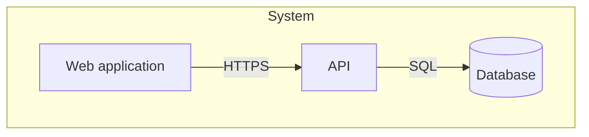

## 4. Components and building blocks (C4 level 3)
### Monorepo workspace (TK-1)
The code is a pnpm workspace orchestrated by Turborepo
([ADR 0001](adr/0001-monorepo-pnpm-turborepo.md)). `pnpm-workspace.yaml` declares
`apps/*`, `packages/*` and `e2e`; `apps/api`, `packages/config`, `packages/contract`, `packages/db` and `packages/ui` exist.

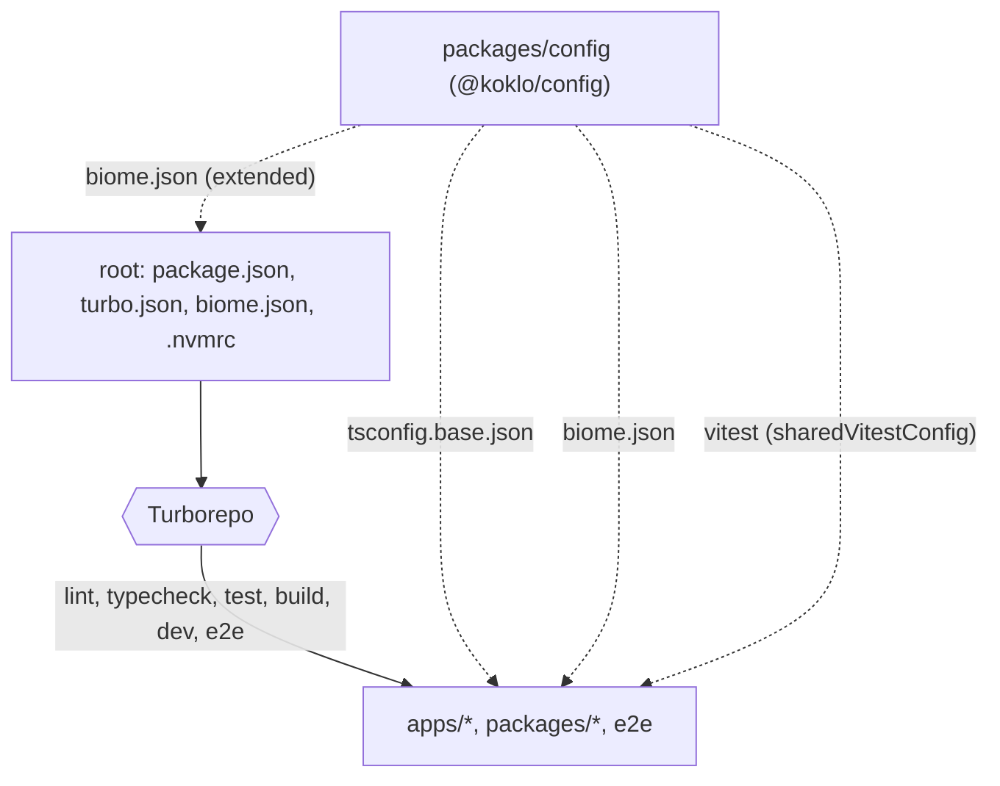

- **Root**: `package.json` pins `packageManager` (`pnpm@12.15.0`) and
  `engines.node` (`>=24 <25`); `.nvmrc` is `24`. Each root script (`lint`, `typecheck`,
  `test`, `build`, `dev`, `e2e`) is `turbo run <task>`.
- **Turborepo tasks** (`turbo.json`): `typecheck` and `test` depend on `^build`;
  `build` depends on `^build` and caches `dist/**` and `.next/**` except
  `.next/cache/**` and `.next/dev/**`; `test` caches `coverage/**`; `dev` is
  persistent and uncached; `e2e` is uncached.
- **`@koklo/config`** (`packages/config`, private) exports three shared configs:
  `./tsconfig.base.json`, `./biome.json`, `./vitest` (`src/vitest.ts`).
  - `tsconfig.base.json`: `strict`, `noUncheckedIndexedAccess`, ES2023, `NodeNext`
    modules, `verbatimModuleSyntax`, `isolatedModules`.
  - `tsconfig.json` (the package's own typecheck config): extends the base,
    `noEmit`, `types: ["node"]`, and includes `src`, `test` and `*.ts` so the Biome
    rule test in `test/` is type-checked.
  - `biome.json`: `noExcessiveLinesPerFunction` (error, `maxLines: 50`),
    `noExcessiveCognitiveComplexity` (error, `maxAllowedComplexity: 15`),
    `noExplicitAny` (error). The root `biome.json` extends it and ignores
    `**/fixtures`, `coverage`, `dist`, `.next` and `pnpm-lock.yaml`.
  - `vitest`: `sharedVitestConfig` (v8 coverage, thresholds `lines: 80`,
    `branches: 70`, exported as `coverageThresholds`, CDC §19.2).
- **Rule for new code**: every new workspace package exposes the `lint`, `typecheck`,
  `test` and `build` scripts so it enters the Turborepo graph, and extends the shared
  configs instead of redefining them.

### Package boundaries (TK-3)
Dependencies between workspace packages are constrained by tags (CDC §16.4). Each
package declares one tag in its own `turbo.json` (`{ "extends": ["//"], "tags": ["domain"] }`);
the rules live in `boundaries.tags` of the root `turbo.json` and are checked by
`turbo boundaries`. Only `packages/config` (tag `config`) exists today.

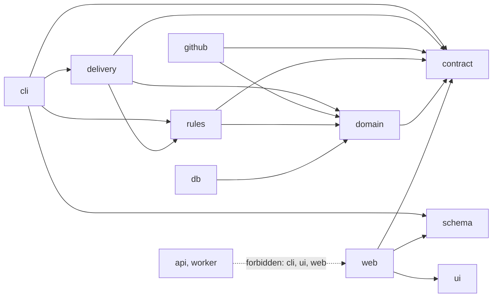

- `allow` lists (every tag also allows `config`): `domain` → `contract`; `db` →
  `domain`; `contract`, `schema`, `ui` → nothing else; `github`, `rules` → `domain`,
  `contract`; `delivery` → `domain`, `contract`, `rules`; `cli` → `contract`,
  `schema`, `delivery`, `rules`; `web` → `contract`, `ui`, `schema`.
- `api` and `worker` use `deny` (`cli`, `ui`, `web`) instead of an allow list, so they
  may depend on any other tag.
- A package without a tag is not subject to any rule.
- **Deep imports** (`@scope/pkg/src/...`) are refused by a second check,
  `packages/config/src/check-deep-imports.ts` (logic in `src/deep-imports.ts`), because
  `turbo boundaries` does not detect them. It reads the workspaces from
  `pnpm-workspace.yaml`, scans source files (`.js/.ts/.jsx/.tsx` and `m`/`c` variants,
  skipping `node_modules`, `dist`, `.next`, `.turbo`, `coverage`, `fixtures`) and accepts
  a subpath only if it matches a key of the target package's `exports` (`*` patterns
  supported). Exit code 1 and a message on stderr otherwise.
- Both checks run from the root `lint` script:
  `turbo run lint && turbo boundaries && node packages/config/src/check-deep-imports.ts`.
### API contract package (TK-9)
`packages/contract` (`@koklo/contract`, tag `contract`, private) holds the oRPC v2
contract that other packages consume (see the `contract` edges in the boundaries
diagram). It exports only through `exports["."]` (`dist/index.js`, built by
`tsc -p tsconfig.build.json`); its dependencies are `@koklo/config`, `@orpc/contract`,
`@orpc/openapi`, `@orpc/zod` (all oRPC at `2.0.0-beta.46`) and `zod` 4.6.7.
Operations, errors and the version guard: [api-contract.md](api-contract.md).

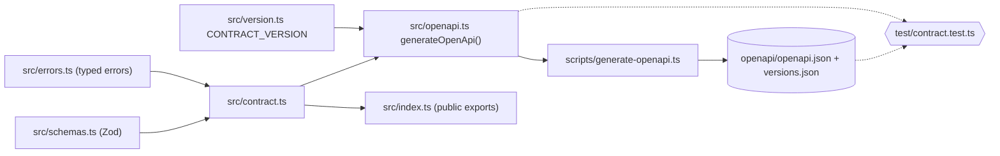

### Database package (TK-7)
`packages/db` (`@koklo/db`, tag `db`, private) owns the Prisma 7 schema
(`prisma/schema.prisma`, PostgreSQL 17), the migrations and their rollback. Prisma is
configured by `prisma.config.ts` (schema, migrations path, `DATABASE_URL`, optional
`SHADOW_DATABASE_URL`; `.env` is loaded with `process.loadEnvFile()`). The generated
client goes to `packages/db/generated/` (git-ignored, excluded from Biome). Dependencies:
`@koklo/config`, `@prisma/client` 7.10.1 (runtime), `pg`; dev: `prisma` 7.10.1. `pnpm-workspace.yaml` allows the build
scripts of `prisma` and `@prisma/engines` (`allowBuilds`). Entities:
[domain-model.md](domain-model.md).

Local database: `docker-compose.yml` at the root runs `postgres:17-alpine`
(user/password/db `koklo`, bound to `127.0.0.1`, host port `KOKLO_DB_PORT`, default 5432,
volume `koklo-postgres-data`, `pg_isready` healthcheck).

Each migration folder carries a `migration.sql` and a `down.sql`. The rollback logic
(`src/rollback.ts`) is pure and receives its side effects as ports, so it is unit-tested
without a database; `scripts/rollback.ts` wires the real ports.

Demo seed (TK-8): `src/seed.ts` exports `seed(databaseUrl)` and `SEED_IDS`;
`scripts/seed.ts` loads `DATABASE_URL` (environment or `.env`) and calls it. It opens a
`pg` connection and runs, in one transaction, `INSERT ... ON CONFLICT (id) DO UPDATE`
statements with fixed UUIDs and a fixed timestamp (`2026-01-01T00:00:00.000Z`, never the
clock), so two runs give the same database. Content: one organization (`demo`), two users
and their members (`admin`, `client`) and one project. No `accounts` row is written, so
no password is seeded. The rest of the vision §18.3 seed (fictional spec, sprint,
6 tickets) waits for the R1 tables (TK-33).

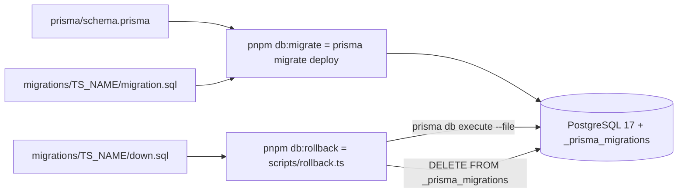

### Multi-tenant isolation (TK-20)
`@koklo/db` filters every business model by organization with a Prisma `$extends`
(`src/tenant-extension.ts`) and an `AsyncLocalStorage` (`src/tenant-context.ts`).

- `withOrganization(organizationId, fn)` opens the context (the id must be a UUID, else
  `MissingOrganizationContextError`). The organization always comes from the session guard
  (`OrganizationContext`), never from the client input. `currentOrganizationId()` reads it.
- On a business model (`TENANT_MODELS`, today `Project`), outside a context every operation
  rejects with `MissingOrganizationContextError`. Inside, `where` is forced to the context
  organization (reads, `update*`, `delete*`, `count`, `aggregate`, `groupBy`; it overrides any
  caller-supplied `organizationId`). `create`, `createMany(AndReturn)` and `upsert.create` set
  `organizationId` to the context, or reject with `OrganizationMismatchError` on another one
  (a nested `organization` relation is rejected too). An unknown operation is rejected
  (fail closed).
- `upsert` first looks up its target on the raw client and rejects when the row belongs to
  another organization (otherwise the filtered `where` would create a duplicate). The check
  and the upsert are two queries: if a concurrent transaction inserts the foreign row between
  them, the upsert fails on the unique constraint, so nothing crosses organizations.
- Raw SQL (`$queryRaw`, `$executeRaw`, `...Unsafe`) is rejected on the extended client
  (`RawQueryNotAllowedError`) because it cannot be filtered.
- Excluded models (`TENANT_EXCLUDED_MODELS`: Better Auth tables, `Organization`, `Member`,
  `Invitation`) pass through untouched, each with a written reason. PostgreSQL RLS is not used
  in v1 (vision §18.4).

Two clients, one pool: `createRawDbClient(url)` returns the plain Prisma client;
`createDbClient(url)` returns it wrapped by `withTenantIsolation`. In the api,
`DatabaseService.raw` is the unfiltered client (Better Auth, health probe) and
`DatabaseService.client` the extended one built on the same pool. Business code uses `client`
only; `raw` is infrastructure, never a business model. Seed and tests use the raw client.

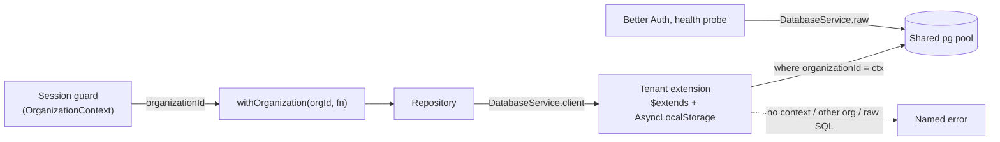

### API application (TK-10)
`apps/api` (`@koklo/api`, tag `api`, private) is a NestJS (Express platform) application
that implements `@koklo/contract` with `@orpc/nest` (`@Implement`). It is compiled with
`tsc` (decorators need `experimentalDecorators`; Node cannot strip them) and started with
`pnpm --filter @koklo/api start`. Configuration is read once at startup and validated
with Zod (`DATABASE_URL`, `PORT`, `APP_ENV`, `APP_VERSION` and, since TK-11, `BETTER_AUTH_SECRET` (32 characters minimum),
`BETTER_AUTH_URL` (the public URL of the web, since the API is not exposed), `GITHUB_CLIENT_ID`, `GITHUB_CLIENT_SECRET`; see `apps/api/.env.example`).
A configuration error names the variable and the rule, never the received value.
The `project` module keeps its port in `apps/api` ([ADR 0002](adr/0002-project-port-in-api.md)).
`@koklo/db` now exports `createDbClient` (Prisma 7 + `@prisma/adapter-pg`), `seed` and
`SEED_IDS`, plus the `@koklo/db/testing` sub-path used by integration tests; the Prisma
client is generated into `packages/db/src/generated` (git-ignored) before build,
typecheck and test.

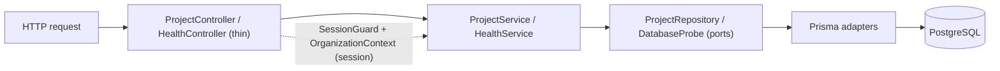

### Authentication and session guard (TK-11)
`apps/api/src/auth/` (global `AuthModule.forRoot(config)`):

| File | Role |
|------|------|
| `auth.ts` | `createAuth`: Better Auth with GitHub OAuth, Prisma adapter on the shared client (UUID ids), `organization()` plugin (active organization carried by the session) |
| `auth.controller.ts` | Mounts Better Auth on `/api/auth/*` |
| `session.ts` | `AuthSession { userId, organizationId }` and the `SessionResolver` port (`null` = unauthenticated) |
| `better-auth-session.resolver.ts` | Real resolver: Better Auth session, active organization, `member` row check |
| `session.guard.ts` | `SessionGuard` (per procedure) stores the session on the request; `sessionOf(request)` reads it |
| `test-session.ts` | `x-test-session` resolver, registered only when `APP_ENV=test` |
| `orpc-error.filter.ts` | Renders a guard's `ORPCError` in the typed contract format; statuses from `ERROR_STATUS_MAP` (`src/error-status.ts`, shared with `ORPCModule`) |

`SessionOrganizationContext` replaces the closed `DenyOrganizationContext` of TK-10 and
returns the organization of the session set by the guard.

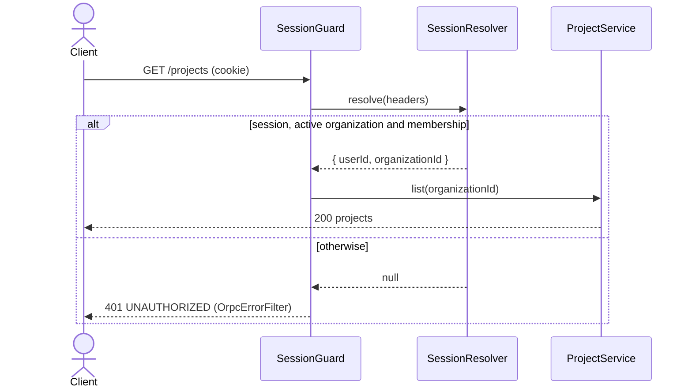

### UI foundations (TK-13)
`packages/ui` (`@koklo/ui`) holds the visual foundations only: no business component and no
screen yet. Values come from `DESIGN.md` (§2 colours, §3 typography); Tailwind v4 is
configured CSS-first (no `tailwind.config`), and `components.json` points shadcn/ui at
`src/styles/index.css`. Dark mode is the `.dark` class on `html`.

| File (`src/styles/`) | Role |
|------|------|
| `theme.css` | `:root` and `.dark` blocks of DESIGN.md §2.1, except the "to confirm" values |
| `tentative.css` | The only file declaring `--primary`, `--ring`, `--destructive`, `--destructive-foreground` (values "to confirm"): change the accent or destructive red here only |
| `status.css` | `--status-{validated,pending,revise}-{bg,fg}`, light and dark; the brand violet is never a status |
| `typography.css` | `--font-sans`, `--font-mono` and the scale `--text-<role>-{size,weight,tracking,font}` |
| `fonts.css` | Self-hosted Fontsource fonts: Instrument Sans 400-700, JetBrains Mono 400-500 |
| `index.css` | Entry point (`@import "@koklo/ui/styles.css"`): Tailwind, the files above, `@theme inline` mapping to shadcn names and `bg-status-*` utilities |

`@koklo/ui` is built to `dist/` (`exports["."]`, entry point `src/index.ts`); the CSS files are
exported raw (`./styles.css`, `./theme.css`, ...). Components, icons and `cn` are described in
[UI components and icons (TK-84)](#ui-components-and-icons-tk-84).

```mermaid
flowchart LR
  idx[index.css] --> tw[tailwindcss]
  idx --> fonts[fonts.css] --> fs[(@fontsource/*)]
  idx --> theme[theme.css]
  idx --> tent[tentative.css]
  idx --> status[status.css]
  idx --> typo[typography.css]
  idx --> map["@theme inline: shadcn + status names"]
```

Decision: [ADR 0004](adr/0004-ui-foundations-tokens-and-fonts.md).

### UI components and icons (TK-84)
`@koklo/ui` now also exports the shadcn/ui components of `DESIGN.md` §5 and the `Icon`
component, **only** through its entry point `src/index.ts` (no sub-path export; checked by
`test/entrypoint.test.ts`).

| Area | Content |
|------|---------|
| `src/components/` | `Table`, `Badge`, `Tabs`, `Button`, `Sheet`, `Card`, `Accordion`, `Alert`, `Select`, `Popover`, `Resizable`, `Avatar`, `DropdownMenu` (shadcn/ui on the unified `radix-ui` package, `class-variance-authority`, `react-resizable-panels` v4), plus `IconButton` and `StatusBadge` |
| `src/icons/icon.tsx` | `Icon`: inline `<svg>` (viewBox `0 -960 960 960`, `currentColor`); sizes 16/18/20/22/28 (default 20); `fill` selects the filled glyph (active state, statuses); decorative (`aria-hidden`) unless `title`, `aria-label` or `aria-labelledby` is given |
| `src/icons/cache.ts` | `loadIcon` imports an icon module once on demand; `readIcon`/`primeIcon` read or pre-seed the cache; a name outside the registry renders an empty icon instead of throwing |
| `src/icons/generated/` | One module per icon (`outline`, `filled` paths) and `registry.ts` (closed, typed `IconName` registry), generated from `@material-symbols/svg-400` (dev dependency) by `scripts/generate-icons.ts` |
| `src/styles/index.css` | Two `@keyframes` (`overlay-in`, `content-in`, exposed as `animate-overlay-in` / `animate-content-in`) |

- `IconButton` requires `aria-label` (type level) and renders a single decorative 20 px icon.
- `StatusBadge` takes `status` (`validated` | `pending` | `revise`) and a mandatory `label`; it
  always renders a filled icon (`check_circle`, `schedule`, `edit_note`), primed statically so it
  renders without waiting.
- Lucide is forbidden: Biome `noRestrictedImports` (root `biome.json`, patterns `lucide`,
  `lucide-*`, `lucide/*`) and `test/no-lucide.test.ts`.

```mermaid
flowchart LR
  app[apps/web] --> idx["@koklo/ui (src/index.ts)"]
  idx --> comp[components/*]
  idx --> icon[icons/icon.tsx]
  comp --> radix[radix-ui, cva, react-resizable-panels]
  comp --> icon
  icon --> cache[icons/cache.ts]
  cache -. "dynamic import on demand" .-> gen["icons/generated/<name>.ts"]
  gen -. "icons:generate" .-> svg[(@material-symbols/svg-400)]
```

Decision: [ADR 0005](adr/0005-ui-components-icons-radix.md).

### Worker: pg-boss and `noop` job (TK-12)
`apps/worker` (`@koklo/worker`, tag `worker`, private) is a **separate Node process**
that consumes jobs with pg-boss (`12.38.0`) on the same PostgreSQL database as the
rest of the system. It depends only on `@koklo/config`. Nothing else is registered
yet: `noop` is the only job.

- `src/config.ts` — `loadConfig(env)` reads `DATABASE_URL` and throws
  `DATABASE_URL is required` when it is missing or empty.
- `src/worker.ts` — `startWorker(config)` creates `new PgBoss(databaseUrl)`, logs
  `error` events, calls `boss.start()`, `createQueue("noop")`, then
  `boss.work("noop", …)`. It returns `{ boss, stop() }`; `stop()` calls `boss.stop()`.
- `src/jobs/noop.ts` — `NOOP_QUEUE = "noop"` and `handleNoop()`, which does nothing:
  the job is completed as soon as the handler returns. It is a liveness proof of the
  consumer, not business logic.
- `src/main.ts` — entry point: `startWorker(loadConfig(process.env))`, logs
  `worker started`, and calls `worker.stop()` then exits 0 on `SIGINT`/`SIGTERM`.

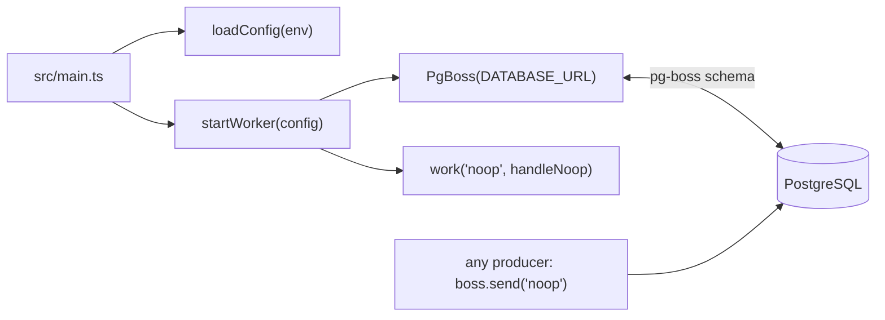

### Organizations, members and roles (TK-23)
Modules `organization/`, `member/` and `project/` in `apps/api`, on top of the Better Auth
`organization()` plugin (six CDC §14 roles, 7-day invitations).

- **Guards** (`auth/session.guard.ts`): `UserSessionGuard` (valid session, organization
  optional: `organization.create/list`), `SessionGuard` (active organization and membership),
  `RoleGuard` + `@Roles(...MANAGER_ROLES)` (role re-read from `members`, 403). The manager
  roles live once in `auth/roles.ts`; the plugin access-control table is its echo, checked by
  a test.
- **Data access**: `members`, `invitations`, `organizations` are outside the tenant filter and
  always bounded by the session `organizationId` or `userId`; `Project` goes through
  `withOrganization`.
- **Queue**: `PgBossProducer` (`queue/pg-boss-producer.ts`) is the lazy producer base of
  `MagicLinkQueue` and `InvitationQueue`; it logs and reports to Sentry an enqueue failure
  before rethrowing. The worker consumes `send-invitation` (`jobs/send-invitation.ts`,
  `mail/invitation-message.ts`, shared `mail/html.ts`), 3 attempts, 1 h retention.

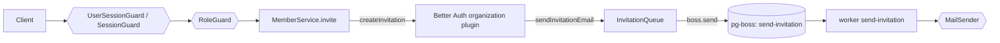

### Magic-link emails: `send-magic-link` queue (TK-22)
The api is a pg-boss **producer only**; the worker owns migrations, queue options and sending.

- **Producer** (`apps/api/src/auth/magic-link-queue.ts`): `MagicLinkQueue` opens its pg-boss
  connection on the first request (`migrate`, `supervise`, `schedule` off), forgets a failed
  attempt, and stops on `app.close()`. The api therefore boots without the queue.
- **Queue** (`apps/worker/src/worker.ts`): `send-magic-link`, 3 attempts, 1 h retention.
- **Port** `MailSender` (`src/mail/mail-sender.ts`): `send(message)`, throws on failure so
  pg-boss retries. Adapters: `ResendMailSender` (staging, production) and `CaptureMailSender`
  (development, test), chosen by `createMailSender(config.mail)`.
- The queue name is declared on both sides (the api cannot import the worker at runtime).

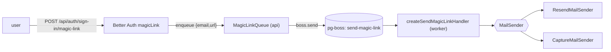

### Real-stack e2e and one-command dev (TK-15)
Package `e2e/` (`@koklo/e2e`, Playwright) holds the browser test on the real stack, and the two
root scripts that orchestrate processes: `pnpm e2e` → `e2e/scripts/run.ts`, `pnpm dev` →
`e2e/scripts/dev.ts` (root `package.json`; they no longer go through `turbo run`).

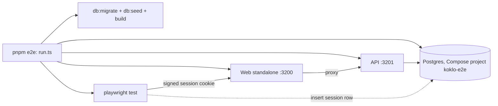

`pnpm dev` runs `docker compose up -d --wait postgres`, then `turbo run dev` (web :3000, API :3001,
worker). Web and API ports are now distinct (`apps/web` dev is `next dev --port 3000`). Variables
already exported win over the defaults; `turbo.json` passes the ports and auth variables through
(`globalPassThroughEnv`, `dev.passThroughEnv`). Run steps and gates:
[quality-and-operations.md](quality-and-operations.md#real-stack-e2e-tk-15) ·
decision: [ADR 0007](adr/0007-real-stack-e2e-orchestration.md).

### Observability: `@koklo/observability` (TK-19)
`packages/observability` is the single place that knows pino and the Sentry-compatible SDK
(`@sentry/node`, speaking to GlitchTip). Public API (entry point only): `createLogger`,
`LOG_LEVELS`, `initObservability`, `captureError`, and `setupObservability` (SDK init plus
logger, shared by the api and the worker). The error SDK is **optional**: without a DSN
`initObservability` does nothing and `captureError` never throws, so the service behaves the
same with or without GlitchTip.

- **api**: `AppModule.forRoot(config)` calls `setupObservability`, then mounts `nestjs-pino`
  (`LoggerModule`) with that logger. The request id (`x-request-id` or a UUID) is generated
  once per request and written on every log line as `requestId`; 5xx responses log at `error`.
  `guard` (used by the oRPC handlers, outside dependency injection) logs the unexpected error
  name, sends it to the SDK tagged with `requestId`, then raises the typed `INTERNAL` error.
  Its logger lives in `apps/api/src/request-logger.ts` (one logger per process, an
  info-level JSON logger until `forRoot` replaces it).
- **worker**: `setupObservability(config)` builds the logger; `instrumentJob` wraps each
  pg-boss handler with a child logger `{ jobId, queue }`, captures and logs a failure, and
  rethrows so pg-boss marks the job failed while the consumer stays alive.

```mermaid
flowchart LR
  req([HTTP request]) --> api[api: nestjs-pino + guard]
  job([pg-boss job]) --> wrk[worker: instrumentJob]
  api --> obs[[@koklo/observability]]
  wrk --> obs
  obs -->|JSON lines| stdout[(stdout)]
  obs -.->|only if SENTRY_DSN| gt[GlitchTip]
```

## 5. Runtime views
TO DOCUMENT — the two or three flows worth a sequence diagram (the critical
path, the failure path).

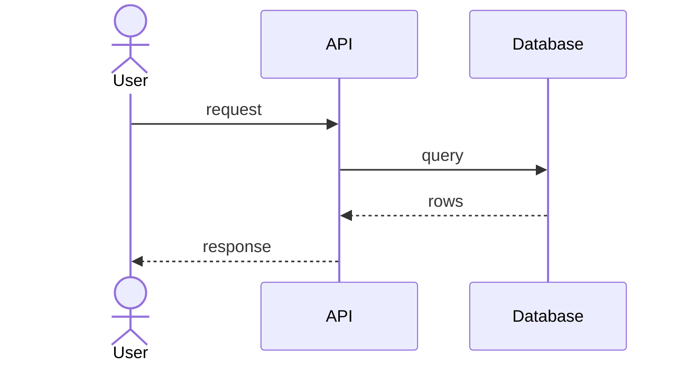

## 6. Cross-cutting concerns
TO DOCUMENT — authentication, error handling, logging, i18n, caching,
transactions: the conventions every module obeys.

### Delivery pipeline (CI side)
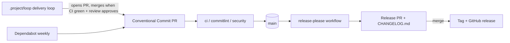

Release Please runs in manifest mode, configured by `release-please-config.json`
and `.release-please-manifest.json` at the repository root.

The `security` workflow (Trivy) and the `commitlint` workflow gate every pull request;
the delivery loop in `.project/loop/` produces most PRs and merges them. Gate details
and the loop's phases are in
[quality-and-operations.md](quality-and-operations.md#quality-gates).
Whether `main` or `develop` is the integration branch is not settled in the sources
read: `security.yml` runs on both, the sprint range ends at `origin/develop`
(ASSUMPTION: `develop` integrates, `main` releases; to confirm with an ADR).

### Agent permissions in worktrees
The delivery loop runs agents in git worktrees. Project-level permissions in
`.claude/settings.json` (`permissions.allow`) let them work without prompts:
`pnpm *`, `corepack *`, `bash .github/scripts/*.test.sh`, `engineering-rules *`, the
shipyard scripts under `~/.claude/shipyard/bin/` (three spellings: absolute path,
`$HOME`, quoted `"$HOME"`), and read access to the vault `koklo-v2/**`. The `deny`
list is unchanged. Source: commit `9be9b7e` (#7).

Commit `5d36e27` (#9) extends that list: `node *`, `awk *`, `chmod +x *`,
`make help|lint*|test*|build*`, `bash .github/scripts/*`, read-only `git check-ignore`
and `git config --get`, the history-rewriting or branch-switching git commands
`git restore|checkout|switch|cherry-pick|reset|rerere|stash`, and two more spellings of
the shipyard scripts (`~/.claude/shipyard/bin/*`, `bash .../shipyard/bin/*`). The vault
read rule now uses `~/perso/projets/MyVault/koklo-v2/**`, and the vault is added to
`additionalDirectories`. `deny` gains `Edit(~/perso/projets/MyVault/koklo-v2/vision.md)`,
which protects the vision file from agent edits.

## 7. Decisions
Architecture decisions live in [decisions/](decisions/) as ADRs. Recorded ones are in `adr/`:
[0001](adr/0001-monorepo-pnpm-turborepo.md), [0002](adr/0002-project-port-in-api.md),
[0003](adr/0003-better-auth-session-guard.md),
[0004](adr/0004-ui-foundations-tokens-and-fonts.md), [0005](adr/0005-ui-components-icons-radix.md),
[0006](adr/0006-web-same-origin-proxy-runtime-config.md),
[0007](adr/0007-real-stack-e2e-orchestration.md).
TK-20 (multi-tenant extension) is described in [Multi-tenant isolation](#multi-tenant-isolation-tk-20); no new framework, so no ADR.
