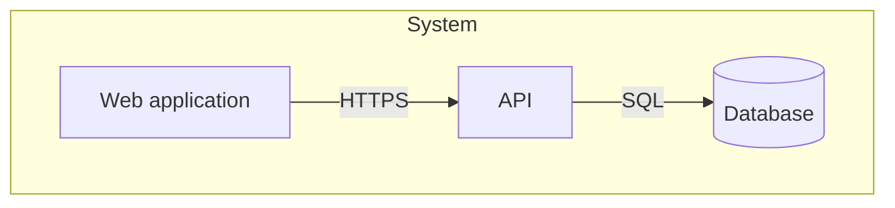
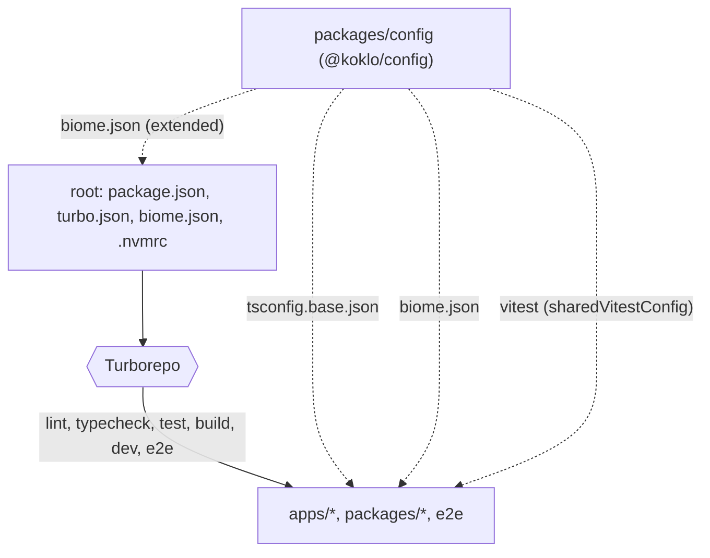
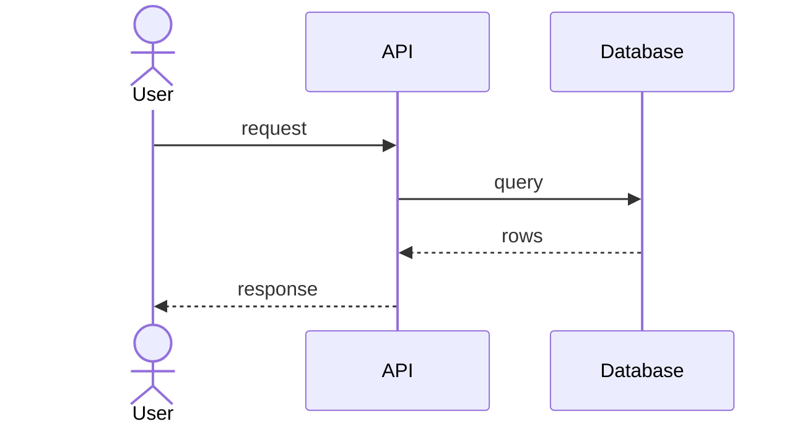
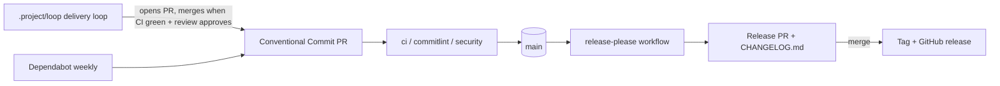

# Architecture

## 1. Goals and constraints
TO DOCUMENT — what this system must achieve, the quality attributes that drive
its design, and the constraints that are not negotiable.

## 2. Scope and context (C4 level 1)
TO DOCUMENT — the system as one box, its users and the systems it talks to.

## 3. Containers (C4 level 2)
TO DOCUMENT — deployable/runnable units, their responsibilities and protocols.

## 4. Components and building blocks (C4 level 3)
### Monorepo workspace (TK-1)
The code is a pnpm workspace orchestrated by Turborepo
([ADR 0001](adr/0001-monorepo-pnpm-turborepo.md)). `pnpm-workspace.yaml` declares
`apps/*`, `packages/*` and `e2e`; at this stage only `packages/config` exists.

- **Root**: `package.json` pins `packageManager` (`pnpm@12.15.0`) and
  `engines.node` (`>=24 <25`); `.nvmrc` is `24`. Each root script (`lint`, `typecheck`,
  `test`, `build`, `dev`, `e2e`) is `turbo run <task>`.
- **Turborepo tasks** (`turbo.json`): `typecheck` and `test` depend on `^build`;
  `build` depends on `^build` and caches `dist/**` and `.next/**` except
  `.next/cache/**` and `.next/dev/**`; `test` caches `coverage/**`; `dev` is
  persistent and uncached; `e2e` is uncached.
- **`@koklo/config`** (`packages/config`, private) exports three shared configs:
  `./tsconfig.base.json`, `./biome.json`, `./vitest` (`src/vitest.ts`).
  - `tsconfig.base.json`: `strict`, `noUncheckedIndexedAccess`, ES2023, `NodeNext`
    modules, `verbatimModuleSyntax`, `isolatedModules`.
  - `tsconfig.json` (the package's own typecheck config): extends the base,
    `noEmit`, `types: ["node"]`, and includes `src`, `test` and `*.ts` so the Biome
    rule test in `test/` is type-checked.
  - `biome.json`: `noExcessiveLinesPerFunction` (error, `maxLines: 50`),
    `noExcessiveCognitiveComplexity` (error, `maxAllowedComplexity: 15`),
    `noExplicitAny` (error). The root `biome.json` extends it and ignores
    `**/fixtures`, `coverage`, `dist`, `.next` and `pnpm-lock.yaml`.
  - `vitest`: `sharedVitestConfig` (v8 coverage, thresholds `lines: 80`,
    `branches: 70`, exported as `coverageThresholds`, CDC §19.2).
- **Rule for new code**: every new workspace package exposes the `lint`, `typecheck`,
  `test` and `build` scripts so it enters the Turborepo graph, and extends the shared
  configs instead of redefining them.

## 5. Runtime views
TO DOCUMENT — the two or three flows worth a sequence diagram (the critical
path, the failure path).

## 6. Cross-cutting concerns
TO DOCUMENT — authentication, error handling, logging, i18n, caching,
transactions: the conventions every module obeys.

### Delivery pipeline (CI side)

Release Please runs in manifest mode, configured by `release-please-config.json`
and `.release-please-manifest.json` at the repository root.

The `security` workflow (Trivy) and the `commitlint` workflow gate every pull request;
the delivery loop in `.project/loop/` produces most PRs and merges them. Gate details
and the loop's phases are in
[quality-and-operations.md](quality-and-operations.md#quality-gates).
Whether `main` or `develop` is the integration branch is not settled in the sources
read: `security.yml` runs on both, the sprint range ends at `origin/develop`
(ASSUMPTION: `develop` integrates, `main` releases; to confirm with an ADR).

## 7. Decisions
Architecture decisions live in [decisions/](decisions/) as ADRs.
