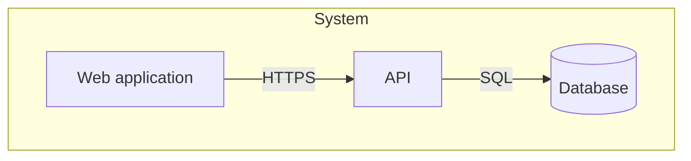
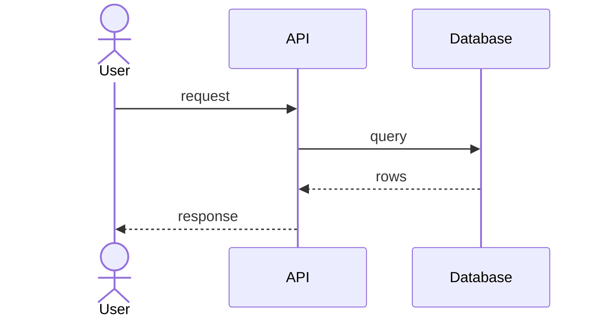
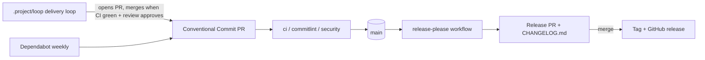

# Architecture

## 1. Goals and constraints
TO DOCUMENT — what this system must achieve, the quality attributes that drive
its design, and the constraints that are not negotiable.

## 2. Scope and context (C4 level 1)
TO DOCUMENT — the system as one box, its users and the systems it talks to.

## 3. Containers (C4 level 2)
TO DOCUMENT — deployable/runnable units, their responsibilities and protocols.

## 4. Components and building blocks (C4 level 3)
TO DOCUMENT — the internal structure of the containers that matter, module by
module, with the rule that decides where new code goes.

## 5. Runtime views
TO DOCUMENT — the two or three flows worth a sequence diagram (the critical
path, the failure path).

## 6. Cross-cutting concerns
TO DOCUMENT — authentication, error handling, logging, i18n, caching,
transactions: the conventions every module obeys.

### Delivery pipeline (CI side)

Release Please runs in manifest mode, configured by `release-please-config.json`
and `.release-please-manifest.json` at the repository root.

The `security` workflow (Trivy) and the `commitlint` workflow gate every pull request;
the delivery loop in `.project/loop/` produces most PRs and merges them. Gate details
and the loop's phases are in
[quality-and-operations.md](quality-and-operations.md#quality-gates).
Whether `main` or `develop` is the integration branch is not settled in the sources
read: `security.yml` runs on both, the sprint range ends at `origin/develop`
(ASSUMPTION: `develop` integrates, `main` releases; to confirm with an ADR).

## 7. Decisions
Architecture decisions live in [decisions/](decisions/) as ADRs.
