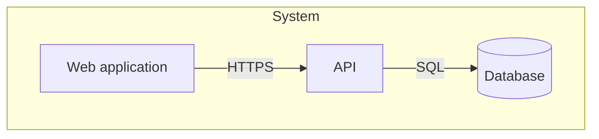
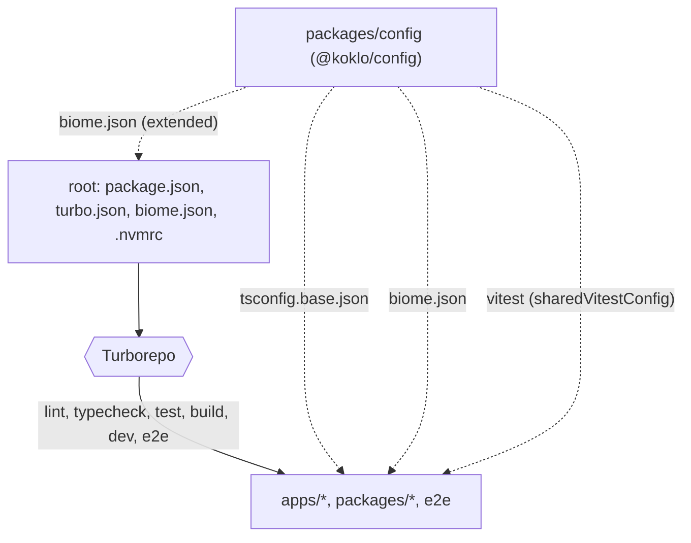
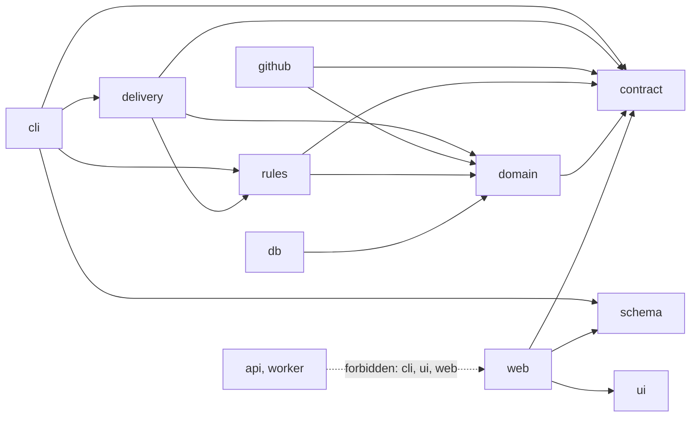
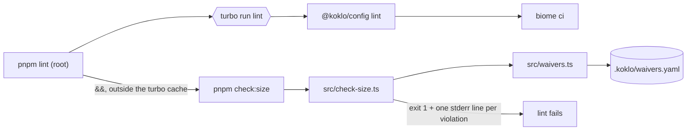
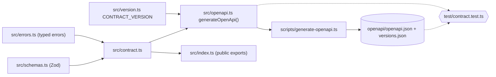
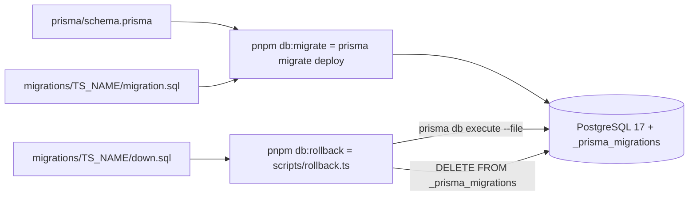
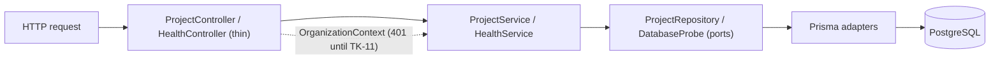
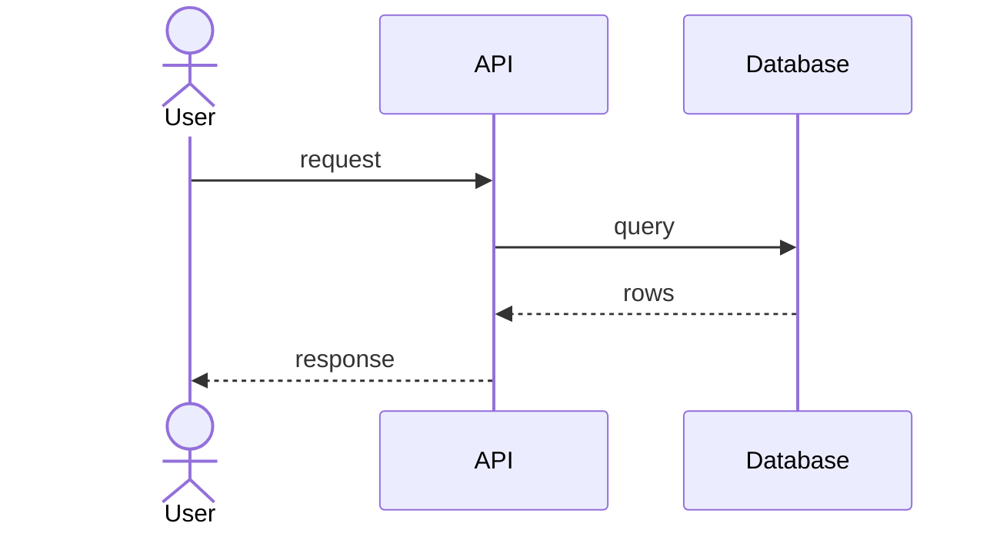
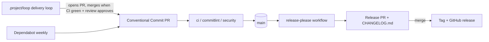

# Architecture

## 1. Goals and constraints
TO DOCUMENT — what this system must achieve, the quality attributes that drive
its design, and the constraints that are not negotiable.

## 2. Scope and context (C4 level 1)
TO DOCUMENT — the system as one box, its users and the systems it talks to.

## 3. Containers (C4 level 2)
TO DOCUMENT — deployable/runnable units, their responsibilities and protocols.

## 4. Components and building blocks (C4 level 3)
### Monorepo workspace (TK-1)
The code is a pnpm workspace orchestrated by Turborepo
([ADR 0001](adr/0001-monorepo-pnpm-turborepo.md)). `pnpm-workspace.yaml` declares
`apps/*`, `packages/*` and `e2e`; `apps/api`, `packages/config`, `packages/contract` and `packages/db` exist.

- **Root**: `package.json` pins `packageManager` (`pnpm@12.15.0`) and
  `engines.node` (`>=24 <25`); `.nvmrc` is `24`. Each root script (`lint`, `typecheck`,
  `test`, `build`, `dev`, `e2e`) is `turbo run <task>`.
- **Turborepo tasks** (`turbo.json`): `typecheck` and `test` depend on `^build`;
  `build` depends on `^build` and caches `dist/**` and `.next/**` except
  `.next/cache/**` and `.next/dev/**`; `test` caches `coverage/**`; `dev` is
  persistent and uncached; `e2e` is uncached.
- **`@koklo/config`** (`packages/config`, private) exports three shared configs:
  `./tsconfig.base.json`, `./biome.json`, `./vitest` (`src/vitest.ts`).
  - `tsconfig.base.json`: `strict`, `noUncheckedIndexedAccess`, ES2023, `NodeNext`
    modules, `verbatimModuleSyntax`, `isolatedModules`.
  - `tsconfig.json` (the package's own typecheck config): extends the base,
    `noEmit`, `types: ["node"]`, and includes `src`, `test` and `*.ts` so the Biome
    rule test in `test/` is type-checked.
  - `biome.json`: `noExcessiveLinesPerFunction` (error, `maxLines: 50`),
    `noExcessiveCognitiveComplexity` (error, `maxAllowedComplexity: 15`),
    `noExplicitAny` (error). The root `biome.json` extends it and ignores
    `**/fixtures`, `coverage`, `dist`, `.next` and `pnpm-lock.yaml`.
  - `vitest`: `sharedVitestConfig` (v8 coverage, thresholds `lines: 80`,
    `branches: 70`, exported as `coverageThresholds`, CDC §19.2).
- **Rule for new code**: every new workspace package exposes the `lint`, `typecheck`,
  `test` and `build` scripts so it enters the Turborepo graph, and extends the shared
  configs instead of redefining them.

### Package boundaries (TK-3)
Dependencies between workspace packages are constrained by tags (CDC §16.4). Each
package declares one tag in its own `turbo.json` (`{ "extends": ["//"], "tags": ["domain"] }`);
the rules live in `boundaries.tags` of the root `turbo.json` and are checked by
`turbo boundaries`. Only `packages/config` (tag `config`) exists today.

- `allow` lists (every tag also allows `config`): `domain` → `contract`; `db` →
  `domain`; `contract`, `schema`, `ui` → nothing else; `github`, `rules` → `domain`,
  `contract`; `delivery` → `domain`, `contract`, `rules`; `cli` → `contract`,
  `schema`, `delivery`, `rules`; `web` → `contract`, `ui`, `schema`.
- `api` and `worker` use `deny` (`cli`, `ui`, `web`) instead of an allow list, so they
  may depend on any other tag.
- A package without a tag is not subject to any rule.
- **Deep imports** (`@scope/pkg/src/...`) are refused by a second check,
  `packages/config/src/check-deep-imports.ts` (logic in `src/deep-imports.ts`), because
  `turbo boundaries` does not detect them. It reads the workspaces from
  `pnpm-workspace.yaml`, scans source files (`.js/.ts/.jsx/.tsx` and `m`/`c` variants,
  skipping `node_modules`, `dist`, `.next`, `.turbo`, `coverage`, `fixtures`) and accepts
  a subpath only if it matches a key of the target package's `exports` (`*` patterns
  supported). Exit code 1 and a message on stderr otherwise.
- Both checks run from the root `lint` script:
  `turbo run lint && turbo boundaries && node packages/config/src/check-deep-imports.ts`.

### File size gate `check:size` (TK-2)
`packages/config` also owns the file-size limits (CDC §17.2), implemented in two
modules that the package README ([packages/config/README.md](../packages/config/README.md))
documents for users:

- `src/check-size.ts`: walks the repository from a root (default: two levels above
  the package; `node src/check-size.ts <root>` overrides it), counts lines of
  `.ts .tsx .js .jsx .mjs .cjs .mts .cts` files and reports violations. Exported API:
  `checkSize({ root, today? })`, `SOURCE_LIMIT` (300), `TEST_LIMIT` (500), `Violation`.
  A file is a test when it matches `*.test.*` / `*.spec.*` or sits under `test/`,
  `tests/`, `__tests__/` or `e2e/`.
- `src/waivers.ts`: `loadWaivers(root)` parses `.koklo/waivers.yaml` (`yaml` 2.9.1),
  `isExpired(waiver, today)` compares UTC calendar days.

Not counted: `node_modules`, `.git`, `.worktrees`, `.workflow`, `.turbo`, `dist`,
`.next`, `coverage`, `migrations/` and `generated/` directories, `*.generated.*` and
`*.gen.*` files, and files with `@generated` or `DO NOT EDIT` in their first 5 lines.

A file over its limit is a violation unless a waiver with the same `file` (path
relative to the root, `/` separators) and `rule: max-file-lines` has not expired.
A waiver is valid through the end of its `expires` day (UTC). If only expired waivers
match, the violation has reason `waiver-expired` and the message names the file, the
expiry date and the author; otherwise the reason is `too-long`. A missing
`waivers.yaml` means no waivers; an unreadable or incomplete one (all five fields
`file`, `rule`, `justification`, `author`, `expires` are mandatory) makes the check
fail with an explicit message.

Wiring: root `package.json` adds `check:size` (`pnpm --filter @koklo/config check:size`);
the root `lint` ends with `&& pnpm check:size` (after `turbo run lint`, `turbo boundaries` and the deep-import check). `packages/config` `lint` stays
`biome ci --config-path=../.. .`: `check:size` must not live inside the cached turbo
task, because it reads the whole repository and today's date (waiver expiry), which are
not turbo inputs — a cache hit would replay a stale verdict. The check scans the whole
repository, not only the package.

### API contract package (TK-9)
`packages/contract` (`@koklo/contract`, tag `contract`, private) holds the oRPC v2
contract that other packages consume (see the `contract` edges in the boundaries
diagram). It exports only through `exports["."]` (`dist/index.js`, built by
`tsc -p tsconfig.build.json`); its dependencies are `@koklo/config`, `@orpc/contract`,
`@orpc/openapi`, `@orpc/zod` (all oRPC at `2.0.0-beta.46`) and `zod` 4.6.7.
Operations, errors and the version guard: [api-contract.md](api-contract.md).

### Database package (TK-7)
`packages/db` (`@koklo/db`, tag `db`, private) owns the Prisma 7 schema
(`prisma/schema.prisma`, PostgreSQL 17), the migrations and their rollback. Prisma is
configured by `prisma.config.ts` (schema, migrations path, `DATABASE_URL`, optional
`SHADOW_DATABASE_URL`; `.env` is loaded with `process.loadEnvFile()`). The generated
client goes to `packages/db/generated/` (git-ignored, excluded from Biome). Dependencies:
`@koklo/config`, `@prisma/client` 7.10.1 (runtime), `pg`; dev: `prisma` 7.10.1. `pnpm-workspace.yaml` allows the build
scripts of `prisma` and `@prisma/engines` (`allowBuilds`). Entities:
[domain-model.md](domain-model.md).

Local database: `docker-compose.yml` at the root runs `postgres:17-alpine`
(user/password/db `koklo`, bound to `127.0.0.1`, host port `KOKLO_DB_PORT`, default 5432,
volume `koklo-postgres-data`, `pg_isready` healthcheck).

Each migration folder carries a `migration.sql` and a `down.sql`. The rollback logic
(`src/rollback.ts`) is pure and receives its side effects as ports, so it is unit-tested
without a database; `scripts/rollback.ts` wires the real ports.

Demo seed (TK-8): `src/seed.ts` exports `seed(databaseUrl)` and `SEED_IDS`;
`scripts/seed.ts` loads `DATABASE_URL` (environment or `.env`) and calls it. It opens a
`pg` connection and runs, in one transaction, `INSERT ... ON CONFLICT (id) DO UPDATE`
statements with fixed UUIDs and a fixed timestamp (`2026-01-01T00:00:00.000Z`, never the
clock), so two runs give the same database. Content: one organization (`demo`), two users
and their members (`admin`, `client`) and one project. No `accounts` row is written, so
no password is seeded. The rest of the vision §18.3 seed (fictional spec, sprint,
6 tickets) waits for the R1 tables (TK-33).

### API application (TK-10)
`apps/api` (`@koklo/api`, tag `api`, private) is a NestJS (Express platform) application
that implements `@koklo/contract` with `@orpc/nest` (`@Implement`). It is compiled with
`tsc` (decorators need `experimentalDecorators`; Node cannot strip them) and started with
`pnpm --filter @koklo/api start`. Configuration is read once at startup and validated
with Zod (`DATABASE_URL`, `PORT`, `APP_ENV`, `APP_VERSION`; see `apps/api/.env.example`).
The `project` module keeps its port in `apps/api` ([ADR 0002](adr/0002-project-port-in-api.md)).
`@koklo/db` now exports `createDbClient` (Prisma 7 + `@prisma/adapter-pg`), `seed` and
`SEED_IDS`, plus the `@koklo/db/testing` sub-path used by integration tests; the Prisma
client is generated into `packages/db/src/generated` (git-ignored) before build,
typecheck and test.

## 5. Runtime views
TO DOCUMENT — the two or three flows worth a sequence diagram (the critical
path, the failure path).

## 6. Cross-cutting concerns
TO DOCUMENT — authentication, error handling, logging, i18n, caching,
transactions: the conventions every module obeys.

### Delivery pipeline (CI side)

Release Please runs in manifest mode, configured by `release-please-config.json`
and `.release-please-manifest.json` at the repository root.

The `security` workflow (Trivy) and the `commitlint` workflow gate every pull request;
the delivery loop in `.project/loop/` produces most PRs and merges them. Gate details
and the loop's phases are in
[quality-and-operations.md](quality-and-operations.md#quality-gates).
Whether `main` or `develop` is the integration branch is not settled in the sources
read: `security.yml` runs on both, the sprint range ends at `origin/develop`
(ASSUMPTION: `develop` integrates, `main` releases; to confirm with an ADR).

### Agent permissions in worktrees
The delivery loop runs agents in git worktrees. Project-level permissions in
`.claude/settings.json` (`permissions.allow`) let them work without prompts:
`pnpm *`, `corepack *`, `bash .github/scripts/*.test.sh`, `engineering-rules *`, the
shipyard scripts under `~/.claude/shipyard/bin/` (three spellings: absolute path,
`$HOME`, quoted `"$HOME"`), and read access to the vault `koklo-v2/**`. The `deny`
list is unchanged. Source: commit `9be9b7e` (#7).

Commit `5d36e27` (#9) extends that list: `node *`, `awk *`, `chmod +x *`,
`make help|lint*|test*|build*`, `bash .github/scripts/*`, read-only `git check-ignore`
and `git config --get`, the history-rewriting or branch-switching git commands
`git restore|checkout|switch|cherry-pick|reset|rerere|stash`, and two more spellings of
the shipyard scripts (`~/.claude/shipyard/bin/*`, `bash .../shipyard/bin/*`). The vault
read rule now uses `~/perso/projets/MyVault/koklo-v2/**`, and the vault is added to
`additionalDirectories`. `deny` gains `Edit(~/perso/projets/MyVault/koklo-v2/vision.md)`,
which protects the vision file from agent edits.

## 7. Decisions
Architecture decisions live in [decisions/](decisions/) as ADRs.
