# Architecture

## 1. Goals and constraints
TO DOCUMENT — what this system must achieve, the quality attributes that drive
its design, and the constraints that are not negotiable.

## 2. Scope and context (C4 level 1)
TO DOCUMENT — the system as one box, its users and the systems it talks to.


## 3. Containers (C4 level 2)
TO DOCUMENT — deployable/runnable units, their responsibilities and protocols.

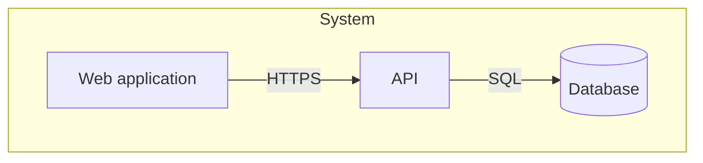

## 4. Components and building blocks (C4 level 3)
### Monorepo workspace (TK-1)
The code is a pnpm workspace orchestrated by Turborepo
([ADR 0001](adr/0001-monorepo-pnpm-turborepo.md)). `pnpm-workspace.yaml` declares
`apps/*`, `packages/*` and `e2e`; `apps/api`, `packages/config`, `packages/contract`, `packages/db` and `packages/ui` exist.

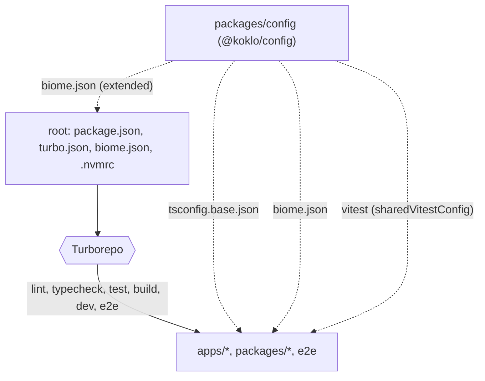

- **Root**: `package.json` pins `packageManager` (`pnpm@12.15.0`) and
  `engines.node` (`>=24 <25`); `.nvmrc` is `24`. Each root script (`lint`, `typecheck`,
  `test`, `build`, `dev`, `e2e`) is `turbo run <task>`.
- **Turborepo tasks** (`turbo.json`): `typecheck` and `test` depend on `^build`;
  `build` depends on `^build` and caches `dist/**` and `.next/**` except
  `.next/cache/**` and `.next/dev/**`; `test` caches `coverage/**`; `dev` is
  persistent and uncached; `e2e` is uncached.
- **`@koklo/config`** (`packages/config`, private) exports three shared configs:
  `./tsconfig.base.json`, `./biome.json`, `./vitest` (`src/vitest.ts`).
  - `tsconfig.base.json`: `strict`, `noUncheckedIndexedAccess`, ES2023, `NodeNext`
    modules, `verbatimModuleSyntax`, `isolatedModules`.
  - `tsconfig.json` (the package's own typecheck config): extends the base,
    `noEmit`, `types: ["node"]`, and includes `src`, `test` and `*.ts` so the Biome
    rule test in `test/` is type-checked.
  - `biome.json`: `noExcessiveLinesPerFunction` (error, `maxLines: 50`),
    `noExcessiveCognitiveComplexity` (error, `maxAllowedComplexity: 15`),
    `noExplicitAny` (error). The root `biome.json` extends it and ignores
    `**/fixtures`, `coverage`, `dist`, `.next` and `pnpm-lock.yaml`.
  - `vitest`: `sharedVitestConfig` (v8 coverage, thresholds `lines: 80`,
    `branches: 70`, exported as `coverageThresholds`, CDC §19.2).
- **Rule for new code**: every new workspace package exposes the `lint`, `typecheck`,
  `test` and `build` scripts so it enters the Turborepo graph, and extends the shared
  configs instead of redefining them.

### Package boundaries (TK-3)
Dependencies between workspace packages are constrained by tags (CDC §16.4). Each
package declares one tag in its own `turbo.json` (`{ "extends": ["//"], "tags": ["domain"] }`);
the rules live in `boundaries.tags` of the root `turbo.json` and are checked by
`turbo boundaries`. Only `packages/config` (tag `config`) exists today.

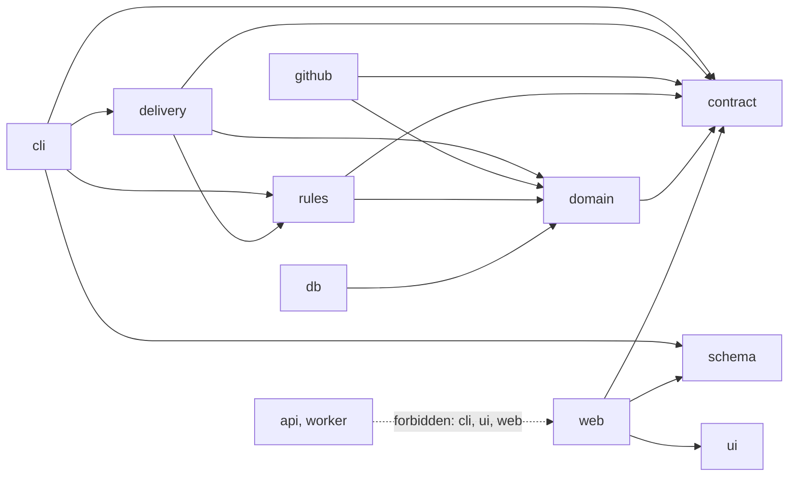

- `allow` lists (every tag also allows `config`): `domain` → `contract`; `db` →
  `domain`; `contract`, `schema`, `ui` → nothing else; `github`, `rules` → `domain`,
  `contract`; `delivery` → `domain`, `contract`, `rules`; `cli` → `contract`,
  `schema`, `delivery`, `rules`; `web` → `contract`, `ui`, `schema`.
- `api` and `worker` use `deny` (`cli`, `ui`, `web`) instead of an allow list, so they
  may depend on any other tag.
- A package without a tag is not subject to any rule.
- **Deep imports** (`@scope/pkg/src/...`) are refused by a second check,
  `packages/config/src/check-deep-imports.ts` (logic in `src/deep-imports.ts`), because
  `turbo boundaries` does not detect them. It reads the workspaces from
  `pnpm-workspace.yaml`, scans source files (`.js/.ts/.jsx/.tsx` and `m`/`c` variants,
  skipping `node_modules`, `dist`, `.next`, `.turbo`, `coverage`, `fixtures`) and accepts
  a subpath only if it matches a key of the target package's `exports` (`*` patterns
  supported). Exit code 1 and a message on stderr otherwise.
- Both checks run from the root `lint` script:
  `turbo run lint && turbo boundaries && node packages/config/src/check-deep-imports.ts`.
### Delivery package: run state machine (TK-72 lots 1 and 2)
`packages/delivery` (`@koklo/delivery`, tag `delivery`, private) holds the pure core of the
delivery loop. Its only runtime dependency is `@koklo/domain` (workspace); it adds no
third-party dependency and no I/O, clock, randomness or environment access, which a
purity test enforces (relative imports or `@koklo/domain` only, files at most 300 lines,
functions at most 50). The tag `delivery` is already declared in the root `turbo.json`
(allow: `domain`, `contract`, `rules`, `config`); `turbo boundaries` stays green. The
package decides, the runner (TK-75/76) executes and persists.

| File | Responsibility |
|---|---|
| `run-state.ts` | `RUN_STATES` (11, vision order), `isRunState`, `isTerminal` |
| `block-cause.ts` | `BLOCK_CAUSES` (9), `createBlock` (frozen, raw output required) |
| `run.ts` | immutable, JSON-serialisable `Run`, `startRun`, `RunLimits` |
| `run-event.ts`, `run-event-check.ts` | 16 event types; validation and block extraction |
| `run-effects.ts` | `RunEffect` commands (frozen constants) |
| `run-transitions.ts` | transition table (data, replays included), `applyEvent`, `canApply`, `allowedEvents` |
| `run-counters.ts` | `checkLimits`, `applyCounters` (attempts, review rounds, CI waits, ceilings from `RunLimits`) |
| `run-resume.ts` | `resumePoint`, `canRestartDevelopment`, resume guard (`ResumeRequiredError`) |
| `errors.ts` | `InvalidRunStateError`, `InvalidRunEventError`, `InvalidRunTransitionError`, `StaleRunError`, `ResumeRequiredError` |

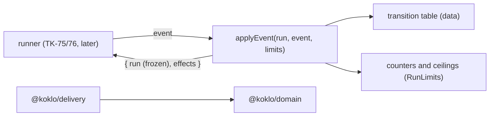

The state diagram, transitions, block causes and effects are in
[domain-model.md](domain-model.md#run-lifecycle-tk-72-lots-1-and-2-packagesdelivery).
Counters, ceilings, idempotent replays and resume are described there too (lot 2).

### Rules package: catalog and parser (TK-71 lot A)
`packages/rules` (`@koklo/rules`, tag `rules`, private) is the pure engineering-rules library.
Lot A ships the catalog model and its parser; composition, locks, waivers and resolution come
with lots B and C. Its only third-party dependency is `zod` 4.6.7 and it imports no other
workspace package; a purity test enforces relative or `zod` imports only, no clock, randomness,
environment or I/O in `src`, files at most 300 lines and functions at most 50. The tag `rules`
is already declared in the root `turbo.json` (allow: `domain`, `contract`, `config`).

| File | Responsibility |
|---|---|
| `catalog-types.ts` | `AGENT_ROLES` (8), `PROFILE_KINDS` (6), `Catalog`, `Rule`, `Profile`, `Enforcement` |
| `catalog-schema.ts` | strict zod schemas (snake_case in, camelCase out), `RULE_ID_PATTERN` |
| `catalog-checks.ts` | raw-document checks (version, protected, enforcement) and semantic checks |
| `catalog-error.ts` | `CATALOG_ERROR_CODES` (10), `CatalogError`, `CatalogResult` |
| `parse-catalog.ts` | `parseCatalog(json)`, never throws, `MAX_CATALOG_BYTES` (1 MiB of UTF-8) |
| `builtin-catalog.ts`, `catalog.json` | `loadBuiltInCatalog()`: the shipped catalog, imported with `with { type: "json" }` |

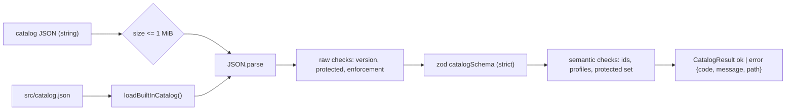

`tsc` copies `catalog.json` into `dist/`, so the import works unchanged from the build. The
catalog is a copy of the Shipyard catalog 2026.08.3 (34 rules, 13 profiles, 4 protected rules).
Model and error codes: [domain-model.md](domain-model.md#rules-catalog-tk-71-lot-a-packagesrules).

### Rules package: layered composition and locks (TK-71 lot B)
Lot B adds `resolveEffectiveRules(input)` to `packages/rules`: the catalog plus up to three
layers (`organization` < `group` < `project`) resolved for one role and one path. It stays pure:
`now` is an input, nothing is mutated, the output is a deep-frozen copy sorted by id. The
catalog of koklo is the source of truth; there is no automatic synchronisation with Shipyard
(D5). Path scopes use a home-made matcher (D6): `*` inside a segment, `**` for 0..n segments,
dotfiles included, no `?` nor `[]`.

| File | Responsibility |
|---|---|
| `layer-types.ts`, `resolve-types.ts`, `rules-error.ts` | `RuleLayer`, `Override`, `Waiver`, `EffectiveRule`, `Conflict`, `Resolution`, `RulesError` (11 codes) |
| `layer-schema.ts`, `layer-checks.ts`, `parse-layer.ts` | strict zod shape, then dates and patterns; `parseLayer`, `parseWaivers` |
| `resolve.ts` | input checks, layer revalidation and ordering, orchestration |
| `profiles.ts` | `core` + selection (longest package prefix) + profiles declared by layers |
| `compose.ts`, `compose-add.ts`, `compose-override.ts`, `compose-waiver.ts`, `compose-lock.ts`, `compose-context.ts` | one layer at a time: adds, overrides, waivers, then locks |
| `resolution.ts` | filter by profile, role and path scope; sort rules, conflicts, disabled, waivers |
| `strength.ts`, `scope-match.ts`, `iso-date.ts` | `isWeaker` (gate > evidence > instruction; blocking > advisory), matcher, dates |
| `explain.ts` | `renderExplanation`: same text as `engineering-rules.sh explain` plus conflicts |

The lock is monotone. A layer is applied against the locks set by the layers above it; its own
`lock` list (and its `protected: true` additions) only takes effect once the layer is done, so
it binds strictly lower levels and is never lifted.

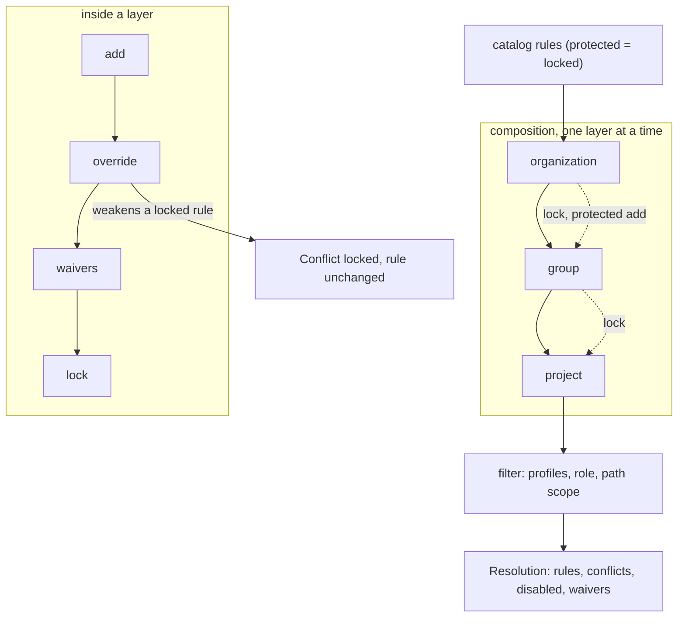

Model, conflicts and errors:
[domain-model.md](domain-model.md#rules-composition-tk-71-lot-b-packagesrules).

### API contract package (TK-9)
`packages/contract` (`@koklo/contract`, tag `contract`, private) holds the oRPC v2
contract that other packages consume (see the `contract` edges in the boundaries
diagram). It exports only through `exports["."]` (`dist/index.js`, built by
`tsc -p tsconfig.build.json`); its dependencies are `@koklo/config`, `@orpc/contract`,
`@orpc/openapi`, `@orpc/zod` (all oRPC at `2.0.0-beta.46`) and `zod` 4.6.7.
Operations, errors and the version guard: [api-contract.md](api-contract.md).

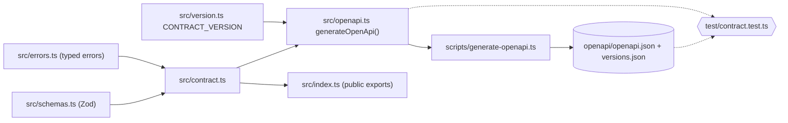

### Database package (TK-7)
`packages/db` (`@koklo/db`, tag `db`, private) owns the Prisma 7 schema
(`prisma/schema.prisma`, PostgreSQL 17), the migrations and their rollback. Prisma is
configured by `prisma.config.ts` (schema, migrations path, `DATABASE_URL`, optional
`SHADOW_DATABASE_URL`; `.env` is loaded with `process.loadEnvFile()`). The generated
client goes to `packages/db/generated/` (git-ignored, excluded from Biome). Dependencies:
`@koklo/config`, `@prisma/client` 7.10.1 (runtime), `pg`; dev: `prisma` 7.10.1. `pnpm-workspace.yaml` allows the build
scripts of `prisma` and `@prisma/engines` (`allowBuilds`). Entities:
[domain-model.md](domain-model.md).

Local database: `docker-compose.yml` at the root runs `postgres:17-alpine`
(user/password/db `koklo`, bound to `127.0.0.1`, host port `KOKLO_DB_PORT`, default 5432,
volume `koklo-postgres-data`, `pg_isready` healthcheck).

Each migration folder carries a `migration.sql` and a `down.sql`. The rollback logic
(`src/rollback.ts`) is pure and receives its side effects as ports, so it is unit-tested
without a database; `scripts/rollback.ts` wires the real ports.

Demo seed (TK-8, TK-33): `src/seed.ts` exports `seed(databaseUrl, { env? })` and `SEED_IDS`;
`scripts/seed.ts` loads `DATABASE_URL` (environment or `.env`) and calls it. It is split into
`seed-data.ts` (ids, fixed date, `DEMO_SPEC`, sprint and tickets), `seed-statements.ts`
(`buildSeedStatements`, pure and deterministic) and `seed-guard.ts` (`assertSeedAllowed`,
refuses `NODE_ENV=production` before any connection). The statements run in one `pg`
transaction with fixed UUIDs and a fixed timestamp (never the clock). Content: one
organization (`demo`), two users and their members, one project, the active sprint `SP-1`,
six tickets with dependencies, labels, feature refs and criteria, and the counters. No
`accounts` row is written, so no password is seeded. Details: quality-and-operations.md.

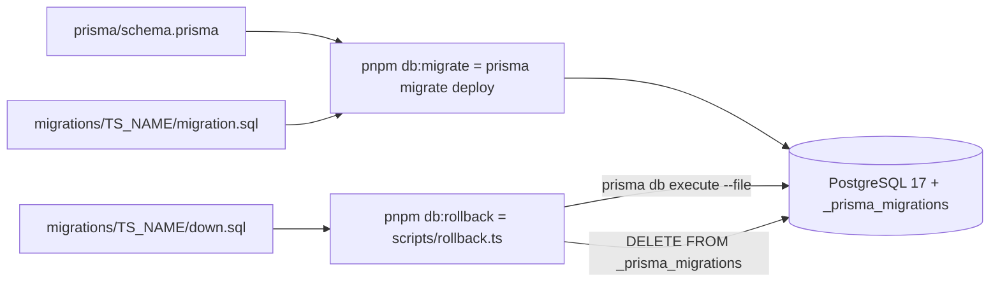

### Multi-tenant isolation (TK-20)
`@koklo/db` filters every business model by organization with a Prisma `$extends`
(`src/tenant-extension.ts`) and an `AsyncLocalStorage` (`src/tenant-context.ts`).

- `withOrganization(organizationId, fn)` opens the context (the id must be a UUID, else
  `MissingOrganizationContextError`). The organization always comes from the session guard
  (`OrganizationContext`), never from the client input. `currentOrganizationId()` reads it.
- On a business model (`TENANT_MODELS`, today `Project`), outside a context every operation
  rejects with `MissingOrganizationContextError`. Inside, `where` is forced to the context
  organization (reads, `update*`, `delete*`, `count`, `aggregate`, `groupBy`; it overrides any
  caller-supplied `organizationId`). `create`, `createMany(AndReturn)` and `upsert.create` set
  `organizationId` to the context, or reject with `OrganizationMismatchError` on another one
  (a nested `organization` relation is rejected too). An unknown operation is rejected
  (fail closed).
- `upsert` first looks up its target on the raw client and rejects when the row belongs to
  another organization (otherwise the filtered `where` would create a duplicate). The check
  and the upsert are two queries: if a concurrent transaction inserts the foreign row between
  them, the upsert fails on the unique constraint, so nothing crosses organizations.
- Raw SQL (`$queryRaw`, `$executeRaw`, `...Unsafe`) is rejected on the extended client
  (`RawQueryNotAllowedError`) because it cannot be filtered.
- Excluded models (`TENANT_EXCLUDED_MODELS`: Better Auth tables, `Organization`, `Member`,
  `Invitation`) pass through untouched, each with a written reason. PostgreSQL RLS is not used
  in v1 (vision §18.4).

Two clients, one pool: `createRawDbClient(url)` returns the plain Prisma client;
`createDbClient(url)` returns it wrapped by `withTenantIsolation`. In the api,
`DatabaseService.raw` is the unfiltered client (Better Auth, health probe) and
`DatabaseService.client` the extended one built on the same pool. Business code uses `client`
only; `raw` is infrastructure, never a business model. Seed and tests use the raw client.

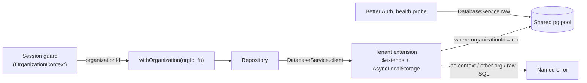

### API application (TK-10)
`apps/api` (`@koklo/api`, tag `api`, private) is a NestJS (Express platform) application
that implements `@koklo/contract` with `@orpc/nest` (`@Implement`). It is compiled with
`tsc` (decorators need `experimentalDecorators`; Node cannot strip them) and started with
`pnpm --filter @koklo/api start`. Configuration is read once at startup and validated
with Zod (`DATABASE_URL`, `PORT`, `APP_ENV`, `APP_VERSION` and, since TK-11, `BETTER_AUTH_SECRET` (32 characters minimum),
`BETTER_AUTH_URL` (the public URL of the web, since the API is not exposed), `GITHUB_CLIENT_ID`, `GITHUB_CLIENT_SECRET`; see `apps/api/.env.example`).
A configuration error names the variable and the rule, never the received value.
The `project` module keeps its port in `apps/api` ([ADR 0002](adr/0002-project-port-in-api.md)).
`@koklo/db` now exports `createDbClient` (Prisma 7 + `@prisma/adapter-pg`), `seed` and
`SEED_IDS`, plus the `@koklo/db/testing` sub-path used by integration tests; the Prisma
client is generated into `packages/db/src/generated` (git-ignored) before build,
typecheck and test.

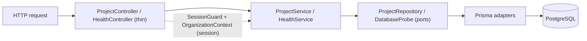

### Authentication and session guard (TK-11)
`apps/api/src/auth/` (global `AuthModule.forRoot(config)`):

| File | Role |
|------|------|
| `auth.ts` | `createAuth`: Better Auth with GitHub OAuth, Prisma adapter on the shared client (UUID ids), `organization()` plugin (active organization carried by the session) |
| `auth.controller.ts` | Mounts Better Auth on `/api/auth/*` |
| `session.ts` | `AuthSession { userId, organizationId }` and the `SessionResolver` port (`null` = unauthenticated) |
| `better-auth-session.resolver.ts` | Real resolver: Better Auth session, active organization, `member` row check |
| `session.guard.ts` | `SessionGuard` (per procedure) stores the session on the request; `sessionOf(request)` reads it |
| `test-session.ts` | `x-test-session` resolver, registered only when `APP_ENV=test` |
| `orpc-error.filter.ts` | Renders a guard's `ORPCError` in the typed contract format; statuses from `ERROR_STATUS_MAP` (`src/error-status.ts`, shared with `ORPCModule`) |

`SessionOrganizationContext` replaces the closed `DenyOrganizationContext` of TK-10 and
returns the organization of the session set by the guard.

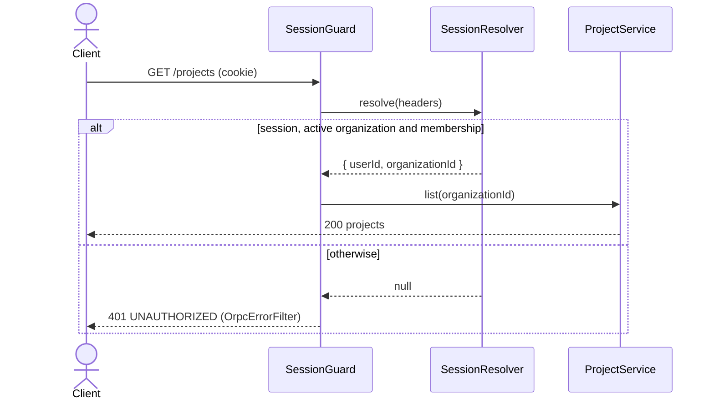

### UI foundations (TK-13)
`packages/ui` (`@koklo/ui`) holds the visual foundations only: no business component and no
screen yet. Values come from `DESIGN.md` (§2 colours, §3 typography); Tailwind v4 is
configured CSS-first (no `tailwind.config`), and `components.json` points shadcn/ui at
`src/styles/index.css`. Dark mode is the `.dark` class on `html`.

| File (`src/styles/`) | Role |
|------|------|
| `theme.css` | `:root` and `.dark` blocks of DESIGN.md §2.1, except the "to confirm" values |
| `tentative.css` | The only file declaring `--primary`, `--ring`, `--destructive`, `--destructive-foreground` (values "to confirm"): change the accent or destructive red here only |
| `status.css` | `--status-{validated,pending,revise}-{bg,fg}`, light and dark; the brand violet is never a status |
| `typography.css` | `--font-sans`, `--font-mono` and the scale `--text-<role>-{size,weight,tracking,font}` |
| `fonts.css` | Self-hosted Fontsource fonts: Instrument Sans 400-700, JetBrains Mono 400-500 |
| `index.css` | Entry point (`@import "@koklo/ui/styles.css"`): Tailwind, the files above, `@theme inline` mapping to shadcn names and `bg-status-*` utilities |

`@koklo/ui` is built to `dist/` (`exports["."]`, entry point `src/index.ts`); the CSS files are
exported raw (`./styles.css`, `./theme.css`, ...). Components, icons and `cn` are described in
[UI components and icons (TK-84)](#ui-components-and-icons-tk-84).

```mermaid
flowchart LR
  idx[index.css] --> tw[tailwindcss]
  idx --> fonts[fonts.css] --> fs[(@fontsource/*)]
  idx --> theme[theme.css]
  idx --> tent[tentative.css]
  idx --> status[status.css]
  idx --> typo[typography.css]
  idx --> map["@theme inline: shadcn + status names"]
```

Decision: [ADR 0004](adr/0004-ui-foundations-tokens-and-fonts.md).

### UI components and icons (TK-84)
`@koklo/ui` now also exports the shadcn/ui components of `DESIGN.md` §5 and the `Icon`
component, **only** through its entry point `src/index.ts` (no sub-path export; checked by
`test/entrypoint.test.ts`).

| Area | Content |
|------|---------|
| `src/components/` | `Table`, `Badge`, `Tabs`, `Button`, `Sheet`, `Card`, `Accordion`, `Alert`, `Select`, `Popover`, `Resizable`, `Avatar`, `DropdownMenu` (shadcn/ui on the unified `radix-ui` package, `class-variance-authority`, `react-resizable-panels` v4), plus `IconButton` and `StatusBadge` |
| `src/icons/icon.tsx` | `Icon`: inline `<svg>` (viewBox `0 -960 960 960`, `currentColor`); sizes 16/18/20/22/28 (default 20); `fill` selects the filled glyph (active state, statuses); decorative (`aria-hidden`) unless `title`, `aria-label` or `aria-labelledby` is given |
| `src/icons/cache.ts` | `loadIcon` imports an icon module once on demand; `readIcon`/`primeIcon` read or pre-seed the cache; a name outside the registry renders an empty icon instead of throwing |
| `src/icons/generated/` | One module per icon (`outline`, `filled` paths) and `registry.ts` (closed, typed `IconName` registry), generated from `@material-symbols/svg-400` (dev dependency) by `scripts/generate-icons.ts` |
| `src/styles/index.css` | Two `@keyframes` (`overlay-in`, `content-in`, exposed as `animate-overlay-in` / `animate-content-in`) |

- `IconButton` requires `aria-label` (type level) and renders a single decorative 20 px icon.
- `StatusBadge` takes `status` (`validated` | `pending` | `revise`) and a mandatory `label`; it
  always renders a filled icon (`check_circle`, `schedule`, `edit_note`), primed statically so it
  renders without waiting.
- Lucide is forbidden: Biome `noRestrictedImports` (root `biome.json`, patterns `lucide`,
  `lucide-*`, `lucide/*`) and `test/no-lucide.test.ts`.

```mermaid
flowchart LR
  app[apps/web] --> idx["@koklo/ui (src/index.ts)"]
  idx --> comp[components/*]
  idx --> icon[icons/icon.tsx]
  comp --> radix[radix-ui, cva, react-resizable-panels]
  comp --> icon
  icon --> cache[icons/cache.ts]
  cache -. "dynamic import on demand" .-> gen["icons/generated/<name>.ts"]
  gen -. "icons:generate" .-> svg[(@material-symbols/svg-400)]
```

Decision: [ADR 0005](adr/0005-ui-components-icons-radix.md).

### Worker: pg-boss and `noop` job (TK-12)
`apps/worker` (`@koklo/worker`, tag `worker`, private) is a **separate Node process**
that consumes jobs with pg-boss (`12.38.0`) on the same PostgreSQL database as the
rest of the system. It depends on `@koklo/config` and, since TK-44b, on `@koklo/db`,
`@koklo/domain`, `@koklo/github` and `@koklo/schema` for the `spec-write` job (see "Spec batches:
submit, queue, commit (TK-44b)"); the mail jobs and `noop` are the other registered jobs.

- `src/config.ts` — `loadConfig(env)` reads `DATABASE_URL` and throws
  `DATABASE_URL is required` when it is missing or empty.
- `src/worker.ts` — `startWorker(config)` creates `new PgBoss(databaseUrl)`, logs
  `error` events, calls `boss.start()`, `createQueue("noop")`, then
  `boss.work("noop", …)`. It returns `{ boss, stop() }`; `stop()` calls `boss.stop()`.
- `src/jobs/noop.ts` — `NOOP_QUEUE = "noop"` and `handleNoop()`, which does nothing:
  the job is completed as soon as the handler returns. It is a liveness proof of the
  consumer, not business logic.
- `src/main.ts` — entry point: `startWorker(loadConfig(process.env))`, logs
  `worker started`, and calls `worker.stop()` then exits 0 on `SIGINT`/`SIGTERM`.

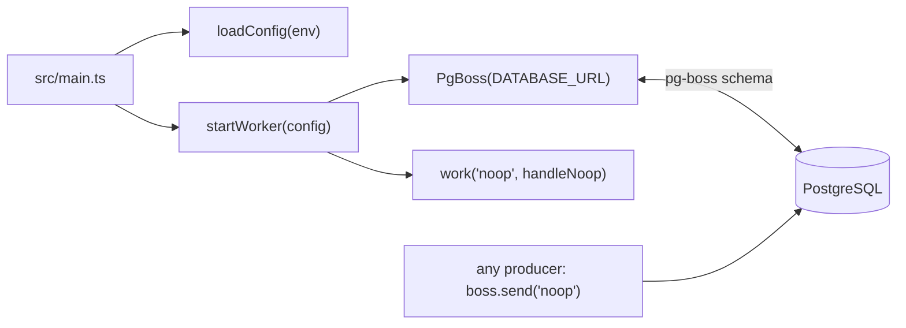

### Organizations, members and roles (TK-23)
Modules `organization/`, `member/` and `project/` in `apps/api`, on top of the Better Auth
`organization()` plugin (six CDC §14 roles, 7-day invitations).

- **Guards** (`auth/session.guard.ts`): `UserSessionGuard` (valid session, organization
  optional: `organization.create/list`), `SessionGuard` (active organization and membership),
  `RoleGuard` + `@Roles(...MANAGER_ROLES)` (role re-read from `members`, 403). The manager
  roles live once in `auth/roles.ts`; the plugin access-control table is its echo, checked by
  a test.
- **Data access**: `members`, `invitations`, `organizations` are outside the tenant filter and
  always bounded by the session `organizationId` or `userId`; `Project` goes through
  `withOrganization`.
- **Queue**: `PgBossProducer` (`queue/pg-boss-producer.ts`) is the lazy producer base of
  `MagicLinkQueue` and `InvitationQueue`; it logs and reports to Sentry an enqueue failure
  before rethrowing. The worker consumes `send-invitation` (`jobs/send-invitation.ts`,
  `mail/invitation-message.ts`, shared `mail/html.ts`), 3 attempts, 1 h retention.

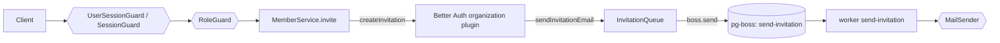

### Tickets and sprints in the API (TK-30)
Modules `ticket/`, `sprint/` and `tracker/` in `apps/api`: hexagonal slices where the service
holds the use cases, a port (`TicketRepository`, `SprintRepository`) hides Prisma, and
`@koklo/domain` makes every business decision (lifecycle, dependency graph, validation,
`pkg:*` label rule). Details and the permission matrix: [API contract](api-contract.md#tickets-dependencies-and-sprints-tk-30).

- **One transaction per use case** (`ProjectTransactions`): project check, read/write, key counter
  and audit row commit together under `withOrganization`.
- **Current project**: `PROJECT_CONTEXT` (`OldestProjectContext` in v1), never from the client.
- **Shared bricks** in `tracker/`: `scope.ts`, `counters.ts`, `audit.ts`, `api-errors.ts`
  (domain errors translated to typed contract errors).
- **Debt**: no composite FK child -> ticket (TK-28); covered by the application safety net
  (`assertOwned`, `projectId` filters) only.

```mermaid
flowchart LR
  c[Client] --> g{{SessionGuard / RoleGuard}}
  g --> ctl[Controller] --> svc[TicketService / SprintService]
  svc -->|decides| d[@koklo/domain]
  svc --> port[(Repository port)]
  port --> tx[ProjectTransactions: 1 transaction]
  tx --> db[(PostgreSQL: rows + counter + audit_log)]
```

### Sprint import command (TK-34)
Module `sprint-import/` and entry point `cli/` in `apps/api`. Not a controller: the script
`import:sprints` builds the Nest application context and calls `SprintImportService`.

- **Pure parser**: `parseSprintFile` (no I/O) turns one file into a `ParsedSprint` and classifies
  every line of the tasks zone (`task-zone-parser.ts`, `ticket-draft.ts`); `read-sprint-directory.ts`
  is the only reader (no symlink, size and UTF-8 checks).
- **Reuse, no duplication**: `ImportRun` writes through `TicketStore` and `SprintStore`
  (`insertImported`, `raiseCounter`, `findIncludingDeleted`) and `recordAudit`; `insert` and
  `insertImported` share one private `insertRow`. Dependencies go through `addDependency` of
  `@koklo/domain`.
- **One transaction** per run via `ProjectTransactions.run(scope, work, { timeoutMs })`; without
  options the behavior is unchanged (Prisma default). `--dry-run` rolls back after the report.

```mermaid
flowchart LR
  cli[cli/import-sprints] --> rd[read-sprint-directory]
  cli --> svc[SprintImportService: owner/admin check]
  rd --> ps[parseSprintFile: pure]
  svc --> ps
  svc --> run[ImportRun]
  run --> ports[(TicketStore / SprintStore)]
  run --> dom[@koklo/domain: dependency graph]
  ports --> tx[ProjectTransactions: 1 transaction]
  tx --> db[(PostgreSQL: rows + counters + audit_log)]
```

### Comments and audit log in the API (TK-32)
Modules `comment/` and `audit/` reuse the TK-30 shape. Keyset pagination (`tracker/cursor.ts`) and
UUID checks (`tracker/uuid.ts`) are shared with `ticket.list`. The audit module is read-only; the
single writer is `recordAudit`, called inside each write transaction. Details:
[API contract](api-contract.md#comments-and-audit-log-tk-32).

### Leases and project state in the API (TK-31)
Modules `lease/` and `project-state/` follow the TK-30 shape (service holds the use case, port
hides Prisma, `@koklo/domain` decides, one transaction and one audit row per write). Time comes
from the injected `CLOCK` (`clock.ts`, global module), never from `Date.now()` or SQL `now()`.
Concurrency is settled by the database: the partial unique index for one active lease per ticket
and `UPDATE ... WHERE version = expected` for the project state. Roles and behaviour:
[API contract](api-contract.md#leases-and-project-state-tk-31).

- **Not delivered**: the merge and spec-write locks (no `locks` table, no contract procedure);
  they need a migration and contract 0.5.0, tracked by a follow-up ticket.

### Web: organizations, members and project creation (TK-24)
`apps/web` consumes the TK-23 procedures; `apps/api`, `packages/contract` and the database are untouched.
Decision record: [ADR 0008](adr/0008-web-entry-gate-organizations.md).

| Route | Page | Frame | Guard (`resolveAccess`) |
|-------|------|-------|-------------------------|
| `/organizations` | `OrganizationsPage` (+ `OrganizationForm`, `OrganizationList`) | none (full-page, like `/login`) | session required; never redirected when a session exists |
| `/projects` | `ProjectsPage` (+ `ProjectCreateSheet`) | `AppFrame` | session + active organization |
| `/members` | `MembersPage` (+ `InviteForm`, `RoleField`) | `AppFrame` | session + active organization |

- **Guard** (`lib/auth-guard.ts`, pure, `lib/session.ts`, `proxy.ts`): only a missing session leads to
  `/login`; a session without active organization on `/projects` or `/members` leads to
  `/organizations`; `/login` with a session leads to `/projects`. `readSession` reads
  `session.activeOrganizationId` from `/api/auth/get-session`.
- **Client state**: the active organization comes from `authClient.getSession()` crossed with
  `organization.list` (`useActiveOrganization`: name and role). `useActivateOrganization` calls
  `authClient.organization.setActive` then invalidates every query. `useOrganizationEntry` drives
  `/organizations` (auto-open of a single organization, once the session is known).
  `useUnauthorizedRedirect` re-checks the session on `UNAUTHORIZED`.
- **Roles in the UI** (`lib/roles.ts`): `canManage` (owner, admin) shows "Créer un projet" and the invitation
  form; `invitableRoles` hides `admin` from non-owners and never offers `owner`. The API stays the authority
  (`FORBIDDEN` is rendered as a message).
- **Forms** validate with the contract Zod schemas (`organizationCreateInputSchema`, `memberInviteInputSchema`,
  `projectCreateInputSchema`); messages per field in `lib/form-errors.ts`; `CONFLICT` reasons
  (`slug_taken`, `already_member`, `already_invited`) read by `lib/api-error.ts`.
- **Shared blocks**: `AppFrame` (shell for projects and members), `ErrorNotice`, `LoadingStatus`, `FormField`.
  `packages/ui` only gains the export of the existing `Input`.

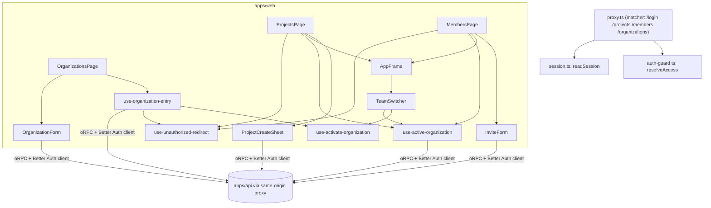

Guard flow (`resolveAccess`):

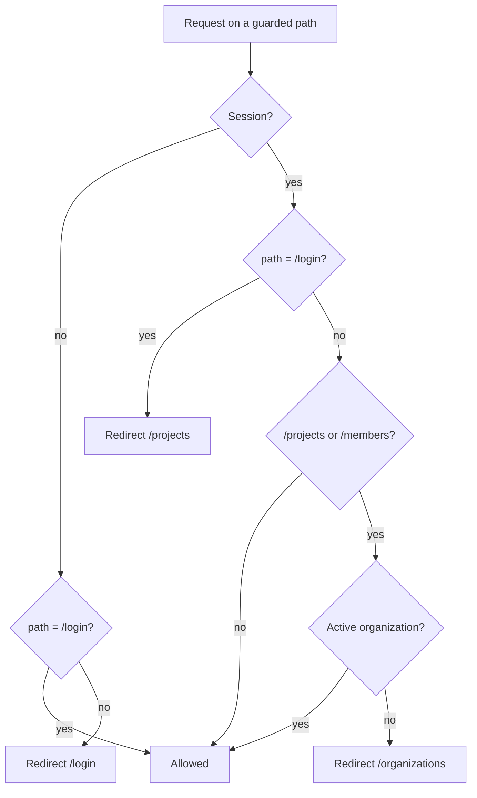

```mermaid
sequenceDiagram
  actor U as User
  participant W as apps/web
  participant A as apps/api
  U->>W: GET /projects (session, no active organization)
  W-->>U: redirect /organizations
  U->>W: "Créer l'organisation" (name, optional slug)
  W->>A: organization.create
  A-->>W: organization (caller owner, active on the session)
  W-->>U: navigate /projects (empty list)
  U->>W: "Créer un projet" (name)
  W->>A: project.create
  A-->>W: project
  W->>A: project.list (invalidated)
  W-->>U: list updated, status "Projet « name » créé."
```

### Web: project features list (TK-48d)
Route `/projects/[projectId]/features` (`app/projects/[projectId]/features/{layout,page}.tsx`), `apps/web` only: it consumes `spec.head`, `spec.listFeatures`, `spec.getFeature`, `repo.list` and `project.list`; the contract (0.7.0) and the API are unchanged. Read-only; writing arrives in 48e. Screen sheet: `design/screens/S-features.md`.
- **Frames**: `app/projects/layout.tsx` renders `ProjectsFrame`, which wraps `/projects` in `AppFrame current="Projets"` but lets any nested path (`/projects/<id>/...`) through, because the feature route has its own `AppFrame` without `current` (the page carries its breadcrumb `Koklo > Projets > name > Fonctionnalités`). One sidebar, one breadcrumb, whatever the depth. The guard is the existing one (`proxy.ts` matcher, `auth-guard.ts`: no session goes to `/login`, no active organization to `/organizations`). The project name links in `/projects` and the sidebar "Projets" group (`nav-projects.tsx`) are plain `<a href>`; a client-side `Link` would add nothing because the page is dynamic and refetches its data anyway.
- **State machine**: `deriveFeaturesView` (`lib/features-view.ts`, pure) reduces the four queries (project, `spec.head`, `repo.list`, list) to one `FeaturesView` kind: `loading`, `not-found`, `error`, `index-failed`, `no-repo`, `neutral`, `preparing`, `empty`, `empty-filtered` or `list`. `repo.list` is read only when `spec.head` is `null` and `canReadRepos(role)` (client and business never call it and get the neutral state). A project in `building` is polled every 5 s for at most 2 minutes (`use-spec-head`), hidden tabs suspended.
```mermaid
stateDiagram-v2
  [*] --> loading
  loading --> not_found: NOT_FOUND or invalid id
  loading --> error: network / INTERNAL
  loading --> index_failed: head failed or 409
  loading --> no_repo: head null, no spec repository (owner/admin/dev/designer)
  loading --> neutral: head null, role without repo.list
  loading --> preparing: head null with repository, or building without items
  preparing --> list: indexed
  loading --> empty: indexed, no feature
  loading --> empty_filtered: filters without result
  loading --> list
  no_repo --> preparing: repository created in place (48c panel, step 2)
```
- **Hooks** (`apps/web/src/lib`, functions of 50 lines at most): `use-features-page` composes `use-features-data` (queries and view), `use-features-url` (filters and open sheet in the address, History API: filters replace, the sheet pushes so Back closes it), `use-features-list` ("Afficher plus", filters actions, focus), `use-feature-sheet` (shareable link of a row, focus return, background refetch) and `use-features-actions` (announcements, repository created). `features-region.ts` holds the pure text of the single status region and which views show filters or the version line.
- **Sheet**: `FeatureSheet` (`Sheet` modal) opened by `?feature=F-nnn`; header from the list row, detail from `spec.getFeature`. Plain text description (no Markdown, no active content). Technical groups (tables, endpoints, non functional requirements) and the commit/file provenance are shown to `canReadRepos` roles only (no git vocabulary for client and business). The scrollable body is a focusable named region (axe `scrollable-region-focusable`).
- **Accessibility**: one `role="status"` region (counter, loading, announcements), a real `table` with caption, 44 px targets under `md`, skeletons animate under `motion-safe:` only, statuses are icon + text.
- **Tests**: unit `apps/web/test/features-*.test.tsx`, `project-create-48d-fixes.test.tsx`; e2e `apps/web/e2e/features.spec.ts` (46 tests against the fake API `e2e/support/stub-features.ts`, captures in `design/screens/captures/S-features/`).

### Web: feature form, create and edit (TK-48e-1)
`apps/web` only, on top of the features list; contract (0.7.0) and API unchanged. A `Sheet` over `/projects/[projectId]/features` (`?new=1`, `?edit=F-nnn`); `@koklo/ui` gains `Textarea`. Deletion (`feature.delete`) is sub-lot 48e-2, described below. Screen sheet: `design/screens/S-feature-form.md` (v1.3).
- **One write, owned by the page**: `useFeatureWrite` (`lib/use-feature-submit.ts`) sends one `specBatch.submit` with one operation (pure builders in `feature-operation.ts`: minimal patch on update, `baseSha` from `spec.head`) and survives the form closing. A form number (`owner`) tells the form that started a write from a reopened one. The idempotency key (`feature-<uuid>`) is reused only after a network failure or an `INTERNAL` reply of `submit` (the server may have written; the same key replays instead of duplicating) with an identical input; any other coded failure, a terminal `failed`/`INTERNAL` batch read by `specBatch.get`, or an edited input gets a new key.
- **Local storage is scoped**: drafts (`koklo:feature-draft:<projectId>:<target>`) and the tracking marker (`koklo:feature-pending:<projectId>`) store the owner (`ownerId`, `organizationId` of the session; `lib/feature-draft.ts`). A read from another account or organisation, or whose JSON does not match the strict validators of `lib/feature-draft-schema.ts` (types, contract status/priority, criteria and steps, `F-\d{3,}`, `kind`, SHA, key), deletes the key and is ignored. `endFeatureSession()` (sign-out buttons and the `UNAUTHORIZED` exit to `/login`) clears everything and blocks later writes, so the unmount flush of a form cannot rewrite; `beginFeatureSession(scope)` (page mount) re-enables writes and purges what belongs to another owner.
```mermaid
stateDiagram-v2
  [*] --> idle
  idle --> sending: Save (valid input)
  sending --> tracking: batch queued / committing
  sending --> failed: submit error (error table)
  sending --> indexing: batch committed in the reply
  tracking --> indexing: committed (specBatch.get, backoff 1.5 s x1.5, max 5 s, 60 s)
  tracking --> failed: failed / conflict batch, NOT_FOUND
  tracking --> tracking: slow after 60 s (checks go on without the page)
  indexing --> saved: spec.head.commitSha = batch commit (every 2 s, 30 s)
  indexing --> late: 30 s without catching up
  late --> saved: spec.head polled every 5 s, 2 min, hidden tab suspended
  late --> indexing: refresh the list
  saved --> idle: dismiss / next write
  failed --> idle: dismiss / next write
```
- **Batch tracking**: `use-batch-tracking` (one poller per window, hidden tab suspended, `restart()` opens a new window), `use-index-wait` (`createIndexPoller`, two windows: 2 s/30 s then 5 s/2 min), `use-pending-save` + `feature-draft` (a local pending marker lets a reloaded page resume with `specBatch.get`, never a second `submit`; it is read for write roles only and cleared by `clearAllFeatureStorage()` at sign-out). After the index catches up, `reloadList` resets the list query (cursor forgotten, filters kept) and reports where the row is (`row`, `filtered`, `more`).
- **Form model**: `use-feature-form` composes `feature-form-state` (initial state, resumed draft, validation, server-designated fields), `use-feature-form-actions` (`useFormSave`, `useReload` = three-way rebase after `stale_base`, `useDraftChoices`), `use-feature-draft` (500 ms debounce, local only) and `use-feature-form-panel` (opening from the address, rights). Pure rules live in `feature-form.ts`, `feature-errors.ts` (single error table), `feature-rebase.ts`, `spec-issues.ts`.
- **Access**: `canWriteSpec(role)` (owner, admin, dev, designer) and `spec.head.status = ready` gate every entry point; for client, business or an unknown role there is no button, no empty slot, and `?new`/`?edit` are stripped. `deriveFeaturesView` no longer waits for the role to show a spec that was read; only the absence of an index still waits for it. This leaks nothing: the list was always readable by every role, `repo.list` stays enabled only when `spec.head` is `null` and `canReadRepos(role)` (undefined role included), write buttons need a known writing role, and the git-flavoured version line and technical groups are shown to `canReadRepos` roles only (an unknown role gets the client wording).
- **Accessibility**: exactly one `role="status"` per document. The page region is used while the form is closed; while the modal is open (the rest of the page is `aria-hidden`) it loses its role and content and a visually hidden region of the panel carries the announcements (sending, queue, criteria, draft). Neutral notices are `role="group"`, one `role="alert"` at a time. Footer DOM order is Save then Close, same as the visual order and the tab order. The scrollable area is a named, focusable region.
- **Tests**: unit and integration `apps/web/test/feature-*.test.ts(x)`; e2e `apps/web/e2e/feature-form.spec.ts` (48 tests in 48e-1, 65 with the deletion block, against the fake provider `e2e/support/stub-feature-write.ts`, fake clock for `slow` and `saved-index-pending`; captures in `design/screens/captures/S-feature-form/`).

#### Feature deletion (TK-48e-2)
Same write machinery, no contract or API change. `useFeatureDelete` (`lib/use-feature-delete.ts`, composed with `useFormSave` by `useWriteActions` in `use-feature-form-actions`) asks, cancels (focus back on the entry button), pre-checks the designer rule (`checkDesignerScreens("delete")`: the value read counts, the input being typed does not; a refusal is a local `FORBIDDEN`, same view as the server's) and sends the single operation `{ kind: "feature.delete", specId }` (`buildDeleteOperation`) with the `baseSha` read at opening and a fresh idempotency key. The input being typed is never sent.
```mermaid
stateDiagram-v2
  [*] --> editing
  editing --> confirming: "Supprimer cette fonctionnalité" (nothing sent)
  confirming --> editing: "Garder" (focus on the entry button)
  confirming --> refused: designer without a screen on the value read (no call)
  confirming --> sending: "Supprimer" (one feature.delete, not while a write is busy)
  sending --> tracking: same states as a save (queued, committing, indexing)
  tracking --> deleted: batch committed and index caught up
  tracking --> failed: error table (SPEC_INVALID = something still points at it)
  failed --> sending: "Réessayer" (no new confirmation; same key after network/INTERNAL of submit only)
  deleted --> [*]: list re-read without the feature, "F-001 supprimée.", focus on the h1
```
- **Safety**: no deletion without the confirmation step (`confirm` is only reachable from `FeatureDeleteConfirm`, and returns when a write is busy), one operation per batch, `baseSha` guards against a stale base, entry limited to `canWriteSpec` roles once the feature is read. The tracking marker has `kind: "delete"` and the same owner scoping (account and organisation) and 24 h limit as drafts; at `committed` the feature's draft and the marker are cleared, other drafts (including the new-feature draft) are kept. The server stays the authority for the designer rule.
- **Errors**: the single table of 48e-1 applies with `mode: "delete"` (`write_conflict` = "changed or no longer exists", then reloading shows "no longer exists"). Only `SPEC_INVALID` has deletion wording: "Rien n'a été écrit. La fonctionnalité reste dans la spec : voyez ci-dessous ce qui bloque sa suppression." (`feature-errors.ts`).
- **Components**: `feature-form-footer.tsx` (`FormFooter`, `deleteEntry`) swaps the footer for `FeatureDeleteConfirm` while asking and sending; `feature-form-sheet.tsx` stays under 250 lines.

### Web: sprint kanban (TK-35)
`apps/web` only; `apps/api`, `packages/contract` and the database are untouched. The screen consumes
`sprint.list({ status: "active" })`, `ticket.list({ sprintId })` and `ticket.transition({ key, to })`
([API contract](api-contract.md#tickets-dependencies-and-sprints-tk-30)). Screen specification:
`design/screens/S-kanban.md`.

| Route | Page | Frame | Guard (`resolveAccess`) |
|-------|------|-------|-------------------------|
| `/kanban` | `KanbanPage` -> `KanbanView` -> `KanbanColumn` -> `KanbanCard` | `AppFrame` | session + active organization |

- **Data** (`lib/use-kanban-data.ts`): reads the active sprint, then every page of its tickets (follows
  `nextCursor` until exhausted, 100 per page). `deriveKanbanData` reduces both queries to one state:
  `loading`, `error`, `no-sprint`, `no-project` (`NOT_FOUND`) or `ready` (`lib/kanban-board.ts` groups by
  status, sorted by priority then key).
- **Moves** (`lib/use-ticket-move.ts`): not optimistic. The card keeps its column (`aria-busy`) until the
  server answers and the board is reloaded; then a status message is announced and focus returns to the
  card's "Déplacer" button. The server is the authority on transitions: a refusal (`INVALID_TRANSITION`,
  `FORBIDDEN`, `CONFLICT`, `NOT_FOUND`) is turned into one dismissible message by `lib/kanban-failure.ts`.
- **Two ways to move**: native HTML5 drag and drop on columns, and the "Déplacer" menu on each card
  (keyboard and touch alternative, WCAG 2.5.7). The menu is non-modal so the button stays in the
  accessibility tree.
- **Roles** (`lib/roles.ts`): `canMoveTickets` (owner, admin, dev, designer); other roles, or a role not yet
  known, get a read-only board (no button, cards not draggable).
- **Shared vocabulary** (`lib/ticket-labels.ts`): status order, labels, one icon per status (status is never
  carried by colour alone) and priority labels. Five icons were added to `packages/ui`
  (`inbox`, `radio_button_unchecked`, `play_circle`, `block`, `cancel`; DESIGN.md section 4).
- **Guard**: `/kanban` joins `GuardedPath` and the proxy matcher; it needs an active organization.
  `RedirectPath` excludes `/kanban` so no redirect ever targets it.

```mermaid
flowchart TB
  proxy["proxy.ts (+ /kanban)"] --> guard["auth-guard.ts: resolveAccess"]
  subgraph apps/web
    page[KanbanPage] --> data[use-kanban-data]
    page --> move[use-ticket-move]
    page --> fail[kanban-failure: describeFailure]
    page --> view[KanbanView] --> col[KanbanColumn x7] --> card[KanbanCard]
    view --> notice[KanbanNotice]
    data --> board[kanban-board: groupByStatus]
    col & card --> labels[ticket-labels]
    page --> roles["roles.canMoveTickets"]
  end
  data -->|sprint.list, ticket.list| api[(apps/api)]
  move -->|ticket.transition| api
```

```mermaid
sequenceDiagram
  actor U as Team member
  participant W as KanbanPage
  participant A as apps/api
  U->>W: drop TK-6 on "À faire" (or menu "Déplacer")
  W->>A: ticket.transition { key, to }
  alt accepted
    A-->>W: ticket
    W->>A: ticket.list (invalidated)
    W-->>U: card in new column, "TK-6 déplacé vers À faire."
  else refused (INVALID_TRANSITION, FORBIDDEN, CONFLICT)
    A-->>W: typed error
    W-->>U: card unchanged, dismissible message
  end
```

### Git provider port (TK-38)
`packages/domain` defines the `GitProvider` port (vision §8) and its value types
(`git-*.ts`). It is types and errors only: **no Octokit, no I/O in `domain`**. The
Octokit adapter lives in `packages/github` (depends on `domain`, never the reverse, see
"GitHub adapter and shared fake (TK-39)"), and tests use its in-memory fake.

Sixteen async methods (TK-44a added `listFiles` and `listCommits`), each taking one request object with an explicit `auth`
(the port is stateless). French names of vision §8 in parentheses:
`authenticate` (authentifier), `createRepo` (creerRepo), `getRepo` (lireRepo, TK-43), `readFile` (lireFichier),
`writeCommit` (ecrireCommit), `createBranch` (creerBranche), `createPullRequest` (creerPR),
`getPullRequestState` (etatPR), `mergePullRequest` (fusionner), `createTag` (poserTag),
`listDeployments` (lireDeploiements), `publishCheck` (publierCheck),
`commentPullRequest` (commenterPR), `subscribeWebhooks` (abonnerWebhooks).

- `GitOwner` is `{ kind: "organization" | "user"; login }`; `kind` is read from the
  provider, never guessed.
- `GitAuth` is `installation` (installation token) or `user` (user access token, optionally
  refreshable). Only `createRepo` on a `user` owner requires `auth.kind === "user"`,
  see [ADR 0009](adr/0009-github-app-creation-repo-compte-personnel.md) (proposed, not yet validated on a real account).
- Failures are typed subclasses of `GitProviderError` (`operation` field, never a token):
  `UserTokenRequiredError`, `RepoCreationForbiddenError`, `GitAuthExpiredError`,
  `GitNotFoundError`, `GitConflictError`, `GitRateLimitedError`, `GitProviderUnavailableError`.
- `mergePullRequest` requires `expectedHeadSha`, the head whose policy was evaluated
  (vision §10.5). The adapter compares it with the current head before merging and throws
  `GitConflictError` with reason `stale-sha` if a push happened since, else `not-mergeable`.
  `GitConflictError.reason` is the literal union `exists | stale-sha | not-mergeable`.
- `GitAuth` and `GitUserCredentials` carry secrets: never log, serialize or put them in an
  error (errors carry only `operation` and non-secret identifiers).
- `WEBHOOK_EVENTS` (frozen) lists the 8 subscribed events.

```mermaid
flowchart LR
  subgraph domain["packages/domain (pure)"]
    Port["GitProvider port<br/>16 methods"]
    Types["GitOwner, GitAuth, Repo,<br/>PullRequest, CheckRun, Deployment"]
    Errors["GitProviderError<br/>+ 7 typed subclasses"]
    Port --> Types
    Port -. throws .-> Errors
  end
  subgraph github["packages/github"]
    Adapter["Octokit adapter (TK-39)"]
  end
  Fake["test fake (in memory)"]
  Adapter -- implements --> Port
  Fake -- implements --> Port
  Adapter -- maps HTTP errors --> Errors
```

`writeCommit` takes a `FileChange`, either a write or a deletion (`{ path, delete: true }`), and an
optional `expectedHeadSha`: a stale head throws `GitConflictError` `stale-sha` before anything is
written. `listFiles` returns the recursive, path-sorted file list of a ref (blobs only) and
`listCommits` the most recent commits first, capped at 50 (TK-44a).

### GitHub adapter and shared fake (TK-39)
`packages/github` (`@koklo/github`) implements the `GitProvider` port twice, behind one
conformance suite (incident 33: a fake that drifts from the real service hides bugs).

- **Adapter** `createOctokitGitProvider(options)`: GitHub App, REST via `@octokit/core` and
  plugins (library, not the `octokit` umbrella; no ADR, it is not a framework and sits behind
  the port). Nothing is read from the environment: App id, PEM key, client secret, clock and
  `fetch` are injected. A `Gateway` is the single call path: it picks the cached client
  (keyed by a SHA-256 of the token), logs `operation`, `status`, `durationMs` only, and maps
  every failure to a typed port error with no `RequestError` as `cause`.
- **Retries**: only reads (GET) on 5xx or network errors; writes never. On quota, one GET
  retry if the wait is short, else `GitRateLimitedError` goes to the worker. `spaceWrites`
  (default `true`) keeps the throttling plugin's 1 s spacing between writes; tests set it
  to `false`.
- **Shared fake** `InMemoryGitProvider`, exported as `@koklo/github/testing`: stateful (commit
  graph with full content, three-way merge per file), deterministic (injected clock and
  ids), per-instance state, expired tokens refused. Other packages' tests import it instead
  of writing their own.
- **Conformance suite** `test/conformance/suite.ts`: one body, two entry points. CI runs it
  against the fake (`fake.test.ts`); `pnpm --filter @koklo/github test:real` runs it
  against real GitHub on `koklo-sandbox-` repositories (manual, never in CI). A divergence
  found on real GitHub becomes a suite case, and the fake is corrected.
- Token safety: never in logs or errors; `.env.real` is git-ignored, `.env.real.example`
  (empty values) is tracked.

```mermaid
flowchart LR
  Port["GitProvider port<br/>packages/domain"]
  subgraph github["packages/github"]
    Adapter["OctokitGitProvider<br/>Gateway, errors-map, ops/"]
    Fake["InMemoryGitProvider<br/>export ./testing"]
    Suite["conformance suite<br/>(one body)"]
  end
  Others["tests of api, worker, delivery"]
  GH[("GitHub API")]
  Adapter -- implements --> Port
  Fake -- implements --> Port
  Adapter -- HTTP --> GH
  Suite -- CI: fake.test.ts --> Fake
  Suite -- manual: test:real --> Adapter
  Others -- import --> Fake
```

Procedure, App permissions and sandbox clean-up: `packages/github/README.md`.

### Spec model: `@koklo/schema` (TK-40)
`packages/schema` (`@koklo/schema`, tag `schema`, private) turns the files of a spec
repository into typed entities and a validation report. It is **pure**: no `node:*`, `fetch`,
`process`, `Date` or `console` in `src/`; the caller passes `{ path, content }` files. Its only
runtime dependencies are `zod` 4.6.7 (same pin as `@koklo/contract`) and `yaml` 2.9.1. Details,
codes and usage: `packages/schema/README.md`.

```mermaid
flowchart LR
  files[("SpecFile[]<br/>path + content")] --> kinds["kindOf(path)"]
  kinds --> load["hardened loaders<br/>YAML / JSON / Markdown"]
  load -->|"STRUCT_* issues"| report
  load --> zod["Zod strictObject<br/>parseWithSchema"]
  zod -->|"STRUCT_SCHEMA_VIOLATION"| report
  zod --> spec["ParsedSpec<br/>(valid entities only)"]
  spec --> index["buildIndex"]
  index --> r4["rule 4: links resolve"]
  index --> r5["rule 5: status vs coverage"]
  index --> r7["rule 7: orphans (warning)"]
  r4 & r5 & r7 --> report["ValidationReport<br/>sorted issues, ok, counts"]
  zod -.-> gen["z.toJSONSchema"] -.-> json[("schemas/*.schema.json<br/>pnpm schemas:generate")]
```

- `checkSpec(files)` = `parseSpecFiles` then `validateSpec`; both halves are exported.
- Files are processed in a stable order (path without extension, then full path); the report is
  sorted by `path`, `pointer`, `code`, `message`, so the output does not depend on input order.
- A failing entity is excluded from `ParsedSpec` and reported; rules 4, 5 and 7 run on the rest.
- JSON Schemas (draft 2020-12) are generated from the Zod schemas and committed; a drift test
  fails CI when they differ. `canonicalize` gives the deterministic serialisation they use.
- Known limits: a duplicate key in a screen JSON file is not detected (`JSON.parse`); the
  Markdown body of a feature silently overrides `description` and `criteres` of its front matter.

### Webhook delivery, deduplication and spec index (TK-41)
The database side of the git provider flow (vision §8). A signed webhook is stored first, then
processed asynchronously; the spec index is a projection of git, rebuilt per commit. Tables and
constraints: `packages/db/README.md` and [domain model](domain-model.md).

```mermaid
sequenceDiagram
  participant P as Git provider
  participant A as API (webhook endpoint)
  participant D as webhook_deliveries
  participant W as Worker (pg-boss)
  participant G as GitProvider
  participant I as Spec index (tenant tables)
  P->>A: POST event (delivery id, signature)
  A->>A: verify signature (secret from env)
  A->>D: INSERT ... ON CONFLICT (provider, delivery_id) DO NOTHING
  alt redelivery (row exists)
    D-->>A: 0 row inserted
    A-->>P: 2xx, nothing enqueued
  else first delivery
    A->>W: enqueue processing
    A-->>P: 2xx
    W->>G: read spec files at the pushed commit
    W->>I: upsert snapshot (UNIQUE repo_id, commit_sha), move spec_heads
    W->>D: status processed
  end
```

- `webhook_deliveries` has no `organization_id` and is outside the tenant filter: the
  `installation` event arrives before `provider_installations` exists. It is read through the raw
  client only, and stores neither signature nor headers.
- Deduplication is a database guarantee (`UNIQUE(provider, delivery_id)`), so concurrent
  redeliveries yield one row and one processing.
- Re-indexing a commit is idempotent (`UNIQUE(repo_id, commit_sha)`); the UI reads the head of a
  branch (`spec_heads`), never a SHA. Bot writes go through `spec_write_batches`, one batch per
  commit, with the batch id as the `Koklo-Ops:` trailer.
- The worker job and the indexer are TK-45b (next sections); the HTTP endpoint that receives and
  enqueues deliveries is TK-45c1 (below).

#### Receiving a webhook: building blocks (TK-45a)
`@koklo/github` provides `verifyWebhookSignature` (HMAC-SHA256 over the raw body, constant-time
comparison, SHA-1 refused, an empty secret raises `WebhookSecretMissingError` before any
computation) and `normalizeWebhook` (provider payload to the `NormalizedWebhook` types of
`@koklo/domain`, personal data dropped). `@koklo/domain` also holds the queue names, the
serialization key (`installation:<id>`, `push:<repo>:<ref>`), the delivery error codes and the
retention bounds. `raiseCounterTo` now lives in `@koklo/db` so that any process can use it.
`normalizeWebhook` also refuses a `ref` longer than 255 characters (`malformed_payload`), because the
ref ends up in the queue key `push:<repo>:<ref>`.

#### API: webhook ingestion endpoint (TK-45c1)
`POST /api/webhooks/github` is a raw Nest route (module `apps/api/src/webhook`), outside oRPC and
absent from `openapi.json`: GitHub sends no session and no contract JSON; the HMAC signature is the
authentication (no session, no audit, no organization at this stage). The web app relays the path
unchanged to `API_INTERNAL_URL` in `proxy.ts`, before any session read; the path is a literal in the
proxy `matcher`, and any other `/api/webhooks/*` is not relayed.

Checks run in this order, cheapest first, and the first failure answers (body `{ "error": code }`):

| Order | Status | Code | Condition |
|-------|--------|------|-----------|
| 1 | 503 | `webhook_not_configured` | `GITHUB_WEBHOOK_SECRET` absent or empty (nothing is read) |
| 2 | 413 | `payload_too_large` | `Content-Length` above 5 MiB (before reading), or a real body above 5 MiB |
| 3 | 415 | `unsupported_media_type` | content type other than `application/json` (absent included) |
| 4 | 401 | `invalid_signature` | `verifyWebhookSignature` over the exact raw bytes fails (same body for every cause) |
| 5 | 400 | `invalid_headers` / `invalid_body` | `X-GitHub-Delivery` not a 36-character UUID, `X-GitHub-Event` not `[a-z_]{1,64}`, JSON invalid or not an object |
| 6 | 202 | `{ "received": true }` | accepted, replayed or ignored |

The raw 5 MiB parser (`webhook-body-parser.ts`) is mounted at the head of the Express stack in
`onModuleInit`, because Nest registers its own 100 kB parsers before module code; every other route
keeps its limit. `request.body` is the `Buffer` of exact bytes. After the signature: `ping` and unknown
events answer 202 without writing; handled events but `push`/`installation` are stored `ignored`; a
payload of the wrong shape is stored `failed` / `invalid_payload` with an empty payload and no job;
`push` / `installation` are stored `received` (normalized payload, attempts 0) with
`INSERT ... ON CONFLICT DO NOTHING` on `(provider, delivery_id)`, then a `webhook-delivery` job is
enqueued. A replay answers the same 202 with no new row and no new job (the first payload wins). If
the enqueue fails, the row is deleted and the answer is 503, so GitHub's redelivery starts afresh.

Nothing sensitive reaches logs or errors: `serializeRequest` masks `x-hub-signature-256` and
`x-hub-signature`, error bodies are fixed codes, and the enqueue error is logged without secret,
signature or payload.

#### Worker: delivery queue, handlers, spec index, purge (TK-45b)
The `webhook-delivery` queue (pg-boss, `key_strict_fifo`) carries `{ deliveryId }` only, with the job
`id` equal to the row id and the `singletonKey` of `webhookDeliverySingletonKey`. The handler reads the
row through the raw client and drives the state machine
`received -> processing (attempts + 1) -> processed | ignored | failed`.

```mermaid
flowchart LR
  P["Provider webhook"] --> E["API endpoint (TK-45c1):<br/>signature, INSERT ON CONFLICT DO NOTHING"]
  E -->|"send {deliveryId}<br/>id=row id, key = push:repo:ref or installation:id"| Q["pg-boss webhook-delivery<br/>key_strict_fifo"]
  Q --> H["handler: state machine<br/>(jobs/webhook-delivery.ts)"]
  H -->|"installation"| IN["status + system audit<br/>(+ erase deliveries if deleted)"]
  H -->|"push"| PU["resolve installation, repo, organization"]
  PU -->|"authenticate, listFiles(branch head)"| G["GitProvider"]
  PU -->|"head already ready: move spec_heads"| X[("spec index")]
  PU -->|"else readSpecFiles, parseSpecFiles"| W["one transaction, no network:<br/>snapshot, entities, joins,<br/>spec_heads, feature counter"]
  W --> X
  H -->|"processed / ignored / failed + error_code"| D[("webhook_deliveries")]
  S["schedule 17 3 * * * UTC"] --> R["webhook-purge: batches of 1000"] --> D
```

- **Idempotence and failure.** A row already `processed` or `ignored`, or absent (purged), is left
  untouched. A business outcome (invalid payload, unknown installation or repository, repository not
  found, spec too large) is written on the row with a closed error code and the job **completes**: a
  failed job would block its key. Only a transient failure (provider unavailable, rate limit, expired
  authorization, database) throws before the last attempt, with a sanitized error that carries the
  code and never the provider body; on the last attempt the row becomes `failed` and the job still
  completes. A row left `received` or `processing` (crash, enqueue lost) is not swept yet: TK-46.
- **Push indexing.** The job indexes the head of the branch **read at execution time** through the
  port (`listFiles`), not the `after` of the payload, so out-of-order deliveries and force-pushes
  cannot regress the index. A head whose snapshot is already `ready` only moves `spec_heads`. The
  `deleted` flag of the payload is never trusted: the branch is read again like for any push, so a
  "deleted" delivery that arrives after a "recreated" one leaves the head in place. A branch found
  missing at the provider removes its `spec_heads` row (snapshots stay), but only after `getRepo`
  confirms the repository still exists: the real adapter answers a 404 "ref" for a deleted,
  transferred or no longer accessible repository too, and that case is `failed` / `repo_not_found`
  with the head untouched. More than 2000 recognized
  files make the snapshot `failed` / `spec_too_large` (the head still moves, so the failure is
  visible). Invalid spec entities are excluded and never fail the job. The `feature` counter is raised
  to the highest `F-nnn` found (at most 999999; larger ids are indexed but ignored by the counter), on
  every branch, in the same transaction as the snapshot. Provider calls never happen inside a
  transaction.
- **Installation events.** `suspend`, `unsuspend` and `deleted` update `provider_installations.status`
  and write a system audit entry (`provider.installation.suspended|reactivated|deleted`) in the same
  transaction. `deleted` is terminal and also erases the other deliveries of that installation.
  `created` never creates a row (the organization is only known by the authorization flow).
- **Shared spec reading.** `apps/worker/src/spec-read/read-spec.ts` (`readSpecFiles`) is the only
  place that reads files through the port; `spec-write` and the indexer both use it.
- **Modules.** `apps/worker/src/webhook`: `payload` (stored payload), `target-store` (installation,
  repository, heads), `index-rows` and `index-writer` (index transaction), `installation`, `push`,
  `delivery-store`, `errors`, `register`; jobs in `src/jobs/webhook-delivery.ts` and
  `webhook-purge.ts`. The fake provider is injected by `startWorker({ gitProvider })` in tests and is
  never imported by production code.

#### API: spec reads (TK-45c2)
`apps/api/src/spec-read` (port `SpecReadRepository`, Prisma adapter, service, controller, `feature-page`,
`feature-detail`). The **index is the source of truth**: `spec.head` and `spec.listFeatures` never call
the provider; each repository method is one short tenant transaction, project checked first (foreign
project = `NOT_FOUND`). `spec.getFeature` decides on the index (`failed` snapshot -> `SPEC_INDEX_FAILED`,
unknown id -> `NOT_FOUND`, provider absent or installation not active -> `PROVIDER_UNAVAILABLE`), then
reads the file **from git at the indexed SHA** (not the branch head) outside any transaction. No audit.

```mermaid
sequenceDiagram
  participant C as Client
  participant A as API spec-read
  participant I as Index (spec_heads, snapshots)
  participant G as Git provider
  C->>A: spec.getFeature
  A->>I: snapshot of the default head + feature row
  alt snapshot failed
    A-->>C: 409 SPEC_INDEX_FAILED
  else found
    A->>G: authenticate, readFile(ref = indexed SHA)
    A-->>C: FeatureDetail (filePath, commitSha)
  end
```

#### Worker: reconciliation of stuck work (TK-46a)
A `reconcile` job (pg-boss, ordinary queue, `retryLimit: 0`) runs on one schedule, `*/10 * * * *` in
UTC (a restart does not duplicate it). A tick takes a transaction-scoped Postgres advisory lock
(`RECONCILE_LOCK_KEY`, `pg_try_advisory_xact_lock`): a second tick, even from another worker, logs
`skipped: already_running` and repairs nothing; the lock is released with the transaction, even if the
process dies. The passes are isolated: a failing pass is named in `failedPasses` and the next one still
runs, the job always completes (the next tick is the retry).

```mermaid
flowchart LR
  S["schedule */10 UTC"] --> T["reconcile tick"] --> L{"advisory lock free?"}
  L -->|"no"| K["log skipped: already_running"]
  L -->|"yes"| P1["P1 webhook_deliveries<br/>received/processing older than grace"]
  L -->|"yes"| P2["P2 spec_write_batches<br/>queued/committing older than grace"]
  L -->|"yes"| P3["P3 tickets in_review<br/>PR merged by hand (TK-46b)"]
  L -->|"yes"| P4["P4 spec-bearing repos<br/>spec heads vs provider (TK-46c)"]
  P1 --> R["no live job (created/retry/active)?<br/>delete failed jobs of the key,<br/>send a NEW job id, same singletonKey"]
  P2 --> R
  P2 -->|"per requeued batch"| A[("audit_log: system,<br/>spec_write_batch.requeued")]
  P3 -->|"PR merged: done + leases released"| A3[("audit_log: system,<br/>ticket.reconcile.pr_merged")]
```

- **Orphan test.** A row is an orphan when it is older than `RECONCILE_GRACE_MINUTES` and no job in
  `created|retry|active` carries its id in the payload. Deliveries older than `retention - 1` day are
  ignored (the purge removes them first). At most `RECONCILE_MAX_REQUEUES_DEFAULT` (200) rows per pass
  and per tick, oldest first; the rest waits for the next tick.
- **Requeue with a new id.** A `failed` job on a `key_strict_fifo` key blocks the key. The repair
  deletes the `failed` jobs of the key and sends a fresh job (new id, same `singletonKey`, minimal
  payload `{ deliveryId }` or `{ batchId }`). Handlers are idempotent (trailer recovery for batches),
  so an occasional duplicate has no effect.
- **Audit.** P2 writes one system entry per relaunched batch, in the batch's own organization
  (`withOrganization`). P1 writes none (deliveries have no organization).
- **P3, pull requests merged by hand (TK-46b, incident 10).** A non-deleted `in_review` ticket whose
  `Ticket.pullRequest` is exactly `https://github.com/<owner>/<repo>/pull/<n>` (`parsePullRequestRef`
  in `@koklo/domain`; any other text is skipped as `pr_ref_unparsable`) is read at the provider. The
  repository read is the one linked to the ticket's own project with an `active` installation, never
  the one the reference names alone (otherwise `repo_not_linked`, no provider call). One
  authentication per installation and per run, one `getPullRequestState` per ticket, sequential, at
  most `RECONCILE_MAX_PULL_REQUESTS_DEFAULT` (200) provider reads per run. Beyond the cap the next
  run resumes after the last ticket handled (in-memory cursor, wrapping at the end of the list), so
  the rest really does wait for a following tick. A provider error leaves the ticket for its next
  turn (`provider_error`, one `errorName` log); a rate limit stops the pass (`rate_limited`). Merged: in one transaction, `UPDATE ... WHERE
  status = 'in_review' AND deleted_at IS NULL` (count must be 1, otherwise a runner or the API won the race and nothing is
  written), open leases released, system audit `ticket.reconcile.pr_merged`. Closed without merge: no
  change, one system audit `ticket.reconcile.pr_closed` per ticket (never repeated). `in_progress` and
  `blocked` tickets are never forced.
- **Log.** One line per tick: counts and pass names only, never ids, payloads or error messages.
- **Code.** `apps/worker/src/jobs/reconcile.ts` (handler, cron), `src/reconcile/{lock,passes,requeue,store,pull-requests,pr-store,heads,head-store,budget,register,types}.ts`;
  constants in `packages/domain/src/reconcile.ts`. P3 is TK-46b; P4 is TK-46c.
- **P4, spec heads (TK-46c).** For each spec-bearing repo of an `active` installation (oldest `last_reconciled_at` first, never-reconciled first), the default branch and the known `spec_heads` are re-indexed by `indexBranch` (shared with the webhook `push` handler). A moved head audits `repo.reconcile.head_updated`, a vanished branch (repo verified by `getRepo`) removes its head and audits `head_removed`, a 404 repo keeps its heads and audits `unreachable` once. Provider calls are capped per run by `RECONCILE_MAX_PROVIDER_CALLS` (authentication included); a rate limit or the budget stops the pass cleanly (`heads.stopped`) and the interrupted repo is retried first next tick. A repo failing on a provider error is skipped and tried after the healthy ones on the next tick (in-memory, no migration), so a broken repo cannot starve the budget of the others.
- **P3 / P4 budgets differ on purpose.** P3 caps *ticket reads* (200) and rotates by a ticket-id cursor; P4 caps *every provider call* (`budgetedProvider` in `budget.ts`) and rotates through `last_reconciled_at` in the database. Both keep one `authenticate` per installation and run; P3 keeps a failed authentication cached for the run, P4 forgets it so the next repo retries. The budgets are not shared.
- **Audits `repo.reconcile.*`.** `head_updated` and `head_removed` are written once per repo and run that changes state (none when nothing moved, so two runs leave the same rows); `unreachable` is written once per repo ever. Actor is the system, target is the repo, in the repo's own organization.
- **Run summary.** `heads: { updated, removed, unreachable, skipped, stopped }`, `stopped` being `rate_limited`, `budget` or `null`.

### User tokens and the prepared installation flow (TK-48a1)
Foundations (48a1), then the module `apps/api/src/installation` (48a2: `installation.list`/`start`, the raw callback `GET /api/github/callback`, relayed by `apps/web/src/proxy.ts` with the session cookie). Flow, outcomes and audit: `api-contract.md`, "Installations in the API (TK-48a2)".
- **Port** (`@koklo/domain`): `GitProvider.exchangeUserCode({ code, redirectUri })` returns
  `GitUserCredentials`; `listUserInstallations({ auth })` returns the installations visible to a user
  token (`externalId`, `ownerKind`, `ownerLogin`); `getUserOwnerRole({ auth, owner })` returns the
  user's link with an owner (`self`, `admin`, `member`, `none`; `ops/user-role.ts`: `GET /user` or
  `GET /user` + `GET /orgs/{org}/memberships/{username}`, App permission Members: read); `appSlug()` gives the App URL slug. A refused code
  raises `InvalidUserCodeError`, which carries nothing received (no code, no client secret).
  `@koklo/github` implements them (`ops/user-oauth.ts`: POST `/login/oauth/access_token`, never
  replayed because the code is single-use; `ops/app-slug.ts`: `GET /app` with the App JWT, success
  cached); the shared fake (`testing/fake-user-oauth.ts`) accepts `fake-code-<login>` once and only
  sees the installations seeded for that login. Both run the same conformance suite.
- **Flow** (ADR 0009, proposed; implemented in 48a2): `installation.start` returns the GitHub install URL with a
  signed single-use `state`; GitHub redirects the browser to the callback with `code` and `state`;
  the API consumes the state, exchanges the code, lists the user's installations and only links an
  installation proven visible to that user token AND owned by that user (own personal account, or
  active admin of the GitHub organization: visibility alone also covers mere members), under the
  organization of the state.
  ```mermaid
  sequenceDiagram
    participant W as Web
    participant A as API
    participant G as GitHub
    W->>A: installation.start
    A-->>W: install URL + state (provider_auth_states)
    W->>G: install the App
    G-->>A: callback (installation_id, code, state)
    A->>A: session user = state user, verify HMAC, consume state (single use, 10 min)
    A->>A: re-read owner/admin role of the state organization
    A->>G: exchangeUserCode (only after the state is consumed)
    A->>G: listUserInstallations (installation must be visible to the user token)
    A->>G: getUserOwnerRole (self for a personal account, admin for an organization, else not_owner)
    A->>A: one transaction: installation, encrypted token, audit
  ```
  Hexagonal split: `InstallationService`/`InstallationCallbackService` depend on the
  `InstallationRepository` port (Prisma adapter) and the `GitProvider` port; the provider is never
  called inside a transaction. The state signer (`auth-state.ts`) is a pure module.
- **Token encryption** (`apps/api/src/crypto/token-cipher.ts`, pure module): AES-256-GCM, a random
  12-byte nonce per message, associated data `userId:installationId` (a sealed token copied to
  another user or installation does not decrypt), `ciphertext = encrypted bytes || 16-byte tag`.
  Only the secret part (access and refresh tokens) is encrypted; expiries stay readable. Each
  row carries `key_version` (1 today); a value that does not match raises `TokenDecryptionError`.
  Every failure (tamper, wrong key, wrong data, malformed row, unexpected plaintext shape) is the
  same `TokenDecryptionError`, without cause, key or content: it is never turned into "no token".
  `PrismaUserCredentials` replaces `NoUserCredentials` only when the App client id and secret AND
  `KOKLO_ENCRYPTION_KEY` are configured (see Quality and operations).

### Web: GitHub screen (TK-48b)
`/github` (`GithubPage` in `AppFrame`, `app/github/page.tsx` server component) consumes `installation.list` and `installation.start`; nothing changes in the API. Guard: session + active organization (`auth-guard.ts`, `proxy.ts` matcher). The sidebar entry "GitHub" is shown to owners and admins only (`canManage`); other roles read a refusal without action or API call.
- **Return from GitHub**: the API redirects (303) to `/github?result=<outcome>`. `page.tsx` keeps a value only if `installationCallbackOutcomeSchema` accepts it; the component stores the outcome in state, then `router.replace("/github")` removes the parameter (never replayed). The notice is `status` for `installed`, `alert` otherwise, icon + title + text from `lib/github-labels.ts`; the raw parameter is never rendered.
- **Start**: one action in flight (a ref lock set before render, re-armed on `pageshow` from the back/forward cache). The URL comes from the API only and `isGithubUrl` (`lib/github-redirect.ts`) accepts nothing but `https://github.com` (no userinfo, no port, exact host); anything else shows an error and does not navigate. Typed errors (`PROVIDER_UNAVAILABLE`, `too_many_pending`, `NOT_FOUND`, `FORBIDDEN`) map to messages in `lib/github-start-error.ts`.
- Statuses are always icon + text (`github-status.tsx`); no token, state, code or external id is displayed, stored or logged by the web. Screen sheet: `design/screens/S-github.md`.

### Web: project creation with its spec repository (TK-48c)
The "Créer un projet" panel (`ProjectCreateSheet`, a `Sheet`) creates the project, then its spec repository, in two visible steps. `apps/web` only: it consumes `project.create`, `installation.list`, `repo.createSpec`, `repo.link` and `installation.start`; the contract (`@koklo/contract` 0.7.0) and the API are unchanged. Screen sheet: `design/screens/S-projects.md` (v5, §3.1, §4.1, §5).
```mermaid
stateDiagram-v2
  [*] --> form
  form --> creating_project: submit (validated before any call)
  creating_project --> form: project.create failed
  creating_project --> creating_repo: project created
  creating_project --> no_account: no GitHub account linked
  creating_repo --> existing: success or spec_repo_exists
  creating_repo --> failed: typed provider error
  failed --> creating_repo: retry (repo.createSpec only)
  failed --> existing: repo.link succeeded
  ready --> creating_repo: resume
```
- **Hooks** (`apps/web/src/lib`, Biome caps functions at 50 lines): `use-creation-panel` composes the accounts query (`use-github-accounts`, enabled only once the panel is mounted), the state machine (`use-project-creation`, one in-flight lock, `project.create` called once), the two steps (`use-creation-steps`), the fields and their validation (`use-creation-fields`), the "authorize" redirect (`use-start-installation`, shared with `/github`) and the `repo.link` fallback (`use-spec-repo-link`). `use-creation-page` owns the page side: opening (the panel is remounted by `key`), the result announcement and the resume notice.
- **Errors**: `describeSpecRepoError` maps each typed code to one text and one action (retry, authorize, reauthorize, close). `spec_repo_exists` is a success. `UNAUTHORIZED` goes through `useUnauthorizedRedirect` (G1: `/login` only when the session is really lost).
- **Resume marker** (`creation-resume.ts`): `sessionStorage`, zod strict, 1 h TTL, every access in `try/catch`. It holds `projectId`, `projectName`, `installationId` and the typed repo name; never a token, a `state` or a URL. It is written when the panel closes with a project and no repository, and right before the redirect to GitHub; any success erases it. `/github?result=installed` shows a "Reprendre la création du projet" link when a valid marker exists.
- **Accessibility**: one `role="status"` or `role="alert"` at a time in the panel, steps as an ordered list (icon + text, never colour alone), 44 px targets on mobile, animations only under `motion-safe:`.
- **Tests**: unit (`apps/web/test/project-create-*.test.tsx`, `spec-repo-errors`, `creation-resume`, including `project-create-gaps` for the `/login` redirect, outside click and reduced motion); e2e `e2e/project-create.spec.ts` against the fake API (`e2e/support/stub-spec-repo.ts`, which journals the project taken from the URL path), never against github.com.

### Spec write foundations (TK-44a)
Additive building blocks for writing the spec in batches; no API procedure or worker job uses them
yet.

```mermaid
flowchart LR
  Ops["feature operations"] --> Emit["emitFeatureMarkdown<br/>@koklo/schema (pure)"]
  Emit --> Files["FileChange[]<br/>writes + deletions"]
  Files --> Commit["GitProvider.writeCommit<br/>expectedHeadSha: stale-sha, nothing written"]
  List["listFiles / listCommits"] --> State["current state of the branch<br/>and recovery of a Koklo-Ops commit"]
  Commit --> Batch["spec_write_batches<br/>report, message, author_role"]
```

- The emitter is the inverse of `parseFeatureMarkdown` (fixed front matter key order, round trip
  and idempotence tested); it rejects text that would inject front matter or a section.
- `spec_write_batches` keeps the outcome of a batch (migration `*_spec_batch_outcome`); the
  `feature` counter feeds the `F-nnn` identifiers.
- The `specBatch` procedures, the serialized write queue and the worker job use these blocks since
  TK-44b (next section).

### Spec batches: submit, queue, commit (TK-44b)
`specBatch.submit` records a batch and a worker commits it; the API never writes to the provider.
Both sides share the pure rules of `@koklo/domain` (`spec-write.ts`: queue name, singleton key, bot
author, error codes, branch and path validation). The worker now depends on `@koklo/db`,
`@koklo/domain`, `@koklo/github` and `@koklo/schema` (the `worker` tag still only denies `cli`, `ui`
and `web`); the fake provider is injected by `startWorker({ gitProvider })` in tests and never imported
by production code.

```mermaid
flowchart LR
  C["Client"] -->|"specBatch.submit"| A["API SpecBatchService"]
  A -->|"Tx: batch queued, operations,<br/>F-nnn counter, audit"| D[("PostgreSQL")]
  A -->|"send {batchId}<br/>id=batchId, key=repoId:branch"| Q["pg-boss queue spec-write<br/>key_strict_fifo"]
  A -. "poll every 150 ms<br/>up to SPEC_BATCH_WAIT_MS" .-> D
  Q --> W["Worker job spec-write"]
  W -->|"committing (just before the write), then committed / failed / conflict"| D
  W --> P["GitProvider: listCommits (Koklo-Ops),<br/>listFiles, readFile"]
  W --> V["checkSpec before / after<br/>(new errors only)"]
  W -->|"one commit by the bot<br/>trailers Koklo-Ops, Co-authored-by"| P
  P --> G["Git (spec repository)"]
  G -. "push webhook (TK-45)" .-> I["spec index in the database"]
```

- Worker modules (`apps/worker/src/spec-write`): `store` (batch, author, state changes; the only raw
  Prisma reads are the organization of a batch and the name and e-mail of its author, a `user` row
  without tenant; everything else runs under `withOrganization`),
  `execute` (recovery, state read, one `writeCommit` guarded by `expectedHeadSha`, one retry on a stale
  head), `plan` (pure: conflicts, designer limit, operations, validation), `message`, `criteria`,
  `features`, `report`, `register` (queue creation and consumer). `src/jobs/spec-write.ts` is the
  handler.
- No provider call happens inside a transaction; the job holds none while it talks to the provider.
- Not delivered: the index rebuild after the commit (TK-45) and the sweep of orphan batches (TK-46).
  See [API contract](api-contract.md), "Spec batches in the API (TK-44b)" for states, errors,
  idempotency and recovery.
- The batch is `queued` during the whole state read and becomes `committing` only just before
  `writeCommit`: a transient failure before the write is retried as a normal first execution, while
  `committing` always means "a write may have left" (recovery by trailer, `INTERNAL` if unknown). After the
  expiry or the exhaustion of the job's attempts, the `repoId:branch` key stays blocked until the
  reconciliation (TK-46).

### Spec repository in the API (TK-43)
`apps/api/src/repo` is the application side of the git provider. It depends on the `GitProvider`
port of `@koklo/domain`, never on Octokit; `@koklo/github` is only used to build the adapter, and
`@koklo/schema` to check the generated structure (the `api` tag of `turbo boundaries` allows both).

```mermaid
flowchart LR
  Ctl["RepoController<br/>repo.list / link / createSpec"] --> Svc["RepoService"]
  Svc --> Repo["RepoRepository (Prisma)<br/>Tx A read, Tx B insert + audit"]
  Svc --> Access["GitAccess<br/>installation / user tokens"]
  Svc --> Prov["provisionSpecRepo<br/>createRepo, writeCommit, createBranch"]
  Prov --> Port["GitProvider (GIT_PROVIDER)"]
  Access --> Port
  Access --> Creds["UserCredentialsStore<br/>(USER_CREDENTIALS)"]
  Port -. App configured .-> Octo["OctokitGitProvider"]
  Port -. no App: null .-> None["503 PROVIDER_UNAVAILABLE"]
  Svc --> Scaffold["buildInitialSpecFiles"]
```

- Nest tokens: `GIT_PROVIDER` (`GitProvider | null`; `null` when `AppConfig.githubApp` is absent) and
  `USER_CREDENTIALS` (default `NoUserCredentials`: no user token is stored yet). Both are global
  and can be overridden by tests (`overrideProvider`).
- The service never holds a token: installation tokens are requested per call and never cached or
  stored; `GitAccess` renews a stored user token and saves it back through the port.
- The network never runs inside a transaction (read, provider calls, then insert and audit); see
  [API contract](api-contract.md), "Repositories in the API (TK-43)" for the sequence and errors.
- `mapProviderError` is the single place where port errors become contract errors.

### Magic-link emails: `send-magic-link` queue (TK-22)
The api is a pg-boss **producer only**; the worker owns migrations, queue options and sending.

- **Producer** (`apps/api/src/auth/magic-link-queue.ts`): `MagicLinkQueue` opens its pg-boss
  connection on the first request (`migrate`, `supervise`, `schedule` off), forgets a failed
  attempt, and stops on `app.close()`. The api therefore boots without the queue.
- **Queue** (`apps/worker/src/worker.ts`): `send-magic-link`, 3 attempts, 1 h retention.
- **Port** `MailSender` (`src/mail/mail-sender.ts`): `send(message)`, throws on failure so
  pg-boss retries. Adapters: `ResendMailSender` (staging, production) and `CaptureMailSender`
  (development, test), chosen by `createMailSender(config.mail)`.
- The queue name is declared on both sides (the api cannot import the worker at runtime).

```mermaid
flowchart LR
  user["user"] -->|"POST /api/auth/sign-in/magic-link"| auth["Better Auth magicLink"]
  auth -->|"enqueue {email,url}"| producer["MagicLinkQueue (api)"]
  producer -->|"boss.send"| q[("pg-boss: send-magic-link")]
  q --> handler["createSendMagicLinkHandler (worker)"]
  handler --> port{{"MailSender"}}
  port --> resend["ResendMailSender"]
  port --> capture["CaptureMailSender"]
```

### Real-stack e2e and one-command dev (TK-15)
Package `e2e/` (`@koklo/e2e`, Playwright) holds the browser test on the real stack, and the two
root scripts that orchestrate processes: `pnpm e2e` → `e2e/scripts/run.ts`, `pnpm dev` →
`e2e/scripts/dev.ts` (root `package.json`; they no longer go through `turbo run`).

```mermaid
flowchart LR
  run[pnpm e2e: run.ts] --> pg[(Postgres, Compose project koklo-e2e)]
  run --> mig[db:migrate + db:seed + build]
  run --> api[stack.ts: API :3201 + worker + fake Git provider, one process]
  run --> web[Web standalone :3200]
  run --> pw[playwright test]
  pw -->|signed session cookie| web
  web -->|proxy| api --> pg
  pw -.->|insert session row| pg
```

`pnpm dev` runs `docker compose up -d --wait postgres`, then `turbo run dev` (web :3000, API :3001,
worker). Web and API ports are now distinct (`apps/web` dev is `next dev --port 3000`). Variables
already exported win over the defaults; `turbo.json` passes the ports and auth variables through
(`globalPassThroughEnv`, `dev.passThroughEnv`). Run steps and gates:
[quality-and-operations.md](quality-and-operations.md#real-stack-e2e-tk-15) ·
decision: [ADR 0007](adr/0007-real-stack-e2e-orchestration.md), extended by
[ADR 0010](adr/0010-e2e-single-process-stack-fake-git-provider.md) (TK-49a): `run.ts` starts
`e2e/scripts/stack.ts`, which hosts the API and the worker in one process around a single in-memory fake Git
provider (injected, never selectable by configuration; refused under `APP_ENV` staging/production), so
`repo.createSpec`, `specBatch` and webhook ingestion run for real against Postgres and pg-boss.

### Observability: `@koklo/observability` (TK-19)
`packages/observability` is the single place that knows pino and the Sentry-compatible SDK
(`@sentry/node`, speaking to GlitchTip). Public API (entry point only): `createLogger`,
`LOG_LEVELS`, `initObservability`, `captureError`, and `setupObservability` (SDK init plus
logger, shared by the api and the worker). The error SDK is **optional**: without a DSN
`initObservability` does nothing and `captureError` never throws, so the service behaves the
same with or without GlitchTip.

- **api**: `AppModule.forRoot(config)` calls `setupObservability`, then mounts `nestjs-pino`
  (`LoggerModule`) with that logger. The request id (`x-request-id` or a UUID) is generated
  once per request and written on every log line as `requestId`; 5xx responses log at `error`.
  `guard` (used by the oRPC handlers, outside dependency injection) logs the unexpected error
  name, sends it to the SDK tagged with `requestId`, then raises the typed `INTERNAL` error.
  Its logger lives in `apps/api/src/request-logger.ts` (one logger per process, an
  info-level JSON logger until `forRoot` replaces it).
- **worker**: `setupObservability(config)` builds the logger; `instrumentJob` wraps each
  pg-boss handler with a child logger `{ jobId, queue }`, captures and logs a failure, and
  rethrows so pg-boss marks the job failed while the consumer stays alive.

```mermaid
flowchart LR
  req([HTTP request]) --> api[api: nestjs-pino + guard]
  job([pg-boss job]) --> wrk[worker: instrumentJob]
  api --> obs[[@koklo/observability]]
  wrk --> obs
  obs -->|JSON lines| stdout[(stdout)]
  obs -.->|only if SENTRY_DSN| gt[GlitchTip]
```

### Untrusted data marking and prompt framing (TK-50a, `packages/domain`)
First lot of the LLM port ([ADR 0011](adr/0011-llm-port-and-untrusted-data.md)); pure domain code, no
dependency, no I/O, no clock, no randomness. Content that does not come from Koklo is typed
`Untrusted` (closed origin list); Koklo's own instructions are `Trusted` (template tag without
interpolation). `framePrompt` is the only producer of `FramedPrompt`: the fixed policy and the
instructions go in `system`, each datum in a delimited block of `user` carrying a caller-supplied
nonce. A model reply is `Unvalidated` until `validateLlmOutput` turns it into a `Validated`
proposal. Framing reduces prompt-injection risk, it does not remove it, and a validated output is
still a proposal that a human validates (vision §6.3). The provider port (50b) and the test fake (50c) are described below; real adapters follow with TK-54.

```mermaid
flowchart LR
  src([spec, comments, issues, git, briefs]) --> u[Untrusted]
  k([Koklo instructions]) --> t[Trusted]
  u --> f[framePrompt + nonce]
  t --> f
  f --> p[FramedPrompt: system / user]
  p --> g[assertLlmRequest]
  g --> m[(LlmProvider.complete)]
  m --> r[Unvalidated]
  r --> v[validateLlmOutput]
  v --> o[Validated: proposal]
```

### LLM provider port (TK-50b, `packages/domain`)
The `LlmProvider` interface (`complete(request) -> response`, no streaming, no tools) is the only
seam between Koklo and a model vendor; the domain names no SDK. An adapter (TK-54, one per provider
`anthropic | openai | google`, plus a deterministic `fake` for tests) first calls `assertLlmRequest`
(request shape, mandatory budget capped by the domain at 5 USD per call, already aborted signal),
reads the key with `revealLlmCredential` only when building the HTTP call, and maps every vendor
failure to a typed `LlmProviderError` subclass carrying only `operation`, `provider` and `status`
(no key, prompt, output, header or `cause`). The output stays `Unvalidated`.

```mermaid
flowchart LR
  caller[Use case] -->|LlmRequest + LlmBudget| port[LlmProvider]
  port --> guard[assertLlmRequest]
  guard -->|InvalidLlmRequestError / LlmBudgetExceededError / LlmAbortedError| caller
  guard --> ad[Adapter: reveals LlmCredential]
  ad -->|HTTP| vendor[(Vendor API)]
  vendor -->|failure| err[Typed LlmProviderError]
  vendor -->|reply| un[Unvalidated output]
  err --> caller
  un --> caller
```

### Fake LLM and conformance suite (TK-50c, `@koklo/domain/testing`)
`packages/domain/src/testing/` holds the deterministic `FakeLlm` and the shared conformance suite,
exported as the sub-path `@koklo/domain/testing` (`exports["./testing"]`, built to `dist/testing`,
same pattern as `@koklo/github/testing`) and never re-exported by the public index. `FakeLlm` is an
`LlmProvider` with id `fake`: a script of replies and typed failures (`FakeLlm.replying`,
`FakeLlm.failing`, `.script([...])`), usage computed as one token per four characters, output cut at
`maxOutputTokens` with stop `max-tokens`, and a record of every call that never contains the key. It
runs `assertLlmRequest` first and consumes only the frozen snapshot it returns. `runLlmConformance`
runs 11 cases on any `LlmProvider` built by a factory (text and usage, unvalidated JSON, determinism,
refused key, every typed failure, capped `retryAfterMs`, budget, `max-tokens`, aborted signal, forged
request, no leak); the fake is its first client and TK-54 runs it on the Anthropic adapter.

```mermaid
flowchart LR
  suite[runLlmConformance + describe/it] --> sub[Subject factory]
  sub --> fake[FakeLlm]
  sub -.-> adapter[Adapter, TK-54]
  fake --> guard[assertLlmRequest: frozen snapshot]
  adapter --> guard
  uc[Use case tests] --> fake
```

## 5. Runtime views
TO DOCUMENT — the two or three flows worth a sequence diagram (the critical
path, the failure path).

```mermaid
sequenceDiagram
  actor U as User
  participant A as API
  participant D as Database
  U->>A: request
  A->>D: query
  D-->>A: rows
  A-->>U: response
```

## 6. Cross-cutting concerns
TO DOCUMENT — authentication, error handling, logging, i18n, caching,
transactions: the conventions every module obeys.

### Delivery pipeline (CI side)
```mermaid
flowchart LR
  dev[Conventional Commit PR] --> ci[ci / commitlint / security]
  ci --> main[(main)]
  loop[.project/loop delivery loop] -->|opens PR, merges when CI green + review approves| dev
  main --> rp[release-please workflow]
  rp --> pr[Release PR + CHANGELOG.md]
  pr -->|merge| tag[Tag + GitHub release]
  dep[Dependabot weekly] --> dev
```

Release Please runs in manifest mode, configured by `release-please-config.json`
and `.release-please-manifest.json` at the repository root.

The `security` workflow (Trivy) and the `commitlint` workflow gate every pull request;
the delivery loop in `.project/loop/` produces most PRs and merges them. Gate details
and the loop's phases are in
[quality-and-operations.md](quality-and-operations.md#quality-gates).
Whether `main` or `develop` is the integration branch is not settled in the sources
read: `security.yml` runs on both, the sprint range ends at `origin/develop`
(ASSUMPTION: `develop` integrates, `main` releases; to confirm with an ADR).

### Agent permissions in worktrees
The delivery loop runs agents in git worktrees. Project-level permissions in
`.claude/settings.json` (`permissions.allow`) let them work without prompts:
`pnpm *`, `corepack *`, `bash .github/scripts/*.test.sh`, `engineering-rules *`, the
shipyard scripts under `~/.claude/shipyard/bin/` (three spellings: absolute path,
`$HOME`, quoted `"$HOME"`), and read access to the vault `koklo-v2/**`. The `deny`
list is unchanged. Source: commit `9be9b7e` (#7).

Commit `5d36e27` (#9) extends that list: `node *`, `awk *`, `chmod +x *`,
`make help|lint*|test*|build*`, `bash .github/scripts/*`, read-only `git check-ignore`
and `git config --get`, the history-rewriting or branch-switching git commands
`git restore|checkout|switch|cherry-pick|reset|rerere|stash`, and two more spellings of
the shipyard scripts (`~/.claude/shipyard/bin/*`, `bash .../shipyard/bin/*`). The vault
read rule now uses `~/perso/projets/MyVault/koklo-v2/**`, and the vault is added to
`additionalDirectories`. `deny` gains `Edit(~/perso/projets/MyVault/koklo-v2/vision.md)`,
which protects the vision file from agent edits.

## 7. Decisions
Architecture decisions live in [decisions/](decisions/) as ADRs. Recorded ones are in `adr/`:
[0001](adr/0001-monorepo-pnpm-turborepo.md), [0002](adr/0002-project-port-in-api.md),
[0003](adr/0003-better-auth-session-guard.md),
[0004](adr/0004-ui-foundations-tokens-and-fonts.md), [0005](adr/0005-ui-components-icons-radix.md),
[0006](adr/0006-web-same-origin-proxy-runtime-config.md),
[0007](adr/0007-real-stack-e2e-orchestration.md),
[0008](adr/0008-web-entry-gate-organizations.md),
[0009](adr/0009-github-app-creation-repo-compte-personnel.md) (proposed: personal-account repo creation via the GitHub App user access token),
[0010](adr/0010-e2e-single-process-stack-fake-git-provider.md) (proposed: single-process e2e stack with an injected fake Git provider),
[0011](adr/0011-llm-port-and-untrusted-data.md) (accepted: LLM port and untrusted data).
TK-20 (multi-tenant extension) is described in [Multi-tenant isolation](#multi-tenant-isolation-tk-20); no new framework, so no ADR.
