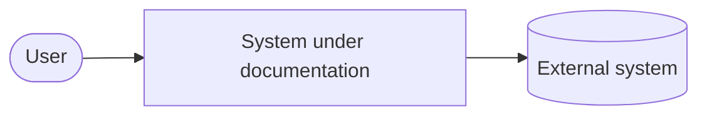
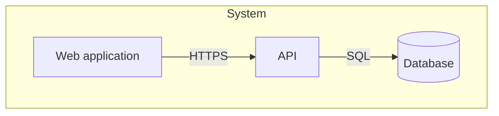
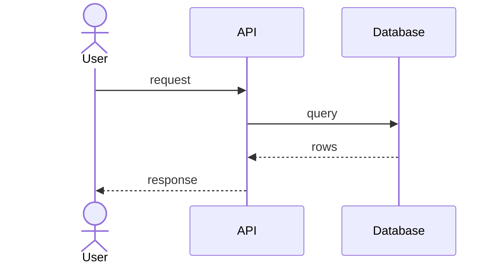
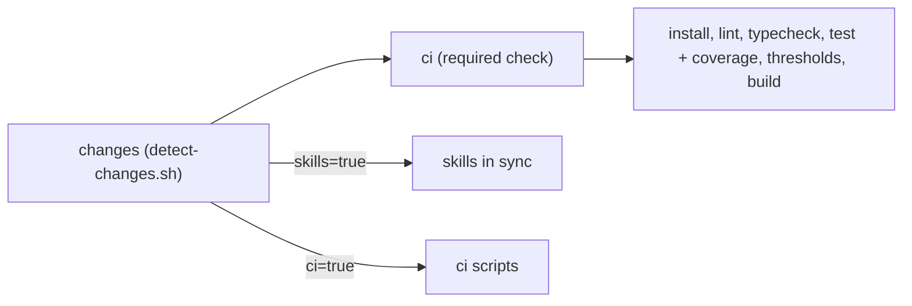

# Architecture

## 1. Goals and constraints
TO DOCUMENT — what this system must achieve, the quality attributes that drive
its design, and the constraints that are not negotiable.

## 2. Scope and context (C4 level 1)
TO DOCUMENT — the system as one box, its users and the systems it talks to.

## 3. Containers (C4 level 2)
TO DOCUMENT — deployable/runnable units, their responsibilities and protocols.

## 4. Components and building blocks (C4 level 3)
TO DOCUMENT — the internal structure of the containers that matter, module by
module, with the rule that decides where new code goes.

## 5. Runtime views
TO DOCUMENT — the two or three flows worth a sequence diagram (the critical
path, the failure path).

## 6. Cross-cutting concerns
TO DOCUMENT — authentication, error handling, logging, i18n, caching,
transactions: the conventions every module obeys.

### Continuous integration
Job graph of `.github/workflows/ci.yml` (details in
[quality-and-operations.md](quality-and-operations.md#quality-gates)):

`ci` always runs; its pnpm steps run only when `code=true` and a root
`package.json` exists. On pull requests turbo is restricted to `--affected`.

## 7. Decisions
Architecture decisions live in [decisions/](decisions/) as ADRs.
