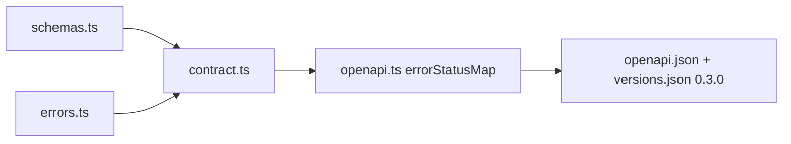

# Report: TK-21 contract for organizations, members, projects (2026-10-28)

## Summary
`@koklo/contract` goes to 0.3.0: six routes (`organization.create|list`,
`member.invite|list|setRole`, `project.create`), roles (CDC §14), typed `NOT_FOUND` and
`CONFLICT` (`reason`) errors. Contract only: no controller yet (TK-23).

## Architecture and Runtime
`errorStatusMap` now walks the contract tree instead of a hand-written list. Details and
the TK-23 checklist (including the guard without active organization) in
[api-contract.md](../../api-contract.md#what-tk-23-must-implement).

## Quality Gates and Fixes
OpenAPI regenerated and hashed in `versions.json`; 0.1.0 and 0.2.0 entries unchanged.
