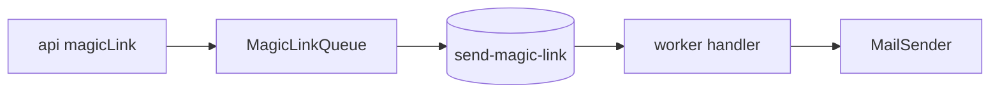

# Report: TK-22 magic link and emails (2026-10-29)

## Summary
Sign-in by magic link (600 s, hashed token, no sign-up). The api enqueues `{ email, url }`;
the worker sends through the `MailSender` port (Resend or in-memory capture).

## Architecture and Runtime
See [architecture.md](../../architecture.md#magic-link-emails-send-magic-link-queue-tk-22).

## Quality Gates and Fixes
Redaction of `token`, `url`, job `data` and `set-cookie`; payload kept 1 h. Operations and
variables: [quality-and-operations.md](../../quality-and-operations.md#emails-and-magic-link-tk-22),
[onboarding.md](../../onboarding.md). `koklo.dev` must be verified at Resend before a real send.
