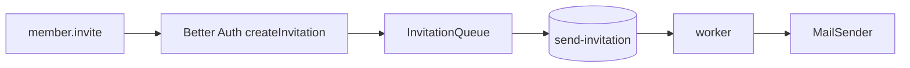

# Report: TK-23 organizations, members and roles (2026-10-29)

## Summary
The six TK-21 procedures are implemented in `apps/api`: `organization.create/list`,
`member.invite/list/setRole`, `project.create`. Better Auth `organization()` is configured with
the six CDC §14 roles. Invitations are emailed through the `send-invitation` pg-boss queue.

## Architecture and Runtime
See [architecture.md](../../architecture.md#organizations-members-and-roles-tk-23).

## Quality Gates and Fixes
Permission matrix, hypotheses H1 to H3 (to validate) and out-of-scope acceptance page:
[api-contract.md](../../api-contract.md#implementation-of-the-six-procedures-tk-23). Known limits
(invitation without email when the enqueue fails, `last_owner` race returning 500):
[quality-and-operations.md](../../quality-and-operations.md#invitations-tk-23). Enqueue failures
are now logged and sent to Sentry.
