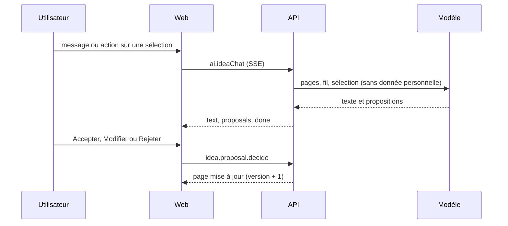

# Rapport : TK-90, l'agent de l'espace Idée et ses propositions (2026-11-08)

## Résumé
L'espace Idée (TK-89) gagne un agent : panneau Entretien / Libre, réponse en flux, actions sur la sélection, propositions de contenu et de page décidées par un humain, « Ce qui manque encore ». Contrat 2.5.0 (additif).

## Changements
- Base : tables `idea_proposals`, `idea_messages`, `idea_ai_locks`, `idea_gap_runs` (migration `20261108120000_idea_agent`, avec `down.sql`).
- Contrat 2.5.0 : `idea.proposal.{decide,undo}`, `idea.message.list`, `idea.agent.status`, `ai.ideaChat`, `ai.ideaGaps` ; `idea.list` et `idea.get` portent les propositions en attente.
- API : verrou d'un appel IA à la fois par utilisateur et projet (120 s) ; sortie du modèle traitée comme hostile (`isSafeText`) ; propositions périmées à chaque `idea.save` qui change la version ; audit des décisions.
- UI et web : composants de l'agent dans `packages/ui`, panneau et propositions dans l'espace Idée.
- Hors lot : Synthèse, jauge de maturité, passage au cadrage (TK-91), interrupteur « données en UE » (TK-93).

## Documentation
`docs/api-contract.md` (2.5.0), guide `docs/functional/guides/work-with-the-idea-agent.md`, `design/screens/S-idea.md`.
