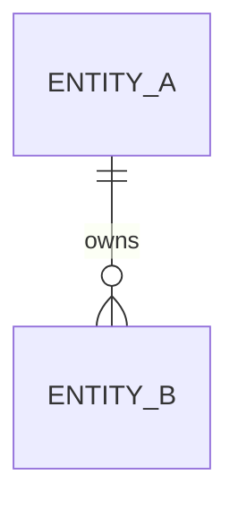
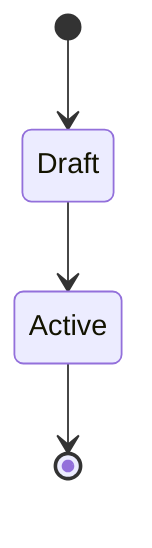

# Domain model

## Entities and responsibilities
TO DOCUMENT — one line per entity: what it owns, what it must never own.

## Relationships and cardinalities

## Enums, invariants and constraints
TO DOCUMENT — the rules the database or the domain layer enforces.

## Lifecycle and state machines
TO DOCUMENT — the state transitions that carry business meaning.

## Persistence and migrations
TO DOCUMENT — storage mapping, migration strategy, backward compatibility.
