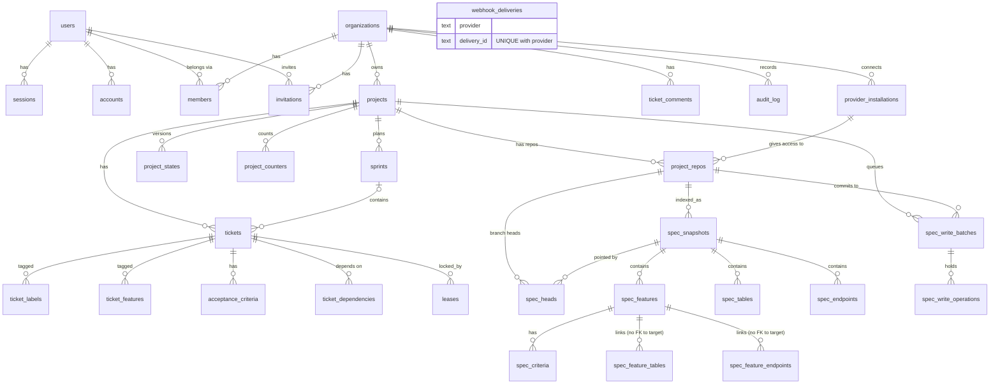
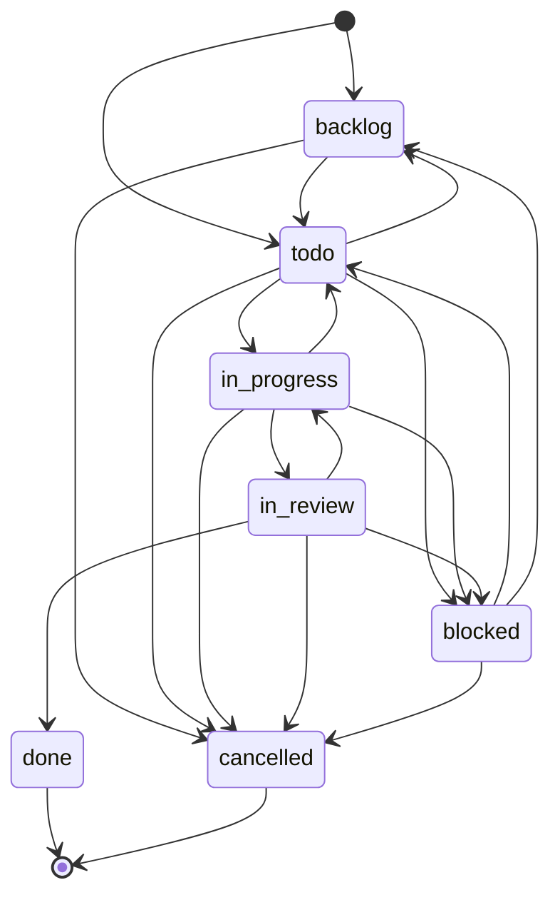
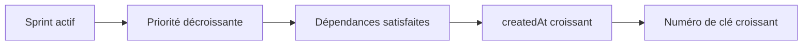
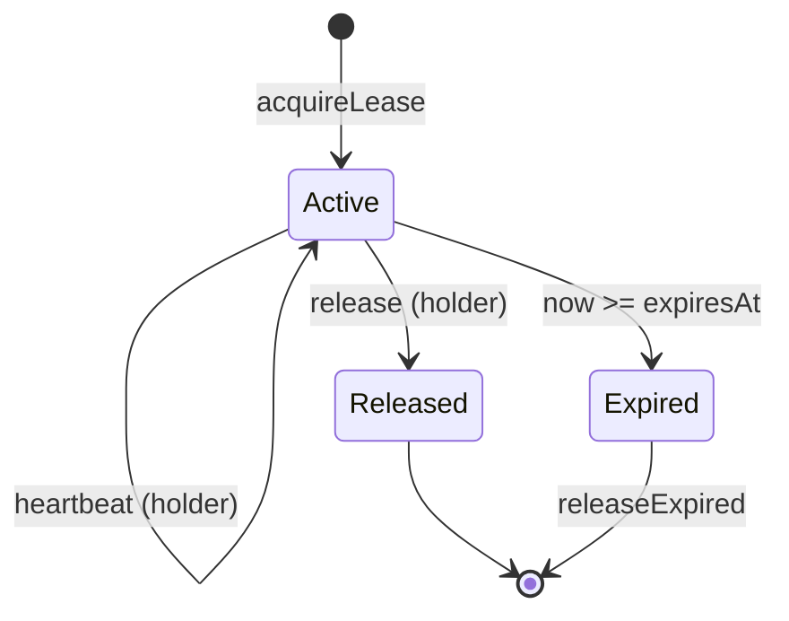
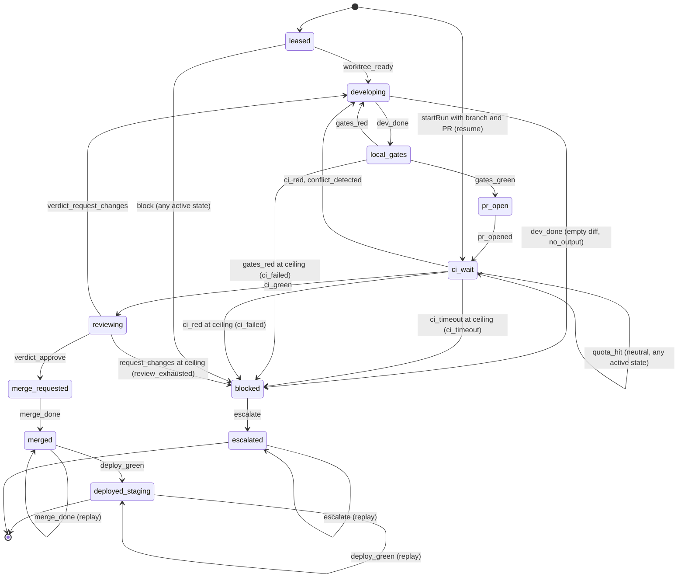

# Domain model

## Entities and responsibilities
Source of truth: `packages/db/prisma/schema.prisma` (TK-7). Models are PascalCase;
tables and columns are `snake_case` through `@@map` / `@map`.

| Table | Model | Owns |
|-------|-------|------|
| `users` | `User` | Identity (`name`, unique `email`, `email_verified`, `image`) |
| `sessions` | `Session` | Login session (unique `token`, `expires_at`, `ip_address`, `user_agent`, `active_organization_id`) |
| `accounts` | `Account` | Credentials per provider (`account_id`, `provider_id`, OAuth tokens, `password`) |
| `verifications` | `Verification` | Pending verification values (`identifier`, `value`, `expires_at`) |
| `organizations` | `Organization` | Tenant (`name`, unique `slug`, `logo`, `metadata`) |
| `members` | `Member` | A user's membership and `role` (default `member`) in an organization |
| `invitations` | `Invitation` | Invitation to an organization (`email`, `role`, `status` default `pending`, `expires_at`, `inviter_id`) |
| `projects` | `Project` | Business table: a named project of an organization |
| `tickets` | `Ticket` | Work item (`key` `TK-n`, `status`, `type`, `priority`, `pkg`, `sensitivity`, `attempts`, `review_rounds`, `estimate_hours`, optional `sprint_id`) |
| `ticket_labels`, `ticket_features` | `TicketLabel`, `TicketFeature` | Labels and feature tags of a ticket (composite key) |
| `acceptance_criteria` | `AcceptanceCriterion` | Ordered criteria of a ticket (`position` >= 1, `proof_status`) |
| `ticket_dependencies` | `TicketDependency` | Edge `ticket_id` depends on `depends_on_id` (composite key, no self-edge) |
| `sprints` | `Sprint` | Time box of a project (`number`, `key`, `starts_on`/`ends_on`, `status`) |
| `project_states` | `ProjectState` | Versioned optimistic project state (`version` >= 1, JSON object `content`) |
| `leases` | `Lease` | Ticket lease (`holder_kind`, `holder_id`, `branch`, `worktree`, `expires_at`, `ttl_ms`, `released_at`) |
| `ticket_comments` | `TicketComment` | Comments on a target (`target_kind`, `target_id`) |
| `audit_log` | `AuditLog` | Append-only audit trail (`actor_kind`, `action`, `target_kind`, `target_id`) |
| `project_counters` | `ProjectCounter` | Per-project monotonic counter (`name`: `ticket`, `sprint`, `feature`, `suggestion`; `last_value`) feeding ticket, sprint, `F-nnn` and `SG-n` keys |
| `suggestions` | `Suggestion` | Client suggestion on a project, keyed `SG-n` (see [Suggestions table](#suggestions-table-tk-51b)) |
| `reviews` | `Review` | Immutable journal of client reviews of a feature, screen or baseline at a SHA (see [Reviews and baselines](#reviews-and-baselines-tables-tk-51c)) |
| `baselines` | `Baseline` | Project baselines (`number`, `status`: `proposed`, `validated`, `tagged`) |

The first seven are the Better Auth tables (organization plugin), with fields aligned on
the Better Auth documentation (ASSUMPTION: not re-checked against the library in this
pass). Business tables carry an indexed `organization_id` (schema comment citing
vision §18.4).

### Roles (TK-23)
`members.role` holds one of `owner`, `admin`, `dev`, `designer`, `client`, `business` (CDC §14;
`roleSchema` in the contract). The creator is the only `owner`; `owner` is never assignable by
invitation or `setRole`, and an organization always keeps at least one owner.

### Spec entities (TK-40, `packages/schema`)
Distinct from the database tables above: these are the files of a project's spec repository,
validated by `@koklo/schema` (not persisted by `packages/db`). Feature `F-nnn` (status
`brouillon` | `specifiee` | `implementee` | `adoptee`, acceptance criteria `AC-n`), table `T-*`
(fields), relation (`T-a.champ` to `T-b.champ`, `1-1` | `1-n` | `n-1` | `n-n`), endpoint `E-*`,
screen `S-*` (annotated node tree), test scenario (feature + criteria covered), product roles
`RL-*` with permissions `PM-*` (`domain/roles.yaml`; action `lire` | `creer` | `modifier` |
`supprimer` | `executer` on a table or endpoint) and business rules `R-nnn`
(`domain/rules/R-nnn-slug.md`; `contrainte` | `calcul` | `workflow`, statement and examples). Invariants
enforced as issues: rule 4 (every link resolves, roles, permissions and rules included, even when `roles: []`), rule 5 (`specifiee` has a screen or endpoint,
`implementee` has a test per criterion; from `specifiee`, each criterion has Given, When, Then
steps in that order, `R5_CRITERION_INCOMPLETE`), rule 7 (no orphan entity, role, permission or rule, warning). See
`packages/schema/README.md` for the 33 issue codes.

## Relationships and cardinalities

`sessions.active_organization_id` is a plain UUID column, not a foreign key.

### Ticket, sprint, lease and audit tables (TK-28)
All eleven are tenant models (`organization_id` FK `ON DELETE CASCADE`, indexed). Hand-written
SQL in migration `*_tickets_sprints_leases` (Prisma cannot express it): partial unique indexes
(one unreleased lease per ticket, one `active` sprint per project), `CHECK` constraints
(counters and durations non-negative, `ends_on >= starts_on`), an `audit_log` trigger refusing
UPDATE/DELETE/TRUNCATE (except the cascade of an organization deletion) and a trigger keeping
`project_counters.last_value` from decreasing. Procedure in `packages/db/README.md`.

### Git provider and spec index tables (TK-41)
Thirteen tables, migration `*_provider_spec_index` (additive, reversible):
- **Installations and repos** (tenant): `provider_installations` holds only public provider
  identifiers; `project_repos` (role `spec|front|back|monorepo|mobile`, mode `new|adopted`,
  `spec_path` for a monorepo). A partial unique index allows at most one spec-carrying repo per
  project.
- **Spec index** (tenant, a projection of git rebuilt per commit): `spec_snapshots`
  (`UNIQUE(repo_id, commit_sha)`, so reindexing a commit is idempotent), `spec_heads` (the UI reads a
  branch head, not a SHA), features, criteria, tables, endpoints and two link tables without FK to
  their target (a dangling reference is a validator error, not an indexing failure). Titles and
  paths only: bodies stay in git.
  **The index is the source of truth for reads** (`spec.head|listFeatures|getFeature`, TK-45c2); a
  feature's body is read from git at the indexed `commit_sha`. A snapshot is `ready` or `failed`
  (`error_code`); `building` is never written today and reads as `ready`. A SHA may be pointed by
  several heads (first branch alphabetically is reported).
- **Bot write batches** (tenant): `spec_write_batches` (one batch = one bot commit; its `id` is the
  `Koklo-Ops:` trailer) and `spec_write_operations`; no list column (incident 6). A batch also keeps
  its outcome: `report` (JSON object), the requested commit `message` and the author's role
  (`author_role`); `failed` and `conflict` require an `error_code`, and a `commit_sha` exists only
  for a `committed` batch. `project_counters.name` gains `feature` (the `F-nnn` counter).
  Operation `position` is 1-based in the database and 0-based in the contract.
- **`webhook_deliveries`** is outside the tenant filter: a delivery arrives before the organization
  is known, so it has no `organization_id` and no FK, and is read through the raw client.
  Deduplication: `UNIQUE(provider, delivery_id)` with `INSERT ... ON CONFLICT DO NOTHING`; a
  redelivery never creates a second row or a second processing.
  A migration adds a plain index on `webhook_deliveries(installation_external_id)` (TK-45a) to find
  the deliveries of an installation. The normalized payloads (`PushWebhook`, `InstallationWebhook`,
  `OtherWebhook` in `@koklo/domain`) keep identifiers, ref and SHAs only: no commit, author, email or
  message.
- **No secret in the database**: no installation token, private key, webhook secret or user access
  token is stored (a test rejects secret-looking column names). Webhook payloads hold personal data
  (commit authors) and are meant to be purged after a bounded retention.
- **Composite foreign keys**: children reference `(organization_id, parent_id)` against
  `UNIQUE(organization_id, id)` on `projects` and on the parent tables, so a row cannot point to a
  parent of another organization even when bypassing the tenant extension.
- Enums `repo_role` and `repo_mode` mirror `REPO_ROLES` and `REPO_MODES` in `@koklo/domain`.

### OAuth tables (TK-48a1)
Two tenant tables (`TENANT_MODELS`), migrations `*_provider_auth_states` and
`*_provider_user_credentials` (additive, each with a `down.sql`):
- **`provider_auth_states`**: single-use authorization state. `nonce` is unique, `expires_at` is
  indexed, `consumed_at` marks use (consumption is an atomic conditional update: 48a2). A CHECK
  bounds the lifetime to 10 minutes; a partial index on `user_id WHERE consumed_at IS NULL` serves
  the per-user cap. `installation_id` is null for a first installation. Expired rows are purged
  opportunistically at each `installation.start` (48a2); no worker.
- **`provider_user_credentials`**: one encrypted user token per `(user_id, installation_id)`
  (unique). `ciphertext` (BYTEA, encrypted bytes then the 16-byte tag), `nonce` (12 bytes),
  `key_version` (>= 1); `expires_at` and `refresh_expires_at` stay in clear. CHECKs enforce the
  nonce length, the key version and a ciphertext longer than the tag.
- Both carry `organization_id` and a composite FK `(organization_id, installation_id)` to
  `provider_installations(organization_id, id)`, so a row cannot point at another organization's
  installation. Deleting the installation, the organization or the user cascades. No clear token
  is ever stored.

### BYOK credentials table (TK-51a)
One tenant table (`TENANT_MODELS`: `LlmProviderCredential`), migration
`20261101090000_llm_provider_credentials` (additive: one enum, one table; `down.sql` drops the table
then the enum). Prisma cannot express the CHECKs: they are written by hand in `migration.sql`.
- **`llm_provider_credentials`**: one encrypted key per `(organization_id, provider)` (`UNIQUE`);
  replacing a key is an in-place `UPDATE`. Exactly 12 columns: `id`, `organization_id`, `provider`
  (enum `llm_provider`: `anthropic`, `openai`, `google`, the values of `LLM_PROVIDER_IDS`; `fake` is
  never stored), `ciphertext` (BYTEA, encrypted bytes then the 16-byte GCM tag), `nonce` (BYTEA, 12
  bytes), `key_version` (default 1), `default_model` (nullable text), `created_by_user_id`
  (nullable, no foreign key: the user may disappear), `last_used_at`, `invalidated_at`,
  `created_at`, `updated_at`.
- CHECKs: `octet_length(nonce) = 12`; `key_version >= 1`; `octet_length(ciphertext)` between 17 and
  2064; `default_model` null or 1 to 100 characters without `/` nor `..`.
- Foreign key to `organizations` with `ON DELETE CASCADE`; `organization_id` is indexed.
- **AAD convention** (derived from the row, never stored, so no AAD column):
  `llm:v1:<organization_id>:<provider>`. A ciphertext copied to another organization or provider
  fails to decrypt. No clear key, hint or last-4 column exists.

### Suggestions table (TK-51b)
One tenant table (`TENANT_MODELS`: `Suggestion`), migration `20261101100000_suggestions` (additive: two
enums, one new `counter_name` value, one table; `down.sql` drops the table then the enums, deletes the
`suggestion` counters and recreates `counter_name` as in `20261030150000_spec_batch_outcome`).
- **`suggestions`**: `id`, `organization_id`, `project_id`, `key` (`SG-n`, unique per project),
  `target_kind` (enum `suggestion_target_kind`: `feature`, `screen`, `project`), `target_ref`
  (nullable), `body`, `author_user_id`, `author_role`, `base_sha` (nullable), `status` (enum
  `suggestion_status`: `open` default, `accepted`, `rejected`, `withdrawn`), `decided_by_user_id`,
  `decided_at`, `decision_note`, `created_at`, `updated_at`.
- **Key and counter**: `SG-n` is allocated from the per-project `project_counters` row named
  `suggestion` (monotonic, gap-free on rollback, concurrency-safe like `ticket` and `feature`).
- CHECKs: `key ~ '^SG-[1-9][0-9]*$'`; `target_ref IS NULL` exactly when `target_kind = 'project'`,
  otherwise 1 to 64 characters, and `F-nnn` for a `feature`; `body` 1 to 5000 characters;
  `decision_note` at most 2000; `base_sha` null or 40/64 lowercase hex characters; `decided_at` is set
  exactly when `status <> 'open'`; an `open` suggestion has no `decided_by_user_id` nor `decision_note`.
- Keys: a single foreign key, composite `(organization_id, project_id)` to
  `projects(organization_id, id)` `ON DELETE CASCADE` (an organization deletion cascades through the
  project). Indexes: `(organization_id)`, `(project_id, status, created_at)`, unique `(project_id, key)`
  and `(organization_id, id)`.
- **Untrusted text**: `body` and `decision_note` are client text, stored raw (never sanitised, so a
  round trip is exact). They enter an LLM prompt only through `Untrusted("client-suggestion")`.
- **Author without GDPR foreign key**: `author_user_id` and `decided_by_user_id` reference no table, so
  erasing a user leaves the suggestion (and its `author_role`) in place.

### Reviews and baselines tables (TK-51c)
Two tenant tables (`TENANT_MODELS`: `Review`, `Baseline`), migration `20261101110000_reviews_baselines`
(additive: three enums, two tables, the function `reviews_immutable()` and two triggers; `down.sql`
drops `baselines`, then the triggers, `reviews`, the function and the enums, in that order).
- **`reviews`**: `id`, `organization_id`, `project_id`, `repo_id`, `target_kind` (enum
  `review_target_kind`: `feature`, `screen`, `baseline`), `target_ref`, `sha`, `status` (enum
  `review_status`: `approved`, `changes_requested`), `author_user_id` (no foreign key, GDPR),
  `author_role`, `comment`, `created_at`, `updated_at`. CHECKs: `sha` is 40/64 lowercase hex;
  `target_ref` 1 to 64 characters, `F-nnn` for a `feature`, `baseline-<n>` (`baseline-0` allowed) for a
  `baseline`, free for a `screen`; `comment` at most 2000.
- **Append-only journal**: there is no uniqueness on target, SHA or author; every review is a new row
  and the latest one for a target (index `(project_id, target_kind, target_ref, created_at DESC)`)
  is authoritative. `UPDATE` and `TRUNCATE` are always refused (`restrict_violation`, 23001) by the
  triggers `reviews_no_update_delete` and `reviews_no_truncate`. A direct `DELETE` is refused too, except
  when the row's project or repo no longer exists, i.e. the cascade of a project, an organization (through
  the project) or a repo. Same pattern as `audit_log`.
- **`baselines`**: `id`, `organization_id`, `project_id`, `repo_id`, `number` (>= 0, unique per
  project; baseline 0 is the starting point), `status` (`proposed` default, `validated`, `tagged`),
  `proposed_sha`, `proposed_by_user_id` (no foreign key), `review_id`, `validated_at`, `tag_sha`,
  `tagged_at`. State CHECK: `proposed` has no review, validation date, tag SHA nor tag date;
  `validated` has a review and `validated_at`; `tagged` has all four. A partial unique index allows at most
  one non-`tagged` baseline per project.
- **Keys**: projects and repos by composite `(organization_id, ...)` foreign keys `ON DELETE CASCADE`
  (no `ON UPDATE CASCADE`); `baselines` reference `reviews` by `(organization_id, project_id, review_id)`
  in NO ACTION, so a review cannot be deleted alone while a baseline points to it (the cascade
  removes both).
- **Human only, and API invariants**: baselines and client validations are human-only actions (vision).
  The database does not check that the review validates the right target and SHA, nor that `repo_id`
  belongs to the same project: the API (TK-55) must verify these invariants.

### Tenant classification (TK-20)
Every model carrying `organization_id` is classified in `packages/db/src/tenant-extension.ts`:
`Project` is a tenant model (filtered by organization, see
[architecture.md](architecture.md#multi-tenant-isolation-tk-20)); `User`, `Session`, `Account`,
`Verification`, `Organization`, `Member` and `Invitation` are excluded, each with a reason.
No entity or migration changed.

## Enums, invariants and constraints
- Primary keys: `uuid` (`@db.Uuid`), generated by Prisma with `uuid(7)`.
- `created_at` (default `now()`) and `updated_at` (`@updatedAt`) on every table.
- Unique: `users.email`, `sessions.token`, `organizations.slug`,
  `members (organization_id, user_id)`.
- Every foreign key is `ON DELETE CASCADE`: session, account, member, invitation and
  project rows disappear with their parent.
- Indexes: `sessions.user_id`, `accounts.user_id`, `verifications.identifier`,
  `members.user_id`, `invitations.organization_id`, `invitations.inviter_id`,
  `projects.organization_id`.
- No SQL enum: `role` and `status` are free-form strings.

## Lifecycle and state machines
No state machine is enforced in the database. `invitations.status` defaults to
`pending`; its other values are TO DOCUMENT.

### Ticket lifecycle (TK-25, `packages/domain`)
Pure module (no I/O, no clock, no runtime dependency, relative imports only; enforced by
`test/purity.test.ts`). Statuses: `backlog`, `todo`, `in_progress`, `in_review`, `blocked`,
`done`, `cancelled`. `done` and `cancelled` are terminal; `blocked` never resumes straight
into `in_progress`. `canTransition` / `transitionTicket` apply this table (rule H1, 17
transitions); tickets are frozen values and every change returns a copy. A ticket carries
exactly one package (`parseTicketPackage`), a `TK-<n>` key, a `safe | sensitive`
sensitivity, and `attempts` / `reviewRounds` counters that only `escalate` resets.

#### `Ticket.pullRequest` format (TK-46b)

`Ticket.pullRequest` holds the pull request URL `https://github.com/<owner>/<repo>/pull/<n>`
(`parsePullRequestRef` in `@koklo/domain`: https and `github.com` only, `n` an integer from 1 to
2^31-1 without leading zero, never throws; any other text yields `undefined`). The reconciliation
pass P3 uses it and records the system audit entries `ticket.reconcile.pr_merged` and
`ticket.reconcile.pr_closed` (`actor_kind = system`, no actor, `target_kind = ticket`).

### Dependencies, eligibility and selection order (TK-26, `packages/domain`)
`DependencyGraph` is a frozen set of edges `{ ticket, dependsOn, type }` with `type` in
`blocks | related`. `addDependency` is idempotent on a duplicate edge, validates both keys and
the type, and rejects any edge that closes a cycle (`DependencyCycleError`, `path` = added edge
plus the existing path back). The no-cycle rule covers `blocks` and `related` together. Edges are
kept in a deterministic order (ticket number, target number, type). `createTicket` now requires
`createdAt` (ISO-8601 UTC, real calendar date), kept as given.

A ticket is eligible (`isEligible`) when it is `todo` and every `blocks` target is `done`
(`related` never blocks; a missing target counts as unsatisfied). `rankTickets` sorts all
tickets and `selectionOrder` keeps the eligible ones; `nextTicket` returns the first eligible
ticket of the active sprint, or `null` without an active sprint (CDC §7.3).

### Leases, locks and versioned project state (TK-27, `packages/domain`)
Same purity rules as the ticket module: time is always injected as an ISO-8601 UTC string
(`instant.ts` parses and formats it; the domain never reads a clock).
- **Lease** (`lease.ts`): claims one ticket for a holder (`member` or `runner`) with its
  branch and worktree. Default TTL 15 min (`DEFAULT_LEASE_TTL_MS = 900000`). `heartbeat`
  pushes `expiresAt` to `now + ttl`; only the holder may heartbeat or `release`; an expired or
  released lease cannot be renewed (`LeaseExpiredError`). At most one active lease per ticket
  (`LeaseAlreadyHeldError`); `releaseExpired` splits active from expired leases.
- **Lock** (`lock.ts`): short-lived exclusive lock of kind `merge` or `spec-write` on a scope.
  A held target refuses other holders (`LockAlreadyHeldError`); a holder already owning an
  active lock cannot take a second one (`NestedLockError`, refusal order: conflict, then
  nesting). Only the holder releases (`LockNotHeldByError`).
- **Project state** (`project-state.ts`): `{ version, content }`, created at version 1.
  `writeProjectState` is an optimistic write: it succeeds only if `expectedVersion` equals the
  current version, then increments it; otherwise `StaleProjectStateError` carries the current
  state so the caller can re-read and retry.

### Untrusted data, framed prompts and validated outputs (TK-50a, `packages/domain`)
Pure value types (no persistence), see [ADR 0011](adr/0011-llm-port-and-untrusted-data.md).
- **Untrusted** (`untrusted.ts`): content from outside Koklo plus its `origin`, one of `spec-file`,
  `client-suggestion`, `ticket-comment`, `issue`, `pull-request`, `git-content`, `user-input`, `brief`,
  `model-output` (`InvalidUntrustedOriginError` otherwise). Frozen, content private; interpolation,
  JSON and `util.inspect` give `[untrusted:<origin>]`. Read only through `revealUntrusted`.
- **Trusted** (`trusted.ts`): an instruction written by Koklo, built only by the `trusted` template
  tag; any interpolation is a type error and raises `TrustedInterpolationError`.
- **FramedPrompt** (`llm-prompt.ts`): `{ system, user }`, produced only by `framePrompt`. `system` is
  the fixed `UNTRUSTED_DATA_POLICY` then the instruction; `user` holds one block per datum,
  `<<<DATA n origin=… nonce=…>>>` / `<<<END n nonce=…>>>`, n from 1. The nonce is 16 to 64
  alphanumeric characters (`InvalidPromptNonceError`), supplied by the caller. Control characters
  (except newline and tab) and bidi/invisible marks become U+FFFD; content containing the nonce,
  `<<<DATA` or `<<<END` raises `UntrustedDelimiterCollisionError` (rank only).
- **Unvalidated / Validated** (`llm-output.ts`): a raw model output is `Unvalidated`;
  `validateLlmOutput(output, parse)` returns `{ status: "proposal", value }` or throws
  `LlmInvalidOutputError` (which never quotes the output). A proposal is never a decision.
  `isValidated` is true only for a proposal produced by `validateLlmOutput`; a thenable or async
  `parse` is refused.

### LLM port, budget and credential (TK-50b, `packages/domain`)
Pure types and guards, no persistence ([ADR 0011](adr/0011-llm-port-and-untrusted-data.md)).
- **LlmProvider** (`llm-provider.ts`): `{ id, complete(request) }`, one operation, no streaming, no
  tools. `id` is an `LlmServingProviderId`: `anthropic | openai | google` (`LLM_PROVIDER_IDS`,
  BYOK, the future `provider` column of TK-51) or `fake` (tests only, never stored).
- **LlmRequest / LlmResponse** (`llm-request.ts`): the request carries the model, an `LlmCredential`,
  a `FramedPrompt`, the wanted output (`text` or `json` + schema), a mandatory `LlmBudget`, an
  optional temperature (0 to 2) and `AbortSignal`, and a `trace` (`purpose`, `correlationId`,
  pattern `[A-Za-z0-9._:-]{1,64}`, never content). The response holds an `Unvalidated` output, the
  stop reason (`end | max-tokens | stop-sequence | refusal`), the usage and the provider and model
  actually served.
- **LlmBudget** (`llm-budget.ts`): `maxOutputTokens`, `timeoutMs`, `maxPromptChars`,
  `maxCostMicroUsd`, all positive integers and mandatory. Domain ceilings: 32 000 tokens, 120 000 ms,
  400 000 characters (`system` + `user`), 5 000 000 micro-USD (5 USD per call).
  `InvalidLlmBudgetError(field)` for a missing or invalid field, `LlmBudgetExceededError { limit }`
  (`output-tokens | timeout | cost | prompt-chars`) above a ceiling.
- **LlmCredential** (`llm-credential.ts`): opaque BYOK key (private field, frozen, no own property);
  every rendering gives `[redacted]`; `revealLlmCredential` is the only reader, for the adapter's last
  step. 1 to 512 characters, no control character, otherwise `InvalidLlmCredentialError(reason)`.
- **Errors** (`llm-provider-errors.ts`): root `LlmProviderError { operation, provider?, status? }`
  (operation `[a-z][a-z0-9-]{0,39}` else `unknown`, known provider, HTTP status 100 to 599, absent
  fields omitted, never a `cause`) and `LlmAuthError`, `LlmRateLimitedError { retryAfterMs }`,
  `LlmQuotaExceededError`, `LlmTimeoutError`, `LlmAbortedError`, `LlmBudgetExceededError`,
  `LlmContextTooLongError`, `LlmRefusedError`, `LlmModelNotFoundError`,
  `LlmProviderUnavailableError`, plus `LlmInvalidOutputError` (`operation = "validate"`, `reason` in
  the closed list `LLM_INVALID_OUTPUT_REASONS` = `shape | not-synchronous`). `retryAfterMs` is
  truncated and capped at `LLM_MAX_RETRY_AFTER_MS` (1 hour); a `null` diagnostic gives
  `operation = "unknown"`.
- **Adapter guard**: `assertLlmRequest` reads each field once, checks the request shape
  (`InvalidLlmRequestError(reason)`: the signal must be a real `AbortSignal`, the model has no `/`
  or `..`), then the budget, then an already aborted signal (`LlmAbortedError`), before any network
  call. It returns a deeply frozen snapshot (budget and trace copied, JSON schema cloned) that the
  adapter must use instead of the original request.

### Fake LLM and conformance (TK-50c, `@koklo/domain/testing`)
Test-support types, outside the public index ([ADR 0011](adr/0011-llm-port-and-untrusted-data.md)).
- **FakeLlm** (`testing/fake-llm.ts`): `LlmProvider` with id `fake`; `FakeLlmStep` is
  `{ reply, stop? } | { fail }` with an optional `when(call)`; `FakeLlmCall` records model, framed
  prompt, output spec, frozen budget and trace, never the credential.
  `FakeLlmScriptExhaustedError` when a script has no step left.
- **Conformance** (`testing/llm-conformance.ts`): `LlmConformanceSubject` (`provider`, `validKey`,
  `invalidKey`, `servedModel`, `replyWith`, `failWith(trigger)`, `callsMade`), triggers
  `LLM_FAILURE_TRIGGERS`, cases `LLM_CONFORMANCE_CASE_NAMES`, failure `LlmConformanceFailure`.

### Run lifecycle (TK-72 lots 1 and 2, `packages/delivery`)
A `Run` is an immutable, JSON-serialisable value (`ticket`, `state`, `attempts`, `reviewRounds`,
`ciWaits`, `blocked`, `branch`, `pullRequest`, `lastReviewedAfterFix`, `version`). `startRun`
creates it `leased`, version 0. `applyEvent(run, event, limits)` is pure and returns
`{ run, effects }`: a new deeply frozen run (`version + 1`) and the commands the runner must
execute; the machine executes nothing. Checks run in this order: unknown run state
(`InvalidRunStateError`), unknown or malformed event (`InvalidRunEventError`), invalid
`RunLimits` (`InvalidRunEventError`, for every event), idempotent replay (no-op), `expectedVersion`
different from `run.version` (`StaleRunError`), pair absent from the table
(`InvalidRunTransitionError(from, event)`, never carrying event data), then the ceilings.

Every non-terminal state except `blocked` also accepts `block` (-> `blocked`) and `quota_hit`
(neutral: same run, same version, no effect). `blocked` accepts only `escalate`; the terminals
`deployed_staging` and `escalated` accept nothing; `merged` and `blocked` are not terminal.
`conflict_detected` is accepted only in `ci_wait`. `ci_timeout` is an event that stays in
`ci_wait`, never a failure.

| Transition | Effect described |
|---|---|
| leased -> developing | `start_dev` |
| developing -> local_gates | `run_gates` |
| local_gates -> pr_open | `open_pr` |
| pr_open -> ci_wait, ci_wait -> ci_wait | `wait_ci` (`bounded: true`) |
| ci_wait -> reviewing | `start_review` |
| any return to developing | `start_dev` |
| reviewing -> merge_requested | `request_merge` |
| merge_requested -> merged | `await_deploy` |
| merged -> deployed_staging | none |
| any -> blocked | `notify` (cause) |
| blocked -> escalated | `escalate` |

**Block causes** (`BLOCK_CAUSES`, closed list, no catch-all): `dependency`, `ambiguous_spec`,
`ci_failed`, `conflict`, `quota`, `review_exhausted`, `no_output`, `git_error`, `ci_timeout`
(distinct from `ci_failed`). A block carries `{ cause, detail: { output, remoteBranchExists? } }`;
the raw output is mandatory, `no_output` also requires `remoteBranchExists`. A `dev_done` with an
empty diff becomes `blocked(no_output)`, never "PR impossible". `resumePoint(run)` maps a
persisted state to the step to resume (`blocked` -> `escalate`, terminals -> `null`).

#### Counters, ceilings and `RunLimits` (lot 2)
`RunLimits { maxAttempts, maxReviewRounds, maxCiWaits }` (integers >= 0) is an argument of
`applyEvent`; the package hardcodes no value. Project defaults are 3 / 4 / 3 and live in the
project state, outside the machine. Counters are monotonic, capped, and never exceed their
ceiling; a ceiling hit blocks with a non-empty raw output, leaves the counter unchanged and
emits `notify{cause}`, with `version + 1`.

| Counter | Incremented by | At the ceiling |
|---|---|---|
| `attempts` | `gates_red`, `ci_red` (shared); ticket attempts passed to `startRun` count (D7) | `blocked(ci_failed)` |
| `reviewRounds` | `verdict_request_changes` (the round reaching the ceiling is accepted) | `blocked(review_exhausted)` |
| `ciWaits` | `ci_timeout` (no attempt cost) | `blocked(ci_timeout)`, never `ci_failed` |

- **Final review**: `ci_green` enters `reviewing` with `lastReviewedAfterFix = (reviewRounds >=
  maxReviewRounds)`; `verdict_request_changes` resets it to false. `review_exhausted` can thus only
  follow a review of the last fix, and `verdict_approve` then leads to `merge_requested`.
- **Conflict**: `conflict_detected` (`ci_wait -> developing`) touches no counter and never blocks.
  Repeated conflicts are not bounded here (TK-76/78).
- **Escalation**: `escalate` (`blocked -> escalated`) resets the three counters to 0 and keeps the
  block cause.
- **Idempotence**: `merge_done` on `merged`, `deploy_green` on `deployed_staging` and `escalate` on
  `escalated` return an equal, deeply frozen copy of the run, no effect, version unchanged,
  without an `expectedVersion` check. Neutral steps (`quota_hit`) do the same; every `effects`
  array is frozen at construction, so a caller cannot corrupt later calls. Any other replay raises `StaleRunError` (stale version) or
  `InvalidRunTransitionError`, so counters are never counted twice.
- **Resume**: `startRun` with both `branch` and `pullRequest` creates a `ci_wait` run (version 0).
  `canRestartDevelopment(run)` is false when both are set. A persisted `leased` run with a branch
  and a PR refuses `worktree_ready` and `resumePoint` with `ResumeRequiredError(ticket, branch,
  pullRequest)`; a fix loop (`developing` with a PR) stays normal.

| Incident (annexe C §C.5) | Named test (`test/run-incidents.test.ts`) |
|---|---|
| 11 CI timeout is not a failure | `incident-11-ci-timeout-is-not-a-failure` |
| 12 conflict costs no review round | `incident-12-conflict-costs-no-review-round` |
| 13 last fix reviewed before exhaustion | `incident-13-last-fix-reviewed-before-exhaustion` |
| 17 pushed branch never restarts development | `incident-17-pushed-branch-never-restarts-development` |
| 18 empty diff is `no_output` with git output | `incident-18-empty-diff-is-no_output-with-git-output` |

- **Input validation**: `startRun` requires a non-empty `ticket`, `attempts` and `reviewRounds`
  as integers >= 0, and non-empty `branch`/`pullRequest` when present (`InvalidRunEventError`).
  Events must carry their payload: `worktree_ready.branch` and `pr_opened.pullRequest` non-empty
  strings, `dev_done.diffEmpty` and `remoteBranchExists` booleans, `expectedVersion` an integer
  >= 0. Errors never echo the faulty value; `InvalidRunStateError.value` is bounded to 32 characters.
  `worktree_ready` cannot replace an already set branch with another one (incident 17).
- **Known gaps (documented, owners TK-75/76/78)**:
  - The runner MUST always pass `expectedVersion` for events that count (`ci_timeout`, `ci_red`,
    `gates_red`, `verdict_request_changes`): without it a replay doubles the counter. To be made
    mandatory in TK-75.
  - `lastReviewedAfterFix` is informative: the machine does not refuse `verdict_approve` on it.
  - Conflicts are accepted only in `ci_wait` (no `conflict_detected` in `reviewing` or
    `merge_requested`), repeated conflicts are unbounded, and a late `merge_done` on
    `deployed_staging` is refused (TK-76/78).
  - Raw git output must be redacted upstream (TK-76) before entering `Run.blocked` or `notify`.
- **Dependency**: `@koklo/domain` stays in `packages/delivery/package.json` (the purity test pins
  it); it is reserved for TK-73+ and imported nowhere in `src` yet.

## Rules catalog (TK-71 lot A, `packages/rules`)
A **catalog** is a versioned set of engineering rules and the profiles that group them. The
input is JSON in snake_case (`schema_version`, `catalog_version`, `protected_rule_ids`); the
parsed value is camelCase (`schemaVersion`, `catalogVersion`, `protectedRuleIds`). Every object
is strict: an unknown key is refused.

- **Profile** (`profiles{id}`): `kind` in `global | language | domain | infrastructure |
  business | standard`, and a `description`.
- **Rule**: `id` (`^[a-z0-9]+(\.[a-z0-9-]+)+$`), `title`, `description`, `profiles` (at least
  one, each an existing profile), `agents` (at least one, no duplicate, among the 8 roles
  `product-owner`, `analyst`, `designer`, `developer`, `test-writer`, `qa-reviewer`,
  `tech-lead`, `doc-writer`), `severity` (`blocking | advisory`), `protected` (default
  `false`), `enforcement`.
- **Enforcement** (how a rule is checked): `gate` (`adapter`, optional `command`: a tool
  decides), `evidence` (`evidence`: the stage artifact must cite proof) or `instruction`
  (guidance only).
- **Protected rules**: `protected_rule_ids` must equal exactly the set of rules with
  `protected: true`, each id must exist, and a protected rule is always `blocking`.
  The shipped catalog protects `global.secrets`, `global.dependency-integrity`,
  `security.authorization` and `privacy.sensitive-logging`.
- A catalog has at least one rule and one profile, unique rule ids and `schema_version` 1.

`parseCatalog(json)` never throws and returns `{ ok: true, value }` or
`{ ok: false, error: { code, message, path? } }`. Checks run in this order: size, JSON,
version, protected flag and enforcement per rule (raw document), zod shape, then ids,
profiles and the protected set. The first failure wins; `path` is dotted (`rules.3.id`).

| Code | Cause | Typical `path` |
|---|---|---|
| `catalog.too-large` | more than 1 MiB (1 048 576 UTF-8 bytes) | none |
| `catalog.invalid-json` | not parseable JSON | none |
| `catalog.invalid-shape` | schema violation (type, empty list, unknown key, unknown severity or role, protected rule not blocking) | `rules.1.agents` |
| `catalog.unknown-version` | `schema_version` is not 1 | `schema_version` |
| `catalog.duplicate-id` | second occurrence of a rule id | `rules.3.id` |
| `catalog.missing-enforcement` | rule without `enforcement` | `rules.1.enforcement` |
| `catalog.unknown-enforcement` | `enforcement.kind` outside `gate | evidence | instruction` | `rules.1.enforcement.kind` |
| `catalog.unknown-profile` | rule references an undefined profile | `rules.1.profiles.1` |
| `catalog.unknown-protected-id` | `protected_rule_ids` entry matches no rule | `protected_rule_ids.1` |
| `catalog.protected-mismatch` | a rule's `protected` flag and `protected_rule_ids` disagree | `rules.1.protected` |

A protected rule that is not listed is reported as `protected-mismatch` (raw check) before the
shape check can call it `invalid-shape`.

## Rules composition (TK-71 lot B, `packages/rules`)
`resolveEffectiveRules({ catalog, layers, role, path, now, profiles?, packages? })` returns
`{ ok: true, value: Resolution }` or `{ ok: false, error: RulesError }`; it never throws.

- **Layer** (`RuleLayer`, camelCase, strict): `level` (`organization | group | project`),
  optional `author`, `profiles` (declared, never deduced), `add` (rules, with optional `paths`,
  `excludePaths`, `replaces`), `override`, `waivers`, `lock` (ids). Levels rank
  organization < group < project; the array order has no effect and a level appears once
  (`layer.duplicate-level`). A layer at level `catalog` or unknown has no right to override:
  `layer.invalid-level` (an error, not a conflict).
- **Override**: `ruleId`, `author`, `justification` (all required), optional `expires`, and at
  least one effect among `severity`, `enforcement`, `disabled`, `agents` (non-empty),
  `excludePaths`, `protected`. Weakening a rule that is not locked is allowed and traced
  (`overridden`; `hardened` when it only strengthens). `isWeaker` ranks `gate > evidence >
  instruction` and `blocking > advisory`; one weaker axis is enough. `protected: true` has no
  effect: locking goes through `lock`.
- **Waiver** (derogation, section 17.2): `ruleId`, `file` (path or pattern), `author`,
  `justification`, `expires` (mandatory). It removes the rule for matching paths only and is
  listed in `Resolution.waivers` with its `level`; it is never applied to a locked rule.
- **Expiry**: `YYYY-MM-DD`, valid up to and including `now`'s day (`now` is a date or an ISO
  date-time). An expired override or waiver is ignored and reported as `expired`.
- **Locked rule**: protected in the catalog (flag or `protectedRuleIds`), added with
  `protected: true`, or listed in the `lock` of a higher level. The lock binds strictly lower
  levels, only ever tightens, and is traced (`locked`). A lower level that tries to disable,
  weaken severity or enforcement, drop an agent, add `excludePaths`, unlock
  (`protected: false`), waive, re-add the id or `replaces` it gets a `Conflict` with reason
  `locked`. The whole override is rejected, the rule stays strictly unchanged (trace included)
  and the other changes of the layer still apply. Strengthening stays allowed.
- **Collision**: adding an existing, unlocked id without `replaces` fails with `layer.collision`.
- **Profiles**: `core` + the root selection, or that of the package with the longest path
  prefix + profiles declared by layers; unique and sorted. An unknown profile in a selection is
  `resolve.unknown-profile`; an unknown profile declared by a layer is a `unknown-profile`
  conflict (`attempted: "profile"`).

**Conflict** `{ ruleId, level, attempted, reason }`: `reason` in `locked`, `unknown-rule`,
`unknown-profile`, `expired`; `attempted` in `disable`, `severity`, `enforcement`, `agents`,
`exclude-paths`, `unlock`, `waiver`, `re-add`, `replace`, `override`, `lock`, `profile`.
Sorted by level rank, then `ruleId`, then `attempted`.

**Resolution** (JSON-serialisable, deep-frozen, never aliasing the input): `catalogVersion`,
`role`, `path` (normalised), `profiles`, `rules` (`EffectiveRule` = rule + `origin`, `locked`,
`paths`, `excludePaths`, `trace`; sorted by id), `conflicts`, `disabled` (overrides that
disabled a rule, sorted by `ruleId`), `waivers`. Only rules matching the active profiles, the
role and the path scope appear.

| Code | Cause | Typical `path` |
|---|---|---|
| `layer.invalid-shape` | schema violation, unknown key, override without effect | `override.0.author` |
| `layer.invalid-level` | level `catalog` or unknown | `level` |
| `layer.duplicate-level` | two layers at the same level | `1.level` |
| `layer.collision` | added id already taken, no `replaces` | `add.node.esm` |
| `layer.invalid-pattern` | pattern with `..`, absolute, `\` or empty | `add.0.paths.0` |
| `waiver.missing-expires` | waiver without `expires` | `waivers.0.expires` |
| `waiver.invalid-expires` | `expires` is not a real `YYYY-MM-DD` day (also for overrides) | `override.0.expires` |
| `resolve.invalid-role` / `invalid-path` / `invalid-now` | invalid input | `role`, `path`, `now` |
| `resolve.unknown-profile` | unknown profile in the root or a package selection | `profiles.0` |

**Matcher (D6)**: `*` inside one segment, a `**` segment matches 0..n segments, anything else is
literal and case-sensitive; dotfiles are matched; no `?`, no `[]`. A pattern without wildcard
covers the path and its descendants. An invalid pattern or path (`..`, absolute, `\`, NUL)
never matches. The catalog of koklo is the source of truth (D5): no automatic synchronisation
with Shipyard. `koklo-strict` and `validateEvidence` belong to lot C.

## Profile koklo-strict and evidence verdicts (TK-71 lot C, `packages/rules`)
**Profile.** `koklo-strict` (kind `standard`) groups 16 rules `strict.*` (vision §17.1 to 17.3), all
for `developer`, `qa-reviewer` and `tech-lead`; 15 are `blocking`, `strict.english-code-french-ui`
is `advisory`. It is activated explicitly (layer `profiles`, root or package selection), never
deduced from other profiles or from a role; on a catalog without `withKokloStrict` the root
selection gives `resolve.unknown-profile` and a layer declaration gives `Conflict(unknown-profile)`.

| Group | Rules |
|---|---|
| Locked (`protected`, D3) | `strict.fn-lines` (50), `strict.cognitive-complexity` (15), `strict.no-explicit-any` (`error`), `strict.file-size-source` (300), `strict.file-size-test` (500), `strict.max-params` (4, instruction), `strict.domain-purity`, `strict.conventional-commits` |
| Free (traced override or waiver) | `strict.adr-per-decision`, `strict.waiver-traced` (evidence); `strict.naming-kebab-case`, `strict.thin-controllers`, `strict.typed-errors`, `strict.structured-logs`, `strict.english-code-french-ui` (instructions); `strict.no-dead-code-or-orphan-todo` (gate `check-todo`) |

`Enforcement.params` is an object of finite scalars (number, string, boolean); nesting, `NaN`
and `Infinity` are `catalog.invalid-shape`. For `isWeaker`, on an identical adapter, a higher or
removed `params.max` is weaker; a lower or added one is a hardening. Raising a locked limit is
therefore `Conflict(locked, "enforcement")`; lowering it stays allowed (trace `hardened`).

**Verdicts.** `validateEvidence(resolution, artifact)` returns `{ ok: true, value: EvidenceReport }`
or `{ ok: false, error: { code: "evidence.invalid-shape", path? } }` (no proof text in errors).
The artifact is `{ evidence?: { ruleId, references[] }[], gates?: { ruleId, status: "pass" | "fail" }[] }`.

| Rule kind | Input | Verdict | Reason |
|---|---|---|---|
| `gate` | status `pass` | PASS | `gate-passed` |
| `gate` | status `fail` (worst wins) | FAIL | `gate-failed` |
| `gate` | no result | UNVERIFIED | `gate-not-run` |
| `evidence` | at least one non-blank reference | PASS | `evidence-provided` |
| `evidence` | only empty or blank references | UNVERIFIED | `evidence-incomplete` |
| `evidence` | nothing | UNVERIFIED | `evidence-missing` |

`instruction` rules have no verdict. `overall` is FAIL if a blocking rule is FAIL, else UNVERIFIED
if a blocking rule is UNVERIFIED, else PASS; `canPass = overall === "PASS"`; advisory rules never
block. `unknownRuleIds` lists proven ids absent from the resolution (unknown, out of role,
disabled, instruction), sorted and unique, without effect on verdicts.

**Biome drift.** `checkBiomeLimits(config)` returns `BiomeDrift { ruleId, setting, expected, actual? }`
sorted by `ruleId` for `maxLines` (50), `maxAllowedComplexity` (15) and `noExplicitAny` (`"error"`).

**Open point (tech-lead).** Vision §17.2 allows a `waivers.yaml` waiver on the limits; this package
treats them as locked (`locked` conflict). A waivable limit would be another ticket.

## Persistence and migrations
- Engine: PostgreSQL 17 (Docker Compose locally); Prisma 7 with `prisma.config.ts`.
- The generated client is written to `packages/db/src/generated` (TK-10, previously `packages/db/generated`) and consumed through `@koklo/db` (`createDbClient`); no entity changed in TK-10.
- TK-11 changes no entity: the API session resolver reads `members` (membership of the user in the active organization) through Prisma to build the organization context.
- Migrations live in `packages/db/prisma/migrations/`; the first is `20261027065954_init`.
  **Every migration folder must contain a non-empty `down.sql`** (tested).
- To create one: edit the schema, generate `down.sql` with
  `prisma migrate diff --from-schema prisma/schema.prisma --to-migrations prisma/migrations --script`
  **before** `migrate dev` (first migration: `--to-empty`), then copy it into the new
  folder. Full steps: `packages/db/README.md`.
- Apply with `pnpm db:migrate` (`prisma migrate deploy`). Roll back the latest with
  `pnpm db:rollback`: it runs its `down.sql` through `prisma db execute`, then deletes
  its row from `_prisma_migrations` so it can be re-applied. Rollback is not
  transactional and is meant for development and incident recovery.
- Tests (`packages/db/test/`) run on an ephemeral Postgres 17 (Docker, random host port,
  or `TEST_DATABASE_URL`): `up` -> `down` -> `up`, then `migrate diff --exit-code`
  between the database and `schema.prisma` must be empty; plus snake_case, uuid key and
  timestamp checks.
