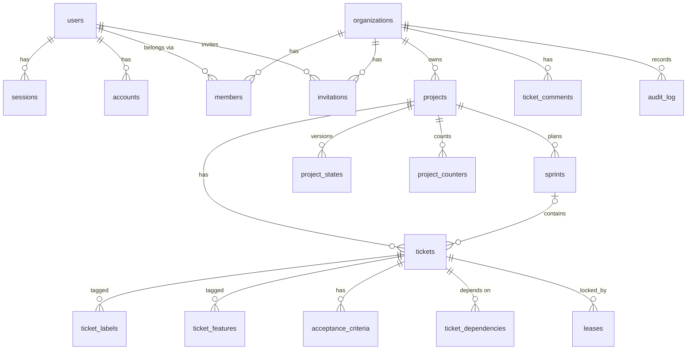
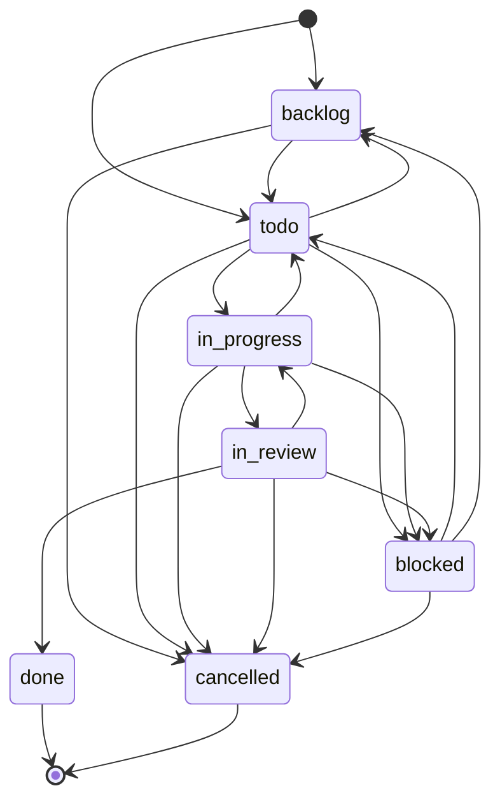
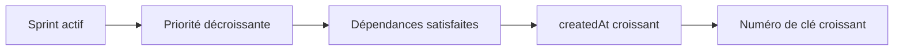
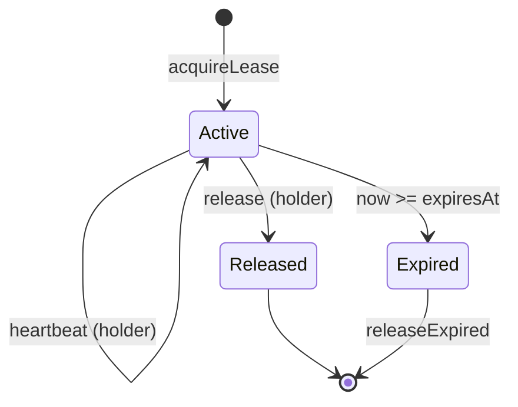

# Domain model

## Entities and responsibilities
Source of truth: `packages/db/prisma/schema.prisma` (TK-7). Models are PascalCase;
tables and columns are `snake_case` through `@@map` / `@map`.

| Table | Model | Owns |
|-------|-------|------|
| `users` | `User` | Identity (`name`, unique `email`, `email_verified`, `image`) |
| `sessions` | `Session` | Login session (unique `token`, `expires_at`, `ip_address`, `user_agent`, `active_organization_id`) |
| `accounts` | `Account` | Credentials per provider (`account_id`, `provider_id`, OAuth tokens, `password`) |
| `verifications` | `Verification` | Pending verification values (`identifier`, `value`, `expires_at`) |
| `organizations` | `Organization` | Tenant (`name`, unique `slug`, `logo`, `metadata`) |
| `members` | `Member` | A user's membership and `role` (default `member`) in an organization |
| `invitations` | `Invitation` | Invitation to an organization (`email`, `role`, `status` default `pending`, `expires_at`, `inviter_id`) |
| `projects` | `Project` | Business table: a named project of an organization |
| `tickets` | `Ticket` | Work item (`key` `TK-n`, `status`, `type`, `priority`, `pkg`, `sensitivity`, `attempts`, `review_rounds`, `estimate_hours`, optional `sprint_id`) |
| `ticket_labels`, `ticket_features` | `TicketLabel`, `TicketFeature` | Labels and feature tags of a ticket (composite key) |
| `acceptance_criteria` | `AcceptanceCriterion` | Ordered criteria of a ticket (`position` >= 1, `proof_status`) |
| `ticket_dependencies` | `TicketDependency` | Edge `ticket_id` depends on `depends_on_id` (composite key, no self-edge) |
| `sprints` | `Sprint` | Time box of a project (`number`, `key`, `starts_on`/`ends_on`, `status`) |
| `project_states` | `ProjectState` | Versioned optimistic project state (`version` >= 1, JSON object `content`) |
| `leases` | `Lease` | Ticket lease (`holder_kind`, `holder_id`, `branch`, `worktree`, `expires_at`, `ttl_ms`, `released_at`) |
| `ticket_comments` | `TicketComment` | Comments on a target (`target_kind`, `target_id`) |
| `audit_log` | `AuditLog` | Append-only audit trail (`actor_kind`, `action`, `target_kind`, `target_id`) |
| `project_counters` | `ProjectCounter` | Per-project monotonic counter (`name`, `last_value`) feeding ticket keys |

The first seven are the Better Auth tables (organization plugin), with fields aligned on
the Better Auth documentation (ASSUMPTION: not re-checked against the library in this
pass). Business tables carry an indexed `organization_id` (schema comment citing
vision §18.4).

### Roles (TK-23)
`members.role` holds one of `owner`, `admin`, `dev`, `designer`, `client`, `business` (CDC §14;
`roleSchema` in the contract). The creator is the only `owner`; `owner` is never assignable by
invitation or `setRole`, and an organization always keeps at least one owner.

### Spec entities (TK-40, `packages/schema`)
Distinct from the database tables above: these are the files of a project's spec repository,
validated by `@koklo/schema` (not persisted by `packages/db`). Feature `F-nnn` (status
`brouillon` | `specifiee` | `implementee` | `adoptee`, acceptance criteria `AC-n`), table `T-*`
(fields), relation (`T-a.champ` to `T-b.champ`, `1-1` | `1-n` | `n-1` | `n-n`), endpoint `E-*`,
screen `S-*` (annotated node tree) and test scenario (feature + criteria covered). Invariants
enforced as issues: rule 4 (every link resolves), rule 5 (`specifiee` has a screen or endpoint,
`implementee` has a test per criterion), rule 7 (no orphan entity, warning). See
`packages/schema/README.md` for the 26 issue codes.

## Relationships and cardinalities

`sessions.active_organization_id` is a plain UUID column, not a foreign key.

### Ticket, sprint, lease and audit tables (TK-28)
All eleven are tenant models (`organization_id` FK `ON DELETE CASCADE`, indexed). Hand-written
SQL in migration `*_tickets_sprints_leases` (Prisma cannot express it): partial unique indexes
(one unreleased lease per ticket, one `active` sprint per project), `CHECK` constraints
(counters and durations non-negative, `ends_on >= starts_on`), an `audit_log` trigger refusing
UPDATE/DELETE/TRUNCATE (except the cascade of an organization deletion) and a trigger keeping
`project_counters.last_value` from decreasing. Procedure in `packages/db/README.md`.

### Tenant classification (TK-20)
Every model carrying `organization_id` is classified in `packages/db/src/tenant-extension.ts`:
`Project` is a tenant model (filtered by organization, see
[architecture.md](architecture.md#multi-tenant-isolation-tk-20)); `User`, `Session`, `Account`,
`Verification`, `Organization`, `Member` and `Invitation` are excluded, each with a reason.
No entity or migration changed.

## Enums, invariants and constraints
- Primary keys: `uuid` (`@db.Uuid`), generated by Prisma with `uuid(7)`.
- `created_at` (default `now()`) and `updated_at` (`@updatedAt`) on every table.
- Unique: `users.email`, `sessions.token`, `organizations.slug`,
  `members (organization_id, user_id)`.
- Every foreign key is `ON DELETE CASCADE`: session, account, member, invitation and
  project rows disappear with their parent.
- Indexes: `sessions.user_id`, `accounts.user_id`, `verifications.identifier`,
  `members.user_id`, `invitations.organization_id`, `invitations.inviter_id`,
  `projects.organization_id`.
- No SQL enum: `role` and `status` are free-form strings.

## Lifecycle and state machines
No state machine is enforced in the database. `invitations.status` defaults to
`pending`; its other values are TO DOCUMENT.

### Ticket lifecycle (TK-25, `packages/domain`)
Pure module (no I/O, no clock, no runtime dependency, relative imports only; enforced by
`test/purity.test.ts`). Statuses: `backlog`, `todo`, `in_progress`, `in_review`, `blocked`,
`done`, `cancelled`. `done` and `cancelled` are terminal; `blocked` never resumes straight
into `in_progress`. `canTransition` / `transitionTicket` apply this table (rule H1, 17
transitions); tickets are frozen values and every change returns a copy. A ticket carries
exactly one package (`parseTicketPackage`), a `TK-<n>` key, a `safe | sensitive`
sensitivity, and `attempts` / `reviewRounds` counters that only `escalate` resets.

### Dependencies, eligibility and selection order (TK-26, `packages/domain`)
`DependencyGraph` is a frozen set of edges `{ ticket, dependsOn, type }` with `type` in
`blocks | related`. `addDependency` is idempotent on a duplicate edge, validates both keys and
the type, and rejects any edge that closes a cycle (`DependencyCycleError`, `path` = added edge
plus the existing path back). The no-cycle rule covers `blocks` and `related` together. Edges are
kept in a deterministic order (ticket number, target number, type). `createTicket` now requires
`createdAt` (ISO-8601 UTC, real calendar date), kept as given.

A ticket is eligible (`isEligible`) when it is `todo` and every `blocks` target is `done`
(`related` never blocks; a missing target counts as unsatisfied). `rankTickets` sorts all
tickets and `selectionOrder` keeps the eligible ones; `nextTicket` returns the first eligible
ticket of the active sprint, or `null` without an active sprint (CDC §7.3).

### Leases, locks and versioned project state (TK-27, `packages/domain`)
Same purity rules as the ticket module: time is always injected as an ISO-8601 UTC string
(`instant.ts` parses and formats it; the domain never reads a clock).
- **Lease** (`lease.ts`): claims one ticket for a holder (`member` or `runner`) with its
  branch and worktree. Default TTL 15 min (`DEFAULT_LEASE_TTL_MS = 900000`). `heartbeat`
  pushes `expiresAt` to `now + ttl`; only the holder may heartbeat or `release`; an expired or
  released lease cannot be renewed (`LeaseExpiredError`). At most one active lease per ticket
  (`LeaseAlreadyHeldError`); `releaseExpired` splits active from expired leases.
- **Lock** (`lock.ts`): short-lived exclusive lock of kind `merge` or `spec-write` on a scope.
  A held target refuses other holders (`LockAlreadyHeldError`); a holder already owning an
  active lock cannot take a second one (`NestedLockError`, refusal order: conflict, then
  nesting). Only the holder releases (`LockNotHeldByError`).
- **Project state** (`project-state.ts`): `{ version, content }`, created at version 1.
  `writeProjectState` is an optimistic write: it succeeds only if `expectedVersion` equals the
  current version, then increments it; otherwise `StaleProjectStateError` carries the current
  state so the caller can re-read and retry.

## Persistence and migrations
- Engine: PostgreSQL 17 (Docker Compose locally); Prisma 7 with `prisma.config.ts`.
- The generated client is written to `packages/db/src/generated` (TK-10, previously `packages/db/generated`) and consumed through `@koklo/db` (`createDbClient`); no entity changed in TK-10.
- TK-11 changes no entity: the API session resolver reads `members` (membership of the user in the active organization) through Prisma to build the organization context.
- Migrations live in `packages/db/prisma/migrations/`; the first is `20261027065954_init`.
  **Every migration folder must contain a non-empty `down.sql`** (tested).
- To create one: edit the schema, generate `down.sql` with
  `prisma migrate diff --from-schema prisma/schema.prisma --to-migrations prisma/migrations --script`
  **before** `migrate dev` (first migration: `--to-empty`), then copy it into the new
  folder. Full steps: `packages/db/README.md`.
- Apply with `pnpm db:migrate` (`prisma migrate deploy`). Roll back the latest with
  `pnpm db:rollback`: it runs its `down.sql` through `prisma db execute`, then deletes
  its row from `_prisma_migrations` so it can be re-applied. Rollback is not
  transactional and is meant for development and incident recovery.
- Tests (`packages/db/test/`) run on an ephemeral Postgres 17 (Docker, random host port,
  or `TEST_DATABASE_URL`): `up` -> `down` -> `up`, then `migrate diff --exit-code`
  between the database and `schema.prisma` must be empty; plus snake_case, uuid key and
  timestamp checks.
