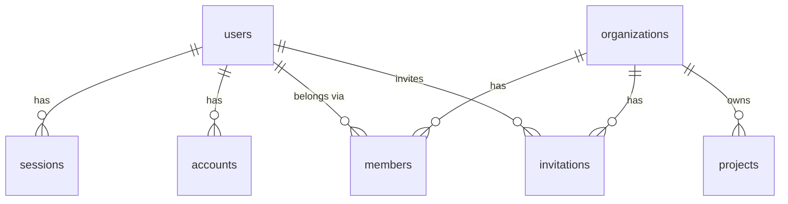

# Domain model

## Entities and responsibilities
Source of truth: `packages/db/prisma/schema.prisma` (TK-7). Models are PascalCase;
tables and columns are `snake_case` through `@@map` / `@map`.

| Table | Model | Owns |
|-------|-------|------|
| `users` | `User` | Identity (`name`, unique `email`, `email_verified`, `image`) |
| `sessions` | `Session` | Login session (unique `token`, `expires_at`, `ip_address`, `user_agent`, `active_organization_id`) |
| `accounts` | `Account` | Credentials per provider (`account_id`, `provider_id`, OAuth tokens, `password`) |
| `verifications` | `Verification` | Pending verification values (`identifier`, `value`, `expires_at`) |
| `organizations` | `Organization` | Tenant (`name`, unique `slug`, `logo`, `metadata`) |
| `members` | `Member` | A user's membership and `role` (default `member`) in an organization |
| `invitations` | `Invitation` | Invitation to an organization (`email`, `role`, `status` default `pending`, `expires_at`, `inviter_id`) |
| `projects` | `Project` | Business table: a named project of an organization |

The first seven are the Better Auth tables (organization plugin), with fields aligned on
the Better Auth documentation (ASSUMPTION: not re-checked against the library in this
pass). Business tables carry an indexed `organization_id` (schema comment citing
vision §18.4).

### Roles (TK-23)
`members.role` holds one of `owner`, `admin`, `dev`, `designer`, `client`, `business` (CDC §14;
`roleSchema` in the contract). The creator is the only `owner`; `owner` is never assignable by
invitation or `setRole`, and an organization always keeps at least one owner.

## Relationships and cardinalities

`sessions.active_organization_id` is a plain UUID column, not a foreign key.

### Tenant classification (TK-20)
Every model carrying `organization_id` is classified in `packages/db/src/tenant-extension.ts`:
`Project` is a tenant model (filtered by organization, see
[architecture.md](architecture.md#multi-tenant-isolation-tk-20)); `User`, `Session`, `Account`,
`Verification`, `Organization`, `Member` and `Invitation` are excluded, each with a reason.
No entity or migration changed.

## Enums, invariants and constraints
- Primary keys: `uuid` (`@db.Uuid`), generated by Prisma with `uuid(7)`.
- `created_at` (default `now()`) and `updated_at` (`@updatedAt`) on every table.
- Unique: `users.email`, `sessions.token`, `organizations.slug`,
  `members (organization_id, user_id)`.
- Every foreign key is `ON DELETE CASCADE`: session, account, member, invitation and
  project rows disappear with their parent.
- Indexes: `sessions.user_id`, `accounts.user_id`, `verifications.identifier`,
  `members.user_id`, `invitations.organization_id`, `invitations.inviter_id`,
  `projects.organization_id`.
- No SQL enum: `role` and `status` are free-form strings.

## Lifecycle and state machines
No state machine is enforced in the database. `invitations.status` defaults to
`pending`; its other values are TO DOCUMENT.

## Persistence and migrations
- Engine: PostgreSQL 17 (Docker Compose locally); Prisma 7 with `prisma.config.ts`.
- The generated client is written to `packages/db/src/generated` (TK-10, previously `packages/db/generated`) and consumed through `@koklo/db` (`createDbClient`); no entity changed in TK-10.
- TK-11 changes no entity: the API session resolver reads `members` (membership of the user in the active organization) through Prisma to build the organization context.
- Migrations live in `packages/db/prisma/migrations/`; the first is `20261027065954_init`.
  **Every migration folder must contain a non-empty `down.sql`** (tested).
- To create one: edit the schema, generate `down.sql` with
  `prisma migrate diff --from-schema prisma/schema.prisma --to-migrations prisma/migrations --script`
  **before** `migrate dev` (first migration: `--to-empty`), then copy it into the new
  folder. Full steps: `packages/db/README.md`.
- Apply with `pnpm db:migrate` (`prisma migrate deploy`). Roll back the latest with
  `pnpm db:rollback`: it runs its `down.sql` through `prisma db execute`, then deletes
  its row from `_prisma_migrations` so it can be re-applied. Rollback is not
  transactional and is meant for development and incident recovery.
- Tests (`packages/db/test/`) run on an ephemeral Postgres 17 (Docker, random host port,
  or `TEST_DATABASE_URL`): `up` -> `down` -> `up`, then `migrate diff --exit-code`
  between the database and `schema.prisma` must be empty; plus snake_case, uuid key and
  timestamp checks.
