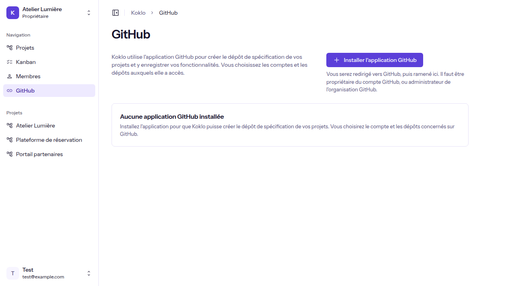
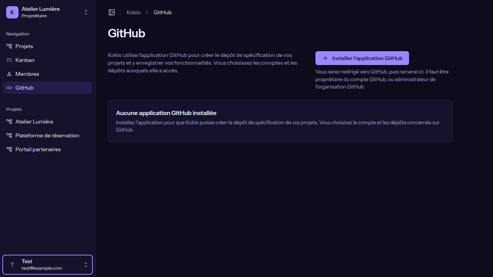
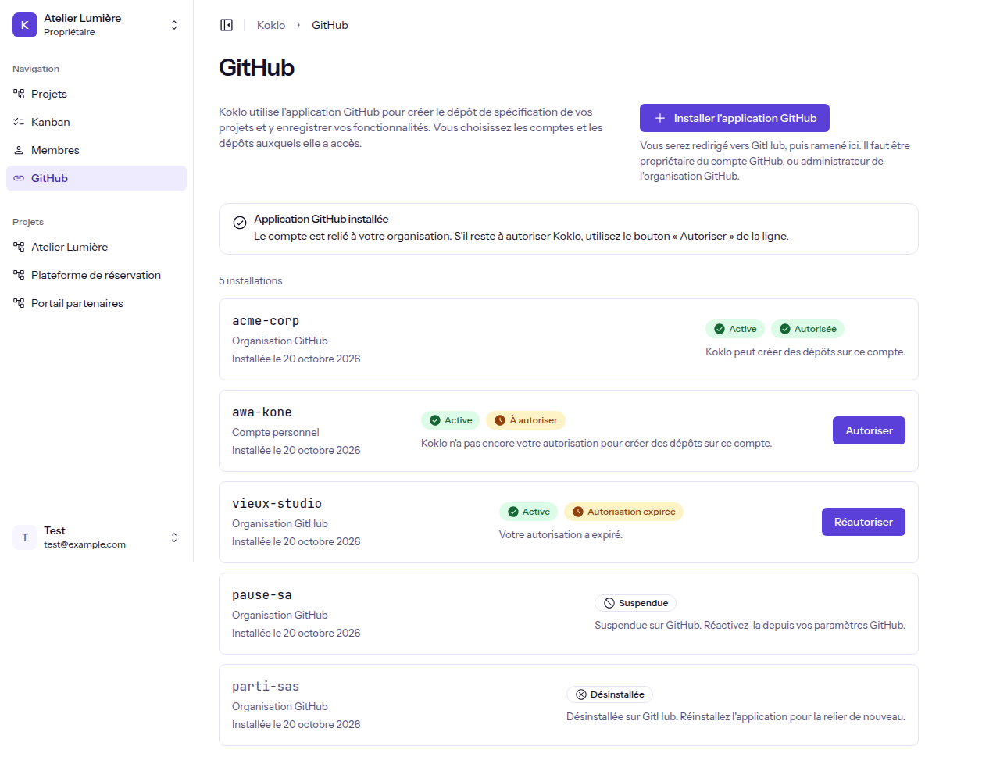
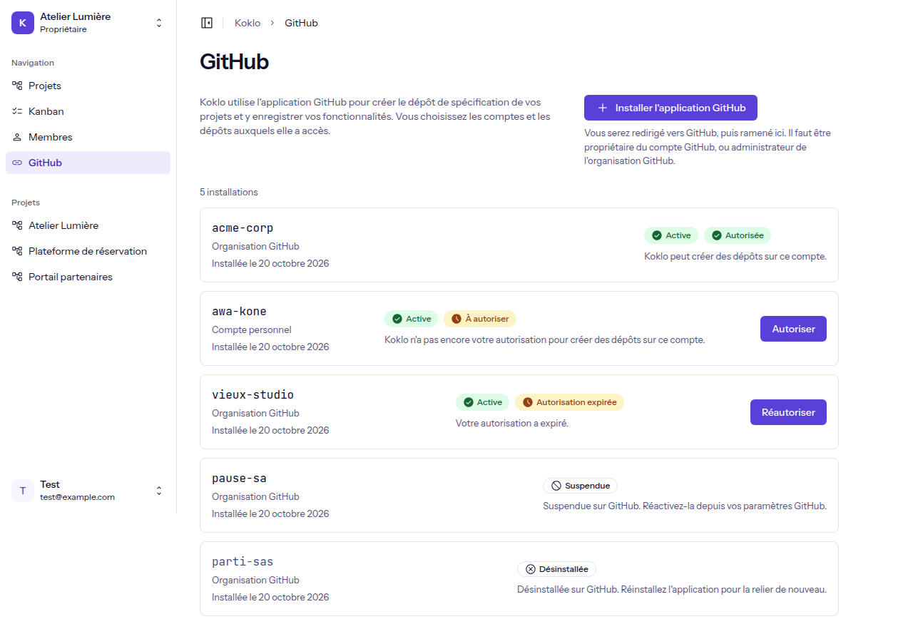
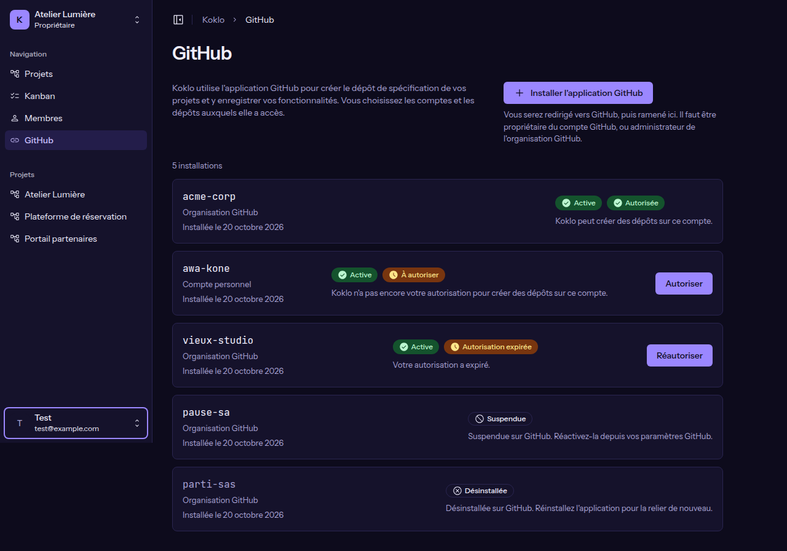

# Connecter GitHub à Koklo

**Pour qui** : les **Propriétaires** et les **Administrateurs**. Les autres rôles voient seulement un message qui les invite à s'adresser à l'un d'eux.
**Avant de commencer** : avoir une organisation active, et être propriétaire du compte GitHub à relier (ou administrateur de l'organisation GitHub).
**Résultat** : le compte GitHub apparaît dans la liste avec le statut **Active**, et Koklo est **Autorisée** à y créer des dépôts.

## Étapes

1. Dans le menu latéral, cliquez sur **GitHub**.

   
   

2. Cliquez sur **Installer l'application GitHub**. Le bouton affiche « Redirection vers GitHub… » : vous quittez Koklo.
3. Sur GitHub, choisissez le compte, puis les dépôts auxquels Koklo a accès, et validez.
4. GitHub vous ramène sur la page **GitHub** avec le message **Application GitHub installée**.

   

5. Si la ligne du compte indique **À autoriser** ou **Autorisation expirée**, cliquez sur **Autoriser** (ou **Réautoriser**) et confirmez sur GitHub.

   
   

## Vérifier que ça a marché
La ligne du compte affiche **Active** et **Autorisée**, avec « Koklo peut créer des dépôts sur ce compte. »

## Si quelque chose ne va pas
| Message | Cause | Que faire |
|---------|-------|-----------|
| Installation non terminée | L'accès a été refusé ou non confirmé | Recommencez l'installation |
| Ce retour depuis GitHub n'est plus valable | Le retour dure 10 minutes et ne sert qu'une fois | Relancez l'installation depuis la page |
| Installation déjà utilisée | Ce compte est déjà relié à une autre organisation Koklo | Utilisez un autre compte GitHub |
| Seul le propriétaire du compte peut faire cette liaison | Vous n'êtes pas propriétaire (ou administrateur de l'organisation GitHub) | Demandez à un propriétaire, ou connectez-vous avec le bon compte GitHub |
| GitHub n'a pas répondu comme prévu | Problème côté GitHub | Réessayez dans quelques minutes |
| L'installation n'est pas disponible pour le moment | L'application n'est pas configurée sur cet environnement | Contactez la personne qui administre Koklo |
| Trop de tentatives en cours | Plusieurs installations commencées sans être terminées | Attendez 10 minutes |
