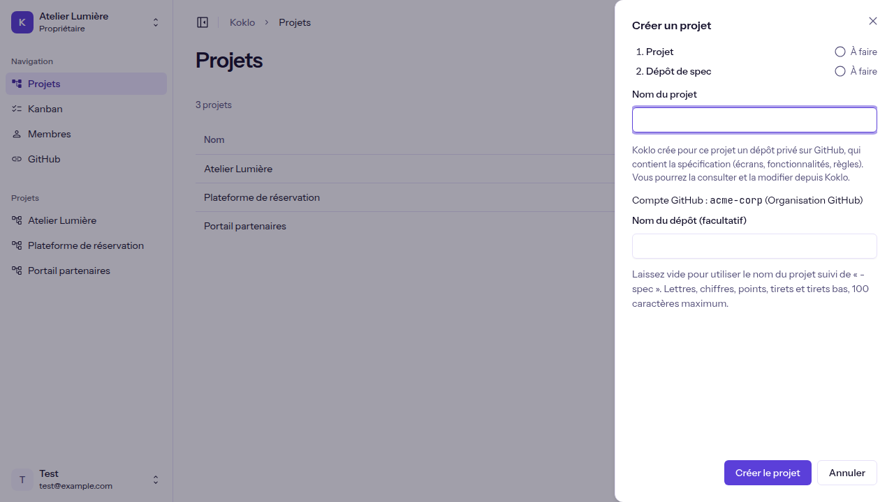
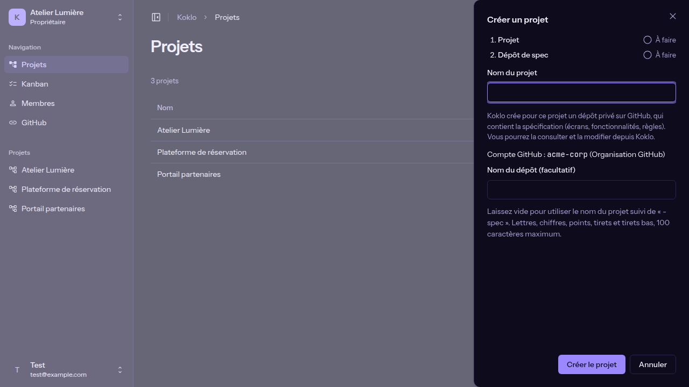
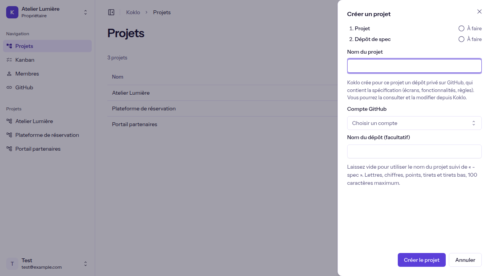
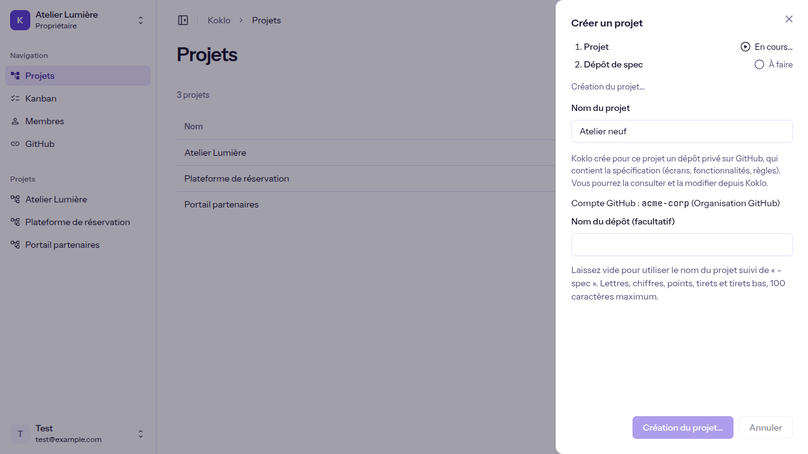
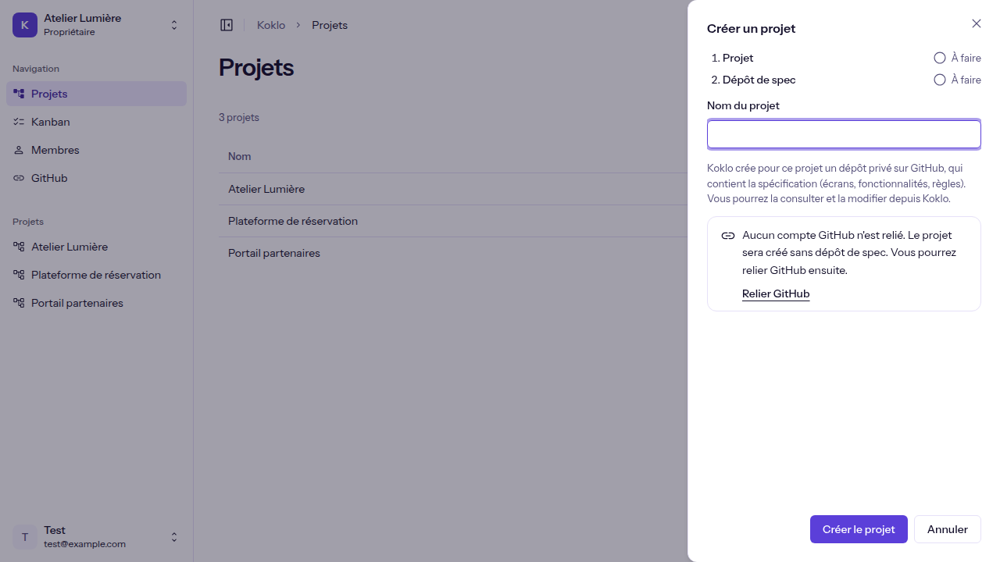
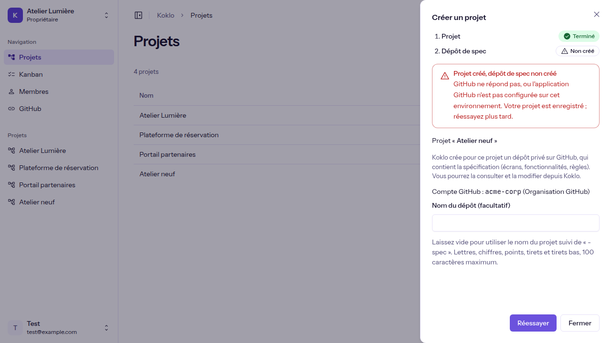
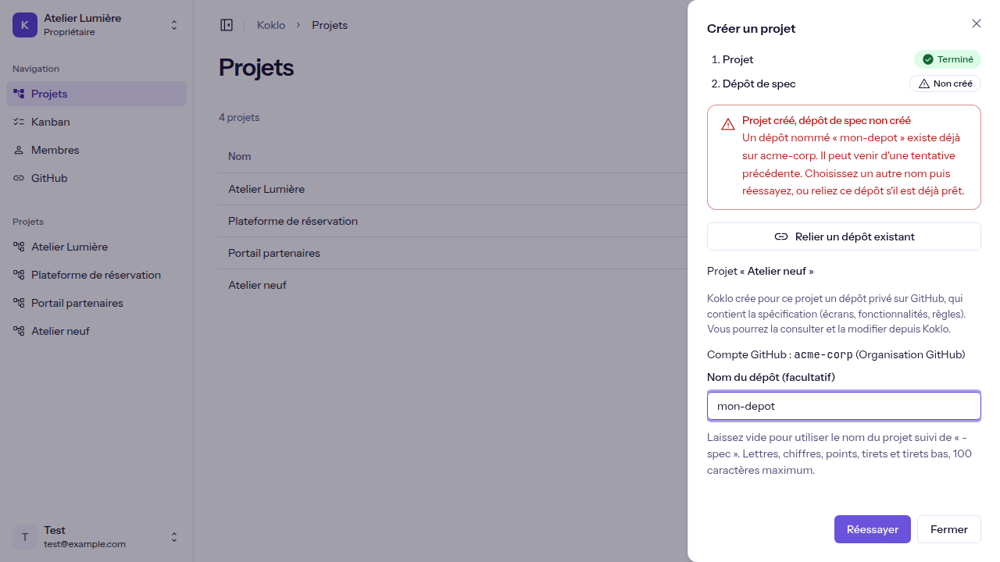
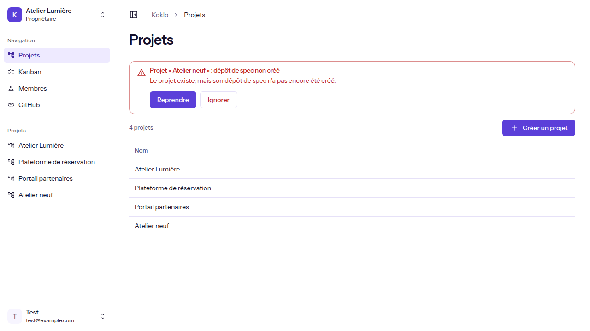

# Créer un projet

**Pour qui** : les **Propriétaires** et les **Administrateurs**. Pour les autres rôles, le bouton n'est pas affiché.
**Avant de commencer** : avoir une organisation active (voir [Créer une organisation](create-an-organization.md)) et, pour le dépôt de spec, un compte GitHub relié (voir [Relier GitHub](connect-github.md)).
**Résultat** : le projet apparaît dans la liste de la page "Projets", avec son dépôt de spec sur GitHub.

## Étapes

1. Ouvrez **Projets** dans le menu latéral. Sans projet, la page indique "Aucun projet pour le moment" et "Créez votre premier projet pour commencer."

   

2. Cliquez sur **Créer un projet**. Un panneau "Créer un projet" s'ouvre à droite. Il montre deux étapes : **Projet** puis **Dépôt de spec**. Koklo crée pour le projet un dépôt privé sur GitHub, qui contient la spécification.

   
   

3. Saisissez le **Nom du projet** (100 caractères au plus).
4. Choisissez le **Compte GitHub** si plusieurs sont reliés (avec un seul, il est utilisé d'office). Le **Nom du dépôt** est facultatif : laissé vide, Koklo utilise le nom du projet suivi de "-spec".

   

5. Cliquez sur **Créer le projet**. Les étapes passent à "En cours…" puis "Terminé". **Annuler** referme le panneau sans rien créer ; pendant l'envoi, le panneau ne peut pas être fermé.

   

Si aucun compte GitHub n'est relié, le projet est créé sans dépôt et le panneau propose **Relier GitHub** (voir [Relier GitHub](connect-github.md)).

   

## Vérifier que ça a marché
Le panneau se ferme, le message "Projet « <nom> » et dépôt de spec créés." est annoncé et le projet figure dans la liste, qui indique le nombre de projets.

## Si quelque chose ne va pas
| Symptôme | Cause | Que faire |
|----------|-------|-----------|
| Pas de bouton **Créer un projet** | Votre rôle ne permet pas d'en créer | Demandez à un Propriétaire ou à un Administrateur |
| "Saisissez le nom du projet." | Nom vide | Saisissez un nom |
| "Le nom ne peut pas dépasser 100 caractères." | Nom trop long | Raccourcissez-le |
| "Vous n'avez pas le droit de créer un projet. Demandez à un propriétaire ou à un administrateur." | Droits insuffisants côté serveur | Demandez à un Propriétaire ou à un Administrateur |
| "Le projet n'a pas pu être créé" | Erreur serveur | Réessayez dans un instant |
| "Impossible de charger les projets" | Erreur réseau | Cliquez sur **Réessayer** |

## Si le projet est créé mais pas son dépôt
Le projet est enregistré, mais le panneau affiche "Projet créé, dépôt de spec non créé" avec la cause et l'action à faire.

| Message | Que faire |
|---------|-----------|
| "GitHub ne répond pas…" | Cliquez sur **Réessayer** plus tard : seul le dépôt est recréé, pas le projet |
| "Pour créer un dépôt sur le compte …, Koklo a besoin de votre autorisation." | Cliquez sur **Autoriser Koklo** : vous passez par GitHub, puis revenez sur Koklo |
| "L'autorisation Koklo sur GitHub a expiré" | Cliquez sur **Réautoriser Koklo** |
| "Un dépôt nommé … existe déjà" | Changez le nom du dépôt puis **Réessayer**, ou **Relier un dépôt existant** s'il est déjà prêt |
| "Vous n'avez plus le droit de créer un dépôt" | Demandez à un Propriétaire ou à un Administrateur de relier le dépôt |

Si vous fermez le panneau sans dépôt, ou revenez de GitHub, une notice "Projet « … » : dépôt de spec non créé" s'affiche au-dessus de la liste. **Reprendre** rouvre le panneau directement à l'étape du dépôt ; **Ignorer** efface la notice.

