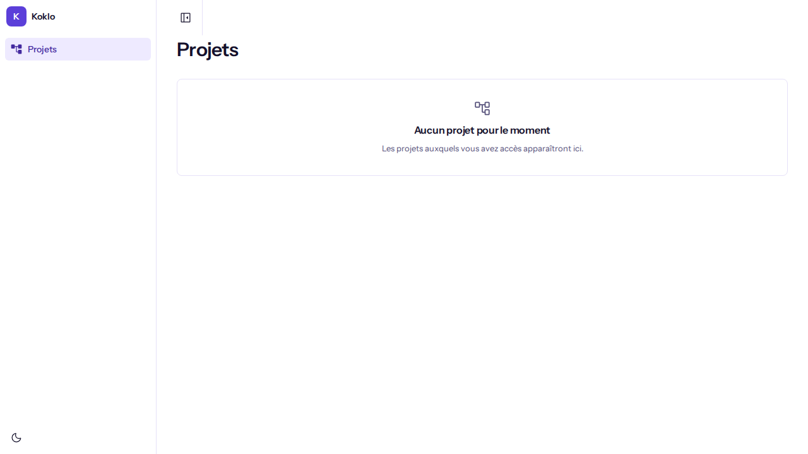
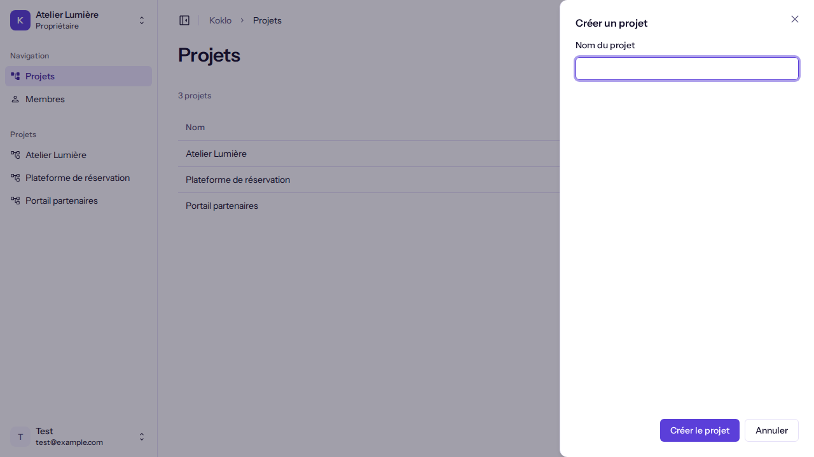
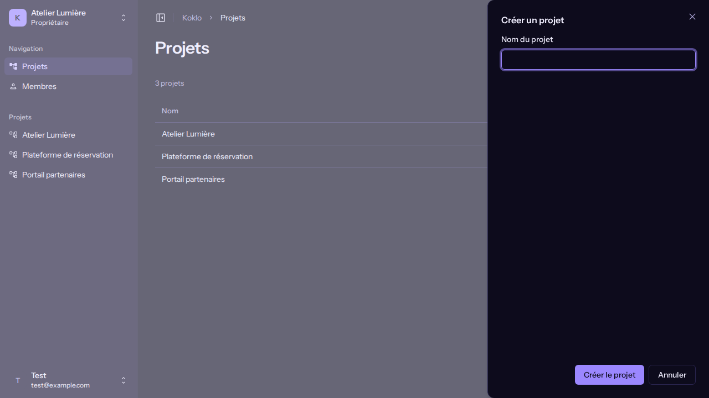
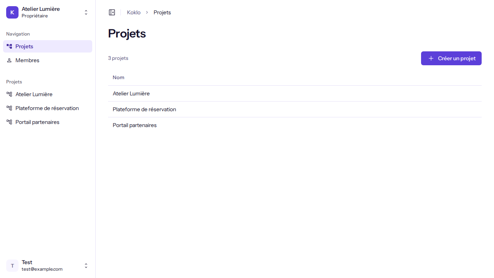
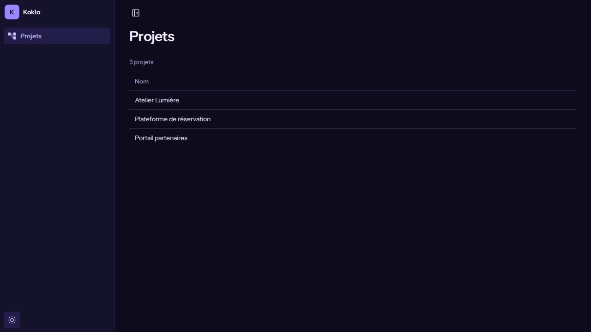

# Créer un projet

**Pour qui** : les **Propriétaires** et les **Administrateurs**. Pour les autres rôles, le bouton n'est pas affiché.
**Avant de commencer** : avoir une organisation active (voir [Créer une organisation](create-an-organization.md)).
**Résultat** : le projet apparaît dans la liste de la page "Projets".

## Étapes

1. Ouvrez **Projets** dans le menu latéral. Sans projet, la page indique "Aucun projet pour le moment" et "Créez votre premier projet pour commencer."

   

2. Cliquez sur **Créer un projet**. Un panneau "Créer un projet" s'ouvre à droite.

   
   

3. Saisissez le **Nom du projet** (100 caractères au plus).
4. Cliquez sur **Créer le projet** ("Création…" pendant l'envoi). **Annuler** referme le panneau sans rien créer.

## Vérifier que ça a marché
Le panneau se ferme, le message "Projet « <nom> » créé." est annoncé et le projet figure dans la liste, qui indique le nombre de projets.

## Si quelque chose ne va pas
| Symptôme | Cause | Que faire |
|----------|-------|-----------|
| Pas de bouton **Créer un projet** | Votre rôle ne permet pas d'en créer | Demandez à un Propriétaire ou à un Administrateur |
| "Saisissez le nom du projet." | Nom vide | Saisissez un nom |
| "Le nom ne peut pas dépasser 100 caractères." | Nom trop long | Raccourcissez-le |
| "Vous n'avez pas le droit de créer un projet. Demandez à un propriétaire ou à un administrateur." | Droits insuffisants côté serveur | Demandez à un Propriétaire ou à un Administrateur |
| "Le projet n'a pas pu être créé" | Erreur serveur | Réessayez dans un instant |
| "Impossible de charger les projets" | Erreur réseau | Cliquez sur **Réessayer** |
