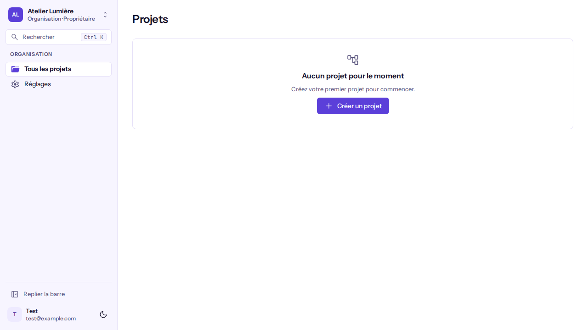
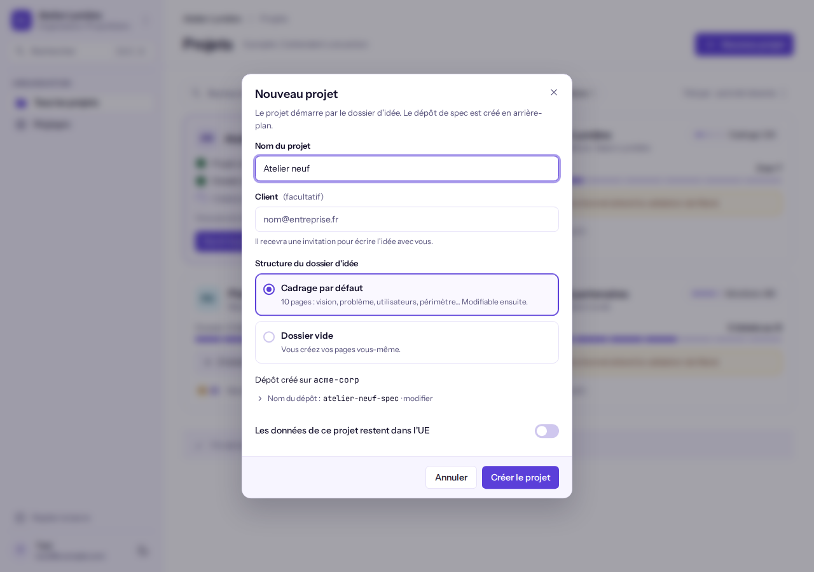
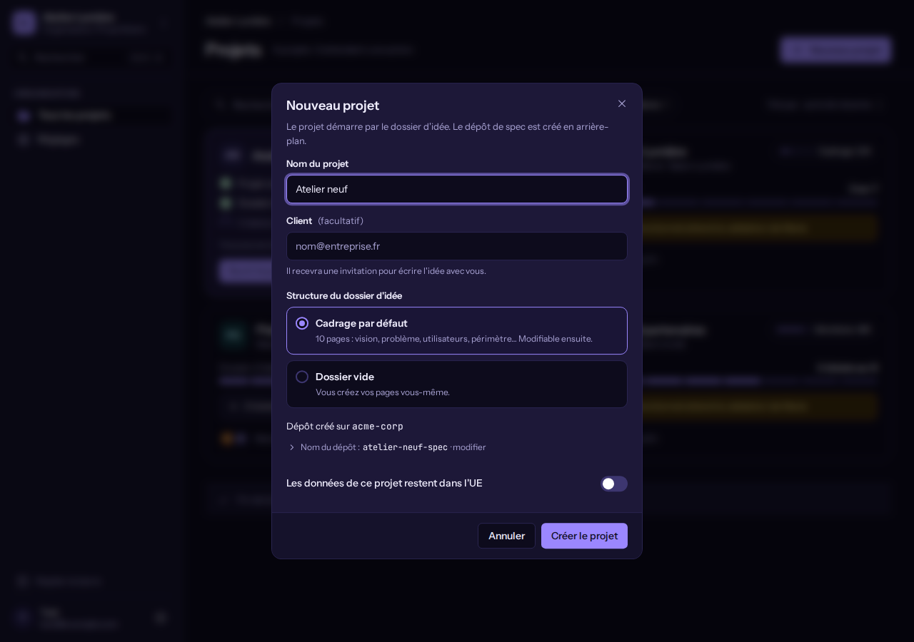
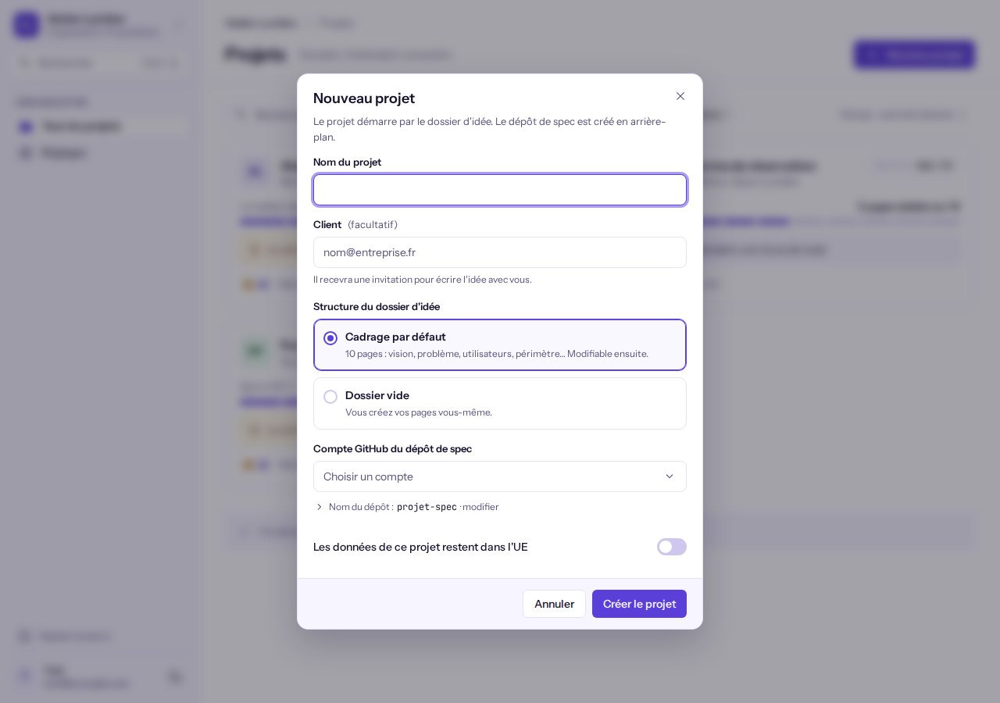
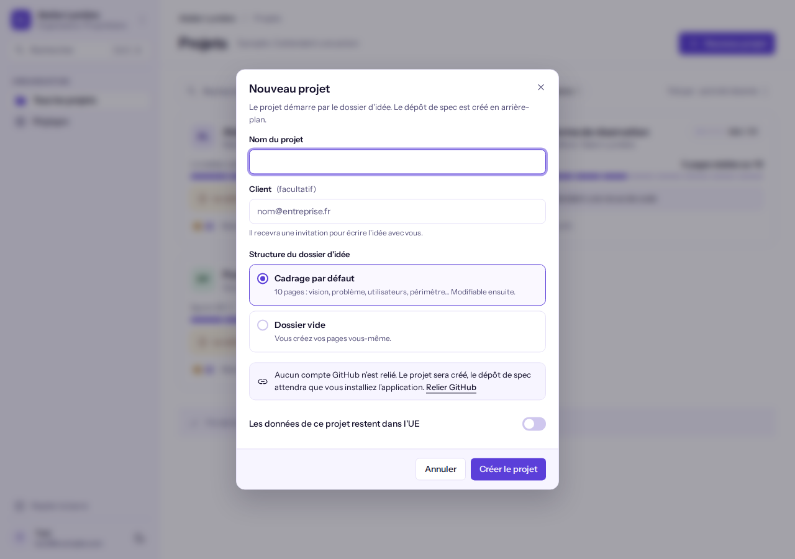
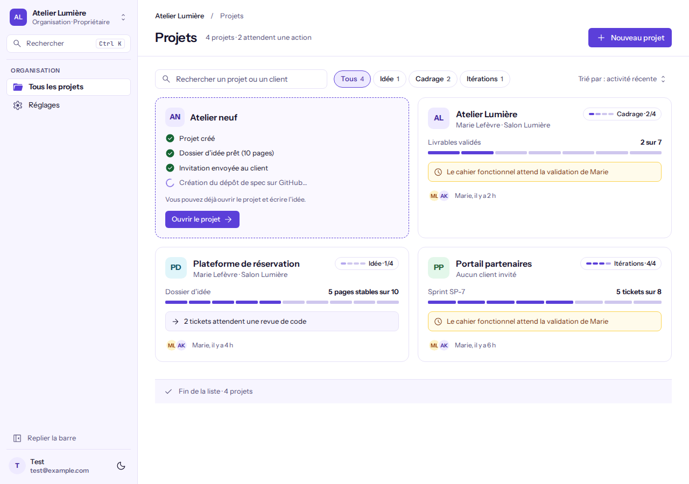
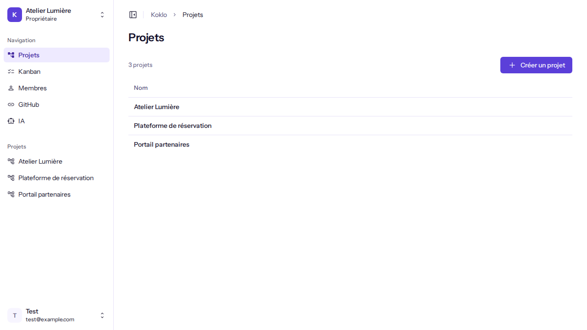
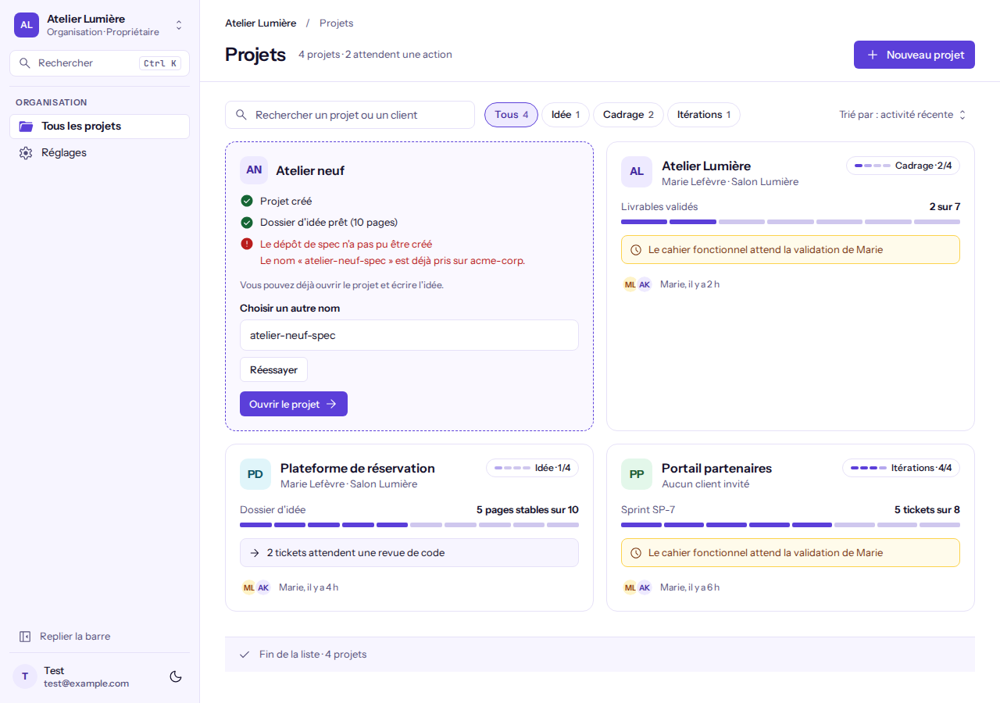

# Créer un projet

**Pour qui** : les **Propriétaires** et les **Administrateurs**. Pour les autres rôles, le bouton n'est pas affiché.
**Avant de commencer** : avoir une organisation active (voir [Créer une organisation](create-an-organization.md)) et, pour le dépôt de spec, un compte GitHub relié (voir [Relier GitHub](connect-github.md)).
**Résultat** : le projet apparaît tout de suite dans la liste de la page "Projets" ; son dépôt de spec est créé sur GitHub en arrière-plan.

## Étapes

1. Ouvrez **Projets** dans le menu latéral. Sans projet, la page indique "Aucun projet pour l'instant".

   

2. Cliquez sur **Nouveau projet**. Une boîte s'ouvre : "Le projet démarre par le dossier d'idée. Le dépôt de spec est créé en arrière-plan."

   
   

3. Saisissez le **Nom du projet** (100 caractères au plus). Le **Client** est facultatif : saisissez son adresse e-mail, il recevra une invitation pour écrire l'idée avec vous.
4. Choisissez la **Structure du dossier d'idée** : "Cadrage par défaut" (10 pages) ou "Dossier vide" (vous créez vos pages vous-même).
5. Choisissez le **Compte GitHub du dépôt de spec** si plusieurs sont reliés (avec un seul, il est utilisé d'office ; aucun n'est présélectionné parmi plusieurs). "Nom du dépôt · modifier" permet de changer le nom proposé (le nom du projet suivi de "-spec"). Les Propriétaires et Administrateurs peuvent aussi activer **Les données de ce projet restent dans l'UE**.

   

6. Cliquez sur **Créer le projet**. **Annuler** (ou Échap) referme la boîte ; si vous avez saisi quelque chose, Koklo demande de confirmer.

Si aucun compte GitHub n'est relié, le projet est créé et le dépôt de spec attendra que vous installiez l'application (voir [Relier GitHub](connect-github.md)).

   

## Vérifier que ça a marché
La boîte se ferme, le message "Projet « <nom> » créé." est annoncé et une carte de création apparaît en tête de la liste : "Projet créé", "Dossier d'idée prêt (10 pages)", puis "Création du dépôt de spec sur GitHub…". Vous pouvez déjà **Ouvrir le projet** et écrire l'idée. Quand le dépôt est créé, la carte devient une carte de projet normale.

## Si quelque chose ne va pas
| Symptôme | Cause | Que faire |
|----------|-------|-----------|
| Pas de bouton **Nouveau projet** | Votre rôle ne permet pas d'en créer | Demandez à un Propriétaire ou à un Administrateur |
| "Saisissez le nom du projet." | Nom vide | Saisissez un nom |
| "Saisissez une adresse e-mail valide." | Adresse du client incorrecte | Corrigez-la ou videz le champ |
| "Cette adresse est déjà membre avec un autre rôle." | Cette personne fait déjà partie de l'organisation avec un autre rôle | Choisissez une autre adresse |
| "Choisissez le compte GitHub du dépôt." | Plusieurs comptes reliés, aucun choisi | Choisissez-en un |
| "Vous n'avez pas le droit de créer un projet." | Droits insuffisants côté serveur | Demandez à un Propriétaire ou à un Administrateur |
| "Impossible de charger les projets" | Erreur réseau | Cliquez sur **Réessayer** |

## Si le projet est créé mais pas son dépôt
Le projet est enregistré et reste utilisable. La carte de création reste en tête de la liste avec la cause et l'action à faire.

| Message | Que faire |
|---------|-----------|
| "Aucun compte GitHub n'est relié…" | **Relier GitHub**, puis **Réessayer** |
| "GitHub ne répond pas…" | **Réessayer** plus tard : seul le dépôt est recréé, pas le projet |
| "Koklo a besoin de votre autorisation GitHub pour créer ce dépôt." | **Autoriser Koklo** : vous passez par GitHub, puis revenez sur Koklo et **Réessayez** |
| "L'autorisation GitHub a expiré." | **Réautoriser Koklo** |
| "L'accès de Koklo à ce compte GitHub a expiré…" | **Ouvrir la page GitHub**, réinstallez l'application, puis **Réessayer** |
| "GitHub refuse la création d'un dépôt sur …" | Un propriétaire du compte GitHub doit accorder ce droit à l'application, puis **Réessayer** |
| "GitHub limite temporairement les demandes…" | Attendez le délai indiqué puis **Réessayer** |
| "Le nom … est déjà pris sur …" | Saisissez un autre nom dans **Choisir un autre nom**, puis **Réessayer** |
| "Ce compte GitHub n'est plus disponible…" | Choisissez un autre compte, puis **Réessayer** |
| "Le nom du dépôt n'est pas accepté." | Corrigez le nom (lettres, chiffres, points, tirets, tirets bas), puis **Réessayer** |
| "Vous n'avez plus le droit de créer un dépôt…" | Demandez à un Propriétaire ou à un Administrateur |
| "L'invitation n'a pas pu être envoyée…" | Invitez le client depuis **Réglages > Membres** |

Si la page est rechargée ou rouverte plus tard, la carte se réaffiche telle que le serveur la connaît : rien n'est à retenir.
