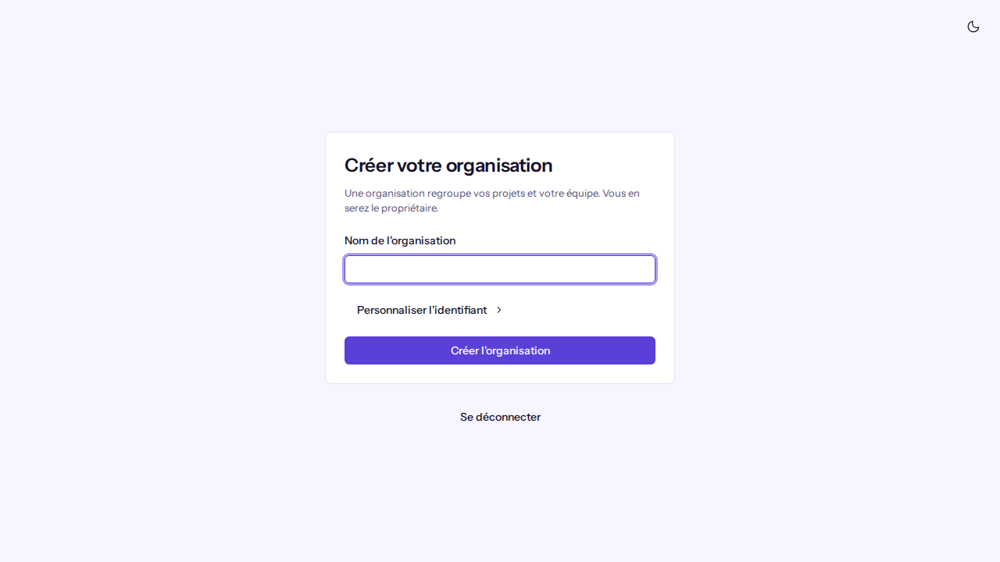
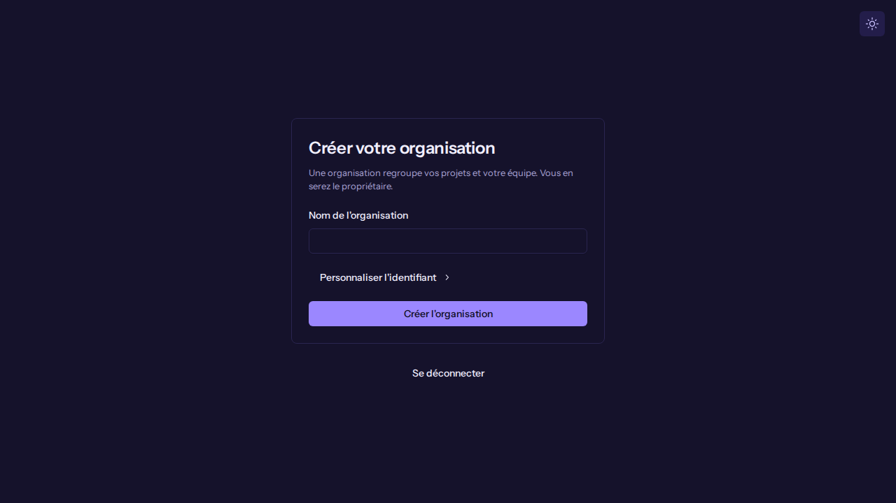
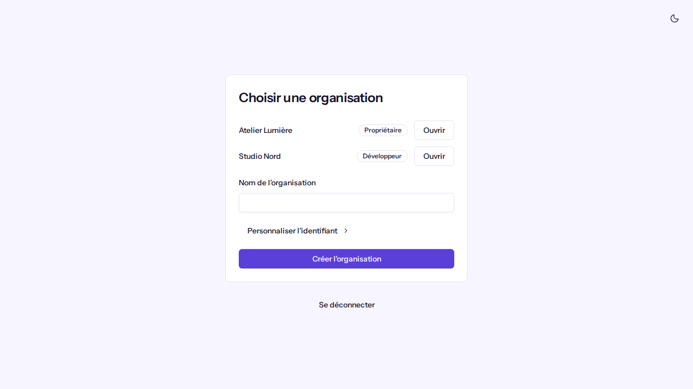
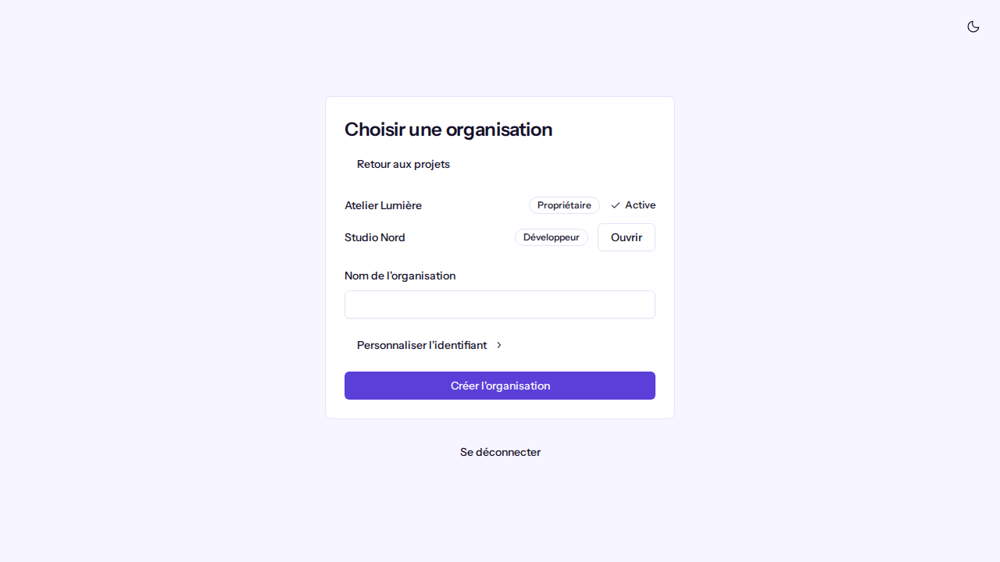
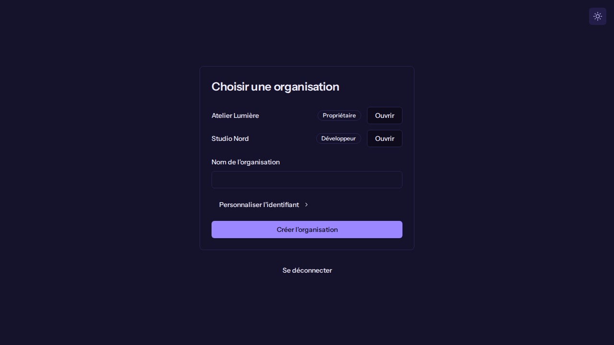
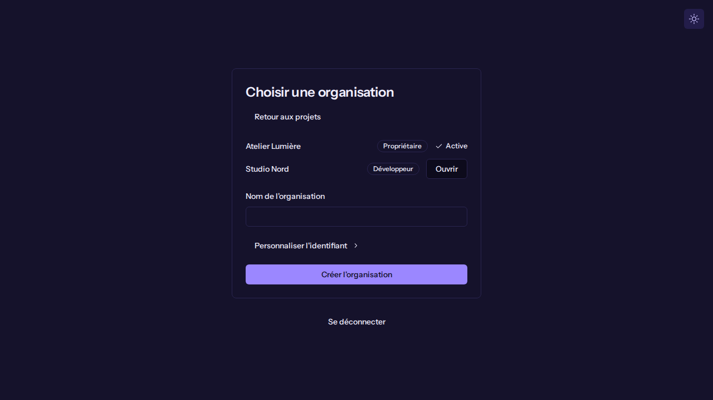

# Créer une organisation

**Pour qui** : toute personne connectée à Koklo, quel que soit son rôle. Vous devenez **Propriétaire** de l'organisation que vous créez.
**Avant de commencer** : être connecté (voir [Se connecter et naviguer](navigate-the-app.md)).
**Résultat** : votre organisation existe, elle est active, et vous arrivez sur la page "Projets".

## Étapes

1. Connectez-vous. Si vous n'appartenez à aucune organisation, vous arrivez sur "Créer votre organisation".
   Si vous appartenez déjà à une organisation, utilisez le sélecteur d'organisation en haut du menu latéral,
   puis **Créer une organisation**.

   
   

2. Saisissez le **Nom de l'organisation**.
3. Facultatif : cliquez sur **Personnaliser l'identifiant** et saisissez un **Identifiant** (2 à 48 lettres minuscules, chiffres ou tirets).
   Laissé vide, il est déduit du nom.
4. Cliquez sur **Créer l'organisation**. Le bouton affiche "Création…" pendant l'envoi.

## Si vous appartenez déjà à une ou plusieurs organisations
- Avec **une seule** organisation et aucune ouverte, Koklo l'ouvre pour vous ("Ouverture de <nom>…") puis affiche les projets.
- Avec **plusieurs** organisations, la page "Choisir une organisation" liste chacune avec votre rôle ; cliquez sur **Ouvrir**.
  L'organisation ouverte est marquée **Active**. **Retour aux projets** vous ramène à la liste.

## Vérifier que ça a marché
Vous arrivez sur "Projets", et le sélecteur en haut du menu affiche le nom de l'organisation et votre rôle (Propriétaire).
Pour un nouveau compte, la liste indique "Aucun projet pour le moment".

## Si quelque chose ne va pas
| Symptôme | Cause | Que faire |
|----------|-------|-----------|
| "Saisissez le nom de l'organisation." | Le nom est vide | Saisissez un nom |
| "Le nom ne peut pas dépasser 100 caractères." | Nom trop long | Raccourcissez-le |
| "Utilisez 2 à 48 lettres minuscules, chiffres ou tirets." | Identifiant invalide | Corrigez-le ou videz le champ |
| "Cet identifiant est déjà utilisé. Choisissez-en un autre." | Un identifiant saisi par vos soins existe déjà | Choisissez-en un autre |
| "Impossible de continuer" | Erreur réseau ou serveur | Vérifiez votre connexion puis réessayez (**Réessayer** quand il est proposé) |

Pour quitter cette page sans organisation, cliquez sur **Se déconnecter**.
