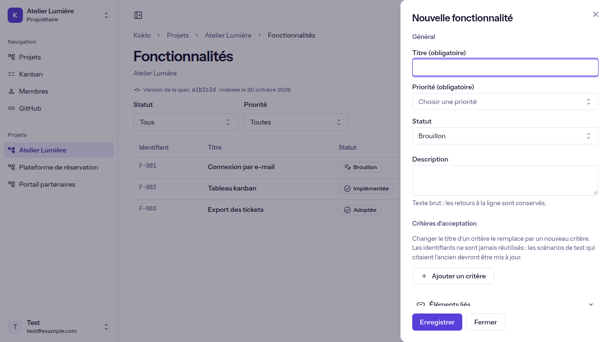
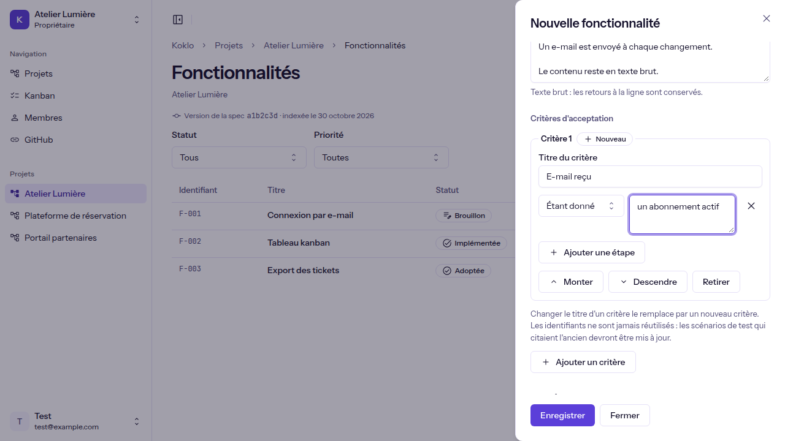
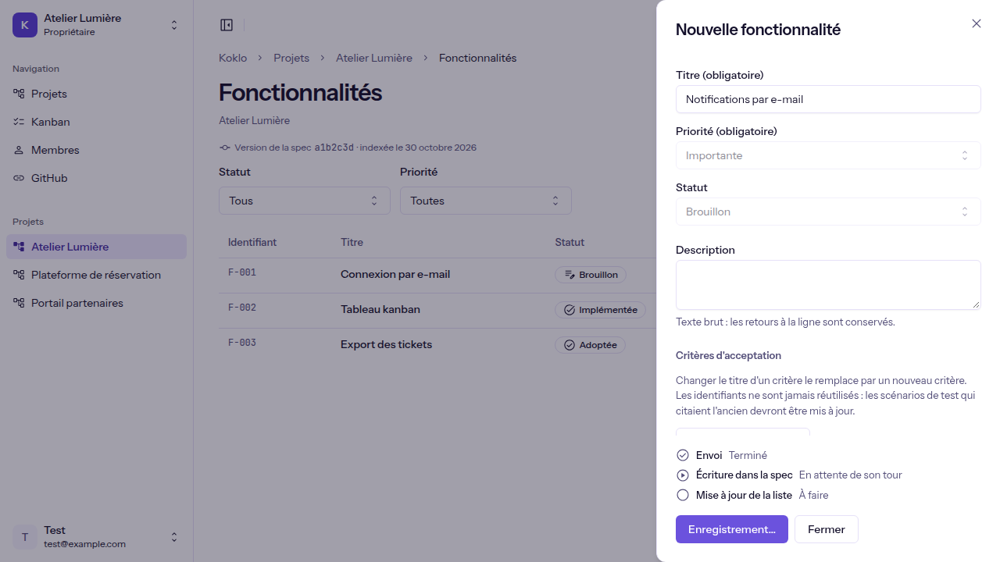

# Créer ou modifier une fonctionnalité

**Pour qui** : les **Propriétaires**, **Administrateurs**, **Développeurs** et **Designers**. Les **Clients** et le **Business** lisent les fonctionnalités mais ne voient aucun bouton d'écriture. Un **Designer** n'enregistre que des fonctionnalités liées à au moins un écran.
**Avant de commencer** : le projet a un dépôt de spec lu par Koklo (voir [Consulter les fonctionnalités d'un projet](view-a-projects-features.md)). Tant que la spec est « en cours de préparation » ou « n'a pas pu être lue », les boutons d'écriture n'apparaissent pas.
**Résultat** : la fonctionnalité est écrite dans la spec du projet et retrouvée à jour dans la liste. Vous n'avez rien à savoir de git : Koklo écrit pour vous.

## Étapes

1. Sur la page **Fonctionnalités**, cliquez sur **Nouvelle fonctionnalité**. Pour modifier, ouvrez la fiche d'une fonctionnalité (clic sur son titre) puis cliquez sur **Modifier**. Un panneau s'ouvre à droite.

   

2. Renseignez le **Titre (obligatoire)** et la **Priorité (obligatoire)** ; le **Statut** reste « Brouillon » tant que vous n'en choisissez pas un autre. La **Description** est un texte simple : les retours à la ligne sont conservés.
3. Ajoutez des **critères d'acceptation** avec **Ajouter un critère**, puis des étapes (Étant donné, Quand, Alors, Et) avec **Ajouter une étape**. **Monter**, **Descendre** et **Retirer** réorganisent la liste. Changer le titre d'un critère existant crée un nouveau critère : son identifiant (AC-n) n'est jamais réutilisé.
4. Si besoin, ouvrez **Éléments liés** et indiquez, un identifiant par ligne, les écrans (S-…), rôles (RL-…), règles (R-…), tables (T-…), endpoints (E-…) et exigences non fonctionnelles (NFR-…).

   

5. Cliquez sur **Enregistrer**. Si des champs sont invalides, un résumé « Corrigez N point(s) avant d'enregistrer » liste chaque erreur ; cliquer sur une erreur place le curseur dans le champ.
6. Suivez l'**avancement** : *Envoi*, *Écriture dans la spec*, *Mise à jour de la liste*. L'écriture peut attendre son tour quelques secondes. Le panneau se ferme tout seul quand la liste est à jour ; une confirmation (« F-004 « Titre » créée. ») apparaît avec **Voir la fiche** et **Fermer**.

   

## Brouillon et fermeture
Votre saisie est gardée automatiquement **sur cet appareil** (7 jours). **Fermer**, Échap ou un clic à côté du panneau ne demandent aucune confirmation : au prochain passage, un bandeau « Brouillon repris, enregistré le … » apparaît et **Abandonner le brouillon** l'efface après confirmation. Le brouillon disparaît dès que la fonctionnalité est écrite et à la déconnexion.

## Vérifier que ça a marché
La fonctionnalité apparaît dans la liste (la ligne reçoit le focus) avec « créée » ou « enregistrée ». Si la ligne n'est pas visible, le message dit pourquoi : « Elle n'apparaît pas avec les filtres actuels. » ou « Utilisez « Afficher plus de fonctionnalités » pour la voir. ».

## Si quelque chose ne va pas
| Symptôme | Cause | Que faire |
|----------|-------|-----------|
| « L'enregistrement prend plus de temps que prévu » | La file d'écriture est chargée | Rien n'est perdu et l'enregistrement continue sans vous ; **Vérifier maintenant** relit tout de suite |
| « Votre modification est enregistrée. La liste se mettra à jour dans un instant. » | La lecture de la spec n'a pas encore rattrapé l'écriture | **Actualiser la liste**, ou fermez : la page continue de vérifier pendant 2 minutes |
| « La spec obtenue ne serait pas valide » | Une règle de la spec n'est pas respectée | Les points sont listés avec un lien vers le champ ; corrigez puis **Enregistrer** |
| « Cette fonctionnalité a changé depuis… » ou conflit de version | Quelqu'un a modifié la fonctionnalité entre-temps | **Recharger la version actuelle** : vos modifications sont gardées, les champs changés des deux côtés sont signalés avec **Reprendre la valeur actuelle** |
| « Liez au moins un écran pour enregistrer cette fonctionnalité. » | Un Designer enregistre une fonctionnalité sans écran | Ouvrez **Éléments liés** et indiquez un écran |
| « Koklo n'a plus accès au dépôt de spec » | L'autorisation GitHub a expiré | Un Propriétaire ou un Administrateur autorise de nouveau Koklo (voir [Relier GitHub](connect-github.md)) |
| « Un enregistrement est déjà en cours. » | Un autre enregistrement de la page n'est pas terminé | Patientez, le bouton redevient actif |
| Erreur avec « Référence : … » | Erreur interne | **Réessayer** ; sinon transmettez la référence à l'équipe |

La suppression d'une fonctionnalité n'est pas encore disponible.
