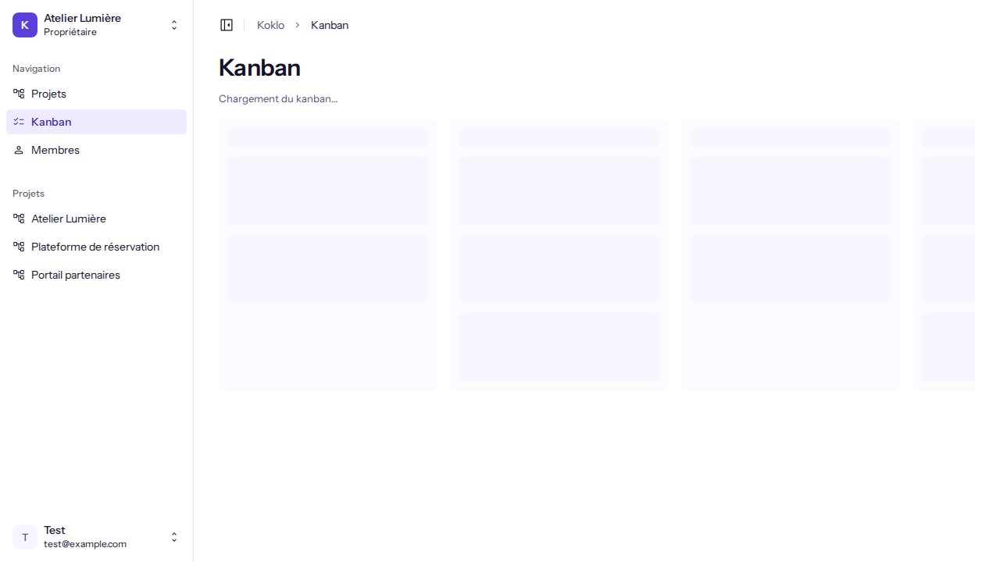
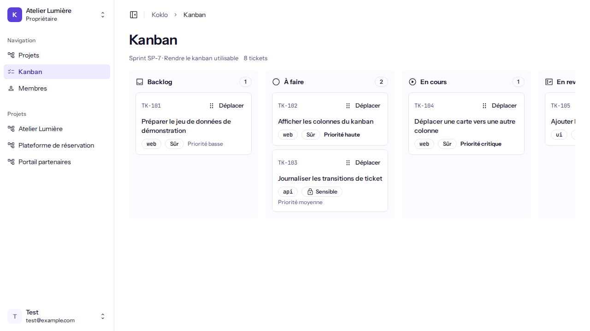
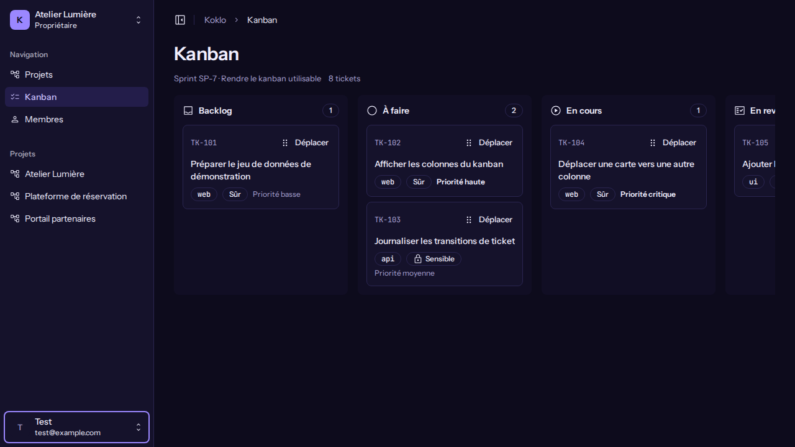
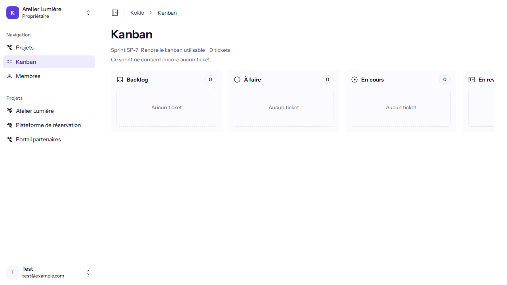
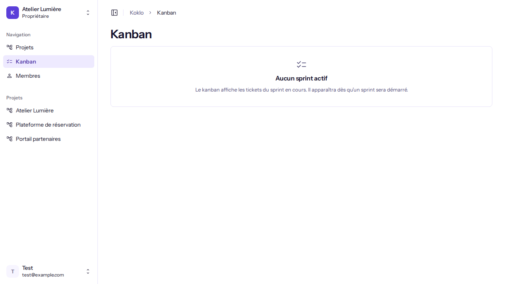
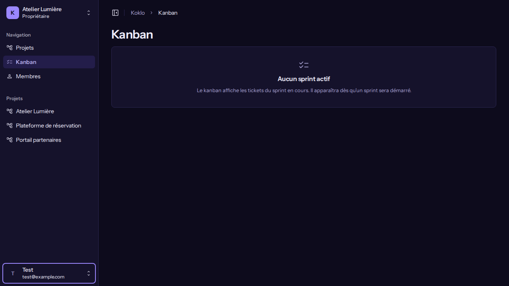
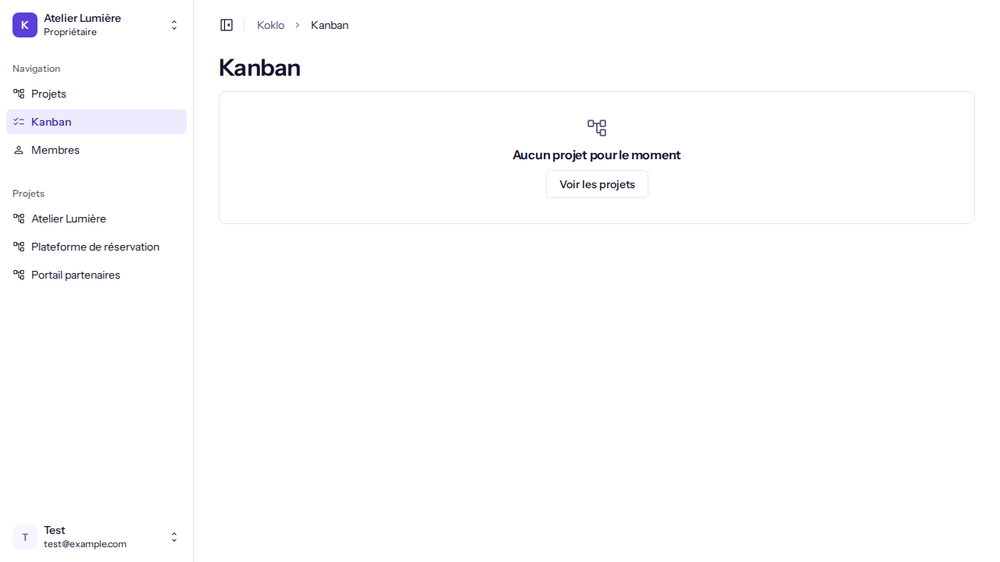
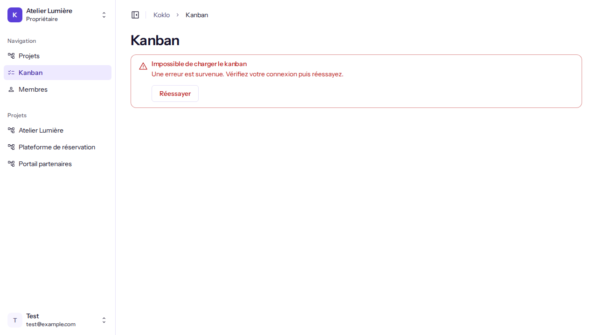

# Suivre et déplacer les tickets du sprint

**Pour qui** : tous les rôles peuvent consulter le tableau. Les **Propriétaires**, **Administrateurs**, **Développeurs** et **Designers** peuvent aussi déplacer les tickets ; les **Clients** et les **Business** le consultent en lecture seule.
**Avant de commencer** : avoir une organisation active (voir [Créer une organisation](create-an-organization.md)) et un sprint actif.
**Résultat** : vous voyez où en est chaque ticket du sprint et, si votre rôle le permet, vous le faites passer d'un statut à l'autre.

## Étapes

1. Ouvrez **Kanban** dans le menu latéral. Pendant le chargement, la page affiche "Chargement du kanban…".

   

2. Le tableau présente le sprint ("Sprint SP-n · objectif") et le nombre de tickets. Sept colonnes suivent le cycle de vie : **Backlog**, **À faire**, **En cours**, **En revue**, **Bloqué**, **Terminé**, **Annulé**. Chaque colonne a une icône, son nom et le nombre de tickets. Chaque carte indique la clé du ticket, son titre, son paquet, "Sensible" ou "Sûr", et sa priorité. Dans une colonne, les tickets les plus prioritaires sont en haut.

   
   

3. Pour déplacer un ticket, au choix :
   - **Glissez** la carte et déposez-la sur la colonne voulue ("Déposer ici pour passer en …" s'affiche au survol) ;
   - ou cliquez sur **Déplacer** dans la carte, puis choisissez le statut dans le menu "Déplacer TK-n vers". Cette voie fonctionne au clavier et au toucher.
4. Pendant l'envoi, la carte reste en place et son bouton affiche "Déplacement…".

## Vérifier que ça a marché
La carte apparaît dans la nouvelle colonne, le message "TK-n déplacé vers <statut>." est annoncé sous le titre du sprint et le focus revient au bouton **Déplacer** de la carte.

## Cas particuliers
- **Lecture seule** : sans droit de déplacement, la page indique "Lecture seule : votre rôle ne permet pas de déplacer les tickets." et les cartes n'ont pas de bouton **Déplacer**.
- **Sprint sans ticket** : les sept colonnes restent affichées, vides ("Aucun ticket"), avec "Ce sprint ne contient encore aucun ticket."

  

- **Aucun sprint actif** : "Aucun sprint actif". Le kanban apparaîtra dès qu'un sprint sera démarré.

  
  

- **Aucun projet** : "Aucun projet pour le moment" avec le lien **Voir les projets**.

  

## Si quelque chose ne va pas
Le message est fermable (**Fermer le message**) ; la carte reste dans sa colonne d'origine.

| Symptôme | Cause | Que faire |
|----------|-------|-----------|
| "Déplacement impossible" : "Transition interdite : TK-n ne peut pas passer de « X » à « Y »." | Le statut demandé n'est pas autorisé depuis le statut actuel (par exemple, des dépendances ne sont pas terminées) | Choisissez un autre statut |
| "Déplacement refusé" | Votre rôle ne permet pas de déplacer les tickets | Demandez à un Propriétaire, un Administrateur, un Développeur ou un Designer |
| "Ce ticket a changé entre-temps" | Quelqu'un l'a modifié pendant ce temps | Cliquez sur **Recharger**, puis recommencez |
| "Ce ticket est en cours de traitement par un agent." | Un agent travaille dessus | Réessayez quand il aura terminé |
| "Ce ticket n'existe plus." | Il a été supprimé ; le tableau se recharge | Aucune action |
| "Le déplacement a échoué" | Erreur serveur | Cliquez sur **Réessayer** |
| "Impossible de charger le kanban" | Erreur réseau ou serveur | Cliquez sur **Réessayer** |

