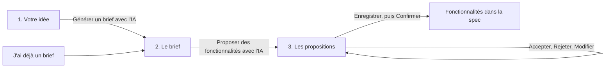
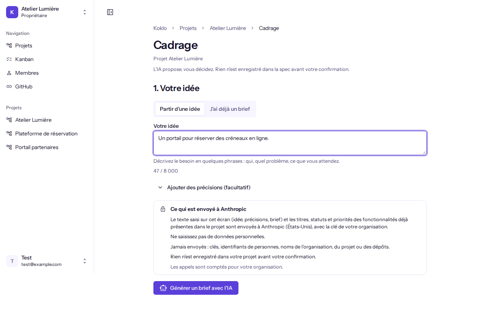
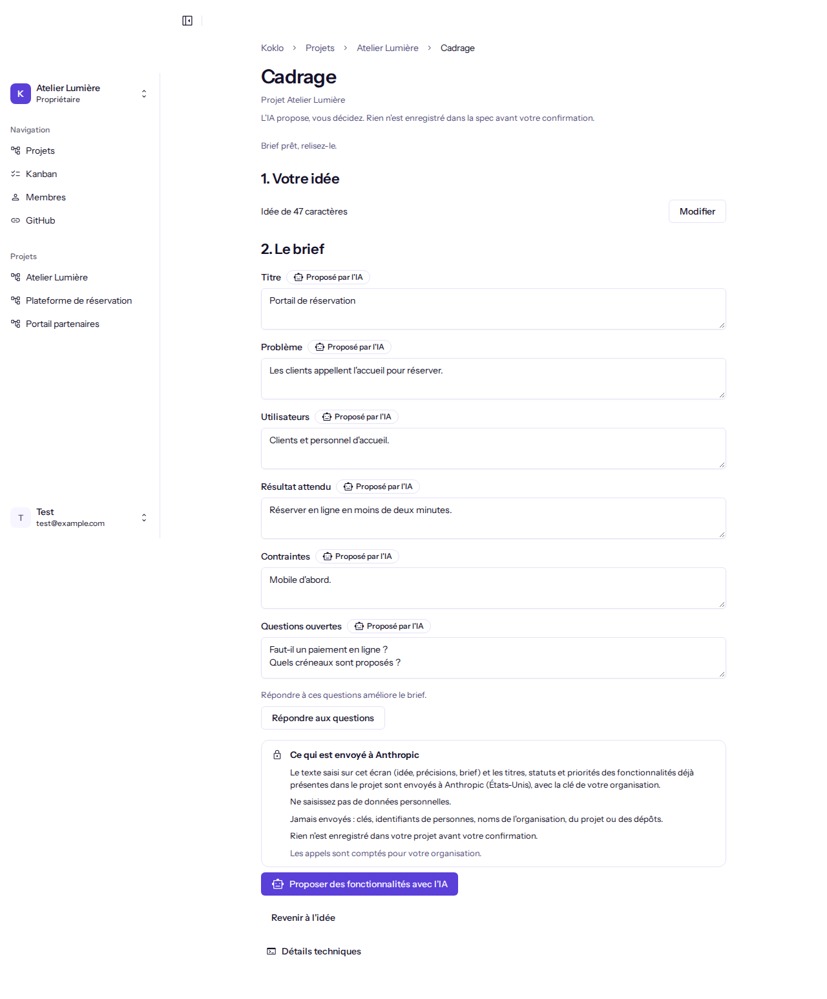
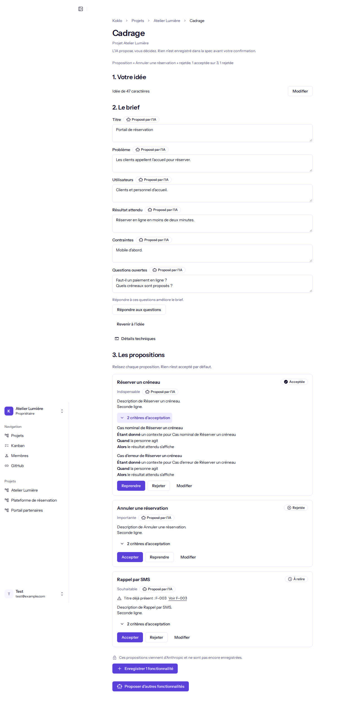
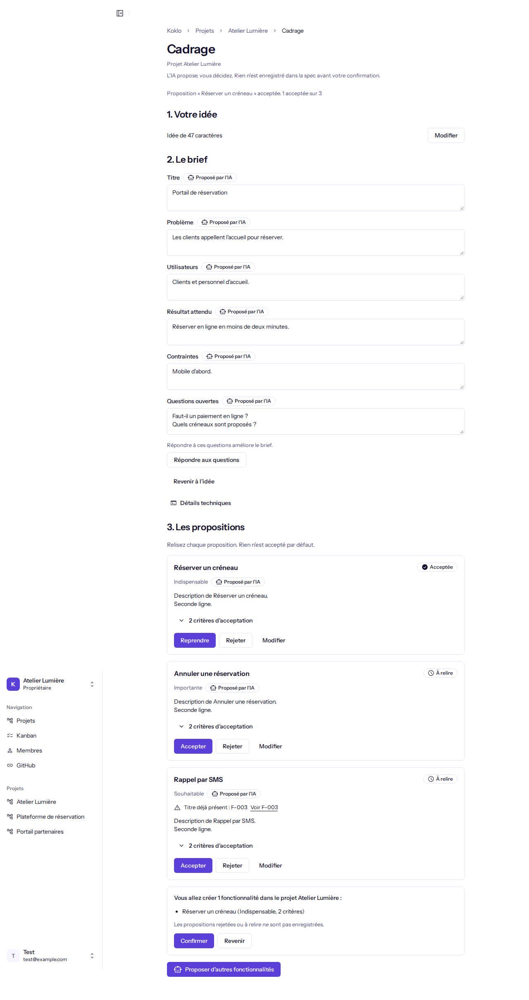

# Cadrer avec l'IA

**Pour qui** : les **Propriétaires**, **Administrateurs**, **Développeurs** et **Designers**. Les **Clients** et le **Business** ne voient pas le bouton. Un **Designer** relit et modifie les propositions mais n'enregistre que des fonctionnalités liées à un écran.
**Avant de commencer** : le projet a un dépôt de spec lu par Koklo, et un administrateur a enregistré la clé du fournisseur d'IA de l'organisation.
**Résultat** : à partir d'une idée (ou d'un brief déjà écrit), vous obtenez des fonctionnalités que vous avez relues une à une, puis enregistrées en une seule fois dans la spec. **L'IA ne crée rien toute seule.**

## Ce qui est envoyé au fournisseur
Seul le texte que vous saisissez (idée, précisions, brief) part chez Anthropic, avec l'identifiant du projet. Aucun nom de personne n'est envoyé. Chaque essai est compté dans les limites de votre organisation.

## Parcours

## Étapes

1. Sur la page **Fonctionnalités**, cliquez sur **Cadrer avec l'IA**.
2. **Étape 1, Votre idée** : décrivez votre idée (et, si besoin, des précisions), puis cliquez sur **Générer un brief avec l'IA**. Si vous avez déjà un brief, choisissez **J'ai déjà un brief** et collez-le.

   

3. **Étape 2, Le brief** : le brief s'affiche dans des champs que vous pouvez corriger. Le badge **Proposé par l'IA** disparaît d'un champ dès que vous le modifiez. Facultatif : **Répondre aux questions** puis **Régénérer le brief**. Si vous avez corrigé le brief, une confirmation demande si vous voulez le **Remplacer** ou **Garder mon brief**.

   

4. Cliquez sur **Proposer des fonctionnalités avec l'IA**.
5. **Étape 3, Les propositions** : chaque carte est « À relire ». Rien n'est accepté d'office. **Accepter**, **Rejeter** ou **Modifier** chacune. Une proposition qui ressemble à une fonctionnalité existante est signalée avec un lien vers celle-ci.

   

6. Cliquez sur **Enregistrer N fonctionnalités**, vérifiez le récapitulatif puis **Confirmer**. Seules les propositions acceptées sont écrites.

   

## Brouillon
Votre saisie et vos propositions sont gardées sur cet appareil pendant 7 jours et effacées à la déconnexion.

## Si quelque chose ne va pas
| Symptôme | Cause | Que faire |
|----------|-------|-----------|
| « L'IA n'est pas encore configurée pour votre organisation. » | Aucune clé valide | Demandez à un administrateur d'ajouter la clé |
| « Trop de demandes pour le moment. Réessayez dans N s. » | Limite atteinte | Attendez la fin du compte à rebours ; votre saisie est conservée |
| Le fournisseur n'a pas répondu, ou réponse inutilisable | Panne ou sortie refusée | **Réessayer** : c'est le texte actuellement affiché qui est envoyé, même si vous l'avez corrigé après l'échec |
| Vous avez cliqué sur **Annuler l'attente** | La demande était déjà partie | Elle reste comptée (« La demande a déjà été comptée. ») ; ne relancez pas en rafale |
| « Toutes ces propositions ressemblent à des fonctionnalités existantes. » | Doublons | Ouvrez les fonctionnalités liées avant d'en accepter |
