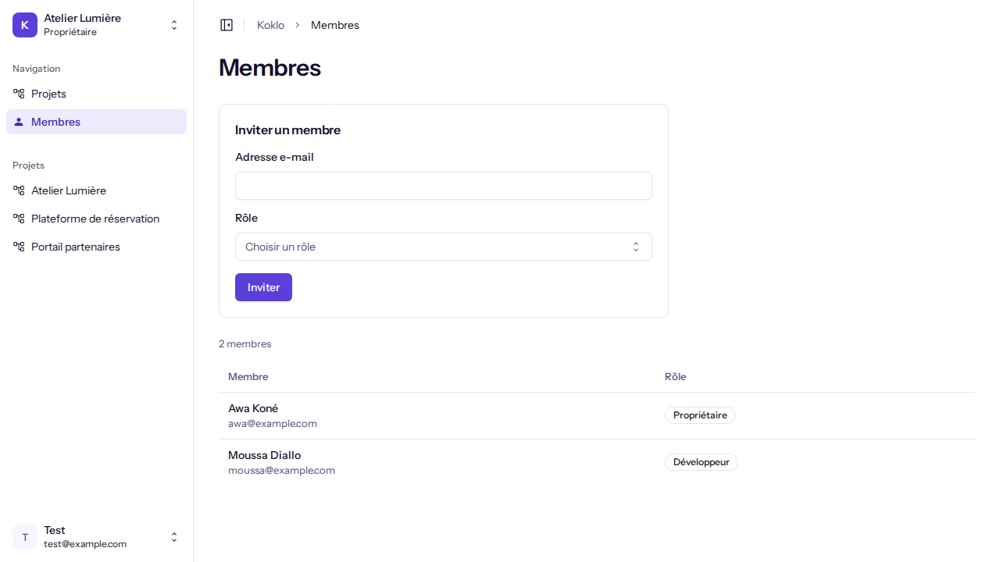

# Inviter un membre

**Pour qui** : les **Propriétaires** et les **Administrateurs**. Les autres rôles voient la liste des membres mais pas le formulaire.
**Avant de commencer** : avoir une organisation active (voir [Créer une organisation](create-an-organization.md)).
**Résultat** : une invitation valable jusqu'à une date affichée est créée et un e-mail est mis en file d'envoi.

## Étapes

1. Dans le menu latéral, cliquez sur **Membres**. La page affiche le nombre de membres, leur nom, leur adresse e-mail et leur rôle.

   
   

2. Dans la carte **Inviter un membre**, saisissez l'**Adresse e-mail** de la personne.
3. Ouvrez **Rôle** ("Choisir un rôle") et choisissez : Administrateur, Développeur, Designer, Client ou Business.
   Aucun rôle n'est présélectionné. Seul un Propriétaire peut inviter un Administrateur ; Propriétaire n'est jamais proposé.
4. Cliquez sur **Inviter** ("Invitation…" pendant l'envoi).

## Vérifier que ça a marché
Le message **Invitation créée** s'affiche : "<e-mail> est invité comme <rôle> jusqu'au <date>. L'e-mail part en arrière-plan."
Le formulaire est vidé. La personne n'apparaît dans la liste qu'après avoir accepté l'invitation.

## Limites actuelles
- La page d'acceptation de l'invitation n'existe pas encore : le lien reçu par e-mail mène à une page introuvable (404).
  Elle sera livrée dans un ticket suivant.
- Il n'y a pas de liste des invitations en attente, ni de renvoi ou d'annulation.
- Dans les environnements de développement et de test, les e-mails ne sont pas envoyés à une vraie boîte aux lettres.

## Si quelque chose ne va pas
| Symptôme | Cause | Que faire |
|----------|-------|-----------|
| Pas de formulaire, message "Seuls les propriétaires et les administrateurs peuvent inviter des membres." | Votre rôle ne permet pas d'inviter | Demandez à un Propriétaire ou à un Administrateur |
| "Saisissez une adresse e-mail valide, par exemple nom@exemple.fr." | Adresse invalide | Corrigez l'adresse |
| "Choisissez un rôle." | Aucun rôle choisi | Choisissez un rôle |
| "Cette personne fait déjà partie de l'organisation." | Elle est déjà membre | Rien à faire |
| "Cette personne a déjà une invitation en attente." | Une invitation existe | Attendez qu'elle l'accepte |
| "Vous n'avez pas le droit d'inviter ce rôle. Seul un propriétaire peut inviter un administrateur." | Vous êtes Administrateur | Choisissez un autre rôle ou demandez à un Propriétaire |
| "L'invitation n'a pas pu être créée" | Erreur serveur | Réessayez dans un instant ; votre saisie est conservée |
