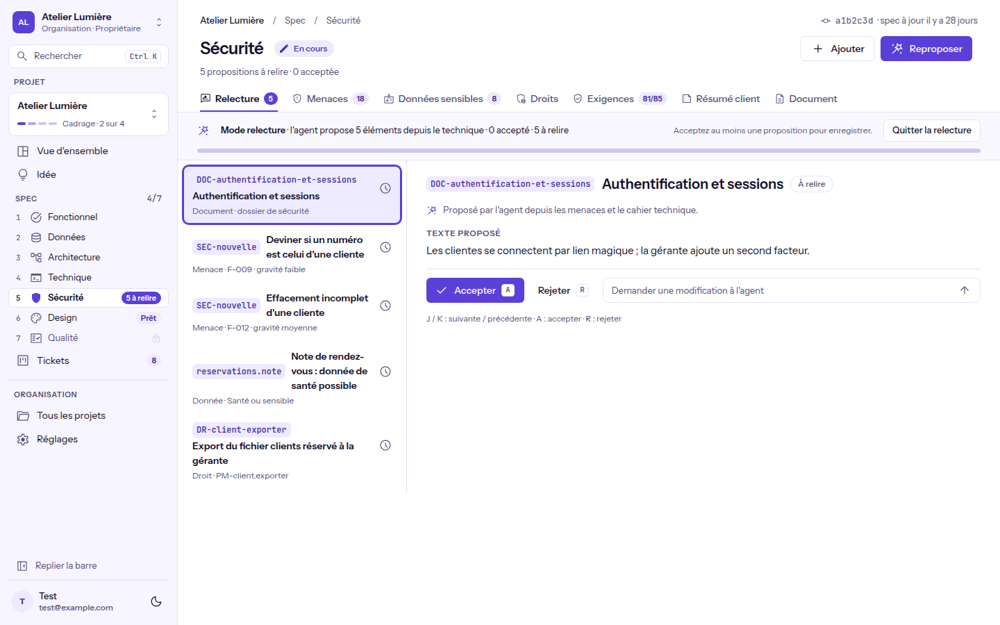
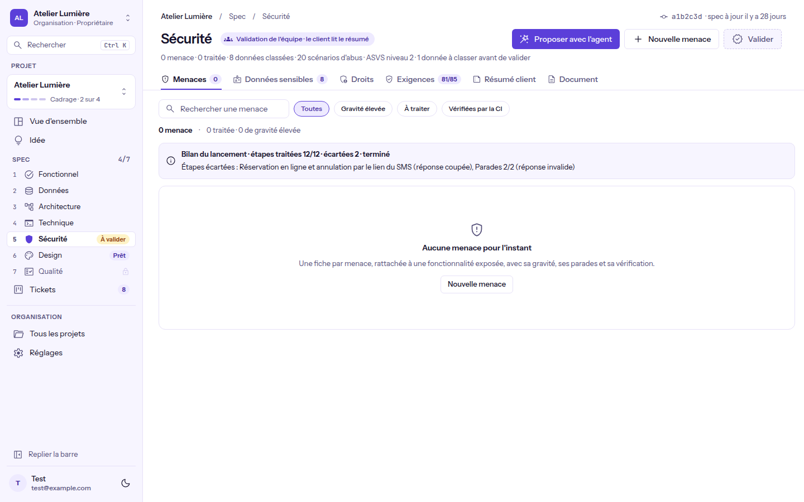
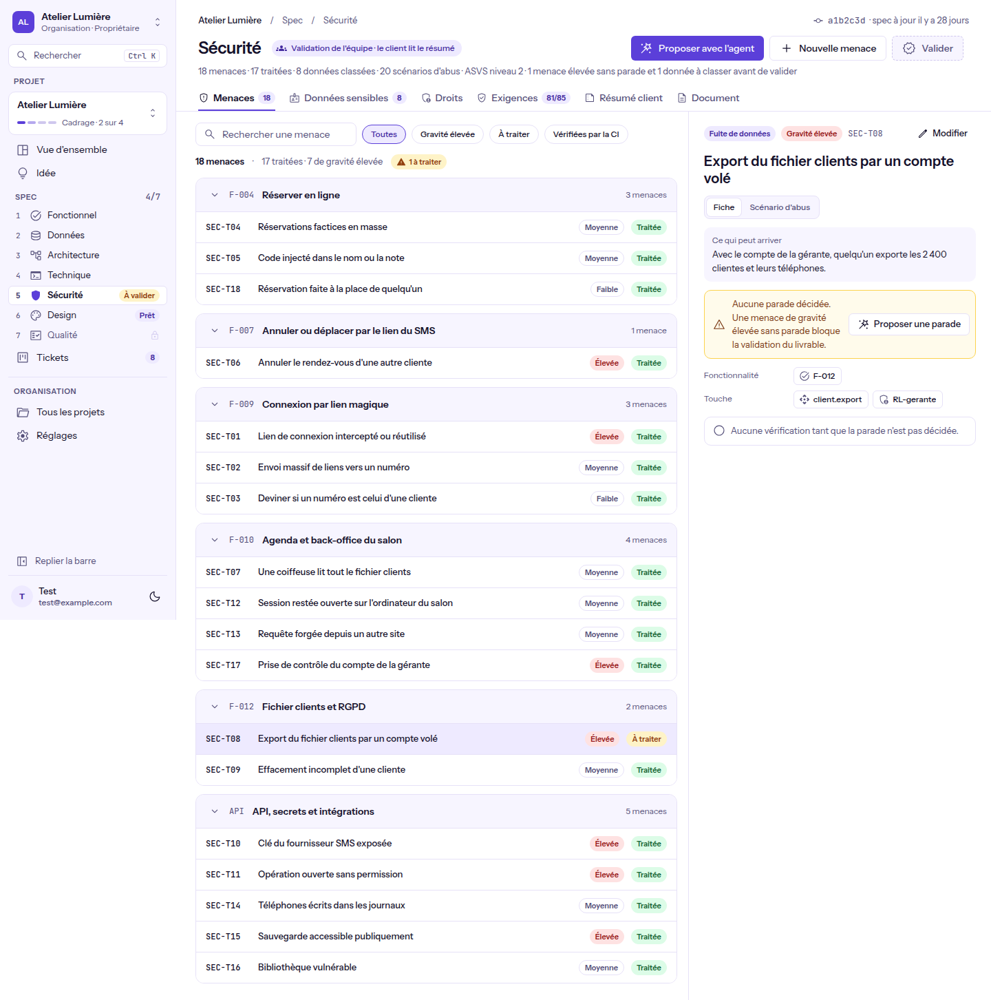
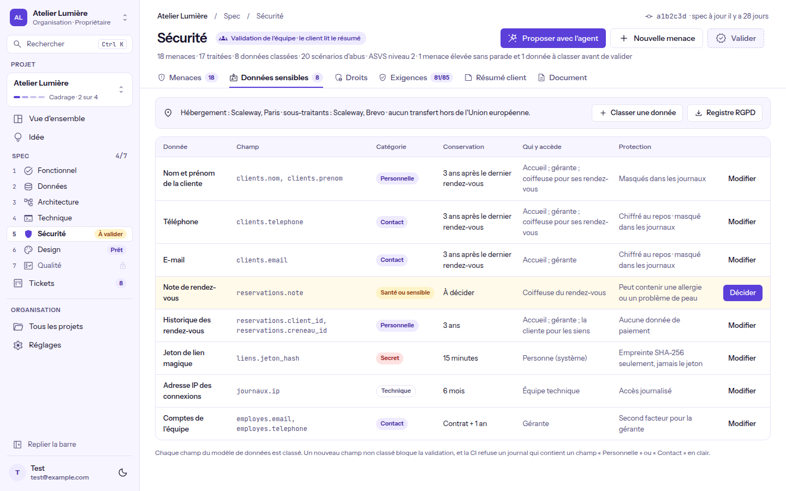
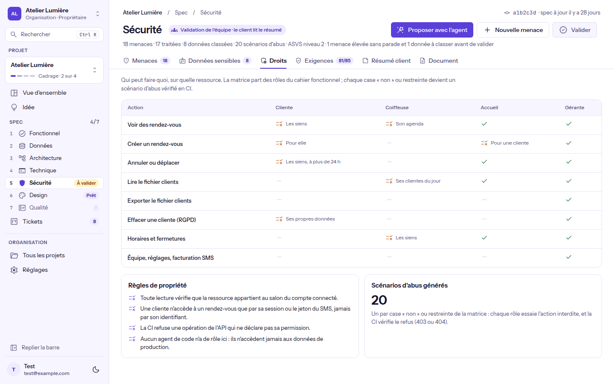
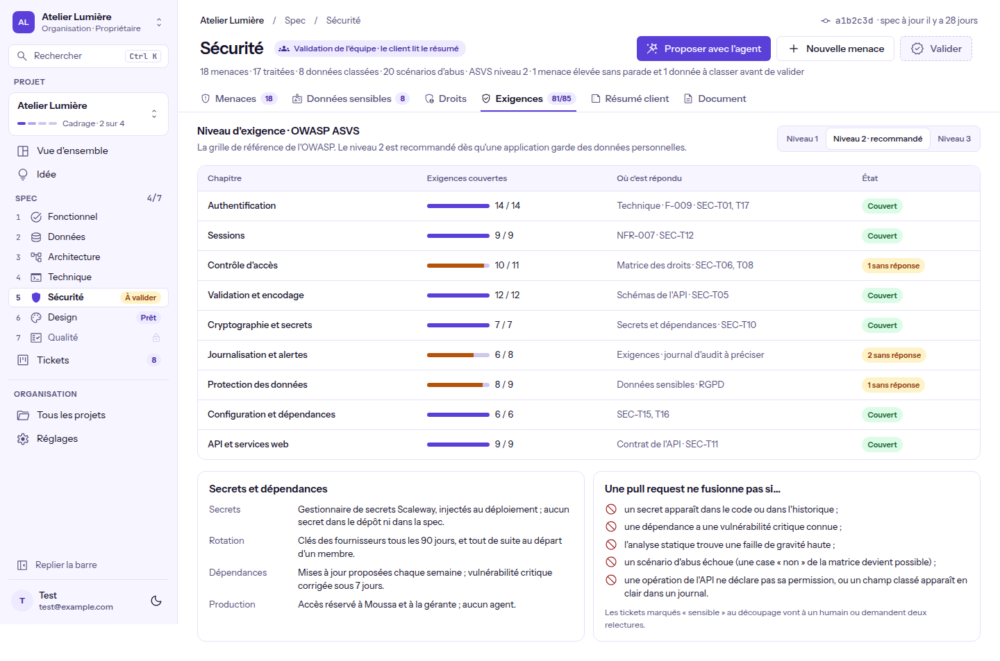
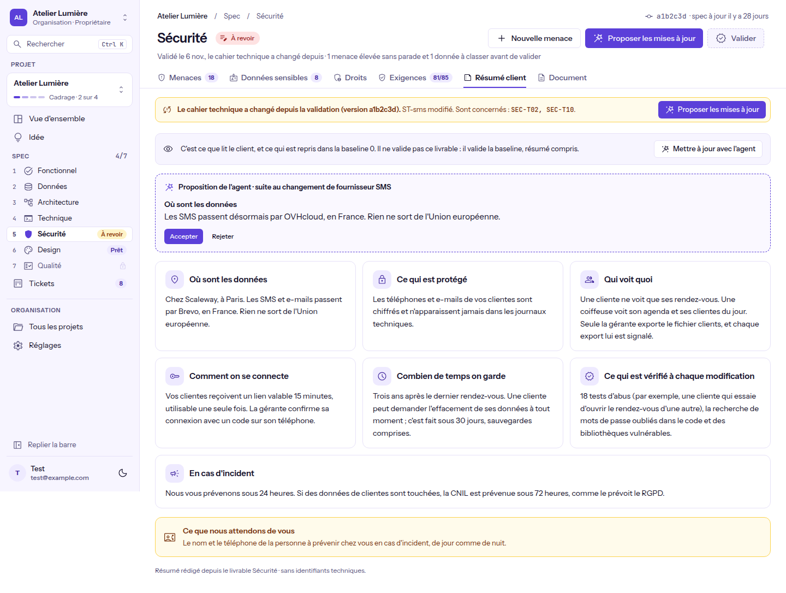
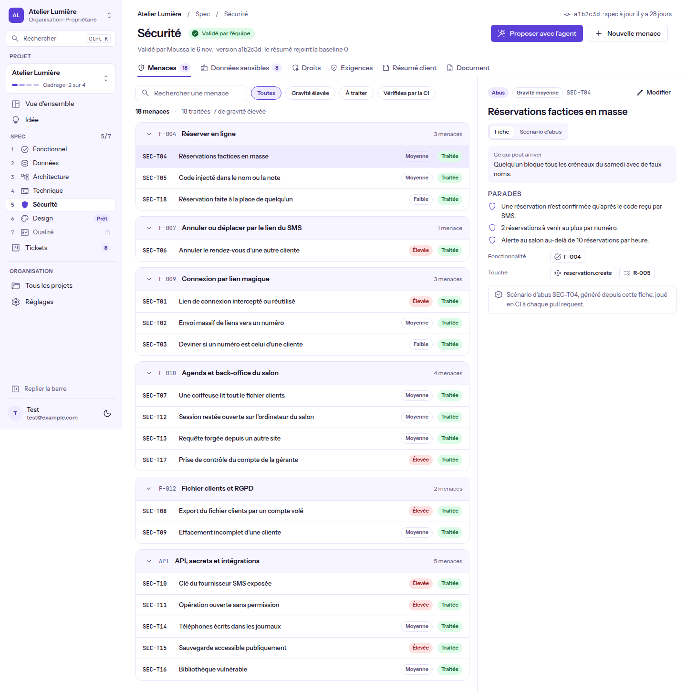
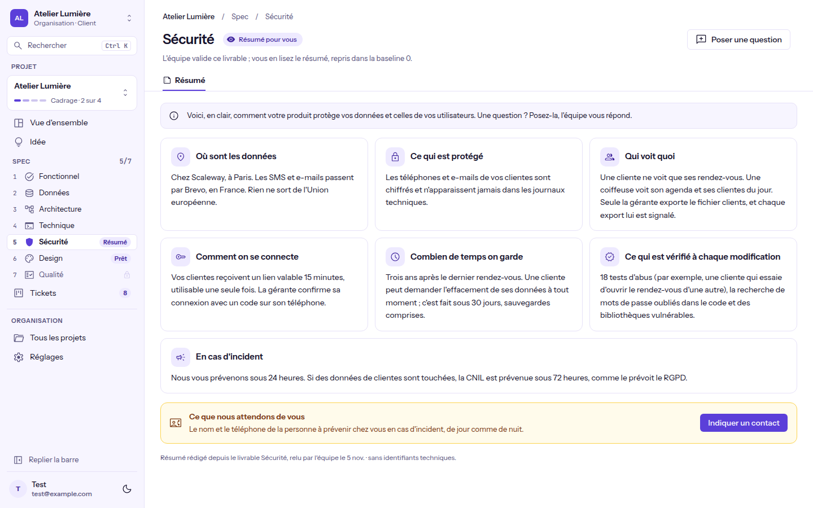

# Relire et compléter la sécurité

**Pour qui** : les **Propriétaires**, **Administrateurs** et **Développeurs**. Le **Designer** lit l'écran sans rien modifier ; le **Client** et le **Business** lisent seulement le résumé (plus bas).
**Avant de commencer** : le cahier technique est validé (ou le livrable a été ouvert).
**Résultat** : les menaces, les données classées, le niveau d'exigence et le résumé sont écrits dans la spec ; rien n'est écrit avant votre clic.

## Étapes

1. Ouvrez le projet, puis **Spec**, puis **Sécurité**. S'il est vide, cliquez **Proposer avec l'agent**, ou **Écrire à la main**.
2. Dans la fenêtre de l'agent, choisissez **Proposer les menaces**, **Classer les données**, **Vérifier les exigences ASVS** ou **Mettre à jour le résumé client**, puis **Lancer**. Vous pouvez quitter la page.
3. Onglet **Relecture** : lisez chaque proposition, **Accepter** ou **Rejeter**, puis **Enregistrer N dans la spec**.

   

   Si l'agent n'a pas pu terminer une partie de son travail, un bandeau **Bilan du lancement** nomme les étapes écartées et leur motif. Il se lit en relecture et, quand il ne reste rien à relire, sur l'onglet **Menaces** vide ou à l'ouverture de la page vide. Relancez **Proposer avec l'agent** pour compléter.

   

4. Onglet **Menaces** : les menaces sont rangées par fonctionnalité exposée. Filtrez par **Gravité élevée**, **À traiter** ou **Vérifiées par la CI**. Une ligne ouvre sa fiche ; **Scénario d'abus** montre le test écrit à partir d'elle. Sur une menace élevée sans parade, cliquez **Proposer une parade**, ou **Modifier** et écrivez une parade par ligne.

   

5. Onglet **Données sensibles** : sur une ligne ambre, cliquez **Décider**, saisissez la **Conservation** (une durée, et à partir de quand), puis enregistrez. L'agent peut suggérer une durée : elle n'est jamais retenue sans votre saisie. **Classer une donnée** ajoute une entrée ; **Registre RGPD** télécharge le registre, à faire relire par un juriste.

   

6. Onglet **Droits** : la matrice vient des rôles du cahier fonctionnel et se modifie là-bas ; l'agent peut proposer des restrictions et des règles de propriété.

   

7. Onglet **Exigences** : choisissez le niveau **OWASP ASVS** (le recommandé est signalé). Il est enregistré aussitôt (« Niveau enregistré »).

   

8. Onglet **Résumé client** : c'est ce que lit le client. **Mettre à jour avec l'agent** prépare une proposition en pointillés : **Accepter** ou **Rejeter**.

   

9. Onglet **Document** : lisez les sections du dossier, acceptez une rédaction proposée ou marquez une section comme validée.

## Valider la sécurité

Le bouton **Valider** reste désactivé tant qu'une menace élevée n'a pas de parade ou qu'une donnée reste à classer ; le résumé de l'en-tête dit combien. Une fois validé, l'en-tête affiche qui a validé, quand et sur quelle version, et le client peut lire le résumé.

## Après une validation

Si le cahier technique change ensuite, un bandeau liste les changements et les éléments concernés, marqués **À revoir**. Cliquez **Proposer les mises à jour**, relisez, puis **Valider** de nouveau.

## Client et Business

Une fois le livrable validé, un seul onglet **Résumé** : sept cartes en mots simples. Le **Client** indique la personne à prévenir en cas d'incident (**Indiquer un contact**) et pose ses questions (**Poser une question**). Le **Business** lit seulement. Avant la validation, l'écran dit que la sécurité est en cours de validation par l'équipe.

## Vérifier que ça a marché
L'en-tête compte les menaces, les menaces traitées, les données classées, les scénarios d'abus et le niveau choisi.

## Si quelque chose ne va pas
| Message | Cause | Que faire |
|---------|-------|-----------|
| Une menace de gravité élevée reste sans parade | La validation a été demandée avec une menace ouverte | Écrivez sa parade, puis **Valider** |
| Des données restent à classer | Un champ du modèle n'a pas de catégorie, ou une donnée personnelle n'a pas de durée | Onglet **Données sensibles**, **Décider** |
| La sécurité s'ouvre quand le technique est validé | Le cahier technique n'est pas validé | Validez-le, ou demandez à un propriétaire ou un administrateur d'ouvrir le livrable |
| Un numéro de téléphone est attendu | Le contact saisi n'est pas un numéro | Écrivez des chiffres, espaces ou points |
| Impossible de charger la sécurité | Problème de lecture | Cliquez **Réessayer** |
