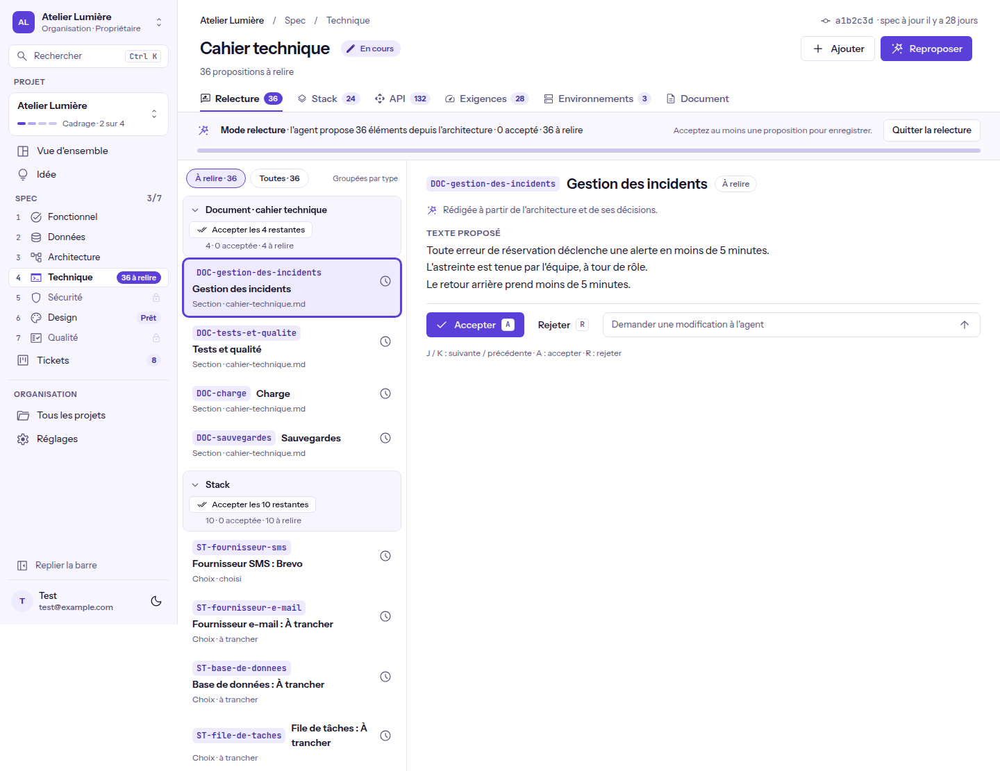
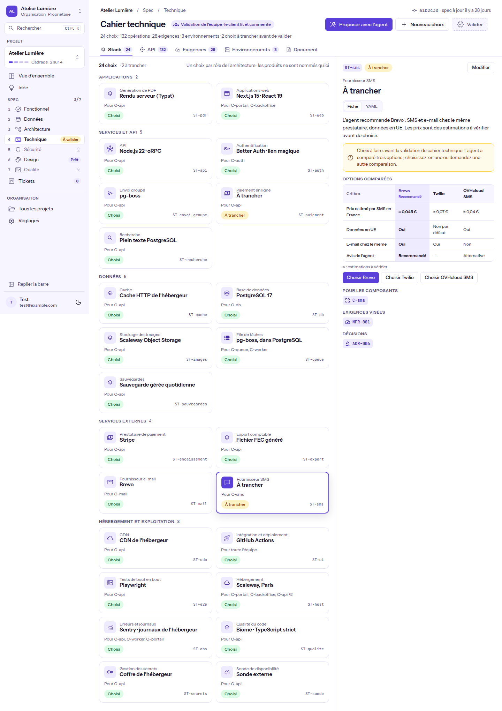
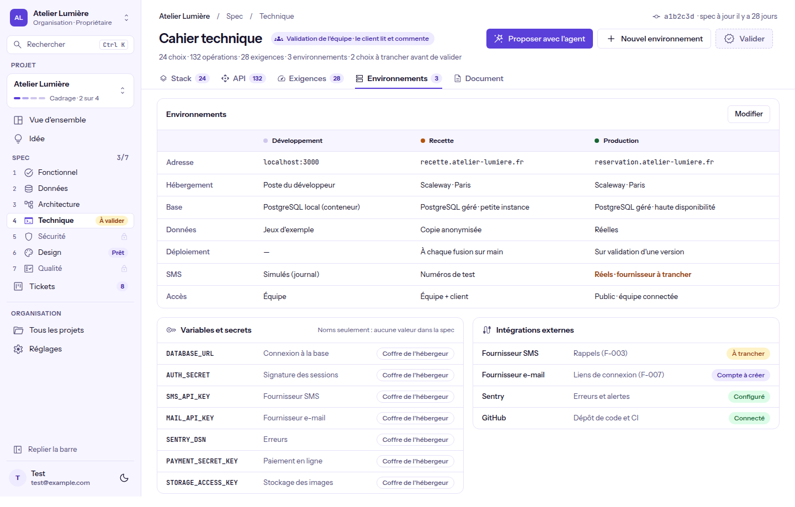
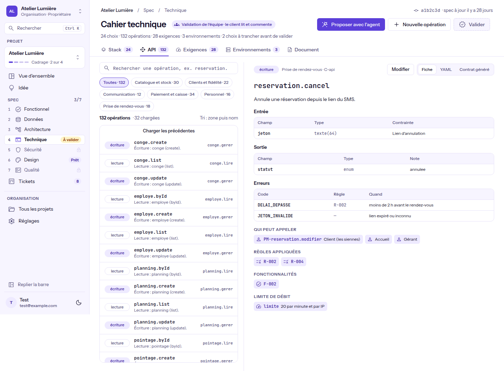
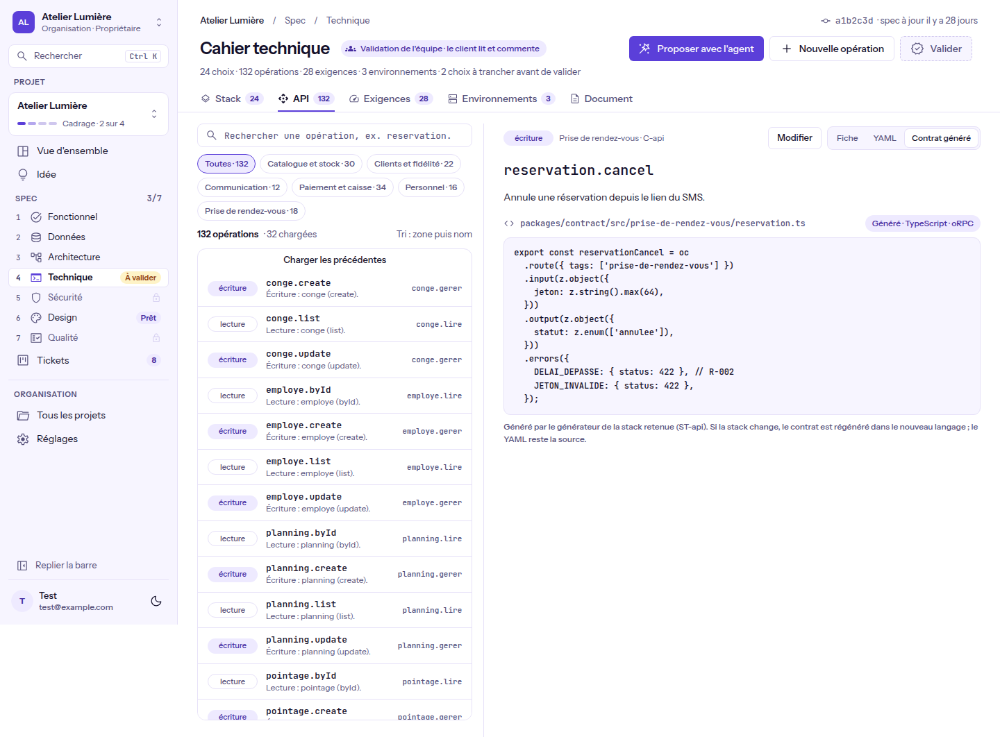
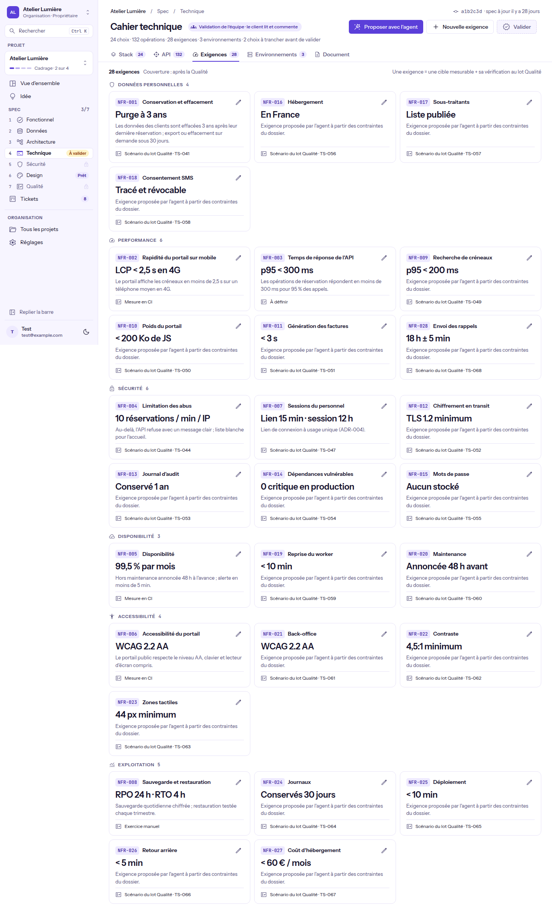
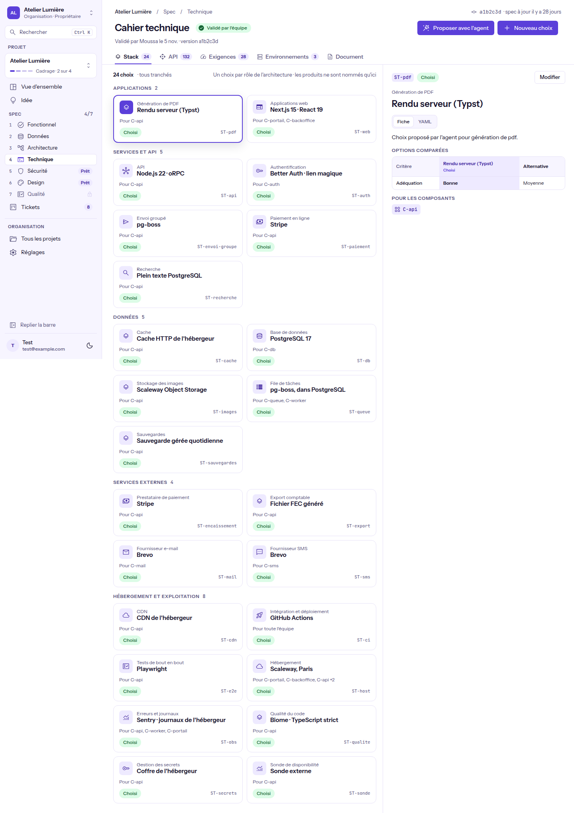

# Relire et compléter le cahier technique

**Pour qui** : les **Propriétaires**, **Administrateurs** et **Développeurs**. Le **Designer** lit l'écran sans rien modifier ; le **Client** et le **Business** ont une vue en lecture seule (plus bas).
**Avant de commencer** : l'architecture est validée (ou le livrable a été ouvert) et contient au moins un composant.
**Résultat** : les choix techniques, les environnements et le document acceptés sont écrits dans la spec ; rien n'est écrit avant votre clic.

## Étapes

1. Ouvrez le projet, puis **Spec**, puis **Technique** : la page **Cahier technique** s'ouvre. S'il est vide, cliquez **Proposer le cahier technique**, ou **Écrire à la main**.
2. Dans la fenêtre de l'agent, choisissez **Compléter le cahier**, **Comparer les options d'un choix** (s'il reste un choix à trancher), **Rendre les exigences mesurables** (s'il existe des exigences) ou **Tout reproposer**, puis cliquez **Lancer**. Les premières propositions arrivent avant la fin ; vous pouvez quitter la page.
3. Relisez les propositions, groupées en **Document**, **Stack**, **Opérations de l'API**, **Exigences** et **Environnements**. Pour chacune : **Accepter**, **Rejeter**, ou **Demander une modification à l'agent**. **Remettre à relire** annule une décision. Les valeurs précédées de « ≈ » sont des estimations à vérifier.

   

4. Cliquez **Enregistrer N dans la spec**.
5. Onglet **Stack** : ouvrez un choix **À trancher**, comparez les **Options comparées**, puis cliquez **Choisir** suivi du nom de l'option. Le choix est enregistré aussitôt (« Choix enregistré »).

   

6. Pour compléter à la main : **Nouveau choix** (ou **Modifier** dans une fiche) et **Nouvel environnement** (ou **Modifier** au-dessus du tableau, puis le nom de l'environnement). À la création, **Décrire en une phrase, l'agent remplit le formulaire** puis **Préremplir** vous fait gagner la saisie. Terminez par **Enregistrer dans la spec** ou **Enregistrer les modifications**.

   

7. **Variables et secrets** : la spec ne garde que les noms et leur usage, jamais les valeurs. Les valeurs restent dans le coffre de votre hébergeur.
8. Onglet **API** : cherchez une opération (par exemple « reservation. »), filtrez par zone, puis cliquez une ligne. La fiche donne l'entrée, la sortie, les erreurs, qui peut l'appeler et sa limite de débit. **Fiche · YAML · Contrat généré** change l'affichage : le contrat apparaît quand le choix technique de l'API est tranché et nomme oRPC. La liste charge la suite en approchant du bas.

   
   

9. **Nouvelle opération** (ou **Modifier** dans une fiche) : écrivez l'**Entrée**, la **Sortie** et les **Erreurs** une ligne par élément, en séparant par « · » (« nom · type · contrainte », « CODE · quand · règle »). Le composant n'est pas demandé : il est déduit de la zone.
10. Onglet **Exigences** : chaque carte porte une cible mesurable et sa vérification. **Nouvelle exigence**, ou le crayon d'une carte. La couverture arrivera avec la Qualité.

    

11. Onglet **Document** : lisez les sections, **Accepter** ou **Rejeter** une rédaction proposée, **Marquer comme validée**, ou **Rédiger avec l'agent** sur une section « Section à rédiger ».

## Valider le cahier technique

Quand tous les choix de la **Stack** sont tranchés, cliquez **Valider** dans l'en-tête. Tant qu'un choix reste à trancher, le bouton est désactivé et le résumé dit combien (« … choix à trancher avant de valider »). L'écran annonce « Cahier technique validé », l'en-tête affiche qui a validé, quand et sur quelle version, et **Sécurité** devient disponible (« Prêt ») dans la barre latérale.

## Après une validation

Si l'architecture change ensuite, un bandeau « L'architecture a changé depuis la validation » liste les changements. **Voir les changements** ouvre l'architecture ; **Proposer les mises à jour** relance l'agent. Les choix et les exigences concernés sont entourés en ambre. Relisez, puis cliquez de nouveau **Valider**.

## Client et Business

Une fois le cahier **Validé par l'équipe**, les cinq onglets se lisent sans modification ; les opérations se lisent sans YAML ni contrat généré. Le **Client** peut cliquer **Commenter** (le choix ouvert, l'opération ouverte, les exigences ou les environnements), ou **Poser une question à l'équipe** sous une section du document. Avant la validation, l'écran affiche « Le cahier technique est en cours de validation par l'équipe ».

## Vérifier que ça a marché
Les éléments acceptés apparaissent dans leur onglet et le résumé de l'en-tête les compte (« … choix · … opérations · … exigences · … environnements »).

## Si quelque chose ne va pas
| Message | Cause | Que faire |
|---------|-------|-----------|
| Une valeur de secret ne peut pas entrer dans la spec : gardez seulement le nom de la variable. | Un texte contient une clé, un mot de passe ou un jeton | Retirez la valeur. Le contrôle ne reconnaît pas tout : relisez vous-même avant d'enregistrer |
| Le technique s'ouvre quand l'architecture est validée : validez-la, ou ouvrez le livrable. | L'architecture n'est pas validée | Validez l'architecture, ou demandez à un propriétaire ou un administrateur d'ouvrir le livrable |
| L'architecture est vide : enregistrez au moins un composant avant de proposer le cahier technique. | Aucun composant enregistré | Complétez l'architecture |
| Revalidez l'architecture pour relancer l'agent. | L'architecture a changé et n'est pas revalidée | Revalidez-la |
| Un choix technique reste à trancher : tranchez-le avant de valider le cahier. | Un choix est resté ouvert | Onglet **Stack** : tranchez-le, puis **Valider** |
| Aucun contrat : le choix ST-api reste à trancher. / Aucun générateur pour la stack retenue | Le choix de l'API est ouvert, ou n'est pas oRPC | Tranchez le choix ; seul TypeScript · oRPC a un générateur |
| La limite ne se retire pas d'ici : saisissez-en une. | Une limite de débit existante a été vidée | Remplacez-la, ou modifiez le fichier dans le dépôt de spec |
| Un choix de ce rôle existe déjà. / Un environnement de ce nom existe déjà. | Le nom est pris | Modifiez l'élément existant |
| Impossible de charger le cahier technique | Problème de lecture | Cliquez **Réessayer** |
