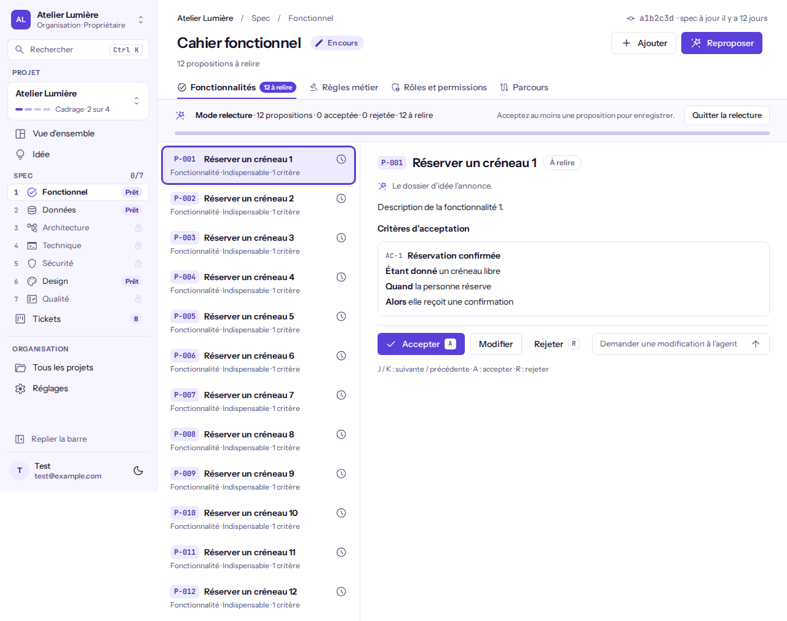

# Enregistrer les propositions de l'agent dans la spec

**Pour qui** : les **Propriétaires**, **Administrateurs**, **Développeurs** et **Designers** (les **Designers** n'enregistrent pas les règles ni les rôles).
**Avant de commencer** : l'agent a fini de proposer, des propositions sont à relire.
**Résultat** : les propositions acceptées sont écrites dans la spec ; rien n'est écrit avant votre clic.

## Étapes

1. Dans **Spec · Fonctionnel**, ouvrez la relecture depuis le bouton de l'agent (« N à relire ») : la relecture s'ouvre, onglet par onglet.

   

2. Acceptez ou rejetez chaque proposition (**Remettre à relire** annule un choix), puis cliquez **Enregistrer N dans la spec**.
3. L'enregistrement se fait **par lots** : une grosse relecture (plusieurs centaines d'éléments) est découpée automatiquement en lots d'au plus 200 éléments et d'environ 3 Mio. Le bandeau montre une barre verte et le texte « Enregistrement · lot 2 sur 3 · 200 sur 512 ». Vous n'avez rien à faire entre les lots.
4. **Quitter la relecture** reste inactif jusqu'à la fin de l'enregistrement, pour ne pas interrompre un lot en cours.

## Vérifier que ça a marché
La barre est pleine et verte, le bouton **Quitter la relecture** redevient actif, et les éléments apparaissent dans la liste de leur onglet.

## Si quelque chose ne va pas
| Message | Cause | Que faire |
|---------|-------|-----------|
| Enregistrement échoué · à reprendre par l'équipe technique | Un lot n'a pas pu être écrit | Prévenez l'équipe technique |
| Vous n'avez pas accès à cette action | Votre rôle n'écrit pas ce type d'élément | Demandez à un propriétaire, un administrateur ou un développeur |
