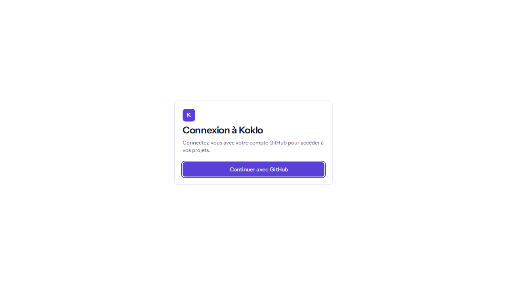
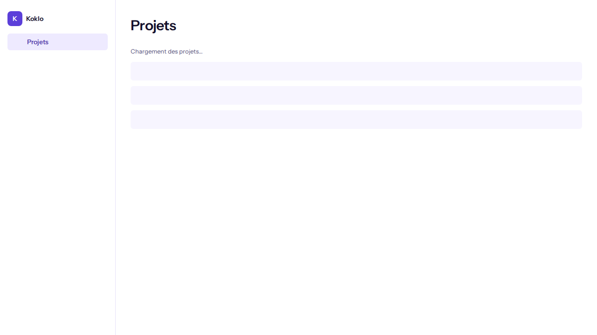

# Sign in with GitHub and view your projects

**Who this is for**: anyone with a GitHub account who has access to Koklo projects.
**Before you start**: a GitHub account and the address of your Koklo environment.
**Result**: you are signed in and see the list of projects you can access.

## Steps

1. Open Koklo. If you are not signed in you land on the page **Connexion à Koklo**.

   

2. Click **Continuer avec GitHub**. The button shows **Redirection vers GitHub…** while you are sent to GitHub.
3. Authorise Koklo on GitHub if asked. You come back to the page **Projets**.
4. Read the list: one row per project, column **Nom**, with a counter ("1 projet", "N projets") above it.
5. To switch between light and dark, use the button at the bottom of the left sidebar (at the top on a phone). It is labelled **Passer au thème sombre** or **Passer au thème clair**. Your choice is remembered; the default is light.

## What you may see instead of the list
- **Chargement des projets…**: the list is loading.
- **Aucun projet pour le moment**: no project is available to you yet.
- **Impossible de charger les projets**: click **Réessayer**.

   

## Checking it worked
The sidebar shows **Projets** as the current page and the title **Projets** is displayed. If you are already signed in, opening the sign-in page takes you straight to **Projets**.

## If something goes wrong
| Symptom | Cause | What to do |
|---------|-------|------------|
| **La connexion avec GitHub a échoué. Réessayez.** | GitHub or the sign-in service did not answer | Click **Continuer avec GitHub** again; contact your administrator if it persists |
| You are sent back to the sign-in page | Your session ended | Sign in again |
| **Impossible de charger les projets** | Network or server error | Check your connection, click **Réessayer** |
