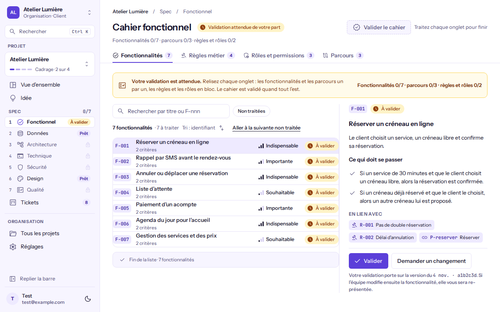
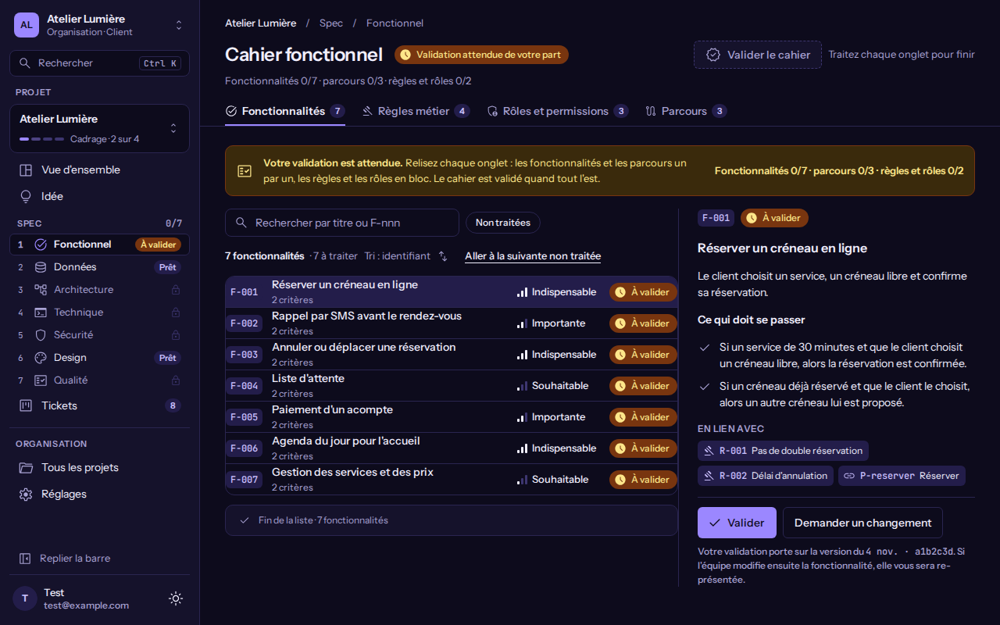
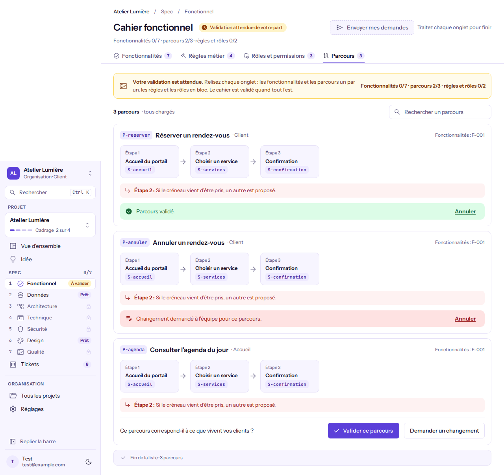
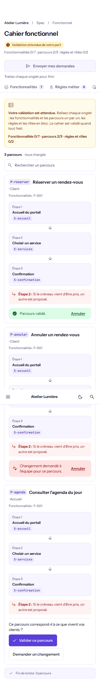
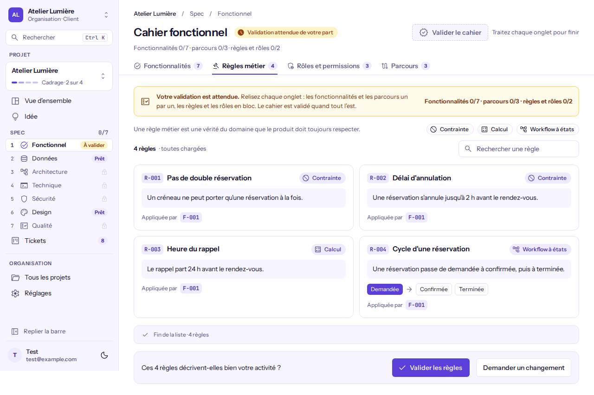

# Valider le cahier fonctionnel

**Pour qui** : le **Client** invité au projet, qui valide. Le **Business** lit le même écran sans pouvoir décider. Le **Propriétaire** et l'**Administrateur** relancent le client, et valident eux-mêmes seulement quand **aucun client n'est invité** au projet. Les **Développeurs** et les **Designers** voient la vue de l'équipe, sans validation.
**Avant de commencer** : le cahier doit avoir été envoyé au client (statut **À valider**).
**Résultat** : le cahier passe à **Validé**. Toute modification qui suit sur un élément validé vous le re-présente.

## Étapes

1. Ouvrez le projet, puis **Spec**, puis **Fonctionnel**. Un bandeau ambre rappelle : « Votre validation est attendue. » et la progression (« Fonctionnalités 12/248 · parcours 3/18 · règles et rôles 1/2 »). L'en-tête affiche **Validation attendue de votre part**.

   
   

2. **Fonctionnalités, une par une.** Cliquez une ligne : la fiche s'ouvre à droite (plein écran sur téléphone, **Fermer la fiche** pour revenir). Elle décrit ce qui doit se passer (« Si … et que …, alors … ») et les éléments en lien, avec leur nom. Le filtre **Non traitées** ne garde que ce qui attend votre décision ; **Aller à la suivante non traitée** vous y amène, même si elle n'est pas encore chargée.
3. Cliquez **Valider**, ou **Demander un changement** : le champ « Que faut-il changer ? » s'ouvre, écrivez votre demande (2 000 caractères au plus) puis **Envoyer à l'équipe**. **Échap** ou **Annuler** referme le champ. Après une décision, la fiche de la suivante non traitée s'ouvre et l'écran annonce « Validée. Suivante : F-004 ».
4. **Parcours, un par un.** Sous chaque parcours, **Valider ce parcours** ou **Demander un changement**. Une confirmation verte (« Parcours validé. ») ou rouge (« Changement demandé à l'équipe pour ce parcours. ») apparaît ; **Annuler** remet le parcours à valider.

   
   

5. **Règles métier et rôles, en bloc.** Lisez toutes les cartes, puis la barre en bas : **Valider les règles** ou **Valider les rôles**, ou **Demander un changement**. **Annuler** reprend la décision.

   

6. Quand les quatre onglets sont traités, le bouton de l'en-tête devient actif : **Valider le cahier**, ou **Envoyer mes demandes** s'il existe au moins une demande de changement. Tant que ce n'est pas le cas, il reste en pointillé avec la raison « Traitez chaque onglet pour finir ».

## Côté équipe

- **Relancer** : dans l'en-tête du cahier (statut **À valider par le client**), **Relancer Marie** envoie un rappel au client. Un seul rappel part par jour et par client ; l'écran dit « Rappel envoyé » ou « Le client a déjà été relancé aujourd'hui ». La relance apparaît dans l'activité du projet.
- **Projet sans client invité** : le bouton **Valider à la place du client** ouvre la même vue que celle du client, et la validation est enregistrée comme « validé par l'équipe · sans client ».
- **Business** : l'écran est en lecture seule, un bandeau neutre le dit (« Vous consultez le cahier. La validation revient au client. »).

## Vérifier que ça a marché
L'en-tête affiche **Cahier validé** ; chaque onglet montre ses éléments **Validés**. Une validation porte sur la version lue (« version du 4 nov. · a1b2c3d ») : si l'équipe modifie ensuite un élément, il redevient **À valider** et un bandeau signale « N éléments ont changé depuis votre validation ».

## Si quelque chose ne va pas
| Message | Cause | Que faire |
|---------|-------|-----------|
| Il reste des éléments à traiter | Au moins une fonctionnalité, un parcours, les règles ou les rôles n'a pas de décision | Utilisez **Aller à la suivante non traitée** puis recommencez |
| Le cahier a changé depuis votre lecture | L'équipe a modifié un élément pendant que vous le relisiez | Rechargez la page et relisez l'élément |
| Vous ne pouvez pas valider ce cahier | Votre rôle ne valide pas, ou un client est invité au projet | Demandez au client, ou invitez-le |
| La décision n'a pas pu être enregistrée | Problème passager | Réessayez |
| Aucun client n'est invité à ce projet | Vous avez cliqué **Relancer** sans client | Invitez le client depuis **Membres** |
