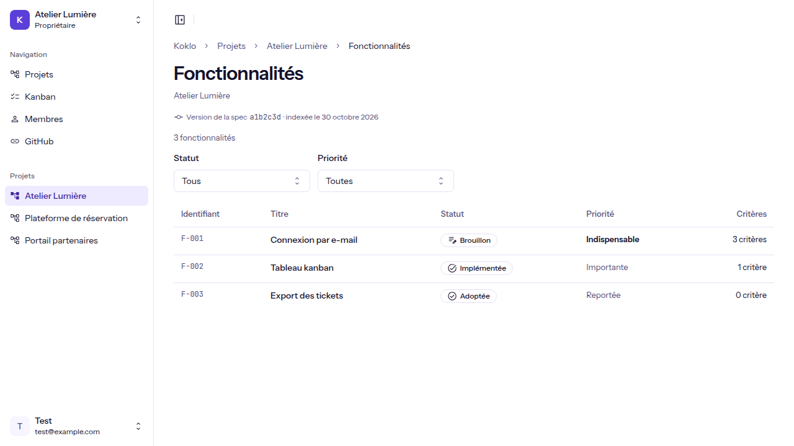
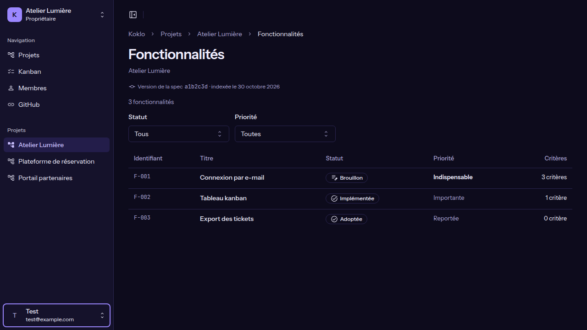
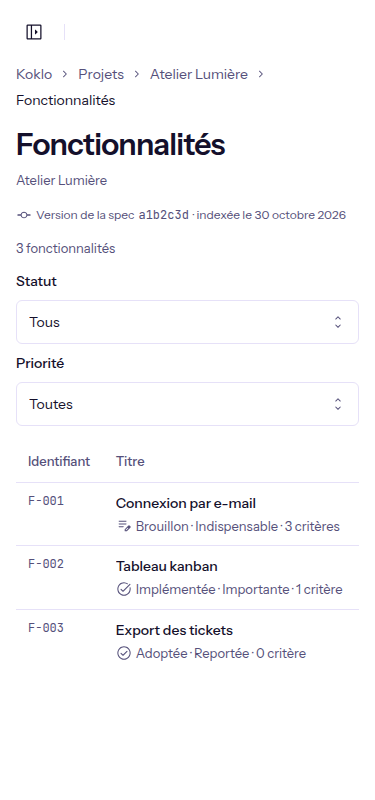
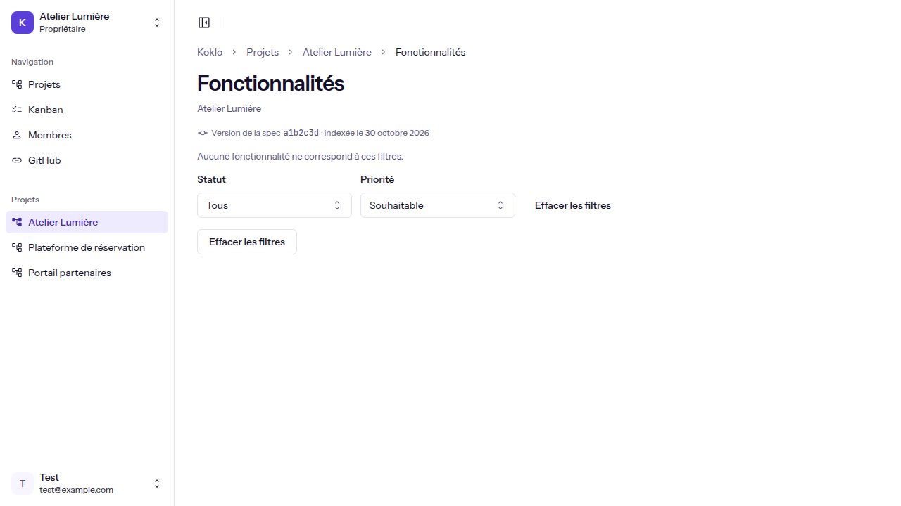
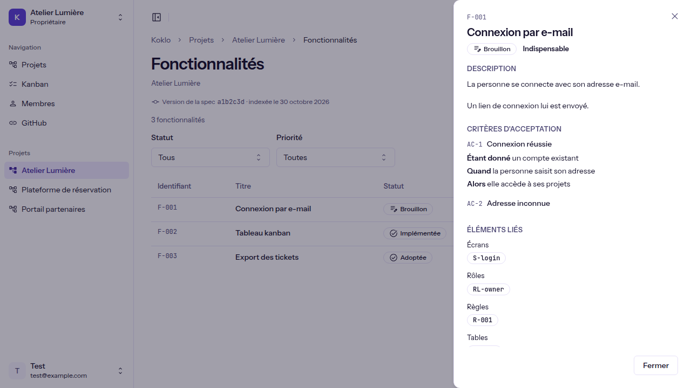

# Consulter les fonctionnalités d'un projet

**Pour qui** : tous les rôles. Les **Propriétaires**, **Administrateurs**, **Développeurs** et **Designers** voient en plus des éléments techniques ; les **Clients** et le **Business** lisent la même liste en langage courant.
**Avant de commencer** : avoir une organisation active et au moins un projet (voir [Créer un projet](create-a-project.md)).
**Résultat** : vous lisez les fonctionnalités décrites dans la spec du projet, leurs critères d'acceptation et leurs éléments liés. L'écran est en lecture seule : on ne peut rien y modifier.

## Étapes

1. Ouvrez **Projets** dans le menu latéral, puis cliquez sur le **nom du projet** (ou choisissez le projet dans le groupe « Projets » du menu). La page **Fonctionnalités** s'ouvre.

   
   

2. Lisez la liste : chaque ligne indique l'identifiant (par exemple F-001), le titre, le **statut** (Brouillon, Spécifiée, Implémentée, Adoptée), la **priorité** (Indispensable, Importante, Souhaitable, Reportée) et le nombre de critères. Sur téléphone, statut, priorité et critères passent sous le titre.

   

3. Pour réduire la liste, choisissez un **Statut** ou une **Priorité**. **Effacer les filtres** rétablit la liste complète.

   

4. Si la liste est longue, cliquez sur **Afficher plus de fonctionnalités** pour voir la suite.
5. Cliquez sur le titre d'une fonctionnalité : sa **fiche** s'ouvre à droite avec la description, les critères d'acceptation et les éléments liés (écrans, rôles, règles ; pour l'équipe aussi tables, endpoints et exigences non fonctionnelles). L'adresse de la page contient la fiche : vous pouvez la partager. **Fermer**, la croix ou la touche Échap referment la fiche.

   

## Vérifier que ça a marché
Le compteur au-dessus de la liste indique le nombre de fonctionnalités et la ligne de version indique la dernière lecture de la spec (l'équipe voit aussi un court identifiant de version).

## Si quelque chose ne va pas
| Symptôme | Cause | Que faire |
|----------|-------|-----------|
| « La spec est en cours de préparation » | Koklo lit encore le dépôt de spec | Patientez, la liste apparaît seule ; **Actualiser** relit tout de suite |
| « La préparation prend plus de temps que prévu » | Lecture longue | Cliquez sur **Actualiser** dans un moment |
| « Ce projet n'a pas de dépôt de spec » | Le projet a été créé sans dépôt | Un Propriétaire ou un Administrateur clique sur **Créer le dépôt de spec** ; les autres rôles préviennent l'un d'eux |
| « Aucune fonctionnalité à afficher pour le moment » | Clients et Business : l'état de la spec n'est pas connu d'eux | Revenez plus tard ou demandez à l'équipe |
| « La spec n'a pas pu être lue » | La spec contient une erreur ou est trop volumineuse | Prévenez l'équipe ; une fois la spec corrigée, la lecture reprend seule |
| « Impossible de charger les fonctionnalités » | Erreur réseau | Cliquez sur **Réessayer** |
| « Le détail est momentanément indisponible » | GitHub ne répond pas | La liste reste consultable ; **Réessayer** dans un instant |
| « Koklo n'a plus accès au dépôt de spec » | L'autorisation GitHub a expiré | Un Propriétaire ou un Administrateur autorise de nouveau Koklo (voir [Relier GitHub](connect-github.md)) |
| « Projet introuvable » | Le projet n'existe pas ou vous n'y avez pas accès | Retournez à la liste des **Projets** |
