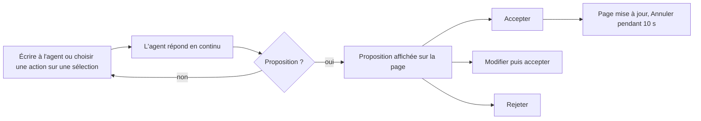
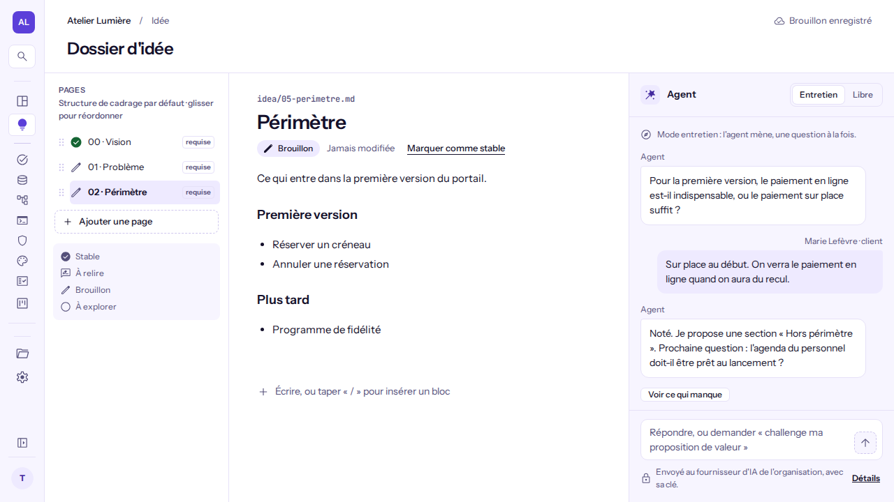
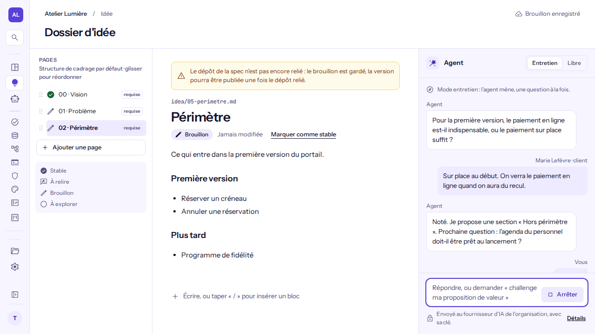
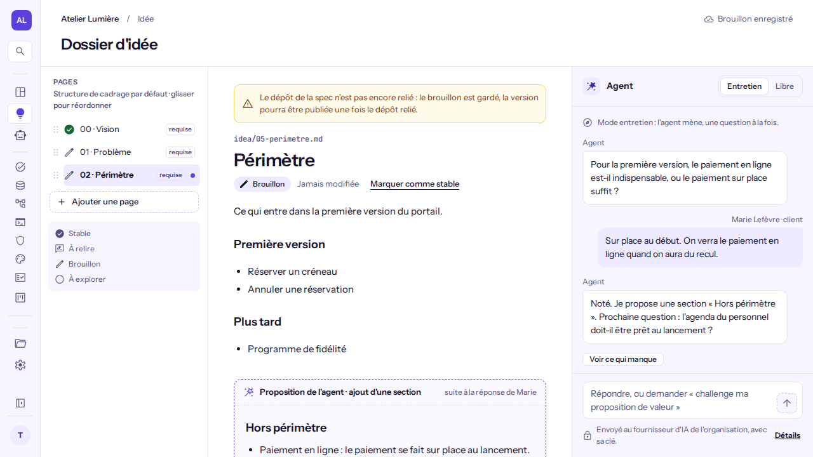
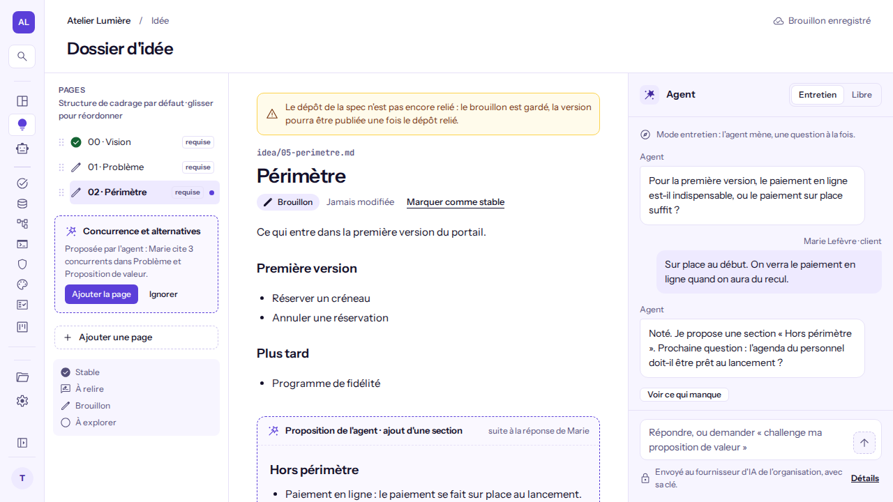

# Travailler avec l'agent dans l'espace Idée

**Pour qui** : les **Propriétaires**, **Administrateurs**, **Développeurs**, **Designers** et **Clients**. Le **Business** lit le dossier d'idée mais ne voit pas le panneau de l'agent.
**Avant de commencer** : le dossier d'idée du projet existe (au moins une page). Un propriétaire ou un administrateur a enregistré la clé du fournisseur d'IA de l'organisation ; sans clé, le panneau l'indique et l'éditeur reste utilisable.
**Résultat** : vous avez fait avancer le dossier avec l'agent, en décidant vous-même de chaque ajout. **L'agent ne modifie jamais une page et n'en crée jamais sans votre décision.**

## Ce qui est envoyé au fournisseur
Les titres et le contenu des pages, la conversation, le passage sélectionné et votre message partent chez le fournisseur d'IA de l'organisation, avec sa clé. Aucun courriel ni identifiant de personne n'est envoyé : les auteurs sont désignés par « l'équipe » ou « le client ». Un seul échange avec l'agent peut tourner à la fois par personne et par projet.

## Parcours

1. **Ouvrez l'espace Idée** puis le panneau « Agent » (à droite dès 1024 px de large, sous le document sinon). Choisissez un mode : **Entretien** (l'agent pose ses questions, vous répondez) ou **Libre** (vous lui demandez ce que vous voulez). Entrée envoie le message, Maj + Entrée saute une ligne.

   

2. **Suivez la réponse.** Elle s'affiche au fil de l'eau ; « Arrêter » l'interrompt. La conversation est conservée : les 50 derniers messages sont affichés, puis « Messages plus anciens ».

   

3. **Agissez sur une sélection.** Sélectionnez un passage dans la page : Développer, Challenger, Simplifier, Trouver les trous ou En faire une page.

4. **Décidez chaque proposition.** Une proposition apparaît sous le bloc concerné (ou remplace le passage, l'ancien texte barré). Choisissez **Accepter** (touche A), **Modifier** (champ de texte brut, rien n'est actif avant l'acceptation) ou **Rejeter** (touche R). Les touches ne jouent que si le focus est dans la proposition. S'il y en a plusieurs, elles sont numérotées « Proposition 1 sur 3 ».

   

5. **Annulez si besoin.** Après une décision, « Annuler » reste disponible 10 secondes ; un rejet redevient une proposition en attente. Une page ajoutée par l'agent n'a pas d'« Annuler » : elle se supprime comme toute page, la corbeille la garde.

6. **Pages proposées.** L'agent peut proposer une nouvelle page : elle apparaît en pointillés dans l'arborescence (trois visibles, puis « N autres »). Elle n'existe qu'une fois **ajoutée** ; « Ignorer » la fait disparaître.

   

7. **« Ce qui manque encore ».** À la demande, l'agent liste au plus quatre manques du dossier, chacun rattaché à une page ou à une page à créer.

## Vérifier que c'est bon
La page porte le texte accepté, l'enregistrement indique « Brouillon enregistré », et la trace « Section ajoutée par l'agent, acceptée par vous. » s'affiche 10 secondes. Chaque décision est inscrite au journal d'audit.

## Si quelque chose ne va pas
| Symptôme | Cause | Que faire |
|---|---|---|
| Alerte « non configuré » à la place du panneau | Aucune clé d'IA pour l'organisation | Propriétaire ou administrateur : « Configurer l'IA ». Sinon, demander à un administrateur d'ajouter la clé. |
| Message de limite au-dessus de la saisie | Un échange est déjà en cours, ou le quota de l'organisation est atteint | Attendre quelques secondes puis renvoyer ; votre saisie est conservée. |
| Proposition barrée « périmée » | La page a changé depuis la proposition | « Redemander à l'agent ». |
| Réponse refusée par l'agent | Le texte renvoyé par le modèle ne respecte pas les règles (lien, balise, image) | Reformuler la demande ; rien n'a été enregistré. |
