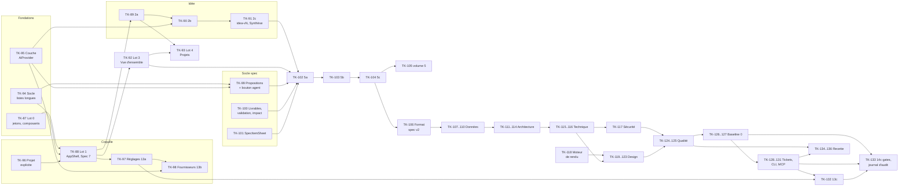

# Refonte du 6 novembre 2026 · Feuille de route

> Étape B de la mission. **Validée par Brice le 2026-11-06** (découpage, tri des tickets, réponses dans `questions.md` §D). Le sprint 036 (S19) est ajouté à sa demande.
> Entrées : `docs/refonte/passations/01…22`, `docs/refonte/ecarts.md` (audit), `docs/refonte/questions.md`.
> Le texte complet des tickets, au format du vault, est dans `docs/refonte/vault-proposition/` (un fichier par sprint, prêt à copier dans `MyVault/koklo-v2/sprints/`).

## 1. Graphe des dépendances

Tiré des sections « Prérequis » et « Tickets » des passations, plus trois socles techniques révélés par l'audit : projet explicite, propositions persistées et validation par élément.

Points de lecture :
- **Projet explicite (TK-96)** passe avant le lot 1. Sans lui, `/projects/[id]/tickets` montrerait le plus ancien projet (`OldestProjectContext`).
- **AiProvider (TK-95)** passe avant tout nouvel usage d'IA. L'espace Idée (2b) en est le premier, et le flux y est ajouté une fois pour toutes.
- **Le socle de la spec (TK-99, TK-100, TK-101)** est réutilisé par les 7 livrables. Il est livré avec le premier livrable (5a), pas isolé : le sprint reste démontrable.
- **Le format de spec v2 (TK-106)** passe avant le lot Données. C'est le premier livrable dont le format existant contredit la passation.
- **Moteur de rendu (TK-118)** : préalable au Design (studio, miniatures, parcours jouable). Il n'a pas de ticket dans la passation 13. Il est tiré de 13 §3 (« rendu réel depuis la spec ») et de la conception v0.6 §16.
- **Ordre de disponibilité des livrables**, en lecture prudente (questions B1) : Fonctionnel ← `idea-v1` ; Données ← Fonctionnel ; Architecture ← Données ; Technique ← Architecture ; Sécurité ← Technique ; Design ← Fonctionnel ; Qualité ← Technique, Sécurité et Design.

## 2. Sprints réordonnés

18 sprints au lieu des 15 proposés. Écarts justifiés :
- **Fonctionnel en deux sprints (S5, S6).** Le socle commun (propositions persistées, validation par élément, livrables, panneau commun) pèse autant que le livrable. Chaque sprint reste démontrable : S5 propose, relit et enregistre des fonctionnalités ; S6 couvre les 4 onglets et la validation du client.
- **Technique et Sécurité ensemble (S9).** Sécurité vient « après le technique » et réutilise toute sa mécanique ; un sprint dédié serait trop léger.
- **Design sur trois sprints (S10 à S12).** C'est le lot capital, non compressé, avec un ticket de moteur de rendu en tête.
- **Itérations sur trois sprints (S15 à S17).** Kanban et jetons, puis CLI et MCP, puis réglages des agents, fusion humaine et gates de sécurité.

Effort en points : S = 1, M = 3, L = 5. Capacité, voir §5.

| Sprint (vault) | Tranche démontrable | Tickets | Points |
|---|---|---|---|
| **S1 · 018** Fondations | Galerie `/dev/ui` en clair et sombre ; écrans existants avec les nouveaux statuts et l'échelle typo ; listes avec total et défilement infini ; l'IA existante passe par `AiProvider` sans changement visible | TK-87, TK-94, TK-95 | 13 |
| **S2 · 019** Coquille et réglages | Navigation à deux niveaux (organisation, projet), barre « SPEC 0/7 », `ProjectHeader`, ⌘K ; kanban sous le projet ; Réglages par rôle ; plusieurs fournisseurs d'IA avec principal et secours | TK-96, TK-88, TK-97, TK-98 | 16 |
| **S3 · 020** Espace Idée | Équipe et client écrivent le dossier, l'agent propose des sections et des pages, « Passer au cadrage » fige `idea-v1` et génère la Synthèse | TK-89, TK-90, TK-91 | 13 |
| **S4 · 021** Vue d'ensemble et projets | Page d'accueil du projet (phase, prochaine étape, activité) ; liste des projets en cartes ; création en une étape avec le dépôt en arrière-plan | TK-92, TK-93 | 10 |
| **S5 · 022** Socle de la spec et Fonctionnalités | « Proposer avec l'agent » sur le Fonctionnel, relecture, enregistrement en un lot ; panneau Créer / modifier ; Assistant de cadrage et brief retirés | TK-99, TK-100, TK-101, TK-102 | 20 |
| **S6 · 023** Fonctionnel complet et validation client | Règles, rôles et parcours ; le client valide le cahier élément par élément ; volume réel | TK-103, TK-104, TK-105 | 13 |
| **S7 · 024** Données | Format v2 migré ; modèle proposé, diagramme avec zones, jeux d'exemple, validation par l'équipe | TK-106, TK-107, TK-108, TK-109, TK-110 | 19 |
| **S8 · 025** Architecture | Schéma en couches, décisions, flux en séquence, document en sections | TK-111, TK-112, TK-113, TK-114 | 14 |
| **S9 · 026** Technique et Sécurité | Stack avec « Choisir », API par zone et contrat généré, exigences ; livrable Sécurité (menaces, données sensibles, droits, ASVS, résumé client) | TK-115, TK-116, TK-117 | 15 |
| **S10 · 027** Design · charte et règles | Moteur de rendu ; design system (contraste calculé) ; règles UI/UX, sévérités, dérogations | TK-118, TK-119, TK-120 | 15 |
| **S11 · 028** Design · écrans et studio | Inventaire trié, conception un écran à la fois, studio d'écran | TK-121, TK-122 | 10 |
| **S12 · 029** Design · parcours jouable | Parcours joué écran par écran, commentaires ancrés, validation client par écran | TK-123 | 5 |
| **S13 · 030** Qualité | Scénarios Gherkin, couverture, stratégie, jeux, plan ; 7/7 livrables validés | TK-124, TK-125 | 8 |
| **S14 · 031** Baseline 0 | Soumission, contrôles, signature du client, tag `baseline-0` ; parcours e2e complet Idée → Baseline | TK-126, TK-127, TK-62 | 13 |
| **S15 · 032** Tickets | Découpage depuis la baseline, sprints, kanban avec règles, chronologie, panneau ; jetons ; retrait de l'exécution d'agents | TK-128, TK-129, TK-63, TK-64, TK-130 | 17 |
| **S16 · 033** Agents locaux | `koklo` en local : login, `ticket start`, serveur MCP, remontées, état « Sans nouvelles », onglet Sessions, vue client | TK-65, TK-131, TK-66, TK-69, TK-68, TK-82, TK-81 | 17 |
| **S17 · 034** Réglages des agents, fusion humaine, sécurité en CI | Postes et révocation, règles du projet, archivage ; fusion humaine seule ; contrôles de sécurité sur les PR ; journal d'audit | TK-132, TK-70, TK-79, TK-133 | 12 |
| **S18 · 035** Recette et mises en ligne | Environnements et aperçus lus dans GitHub ; campagne, retours ; notes de version, PV signé, indicateurs | TK-134, TK-135, TK-136 | 11 |
| **S19 · 036** `koklo deliver` repensé | Conception validée de `koklo deliver` v2 (sur le poste, par MCP), inspirée des agents et des retours d'expérience de Shipyard sans en dépendre ; puis réécriture de la bascule (ancien sprint 017) | TK-137 | 3 |

## 3. Tickets existants

Rien n'est supprimé : un ticket annulé reste dans son sprint, barré, avec « Annulé · remplacé par TK-… » et la date. Un ticket réécrit garde son numéro et son historique (ancien libellé cité en note).

| Ticket | Sprint actuel | Décision | Destination | Raison |
|---|---|---|---|---|
| TK-85 Gabarit `sidebar-07` et `login-05` | 003 | **Annuler** (remplacé par TK-88) | — | La coquille v1 est remplacée par `AppShell`. |
| TK-39 GitHub App et faux fournisseur | 008 | **Garder** | 008 | Le code est livré ; il reste la conformité manuelle contre GitHub (humain). |
| TK-55 Espace client, suggestions, validation liée au SHA | 010 | **Garder**, à clôturer | 010 | 55a à 55d fusionnés (#127 à #131) ; vérifier les critères puis cocher. La granularité de la validation est reprise par TK-100. |
| TK-56 Fin de cadrage et baseline-0 | 011 | **Annuler** (remplacé par TK-126, TK-127) | — | La passation 16 définit soumission, signature et tag. |
| TK-57 Découpage en tickets (API) | 011 | **Fusionner** dans TK-128 | 032 | Devient `tickets.split.propose` depuis la baseline. |
| TK-60 Web : espace client et validation | 011 | **Annuler** (remplacé par TK-104) | — | Vue client par livrable, en commençant par le Fonctionnel. |
| TK-61 Web : revue de la proposition de tickets | 011 | **Fusionner** dans TK-128 | 032 | Écran de découpage du lot 12 §1. |
| TK-62 e2e R3 | 011 | **Réécrire** | 031 | Parcours e2e complet : Idée → Fonctionnel → … → Baseline 0, équipe et client. |
| TK-63 Base : jetons | 012 | **Réécrire** | 032 | Types utilisateur, CLI, agent limité au ticket (12 h) ; plus de « runner » ; postes et révocation. |
| TK-64 API : émission des jetons, flux device | 012 | **Garder** (ajusté) | 032 | Ajouter : un jeton d'agent ne fusionne jamais et ne lit que son ticket. |
| TK-65 CLI : squelette, contexte, schema, auth | 012 | **Garder** | 033 | Base du CLI local. |
| TK-66 CLI : org, project, ticket, sprint | 012 | **Réécrire** | 033 | `ticket start` / `release` au sens du 06/11 (branche, session, tranche figée). Dépend de TK-131 (procédures serveur). |
| TK-67 CLI : feature, spec pull, cache | 013 | **Fusionner** dans TK-131 | 033 | La tranche de spec est renvoyée par `ticket.start`. |
| TK-68 CLI : rules pull / show | 013 | **Garder** | 033 | Instructions d'agent en local. |
| TK-69 CLI : serveur MCP filtré par jeton | 013 | **Réécrire** | 033 | Serveur `koklo mcp` qui expose les outils `ticket.start`, `ticket.progress`, `gate.report`, `ticket.release` (procédures dans TK-131). `sensitive`. |
| TK-70 Publication npm de `@koklo/cli` | 013 | **Garder** | 034 | Requise par le lot 13 §2.7 ; reste bloquée par H-15 (licence). |
| TK-75 Runner : bail, worktree, parallélisme | 015 | **Annuler** (décision du 06/11) | — | Koklo n'orchestre plus d'agent. |
| TK-76 Runner : gates locaux, PR, attente CI | 015 | **Annuler** (remplacé par TK-131) | — | `gate.report` indicatif, la CI fait foi. |
| TK-77 Review d'agent | 015 | **Annuler** (décision du 06/11) | — | « Aucun agent ne peut approuver. » |
| TK-78 Triage et escalade | 015 | **Annuler** (remplacé par TK-131) | — | Remplacé par l'état « Sans nouvelles » et sa notification. |
| TK-79 Politique et merge serveur | 016 | **Réécrire** | 034 | Fusion par un humain seul (`pr.approveAndMerge`) + check `koklo/policy`. Dépend de TK-64 et TK-129. |
| TK-80 Worker : merges et deployed_staging | 016 | **Fusionner** dans TK-134 | 035 | Devient la lecture `deployment` / `deployment_status` / `workflow_run`. |
| TK-81 CLI : `koklo deliver` et doctor | 016 | **Réécrire** (doctor seul) | 033 | `deliver` est une boucle autonome, contraire au 06/11. |
| TK-82 CLI : rules pull sur le catalogue | 016 | **Garder** | 033 | Indépendant de l'exécution. |
| TK-83 Web : vue de livraison | 016 | **Annuler** (remplacé par TK-131 et TK-134) | — | Onglet Sessions (lot 12) et Environnements (lot 15). |
| TK-87 Refonte lot 0 | 018 | **Réécrire** | 018 | Passation 01 de l'archive ; bloc IA selon B15 ; composants de listes dans TK-94. |
| TK-88 Refonte lot 1 | 018 | **Réécrire** | 019 | « SPEC N/7 » numérotée et verrouillée (05, 14a), recherche serveur, `/settings/[section]`, 7 livrables. |
| TK-89, TK-90, TK-91 Lot 2a, 2b, 2c | 019 | **Réécrire** | 020 | Synthèse, `idea-vN`, pas de brief (05) ; colonne de 264 px (12 §8.3) ; propositions persistées (TK-99). |
| TK-92 Lot 3 | 020 | **Réécrire** | 021 | Phase selon `idea-vN` (05), 7 livrables, listes bornées à 5 (07). |
| TK-93 Lot 4 | 021 | **Réécrire** | 021 | Grille par pages de 24 (07). |

Sprints entiers :
- **015 et 016** gardent leur historique. Leurs tickets sont annulés ou déplacés, et une note en tête renvoie à la refonte. Le résultat R5 « mergé par le serveur sans intervention » est retiré.
- **017 (Bascule)** est remplacé par le sprint 036 (S19) : étude `koklo deliver` v2, puis réécriture de la bascule (décision C2).
- **011 à 013** gardent leurs tickets livrés ; ceux qui restent ouverts sont déplacés selon le tableau.

## 4. Nouveaux tickets

Le texte complet (À faire, critères d'acceptation repris de la passation, labels) est dans `docs/refonte/vault-proposition/`. Paquets : `ui`, `web`, `api`, `worker`, `contract`, `db`, `domain`, `schema`, `llm`, `github`, `rules`, `delivery`, `cli` (nouveau, ADR).

| Ticket | Titre | Référence | Dépend de | Paquets | Effort |
|---|---|---|---|---|---|
| TK-94 | Socle listes longues | 07 §1 à §6, §8 ; 08 §4 | — | contract, ui, api, web, db | L |
| TK-95 | Couche `AiProvider` (Vercel AI SDK), modèle par usage, secours, comptage | 20 ; 19 §2.3 (moteur) ; ADR 0015 complétée | — | llm, domain, api, db | L |
| TK-96 | Projet explicite dans le contrat, retrait d'`OldestProjectContext` | 01 §1.2 (tickets sous le projet) ; ecarts.md | — | contract, api, web | M |
| TK-97 | Lot 13a · Réglages : navigation par rôle, Général, Membres, Mon compte | 19 §1, §2.1, §2.2, §2.6 | TK-88 | web, api, contract, db | L |
| TK-98 | Lot 13b · Fournisseurs d'IA : écran, ajout testé, principal / secours, modèle par usage, consommation, plafond | 19 §2.3 ; 20 | TK-95, TK-97 | web, api, contract, db | M |
| TK-99 | Socle des propositions de l'agent : lancements persistés en tâche de fond, flux, verrou par livrable, `proposal.*`, `ai.proposeDeliverable`, `ai.reviseProposal`, `AgentProposeButton`, `AgentProposePopover`, `ai.proposeOptions` | 05 §1.2 ; 06 §4.2, §4.3, §6 ; 07 §1.4 ; 14 | TK-94, TK-95 | api, worker, contract, db, web, ui, llm | L |
| TK-100 | Socle livrables et validation : `spec.deliverables` (7, disponibilité, `staleBecause`), index d'entités avec hachage, validation par élément et par l'équipe, `review.*` étendu, impact amont | 05 §2 ; 06 §5, §6, §7 ; 09 §3.5 | TK-94 | api, worker, contract, db, schema | L |
| TK-101 | Socle `SpecItemSheet` : panneau commun, préremplissage, erreurs, suppression, `ai.prefillItem`, `spec.item.get`, `spec.refs.search` ; formulaire Fonctionnalité | 11 ; 14 §5 | TK-99, TK-100 | ui, web, api, contract | L |
| TK-102 | Lot 5a · Spec · Fonctionnel : page, états Prêt / Génération / Relecture, onglet Fonctionnalités ; retrait de l'Assistant et du brief, redirections | 06 §1 à §4.4 (Fonctionnalités), §6, §7 ; 05 §1 | TK-91, TK-92, TK-99, TK-100, TK-101 | web, api, contract | L |
| TK-103 | Lot 5b · Règles métier, Rôles et permissions, Parcours | 06 §4.3, §4.4, §6 ; 11 §3 | TK-102 | web, api, worker, contract, schema | L |
| TK-104 | Lot 5c · Vue client et validation du cahier, « Relancer » | 06 §4.5, §5, §8 | TK-103 | web, api, contract | L |
| TK-105 | Lot 5 · volume réel | 08 §1, §3 | TK-104 | web, api, contract | M |
| TK-106 | Format de spec v2 et migration des dépôts existants | ecarts.md (migrations) ; 09 §1 ; 08 §2.1 ; questions B8, B9 | TK-104 | schema, worker, api | L |
| TK-107 | Lot 6a · Données : format, Mermaid, états, onglets Tables et Jeux d'exemple | 09 §1 à §3.3, §3.4, §5 | TK-106 | api, worker, contract, web, schema | L |
| TK-108 | Lot 6b · Données : diagramme, zoom, fiche Fiche / YAML / Mermaid | 09 §3.4, §8 | TK-107 | web, ui, api, contract | L |
| TK-109 | Lot 6c · Données : validation par l'équipe, vue client, impact amont | 09 §3.5, §3.6, §4, §6, §7 | TK-108 | web, api, db | M |
| TK-110 | Lot 6 · volume réel : zones, « Aller à une table », niveau de détail, mini-carte, jeux paginés | 08 §2, §3 | TK-108 | web, api, contract | M |
| TK-111 | Lot 7a · Architecture : formats, Mermaid, états, Document (`SpecDocument`), Composants | 10 §1 à §4.3, §6 ; 12 §8.1 | TK-109 | api, worker, contract, web, schema | L |
| TK-112 | Lot 7b · Architecture : schéma en couches, flux en séquence | 10 §4.1, §4.5, §8 ; 12 §8.2 | TK-111, TK-110 | web | L |
| TK-113 | Lot 7c · Architecture : décisions, validation, À revoir, vue client | 10 §3, §4.4, §5, §7 | TK-112 | web, api | M |
| TK-114 | Corrections des lots 2 à 8 : marges des encadrés, en-têtes des livrables | 12 §8.3, §8.4 | TK-111 | web | S |
| TK-115 | Lot 8a · Technique : formats, états, Stack, Environnements, Document | 12 §1 à §4.1, §4.4, §4.5 | TK-113 | api, worker, contract, web, schema | L |
| TK-116 | Lot 8b · Technique : API, générateur de contrat, Exigences, validation | 12 §4.2, §4.3, §5 | TK-115 | api, web, contract | L |
| TK-117 | Lot 14b · Livrable Sécurité | 21 §1, §2, §4 | TK-116 | api, worker, contract, web, schema | L |
| TK-118 | Moteur de rendu des écrans (IR, rendu web par état, viewport et thème) ; ADR du nouveau paquet `render` | 13 §3, §6 ; conception v0.6 §16 (`cadrage/archive/koklo-conception-v0.6.md`, hors archive de la refonte) | TK-104 | render (nouveau), schema, api, contract, web | L |
| TK-119 | Lot 9a · Design system | 13 §1, §2.1, §2.2 | TK-116, TK-118 | api, web, schema | L |
| TK-120 | Lot 9b · Règles UI/UX | 13 §2.3, §6 | TK-119 | rules, api, web | L |
| TK-121 | Lot 9c · Écrans : inventaire, file de conception, galerie | 13 §2.4 | TK-120 | api, worker, web | L |
| TK-122 | Lot 9d · Studio d'écran | 13 §3 | TK-121 | web, api | L |
| TK-123 | Lot 9e · Parcours jouable et validation client par écran | 13 §2.5, §4, §5 | TK-122 | web, api | L |
| TK-124 | Lot 10a · Qualité : formats, Scénarios, Jeux, relecture | 15 §1 à §4.1, §4.4 | TK-117, TK-123 | api, worker, contract, web, schema | L |
| TK-125 | Lot 10b · Qualité : Couverture, Stratégie, Document, validation | 15 §4.2, §4.3, §4.5, §5 | TK-124 | api, web | M |
| TK-126 | Lot 11a · Baseline 0 : page équipe, contrôles, soumission | 16 §1 à §4, §6 ; 21 §0 (contrôles, carte Sécurité) | TK-125 | api, contract, web | M |
| TK-127 | Lot 11b · Baseline 0 : vue client signée, tag, phase Itérations | 16 §3, §5, §6 ; 21 §1.5 (résumé dans le récapitulatif) | TK-126 | api, github, web | M |
| TK-128 | Lot 12a · Découpage depuis la baseline, sprints, backlog | 18 §1, §2.6, §4 | TK-127 | api, contract, web, db | M |
| TK-129 | Lot 12b · Kanban, règles de transition, chronologie, panneau du ticket | 18 §2.1 à §2.5 | TK-128 | web, api, domain | L |
| TK-130 | Retrait de l'exécution d'agents par Koklo (`packages/delivery/src/claude-code`, runner), ADR 0014 remplacée | 17 §1 | — | delivery | S |
| TK-131 | Lot 12c · Agents locaux : outils `ticket.*`, `gate.report`, sessions, « Sans nouvelles », onglet Sessions, vue client | 18 §2.5, §2.6, §3 ; 17 | TK-129, TK-63, TK-64 | cli, api, web, db | L |
| TK-132 | Lot 13c · GitHub, Accès et règles du projet, Agents locaux (postes, révocation) | 19 §2.4, §2.5, §2.7 | TK-97, TK-131 | web, api, contract | M |
| TK-133 | Lot 14c · Contrôles de sécurité et scénarios d'abus en CI, tickets sensibles, journal d'audit | 21 §0, §3 | TK-117, TK-131, TK-132 | api, rules, github, web | L |
| TK-134 | Lot 15a · Lecture GitHub : environnements, déploiements, aperçus, écart | 22 §2.1, §4, §5 | TK-129 | worker, api, github, web | M |
| TK-135 | Lot 15b · Campagne de recette, retours, vue client | 22 §2.2, §3 | TK-134, TK-125 | api, web, contract | L |
| TK-136 | Lot 15c · Notes de version, procès-verbal signé, indicateurs | 22 §2.3 à §2.5 | TK-135 | api, github, web | M |
| TK-137 | Étude : concevoir `koklo deliver` v2 (agents et retours d'expérience de Shipyard, sans dépendre de Shipyard) | 17 ; questions C2 | TK-131, TK-69 | cli | M |

Labels de sensibilité proposés : `sensitive` (approbation humaine avant fusion) pour TK-95, TK-96, TK-98, TK-99, TK-100, TK-104, TK-106, TK-117, TK-127, TK-63, TK-64, TK-131, TK-69, TK-79, TK-133 et TK-136. Ils touchent aux clés, aux droits, aux migrations de données, aux signatures ou à l'exposition aux agents. Les autres sont `safe`.

ADR à écrire avec le ticket qui introduit la bibliothèque (règle de CLAUDE.md) :

| Bibliothèque | Ticket |
|---|---|
| `@tanstack/react-virtual` | TK-94 |
| Vercel AI SDK et adaptateurs | TK-95 (complète l'ADR 0015) |
| `cmdk` | TK-88 |
| TipTap | TK-89 |
| `@dnd-kit` | TK-89 |
| Bibliothèque de diagramme ou SVG maison | TK-108 |
| Parseur Gherkin | TK-124 |
| SDK MCP | TK-131 |
| CLI | TK-65 |

## 5. Capacité

- **Vitesse passée.** 61 tickets livrés en 9 jours (26 octobre au 3 novembre) par la boucle autonome, soit environ 7 par jour. Ces tickets étaient surtout de taille S ou M, sans comparaison visuelle.
- **Ce qui ralentit la refonte.** Tickets L, captures comparées aux planches en clair, sombre et 375 px, revue humaine des PR `sensitive`, et questions à trancher.
- **Hypothèse retenue.** Environ 15 points par sprint, soit 3 à 4 jours ouvrés par sprint avec une revue humaine quotidienne.
  - **Total** : 244 points, 19 sprints (dont l'étude `koklo deliver`), environ 13 à 14 semaines.
  - **Sprints au-dessus de la moyenne** : S5 (20 points) et S7 (19 points). Ils peuvent glisser d'un ticket (TK-101 ou TK-110) vers le sprint suivant sans casser la tranche démontrable.
- La vitesse réelle de S1 et S2 recalibre la suite. Le compte rendu de chaque sprint met cette feuille de route à jour.

## 6. Ce qui reste à décider avant le « go »

1. Valider l'ordre et le découpage (§2), en particulier les 18 sprints au lieu de 15.
2. Valider le tri des tickets existants (§3).
3. Répondre aux questions bloquantes du premier sprint :
   - **B15** : texte du bloc d'envoi à un fournisseur d'IA, pour TK-87 ;
   - **B19** : profils du jeu de données de test, pour TK-94 ;
   - **A4** : modèles qualifiés au lancement, pour TK-95 ;
   - **C3** : boucle arrêtée jusqu'au « go ».
4. **C1** : les passations valent-elles approbation des fonctions absentes de `vision.md` ?
