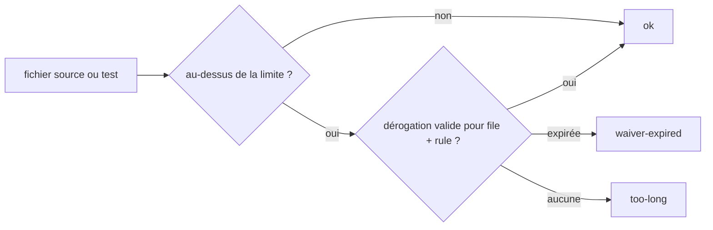

# @koklo/config

Configuration partagée du monorepo : tsconfig, Biome, Vitest, et les contrôles de frontières entre paquets.

## Frontières entre paquets (CDC §16.4)

Deux contrôles, tous deux lancés par `pnpm lint` :

1. **`turbo boundaries`** applique les règles `boundaries.tags` du `turbo.json` racine. Chaque étiquette liste, via `dependencies.allow` (ou `deny` pour `api` et `worker`), les étiquettes dont un paquet peut dépendre. Ces règles encodent la table du §16.4.
2. **`src/check-deep-imports.ts`** refuse tout import profond (`@koklo/pkg/src/...`) : seuls les points d'entrée déclarés dans le champ `exports` du paquet cible sont permis. `turbo boundaries` ne le détecte pas.

### Déclarer l'étiquette d'un nouveau paquet

**Chaque futur paquet déclare son étiquette dans son propre `turbo.json`**, à la racine du paquet :

```json
{ "extends": ["//"], "tags": ["domain"] }
```

L'étiquette est le nom court du paquet du §16.2 (`domain`, `db`, `contract`, `schema`, `github`, `rules`, `delivery`, `cli`, `api`, `worker`, `web`, `ui`, `config`). Un paquet sans étiquette n'est soumis à aucune règle : ne l'oubliez pas. Si un paquet doit dépendre d'un autre qui n'est pas autorisé par la table, la modification passe par une mise à jour du §16.4 de la vision, puis des règles du `turbo.json` racine.

### Tests

`test/boundaries.test.ts` joue les règles du `turbo.json` racine sur les workspaces de `fixtures/boundaries/` : `domain` qui dépend de `db` fait échouer `turbo boundaries`, un import profond est refusé par `check-deep-imports`.

## check:size (CDC §17.2)

Plafonds de taille de fichier, vérifiés par `pnpm lint` (le `lint` du paquet enchaîne `biome ci` puis `check:size`) ou seuls par `pnpm check:size` à la racine.

- fichier source (`.ts .tsx .js .jsx .mjs .cjs .mts .cts`) : 300 lignes max ;
- fichier de test (`*.test.*`, `*.spec.*`, ou sous `test/ tests/ __tests__/ e2e/`) : 500 lignes max ;
- ignorés : `node_modules`, `.git`, `.worktrees`, `.workflow`, `dist`, `.next`, `coverage`, dossiers `migrations/` et `generated/`, fichiers `*.generated.*` / `*.gen.*`, et fichiers dont les 5 premières lignes contiennent `@generated` ou `DO NOT EDIT`.

La racine par défaut se déduit de l'emplacement du script ; `node src/check-size.ts <racine>` permet de la forcer. Sortie en code 1 avec une ligne par violation sur stderr.

## Dérogations : `.koklo/waivers.yaml`

```yaml
waivers:
  - file: packages/x/src/big.ts # relatif à la racine
    rule: max-file-lines
    justification: "..."
    author: "prenom.nom"
    expires: 2026-12-31 # YYYY-MM-DD, valable jusqu'à la fin du jour (UTC)
```

Les cinq champs sont obligatoires ; un fichier invalide fait échouer le contrôle. Une dérogation expirée redevient une violation (`waiver-expired`).


